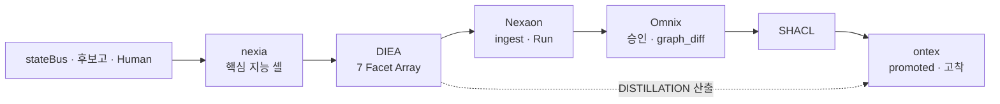
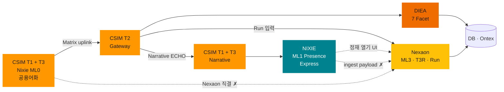
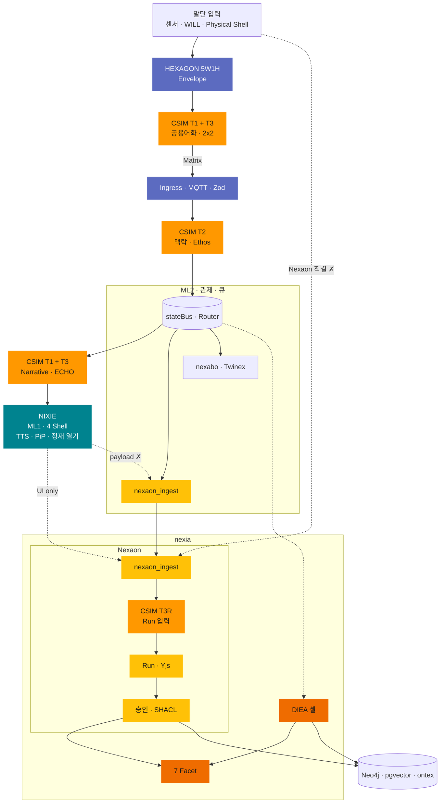

---
doc_id:
title: "Nexaon — Distillation 오케스트레이터 (참고 · archive 예정)"
category: ""
domain: NEXIA
status: draft
created: 2026-06-14
updated: 2026-06-13
parent_doc:
implements_doc:
see_also: [TDD-056, TDD-068, TDD-071, TDD-070, TDD-008, TDD-057, TDD-043, TDD-044]
terms_standard: ["langgraph", "yjs", "react-flow", "shacl", "sse"]
terms_nexa: [Nexaon, NexaonShell, nexia, DIEA, Logex, ontology, Omnix, Ontex, agent-graph, Twinex, Navex, promoted, CSIM, HEXAGON, AXON, NEXAVULT, ML0, ML1, ML2, ML3, Menton-Layer]
tags: []
---

# Nexaon

> **한 줄:** Logex **`ontology` 서브모드** · **ML3 지능 루프** — Human↔LLM **지식·온톨로지 정재** 오케스트레이터. `nexia` · **DIEA** Distillation **Cold Path** 의 **두뇌** — ingest · LangGraph Run · 승인 · SHACL → **promoted**.
>
> **Menton** (Intelligence Stack) — [TDD-070 §3.2.1](../용어집_NEXA전용_v2.0.md) · **≠** CPU cache · **≠** NISE-L* · **≠** `Axon`

**초안 성격:** Obsidian 개념 노트 · 용어·관계 정리. **Normative SSOT = [TDD-073](../08_TDD/NEXIA/Nexaon/08_TDD_Nexaon_Distillation오케스트레이터_v1.0.md)** — 본 문서는 **참고 다이어그램** _(Phase 2 archive 예정)_.

---

## 1. nexia · DIEA · Distillation 에서의 위치

```text
nexia (domainKey · 핵심 지능 셸)
  │
  ├── DIEA (Distillation Intelligence Engine Array)
  │     └── 7 Facet + _(Extended)_  — Omnix … Navex (작업면·산출)
  │
  └── Nexaon (Logex ontology) — Distillation **오케스트레이터**
        └── ingest · Run · graph_diff · 승인 · promoted
```

| 항목             | 내용                                                                                                                     |
| :--------------- | :----------------------------------------------------------------------------------------------------------------------- |
| **호스트**       | `nexia` · `domains/nexia/modules/nexaon/`                                                                                |
| **DIEA 와 관계** | **DIEA Facet ✗** · **8번째 `tabId` ✗** — Facet 산출을 **정재 루프**로 묶는 **오케스트레이션 층**                         |
| **입력**         | `stateBus` · 엣지 후보고 · Human 편집 · Twinex·nexabo·Navex deep link                                                    |
| **출력**         | **Cold:** `ontex` **고착** (`archive` · `explore` · Neo4j **promoted**) · **Hot Path ✗** (실행·ERP 주입은 DIEA Facet 축) |

> **nexia 정의 (요약):** 플랫폼 **핵심 지능 셸** · **DIEA** 호스트 — **Nexaon** 이 **가변적 DIEA Facet** (7 + _(Extended)_) 을 구동·연계하여 **`stateBus` 런타임 상태**를 **정제 (Distillation)**. ([`TDD-070` §3.4.0](../용어집_NEXA전용_v2.0.md))

---

## 2. 정체 — 무엇이고 무엇이 아닌가

| 구분          | Nexaon                                                                    | 금지 혼동                                                                               |
| :------------ | :------------------------------------------------------------------------ | :-------------------------------------------------------------------------------------- |
| **정체**      | Logex **`logexSubMode: ontology`** 모듈 · **NexaonShell** UI              | **별도 `domainKey` ✗**                                                                  |
| **`tabId`**   | **없음** — canonical `/nexia/logex/ontology/{projectId}`                  | 8번째 탭 ✗                                                                              |
| **LangGraph** | **Run 소유** · `nexaon_ingest` / `nexaon_refine` · `apps/agent-graph` SSE | 단순 채팅 UI ✗                                                                          |
| **이름**      | **Nexaon** (제품·모듈)                                                    | **NEXAON** (AXON 프로토콜) · **Nexion** (`ontex` canvas 표시명) · **NEXAON** 프로젝트명 |

**역할 한 줄 (TDD-068):** IoT·온톨로지 **지식 정재 루프의 핵심 두뇌** (Slow path). Run·`graph_diff`·승격은 **`agent-graph` + Omnix** 와 함께 수행.

---

## 3. NexaonShell — UI 집 주소

| 영역       | 컴포넌트                                           | 역할                              |
| :--------- | :------------------------------------------------- | :-------------------------------- |
| **Left**   | `ExplorerTree`                                     | Classes · Assets · PinMaps        |
| **Center** | `GraphCanvas`                                      | React Flow · Yjs `ontology:draft` |
| **Right**  | RunPanel · Properties · Approvals · SHACL · Deploy | LangGraph Run · SSE 타임라인      |
| **Header** | Run · Export · 승인 · Deploy                       | Logex ontology 전용 액션          |

**Canonical URL:** `/nexia/logex/ontology/{projectId}` — 북마크·SSR·`projectId` SSOT.

**Logex 와 2층 분리**

| 층             | `logexSubMode` | 범위                                    |
| :------------- | :------------- | :-------------------------------------- |
| **Logex 기본** | `default`      | `.nxflow` · 워크플로 Run                |
| **Nexaon**     | `ontology`     | 온톨로지 draft · SHACL · ESPHome Deploy |

---

## 4. 정재 루프 (ML3 · Distillation Cold Path)



| 단계         | 주체                                  | 산출                                           |
| :----------- | :------------------------------------ | :--------------------------------------------- |
| **① 수신**   | **nexia** · **DIEA** ← `stateBus`     | 버스 Envelope · Facet 컨텍스트                 |
| **② ingest** | Nest · Event Router → `nexaon_ingest` | Yjs `ontology:draft` · staging                 |
| **③ Run**    | `apps/agent-graph` · LangGraph        | `graph_diff` · Extract · normalize             |
| **④ Human**  | NexaonShell · **Normex**(DIEA) 참조   | 편집 · 검수 · 승인 게이트                      |
| **⑤ 승인**   | **Omnix**(DIEA) · approval-gate       | Diff accept · ASK/VOID 처리                    |
| **⑥ 검증**   | SHACL                                 | PASS → **promoted** 후보                       |
| **⑦ 고착**   | `ontex` · Neo4j                       | Graph RAG · `archive` — **미검증 JSON 직접 ✗** |

**never 직접 promoted:** DIEA Facet 산출·런타임 raw 는 Nexaon 루프·승인·SHACL **경유 후**만 `ontex` 반영.

### 4.1 엣지·로컬 → 웹플랫폼 정재 → DB 저장 (전체 흐름)

> **범위:** **ML0 엣지·로컬** 발생 → **HEXAGON · CSIM** Matrix **양방향 번역** → **Nest·stateBus** 수신 → **nexia · DIEA · Nexaon** 정재 → **pgvector(벡터)** · **Neo4j(그래프)** · **`ontex` 고착**. SSOT: [TDD-068 §1.4.1](../08_TDD/NEXIA/08_TDD_NEXIA_IoT엣지데이터파이프라인_HEXAGON_Nexaon연계_v1.0.md) · [TDD-057](../08_TDD/Ontex/08_TDD_Ontex_기술스택운영방침_v1.0.md) · [TDD-071 §4](../08_TDD/NEXAOS/08_TDD_NEXAOS_도메인구조통합_v1.0.md) · [TDD-043 §13.0](../08_TDD/Cosmic/08_TDD_CSIM_AXON프로토콜_정본.md) · [TDD-044 §2.3](../08_TDD/Cosmic/08_TDD_CosmicLanguage_전역데이터아키텍처.md) · [Core Engine Stack §3 CSIM](<./NEXA_핵심엔진_(Core_Engine_Stack).md>).

#### AXON 의미층 — HEXAGON · CSIM

```text
Cosmic (프레임)
    → HEXAGON (5W1H 문법 · Envelope 캡슐)
    → CSIM (Matrix **양방향 번역** · T1·T2·T3)
    → Zod · Ingress (스키마·Ethos 검증)
    → stateBus · Nexaon ingest
```

**HEXAGON Protocol** (Six-Axis Tokenized Interaction Standard) — AXON **L2** · 데이터를 단순 수치가 아닌 **사건(Event)** 으로 규정하는 **전송·문법** 층. 모든 후보고·명령 Envelope 는 **5W1H 6축** 메타를 담아야 한다 ([TDD-043 §11](../08_TDD/Cosmic/08_TDD_CSIM_AXON프로토콜_정본.md) · [TDD-044 §2.2](../08_TDD/Cosmic/08_TDD_CosmicLanguage_전역데이터아키텍처.md)).

| 축        | 역할           | 본 흐름에서                                       |
| :-------- | :------------- | :------------------------------------------------ |
| **Where** | 공간·좌표·존   | `device_id` · Twinex CELL · 존                    |
| **When**  | 시제·순서·지속 | 후보고 시각 · TICK·DURATION                       |
| **Who**   | 주체·Pulse     | Human · Sentinel · **Normex Ethos** (MUST/SHOULD) |
| **What**  | 대상·본질      | **FACT** · **WILL** · **ECHO**                    |
| **How**   | 방식·강도      | APEX Body · ACTON 강도                            |
| **Why**   | 근거·인과      | Run·승인·Graph RAG 맥락                           |

| 구간              | HEXAGON 역할                          | CSIM 과 관계                                 |
| :---------------- | :------------------------------------ | :------------------------------------------- |
| **ML0 말단**      | raw → **5W1H Envelope** 선처리        | CSIM T1 **입력** — 문법 먼저, 좌표는 CSIM    |
| **게이트웨이**    | **Zod** · HEXAGON 스키마 · Ethos 검증 | CSIM T2 와 **병행** — 위반 Envelope **폐기** |
| **stateBus · NQ** | Envelope **무결성** 유지              | 의미 토큰이 HEXAGON **껍질** 안에 상행       |
| **Nexaon ML3**    | `trace_id` · Who/What **correlate**   | **T3R** · **HEXAGON JSON** 기반 Run 입력     |

> **HEXAGON vs CSIM:** **HEXAGON** = _무엇이·누가·언제_ **구조화** · **CSIM** = **T1 공용어화** → **T2 맥락 동기화** → **T3 구체화** ([TDD-043 §13.0.1](../08_TDD/Cosmic/08_TDD_CSIM_AXON프로토콜_정본.md)). **Nexaon** = Envelope·토큰 **소비·정재** · **Run·promoted** **전용** — CSIM **「사고 토대」✗**.

**CSIM (Cosmic Semantic Interface Matrix)** — **WILL ↔ FACT** 를 **Matrix 규격**으로 주고받는 **양방향 의미 번역기**. 경량 **2×2/3×3** 는 **전송·편의 수단** — 목적은 **의미 동기화·순도(Purity)**. 각 Tier 는 **투영·정렬·토큰화**만 — **최종 ontology 판단·Run** 은 **Nexaon (ML3)** ([TDD-043 §2.3 · §13.0](../08_TDD/Cosmic/08_TDD_CSIM_AXON프로토콜_정본.md)).

#### 개념 Tier (Normative · [TDD-043 §13.0.1](../08_TDD/Cosmic/08_TDD_CSIM_AXON프로토콜_정본.md))

|  Tier  | 단계 (EN)                                | Normative 정의                                                                         |
| :----: | :--------------------------------------- | :------------------------------------------------------------------------------------- |
| **T1** | **Abstraction** · **공용어화**(우주언어) | 거친 **SENSER/WILL/FACT** → **Matrix** **시스템 공용어** · **양방향** 1차 투영         |
| **T2** | **Contextualization** · **맥락 동기화**  | Matrix + **Domain · HEXAGON · `stateBus`** → **오해 없는 의미** · **Ethos** 정렬       |
| **T3** | **Concretization** · **구체화**          | 의미 → **Narrative**(ECHO · Nixie) \| **Action**(HEXAGON · ACTON) — **Run ✗** (Nexaon) |

|  Tier  | 변환 (요약)                                                      | Nexaon 관점 T3             |
| :----: | :--------------------------------------------------------------- | :------------------------- |
| **T1** | FACT/WILL → **2×2** Matrix                                       | ingest **이전**            |
| **T2** | Matrix ↔ 맥락 · Ethos PASS                                       | `nexaon_ingest` **입력**   |
| **T3** | **상향** ECHO/Narrative · **하향** ACTON · ML3 Run **입력 정렬** | T3 **기능** · Run **소유** |

#### 운영 배치 (Nexaon 관점)

|  Tier  | 위치                                | CSIM 역할                                  | Nexaon 이 **안 받는 것**           |
| :----: | :---------------------------------- | :----------------------------------------- | :--------------------------------- |
| **T1** | **ML0** · Nixie Physical · 웨어러블 | **Inverse CSIM** · 1차 APEX · **2×2**      | raw 센서 · GPIO · 레지스터 스트림  |
| **T2** | **Nest Ingress**                    | Matrix **정렬** · **Ethos** (Normex) · Zod | Ethos FAIL · 스키마 위반 payload   |
| **T3** | **Nexaon 내부**                     | LLM·embed **입력 정렬** · **3×3** semantic | Run·SHACL·promoted _(Nexaon 소유)_ |

> **T2 맥락:** **DIEA** · Ontology · Domain Profile · 전후 이벤트 — CSIM Facet **✗**, 번역 **참조**.

| 방향       | 프로세스 ([TDD-043 §13](../08_TDD/Cosmic/08_TDD_CSIM_AXON프로토콜_정본.md)) |              본 문서 Tier               |
| :--------- | :-------------------------------------------------------------------------- | :-------------------------------------: |
| **상향**   | FACT → **Inverse CSIM** → ECHO → 후보고                                     |             **T1** → **T2**             |
| **하향**   | WILL → CSIM → HEXAGON → ACTON                                               |    **T1** · **T2** · Normex→Hot Path    |
| **플랫폼** | LLM·Nexaon **레지스터 raw ✗** — **CSIM 번역 토큰**만                        | **T3** (`agent-graph` · pgvector chunk) |


| 구간                                | raw·대용량                      | 상행 허용                           | Nexaon 부담      |
| :---------------------------------- | :------------------------------ | :---------------------------------- | :--------------- |
| **Nixie Physical · 웨어러블 (ML0)** | 로컬 처리 · Reflex              | **2×2 APEX** · HEXAGON Envelope     | Run·LLM **✗**    |
| **CSIM T1 → T2**                    | 레지스터·영상·GPIO **uplink ✗** | **Matrix 의미 토큰** · Ethos PASS   | raw ingest **✗** |
| **Event Router → NQ**               | FACT trace 는 pgvector 별도     | **정렬 Envelope** → `nexaon_ingest` | 큐 적재만        |
| **Nixie ML1 (4 Shell)**             | payload **✗**                   | SSE **요약** · `trace_id`           | **UI 진입** 만   |
| **Nexaon ingest (ML3)**             | —                               | T1·T2 **번역·정렬된** 토큰          | **T3R** · Run    |
                                                     
#### Nixie → Nexaon 사전 부담 · 우주언어 번역 (Corrected)
```text
[상행: Sensor → 우주언어화]
Sensor (ML0) → HEXAGON → CSIM T1 (2×2) ──► [MQTT Uplink]

[중앙: 맥락화 및 분배]
[MQTT] ──► CSIM T2 (맥락·Ethos) ──► stateBus (공용 허브)

[하행: 우주언어 구체화 (T3)]
stateBus ──┬──► nexaon_ingest (NQ) ──► Nexaon (T3R·Logic) ──► Run
           │
           └──► Nixie ML1 (Presence) ──► CSIM T3N (Narrative) ──► 요약·TTS
                                             │
                                             └─► Human 「정재 열기」 ──► NexaonShell (UI 진입)
```

> **교정 포인트:** 
> 1. **`stateBus` 명시:** 모든 정렬된 우주언어 데이터는 버스를 통해 분산됩니다.
> 2. **T3 분기 명확화:** 동일한 T2 데이터를 [[Nexaon]]은 **로직(T3R)**으로, [[Nixie]]는 **내러티브(T3N)**로 각자의 영역에서 번역합니다.
> 3. **경계 분리:** [[Nixie]]에서 [[Nexaon]]으로의 이동은 '데이터 파이프'가 아닌 'UI 컨텍스트의 이동'임을 분명히 했습니다.


#### 4.1.1 개요 (Macro — 권장 먼저 읽기)



| Macro 주체         |    CSIM     | 역할 (한 줄)                                       |
| :----------------- | :---------: | :------------------------------------------------- |
| **T1 → Nixie ML0** | **T1 + T3** | Physical·웨어러블 · WILL/FACT → Matrix             |
| **NIXIE**          | **T1 + T3** | ML1 4 Shell · Narrative · TTS · PiP · **ingest ✗** |
| **Gateway**        |   **T2**    | 맥락 동기화 · Ethos · `stateBus`                   |
| **DIEA**           |      —      | Facet · Distillation 산출                          |
| **Nexaon**         |   **T3R**   | ingest · Run · SHACL · promoted                    |
| **DB**             |      —      | Neo4j · pgvector · Ontex                           |

#### 4.1.2 상세 (Facet · 게이트웨이 내부)



**상세에서 생략·표로 이관한 것:** MQTT·Ingress 개별 노드 · 7 Facet 개별 노드 · pgvector 분기 · Normex Hot Path · deep link — 아래 **처리 단계 표** · [§5 진입 7축](#5-진입-7축-ui-home--deep-link--데이터).

**처리 단계 (Normative)**

|  단계   | 구간                      | 주체·기술                                                              | 입력                                 | 출력                                                        |
| :-----: | :------------------------ | :--------------------------------------------------------------------- | :----------------------------------- | :---------------------------------------------------------- |
|  **①**  | **엣지·로컬**             | Nano/Micro Sentinel · NEXA-CELL · Twinex · **Nixie Physical·웨어러블** | raw 센서·GPIO · WILL/APEX · `.nxdev` | raw (로컬)                                                  |
| **①-a** | **HEXAGON**               | ML0 **5W1H** Envelope 선처리                                           | ① raw · FACT/WILL                    | **FACT/WILL** Envelope · Who/Where/When…                    |
| **①-b** | **CSIM T1 · 추상화**      | **Inverse CSIM** (엣지·말단)                                           | ①-a Envelope · 물리 벡터             | **2×2 Matrix** · **raw uplink ✗** _(전송 수단)_             |
|  **②**  | **상행**                  | MQTT · Protobuf/JSON                                                   | ①-b **경량** Envelope                | Broker payload (Matrix Envelope)                            |
|  **③**  | **CSIM T2 · 맥락화**      | Nest Ingress · **Zod · HEXAGON** · Matrix **맥락 정렬** · Ethos        | ② payload                            | **의미 토큰 only** · **stateBus** 집약                      |
| **③-b** | **Nixie T3N · Narrative** | Event Router · **ECHO** · TTS 요약                                     | ③ bus · T2 토큰                      | ML1 **표현** · ingest **✗**                                 |
| **③-c** | **Nexaon 큐 적재**        | Event Router → **`nexaon_ingest`**                                     | ③ 정렬 Envelope                      | **NQ** — Nixie ML1 payload **✗**                            |
|  **④**  | **분기**                  | Event Router                                                           | ③ bus 이벤트                         | nexabo · Twinex · **Nexaon queue** · **nexia DIEA** · Nixie |
|  **⑤**  | **DIEA 수신**             | **nexia** · **DIEA** Facet                                             | ④ `stateBus` · Human 편집            | Facet별 컨텍스트 · 산출 초안                                |
|  **⑥**  | **T3R · Nexaon 정재**     | **Nexaon** · Matrix→Run 입력 · `agent-graph` · Yjs                     | ③-c ingest · **T1·T2 토큰**          | `ontology:draft` · `graph_diff`                             |
|  **⑦**  | **승인**                  | **Omnix**(DIEA) · **Normex**·CSIM Ethos                                | ⑥ Run 결과                           | Diff accept · ASK/VOID                                      |
|  **⑧**  | **검증**                  | SHACL                                                                  | ⑦ 승인본                             | **promoted** 후보                                           |
|  **⑨**  | **그래프 DB**             | Neo4j · `ontology/` module                                             | ⑧ PASS                               | **promoted** 노드·엣지 (Cypher)                             |
|  **⑩**  | **벡터 DB**               | **NEXAVULT** · pgvector · `knowledge/` · embedder                      | FACT trace · **CSIM semantic chunk** | **embed** · RAG 코퍼스                                      |
|  **⑪**  | **고착**                  | **Ontex** · Graph RAG                                                  | ⑨⑩ · DIEA **DISTILLATION 산출**      | `explore` · `archive` · canvas 동기화                       |

```text
[Nixie Physical / 웨어러블 · ML0]
    raw (로컬 only · uplink ✗)
        → HEXAGON → CSIM T1 (2×2 Matrix) ──► 경량 Envelope
                                              │
                                              ▼
                                    ②MQTT → CSIM T2 (맥락 · Ethos)
                                              │
                         ┌────────────────────┼────────────────────┐
                         ▼                    ▼                    ▼
                   stateBus/DIEA      nexaon_ingest(NQ)     T3N → Nixie ML1
                         │                    │                    │
                         │                    ▼                    ▼
                         │              Nexaon T3R·Run      Human 「정재 열기」
                         │                    │                 (UI only)
                         └────────────────────┴──► 승인 → DB

※ Nixie ML1 → Nexaon: 데이터 파이프 ✗ · trace_id·요약으로 Shell 진입만
```

**HEXAGON · CSIM ↔ Nexaon 부담 분리 (요약)** — §4.1.1 · §4.1.2 기준

| 구분                  | **HEXAGON**                                      | CSIM **T1·T2**                                      | **T3N** (Nixie) · **T3R** + Nexaon **ML3**                      |
| :-------------------- | :----------------------------------------------- | :-------------------------------------------------- | :-------------------------------------------------------------- |
| **다이어그램**        | `HEX` · `GW`                                     | `T1` · `UPL` · `T2` · `BUS`                         | `T3N`·`NIX` · `T3R`·`RUN`·`APR`                                 |
| **담당**              | **5W1H** Envelope · **Zod** 스키마               | **Matrix 번역** · 맥락 · Ethos · 경량 전송 _(수단)_ | **T3N** Narrative · **T3R** Run 정렬 · SHACL · promoted         |
| **입력**              | raw · WILL/FACT                                  | **HEXAGON** Envelope · Matrix payload               | **NQ** 정렬 토큰 · Human · DIEA 맥락                            |
| **출력**              | Envelope · PASS/FAIL                             | 2×2 Matrix → 의미 토큰 · `stateBus`                 | draft · semantic chunk · Ontex                                  |
| **Nexaon 이 안 받음** | — (ML0·게이트에서 완료)                          | —                                                   | raw · 레지스터 · Nixie ML1 payload · **판단·Run 소유 = Nexaon** |
| **분산 이점**         | 사건 **구조 선확보** · 스키마 위반 **조기 폐기** | **순도·노이즈 제거** · Nexaon **입력 정렬**         | Run·추론 **집중** · promoted **종결**                           |

> **T3 경계:** CSIM T3 **분기** — **T3N**(Narrative · ECHO) = **Nixie ML1** · **T3R**(Run 입력 정렬) = **Nexaon** (`T3R` → `RUN`). **판단·Run·SHACL** = Nexaon — CSIM **「사고 토대」✗** ([TDD-043 §13.0.1](../08_TDD/Cosmic/08_TDD_CSIM_AXON프로토콜_정본.md)).

**Nixie → Nexaon 경계 (요약)** — §4.1.1 · §4.1.2 기준

|                 | Nixie Physical (ML0)                  | Nixie ML1 (표현)                     | Nexaon (ML3)                          |
| :-------------- | :------------------------------------ | :----------------------------------- | :------------------------------------ |
| **다이어그램**  | `T1` · `SRC` · `HEX` (NIXML0)         | `T3N` · `NIX` (NIXML1)               | `T3R` · `ING` · `RUN`                 |
| **HEXAGON**     | **5W1H** Envelope **작성**            | —                                    | **correlate** (`trace_id` · Who/What) |
| **데이터**      | raw **로컬** · **2×2 Matrix** (`UPL`) | payload **✗** · Narrative·`trace_id` | **번역 토큰** (`NQ` → `ING`)          |
| **CSIM**        | **T1** (ML0 Physical)                 | **T3N** (ML1 Narrative)              | **T3R** (Run 입력 · Nexaon 내부)      |
| **Nexaon 연결** | **데이터:** `T2` → `NQ` → `ING`       | **UI:** `NIX` -.-> `ING` (정재 열기) | Run · promoted                        |
| **직결 ✗**      | `SRC` -.-> `NAO` / `ING`              | `NIX` -.-> `NQ` (payload)            | —                                     |

**경로 분리 (Fast vs Slow)**

| Path                    | 구간                                                | DB 반영                                                                                                         |
| :---------------------- | :-------------------------------------------------- | :-------------------------------------------------------------------------------------------------------------- |
| **Fast · Reflex**       | 엣지 Nano ACTON · 물리 제어                         | DB **우회** — 후보고만 상행                                                                                     |
| **Slow · Distillation** | stateBus → **nexia · DIEA** → Nexaon → 승인 → SHACL | **⑨⑩⑪** 필수 — 미검증 raw **직접 write ✗**                                                                      |
| **Hot Path**            | DIEA **Normex·Logex** → `erp`                       | Neo4j/pgvector **우회** — 실행·Zod 축 ([TDD-071 §2.1.1](../08_TDD/NEXAOS/08_TDD_NEXAOS_도메인구조통합_v1.0.md)) |

**저장소 역할 (TDD-057)**

| 저장소                | 유형            | 담당                                           |       SSOT 여부        |
| :-------------------- | :-------------- | :--------------------------------------------- | :--------------------: |
| **Neo4j**             | **관계 그래프** | promoted 온톨로지 · explore traverser · OG-RAG |     미러 (승인 후)     |
| **NEXAVULT**          | **pgvector**    | CSIM·FACT **벡터 코퍼스** · embed              | 코퍼스 (≠ 트리플 SSOT) |
| **Git `docs/specs/`** | 문서 정본       | wikilink · Normex 산출                         |      **✓** (선행)      |
| **Ontex**             | 허브 UI         | `explore` · `archive` · Nexion canvas          |      고착·탐색면       |

---

## 5. 진입 7축 (UI home · deep link · 데이터)

> **출발 구분:** ①·②·③ = **데이터·도메인 출발** · ⑦ = **ML1 UI 표면 출발** (Nixie). ingest 는 **Nest 큐** 로 Nexaon 에 도달 — Nixie 는 **「정재 열기」** UI 이동만.

|  #  | 출발                      | **HEXAGON**             | **CSIM**            | **DIEA**         | **Nexaon**           | Nexaon 연결                | UI                        |
| :-: | :------------------------ | :---------------------- | :------------------ | :--------------- | :------------------- | :------------------------- | :------------------------ |
|  ①  | 엣지 후보고 · Sentinel    | ML0 **5W1H** Envelope   | **T1·T2** 토큰화    | `stateBus` 병행  | **`nexaon_ingest`**  | Nest → **`nexaon_ingest`** | nexabo Live Feed          |
|  ②  | nexabo Live Feed · 알람   | `trace_id` · Who/When   | — (T2 정합)         | **nexabo** ML2   | ingest **correlate** | ingest 큐 · correlate      | `trace_id` 프리로드       |
|  ③  | Twinex `.nxdev`           | **Where** · `device_id` | uplink 맥락         | **Twinex** Facet | Explorer **jump**    | `device_id` → asset        | ExplorerTree              |
|  ④  | Logex ontology            | —                       | —                   | **Logex** Facet  | **canonical home**   | **canonical home**         | `/nexia/logex/...`        |
|  ⑤  | Omnix 승인 · `graph_diff` | **Who** · Ethos 검증    | Normex **Ethos** T3 | **Omnix** 승인   | DiffOverlay · SHACL  | Run 완료 · DiffOverlay     | GraphCanvas · RunPanel    |
|  ⑥  | Navex 자산 선택           | **What** · 자산 URI     | —                   | **Navex** Facet  | Explorer **expand**  | Explorer 컨텍스트          | class/asset expand        |
|  ⑦  | **Nixie** ML1 Presence    | — (Physical ML0 만)     | **T3N** (Narrative) | —                | **UI 진입**          | nixie 채널 **요약**        | **「정재 열기」** → Shell |

> **주체별 핵심 책임:**
>
> - **HEXAGON:** 데이터의 **구조(5W1H)** 및 문법적 무결성(Zod) 담보.
> - **CSIM:** **T1 공용어화** → **T2 맥락 동기화** → **T3 구체화** (Narrative \| Action) — **판단·Run ✗** (Nexaon).
> - **DIEA:** 각 Facet의 **전문 맥락**을 주입하여 정재의 정밀도 향상.
> - **Nexaon:** 위 모든 요소를 **오케스트레이션**하여 최종적으로 지식을 고착(promoted).

**Deep link 예**

```text
/nexia/logex/ontology/{projectId}?from=twinex&device_id={id}
/nexia/logex/ontology/{projectId}?from=nexabo&trace_id={id}
/nexia/logex/ontology/{projectId}?from=nixie&trace_id={id}
```

- `from` — breadcrumb·analytics (`nixie` · `nexabo` · `twinex` …) · **Run·room 분기 ✗**
- mount 후 **canonical URL normalize** 권장
- **Nixie** 는 ingest·Run **소유 ✗** — 알람·요약 **표현** 후 Human 이 ⑦ 로 **Nexaon 진입**만 수행

**금지:** 후보고·알람이 **「Logex 탭을 먼저 열어야만 Run 가능」** 으로 구현 ✗ — 데이터 축은 **Nest 큐·router** 직접 ingest.

---

## 6. ingest 모드

| 모드       | 조건                                | 동작                                                                |
| :--------- | :---------------------------------- | :------------------------------------------------------------------ |
| **Auto**   | MQTT `critical` · STUCK · 정책 매칭 | Omnix/router → `nexaon_ingest`                                      |
| **Queue**  | Normal 후보고                       | staging 큐 → nexabo/**Nixie** 알림 → Human **「정재 열기」** (§5 ⑦) |
| **Buffer** | 고빈도 TICK                         | nexabo Live Feed 만 · Run **배치/임계치**                           |

---

## 7. 협업 주체 — 경계

| 주체             | Nexaon 과의 관계                              | Nexaon 이 하지 않음             |
| :--------------- | :-------------------------------------------- | :------------------------------ |
| **DIEA Facet**   | 산출·편집·Hot Path (`erp` 직주입)             | promoted **직접 쓰기 ✗**        |
| **Omnix**        | 승인 게이트 · `graph_diff` accept             | 온톨로지 편집 UI **대체 ✗**     |
| **Ontex**        | **promoted** · Graph RAG **고착 허브**        | 초안·Run UI **✗**               |
| **Nixie (ML1)**  | Run 결과·알람 **표현**                        | Run · ingest · SHACL **소유 ✗** |
| **nexabo**       | 관제 · Live Feed · **「정재 열기」**          | 온톨로지 Run **✗**              |
| **Event Router** | fan-out **대상 결정** (ML3)                   | Nixie Reflex **대체 ✗**         |
| **HEXAGON**      | ML0·게이트 **Envelope·Zod** — Nexaon **소비** | Envelope **작성·Run 소유 ✗**    |

**Nixie Reflex vs Nexaon Strategic**

|              | Nixie (ML1)                | Nexaon (ML3)                       |
| :----------- | :------------------------- | :--------------------------------- |
| **입력**     | bus · SSE · 큐 알림        | `nexaon_ingest` · Envelope · Human |
| **처리**     | Reflex triage · TTS · 표현 | Run · `graph_diff` · SHACL         |
| **promoted** | **✗**                      | **✓** (승인 후)                    |

---

## 8. 백엔드 · 저장

| 경로                           | 역할                                    |
| :----------------------------- | :-------------------------------------- |
| `apps/web/.../modules/nexaon/` | NexaonShell · 클라이언트 오케스트레이션 |
| `apps/backend/.../nexaon/`     | ingest API · Draft debounce             |
| `apps/agent-graph/`            | LangGraph Run · SSE (LLM·Embed)         |
| `apps/sync/`                   | Hocuspocus · Yjs `ontology:draft`       |
| Neo4j                          | **promoted** 미러 (승인 후 · SSOT 아님) |

**저장 순서 (Normative):** Yjs Draft → Audit → SHACL PASS → Neo4j promoted → (선택) `ontex` · ESPHome 파이프라인.

---

## 9. 승격·초안 메모

| 항목          | 제안                                                                    |
| :------------ | :---------------------------------------------------------------------- |
| **승격 후보** | `08_TDD/NEXIA/08_TDD_NEXIA_Nexaon_정의_v1.0.md` 또는 용어집 §3.4.1 확장 |
| **짝 문서**   | TDD-056 §4 · TDD-068 §1.4 · TDD-008 · TDD-071 §2.1.2                    |
| **중복 정책** | 본 초안은 **개념·관계 맵** — In/Out·MVP 표는 TDD-056 유지               |

---

## 관련 문서

| 관계                       | 문서                                                                                                                                                                                    |
| :------------------------- | :-------------------------------------------------------------------------------------------------------------------------------------------------------------------------------------- |
| **용어 SSOT**              | [용어집 NEXA 전용 (TDD-070) §3.2.1 · §3.3.1 · §3.4.1](../용어집_NEXA전용_v2.0.md)                                                                                                       |
| **Facet · 진입**           | [NEXIA · DIEA Facet 범위 (TDD-056) §4](../08_TDD/NEXIA/08_TDD_NEXIA_7탭범위확정_v1.0.md)                                                                                                |
| **도메인·Distillation**    | [NEXA OS · 도메인 구조 (TDD-071) §2.1.2 · §4](../08_TDD/NEXAOS/08_TDD_NEXAOS_도메인구조통합_v1.0.md)                                                                                    |
| **IoT · ingest · HEXAGON** | [IoT 엣지… Nexaon 연계 (TDD-068) §1.4](../08_TDD/NEXIA/08_TDD_NEXIA_IoT엣지데이터파이프라인_HEXAGON_Nexaon연계_v1.0.md)                                                                 |
| **HEXAGON · Cosmic · Axon**  | [CSIM · AXON (TDD-043) §11 HEXAGON](../08_TDD/Cosmic/08_TDD_CSIM_AXON프로토콜_정본.md) · [Cosmic (TDD-044) §2.2](../08_TDD/Cosmic/08_TDD_CosmicLanguage_전역데이터아키텍처.md) |
| **CSIM · AXON**            | [CSIM · AXON (TDD-043) §13.0](../08_TDD/Cosmic/08_TDD_CSIM_AXON프로토콜_정본.md) · [Core Engine Stack §3 CSIM](<./NEXA_핵심엔진_(Core_Engine_Stack).md>)                                |
| **LangGraph · Run**        | [인간↔LLM IoT 온톨로지 (TDD-008)](../08_TDD/LangGraph/08_TDD_LangGraph_인간LLM협업형IoT온톨로지플랫폼_v1.0.md)                                                                          |
| **고착**                   | [Ontex (TDD-057) §7](../08_TDD/Ontex/08_TDD_Ontex_기술스택운영방침_v1.0.md)                                                                                                             |
