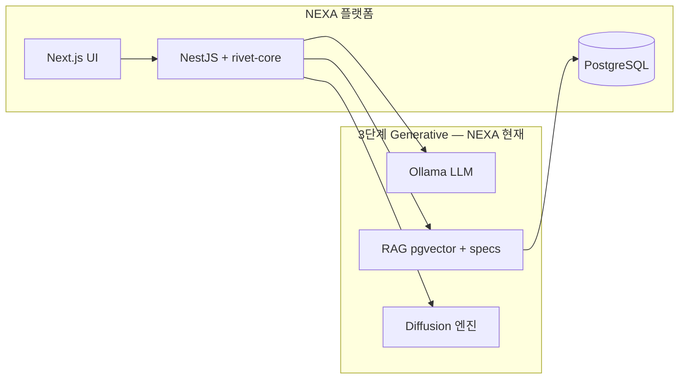

# The Wave of AI Innovation (AI 혁신의 물결)

> **관점:** 본 문서는 AI 역사의 **단계 타임라인**을 정리하고, **NEXA 플랫폼**이 그 물결 속에서 **어디에 서 있으며 무엇을 채택·거부하는지**를 맵핑한다.
> **정체성 SSOT:** [`NEXA 플랫폼·메타-OS·NEXIA·도메인 — 정체성 SSOT`](../_NEXA-플랫폼·메타-OS·NEXIA·도메인%20—%20정체성%20SSOT.md)

---


## AI 혁신 단계 (역사 타임라인)

| 대분류 / 타임라인                                | 포함된 기술 및 핵심 단어 (영어)                                 | 한국어 의미                                                                 |
| ------------------------------------------------ | --------------------------------------------------------------- | --------------------------------------------------------------------------- |
| **메인 제목**                                    | The Wave of AI Innovation                                       | AI 혁신의 물결                                                              |
| **1 단계: AI 의 탄생** (The Birth of AI / ~1980)   | Perceptron · Rules · Von Neumann · Turing Test · 1st AI Winter  | 퍼셉트론 · 규칙 · 폰 노이만 · 튜링 테스트 · 1 차 AI 암흑기                   |
| **2 단계: 논리적 AI** (Logical AI / 1980~2000)    | Logical Reasoning · Machine Learning · Ontology · 2nd AI Winter | 논리적 추론 · 머신러닝 · 온톨로지 · 2 차 AI 암흑기                           |
| **과도기** (2000~2010)                           | Semantic Web                                                    | 시맨틱 웹                                                                   |
| **3 단계: 생성형 AI** (Generative AI / 2010~2030) | DNN, GNN · Transformer · LLM, RAG · Diffusion                   | 심층신경망, 그래프신경망 · 트랜스포머 · 대형언어모델, 검색증강생성 · 디퓨전 |
| **4 단계: 에이전틱 AI** (Agentic AI / 2030~2060)  | Reasoning · Planning · Neuro-symbolic · MCP, A2A, etc.          | 추론 · 계획 수립 · 뉴로 - 심볼릭 · 모델 컨텍스트 프로토콜 등                  |
| **5 단계: 피지컬 AI** (Physical AI / 2060~2080+)  | Neuro-morphic · Quantum · ???                                   | 뉴로모픽 · 양자 컴퓨팅 · 미정 / 예측 불가                                   |

---

## NEXA 플랫폼이 서 있는 위치

**NEXA 플랫폼**은 **3 단계 (생성형 AI)** 를 **현재 운영 기반**으로 삼고, **4 단계 (에이전틱 AI)** 를 **오케스트레이션·규범 레이어**로 구축 중이며, **5 단계 (피지컬 AI)** 를 **엣지·IoT·현장 실행**으로 향하는 **장기 목표**로 둔다.

| 층                         | 역할                                  | AI 물결과의 관계                                             |
| -------------------------- | ------------------------------------- | ------------------------------------------------------------ |
| **M.O.S.E.S. (메타·빌드)** | NEXA 플랫폼을 **만들고 고치는** 층    | 3~4 단계 **도구** (Desktop Rivet · Ollama · Zod · MCP)        |
| **NEXA 플랫폼 (제품)**     | 세상에 **배포·운영**되는 통합 제품    | 3 단계 **런타임** (LLM·RAG·협업 UI) + 4 단계 **에이전트 실행** |
| **NEXIA (`nexia` 도메인)** | 플랫폼 **핵심 지능** 허브 (7 탭·Omnix) | 4 단계 **Reasoning·Planning·Tool Calling** 조율               |
| **엣지·디바이스**          | ESP32 · 센티널 · 펌웨어               | 5 단계 **Physical AI** 로의 연장                              |

```text
[ 3 Generative AI ]  LLM · RAG · Diffusion  ──▶  지금: Ollama · pgvector · ComfyUI …
[ 4 Agentic AI    ]  Plan · MCP · Graph    ──▶  지금: Rivet · Normex · Yjs 협업
[ 5 Physical AI   ]  Edge · Reflex        ──▶  목표: ESP32 · AXON · Safety Reflex
```

> **용어:** 문서·구두에서 「NEXA OS」는 **거버넌스·Grade·Normex** 등 **플랫폼 운영 규칙**을 가리킬 때 쓰이고, **배포 제품 전체**는 **NEXA 플랫폼**이라 부른다. — [정체성 SSOT](../_NEXA-플랫폼·메타-OS·NEXIA·도메인%20—%20정체성%20SSOT.md)

---

## NEXA 확장 방향: 산업 → 아트 → 일상

AI 혁신 **단계 (3~5)** 와 별개로, NEXA **제품·도메인**은 **산업 → 아트 → 일상** 순으로 발전한다.

| 단계 | 초점 | 플랫폼에서의 의미 |
| :--- | :--- | :--- |
| **1. 산업** | B2B/B2G · 안전 · 정밀 IoT | 온톨로지·Normex·Zero-Trust 로 **신뢰 검증** (`nexage` · `infra` · `network`) |
| **2. 아트** | 미디어아트 · 인터랙티브 · 전시 | 산업 센서 데이터를 **감성 미디어**로 매핑 (`solutions` · Vivex · 제너레이터) |
| **3. 일상** | 스마트홈 · 웰니스 · 개인화 | 전시·공공에서 검증된 기술의 **대중화** (`my` · Twinex · NEXA-CELL) |

```text
[ 산업 ]  공장·스마트팜·관제 — 신뢰·규범·코어 온톨로지
    ↓
[ 아트 ]  박물관·미디어아트 — 센서→표현·인터랙션
    ↓
[ 일상 ]  홈·웨어러블 — 검증 기술의 일상 습관화
```

상세 온톨로지·데이터 흐름: [`01_BRD_NEXA_사업마스터플랜`](./01_BRD_NEXA_사업마스터플랜.md) §「산업 ➡️ 아트 ➡️ 일상」.

---

## 단계별 — NEXA 플랫폼 대응

### 1~2 단계 · 과도기 (탄생 ~ 시맨틱 웹)

**역사적 유산:** 규칙·온톨로지·기호 논리.

| AI 물결 키워드   | NEXA 에서의 현대적 계승                               | 구현·문서                                                                                                                                                                                                       |
| ---------------- | ---------------------------------------------------- | --------------------------------------------------------------------------------------------------------------------------------------------------------------------------------------------------------------- |
| **Rules**        | **Normex** · Zod · MUST/SHOULD 실행 차단             | [`M.O.S.E.S. 기술 이행 표준`](<./Rivet/M.O.S.E.S. 기술 이행 표준 (Normex & Standard).md>)                                                                                                                       |
| **Ontology**     | `docs/specs/` 트리 · wikilink · Obsidian MOC (04·14) | [`Desktop Rivet 캔버스 설계 v1.0`](<../Rivet/Desktop%20Rivet%20캔버스(Graph)%20설계%20v1.0.md>)                                                                                                                 |
| **Semantic Web** | 5W1H HEXAGON · nature_tag · capability_id            | [`DDL v5`](../Database/DDL%200%20SCHEMA%20NEXA%20Platform%20DB%20설계%20명세%20v5.md) · [RAG 페르소나 전략서](<../AI/NEXA%20AIS%20RAG%20및%20페르소나%20아카이브%20전략서%20(RAG%20&%20Persona%20Strategy).md>) |

NEXA 는 **순수 기호 AI 시대로 회귀하지 않는다.** 다만 **뉴로 - 심볼릭 (4 단계)** 을 위해 **기호·규범·온톨로지를 SSOT 로 고정**하고, LLM 은 그 위에서 추론·생성만 맡긴다.

---

### 3 단계: 생성형 AI (2010~2030) — **현재 운영의 중심**

| 기술                  | NEXA 플랫폼 채택                                                                          | 거부·제한                                        |
| --------------------- | ----------------------------------------------------------------------------------------- | ------------------------------------------------ |
| **Transformer / LLM** | **Ollama** (로컬) · NestJS 경유만 · Desktop Rivet Chat 노드                               | 브라우저→Ollama 직접 · 클라우드 SSOT 의존 기본값 |
| **RAG**               | `docs/specs/` 코퍼스 + **PostgreSQL `project_knowledge`** (pgvector) · Rivet Vector Store | 벡터 DB 만 블랙박스 메모리                        |
| **OG-RAG** (NEXA)     | 벡터 위 **2 차 관계도** — 04/14 MOC · wikilink · `ref_ids` (GraphRAG 와 별개)               | Vector Store → Chat **단독 종료**                |
| **Diffusion**         | ComfyUI 등 **외부 엔진** · 오케스트레이터 경유 (NEXIA 미디어 파이프라인)                  | UI 에서 엔진 직접 노출                            |
| **GNN**               | Nexion·Logex **관계 그래프 UI** (React Flow) — 지식·워크플로 **시각화**               | (연구·확장 여지)                                 |

**플랫폼 스택 (요약):** Next.js · NestJS · rivet-core · Yjs · PostgreSQL(pgvector) · Ollama — [`NEXIA 00`](../Nexia/00%20인공지능%20NEXIA%20구조와%20기술%20스택과%20운영방침.md) §2.

**RAG 상세:** 설계 코퍼스 (Desktop 01~05) 와 운영 코퍼스 (DB) 를 **같은 Rivet·Ollama 경로**로 읽는다 — [`NEXA RAG 아키텍처`](../Rivet/NEXA%20RAG%20아키텍처%20—%20Rivet·PostgreSQL·Ollama.md).



---

### 4 단계: 에이전틱 AI (2030~2060) — **지금 구축 중인 층**

| 기술                   | NEXA 대응                                                            | 설계 원칙                                                 |
| ---------------------- | -------------------------------------------------------------------- | --------------------------------------------------------- |
| **Reasoning**          | Rivet Sub 그래프 · NEXIA Omnix→Normex→탭 · 5W1H 필터                 | 추론 경로는 **그래프·로그로 가시화**                      |
| **Planning**           | Desktop Main 01→13 · `project_orchestra` · Human CP                  | 계획 변경은 **PR·설계 단위**, 채팅 한 줄로 SSOT 변경 금지 |
| **Neuro-symbolic**     | LLM(Ollama) + **Zod·Normex·Git specs**                               | 신경 (생성) + 기호 (검증·규범) **이중 레일**                |
| **MCP**                | Desktop **MCP FileSystem** (`docs/`) · Get Prompt · (확장) 도구 노드 | 웹은 NestJS API · Path Traversal 검증                     |
| **A2A / 멀티에이전트** | NEXIA 7 탭 위임 · LangGraph(후보) · Embedded Rivet                    | **단일 오케스트레이션** 경유 — 직접 엔진 난립 금지        |

**NEXA 가 에이전트 툴을 중심축으로 삼지 않는 이유** (3 단계와 4 단계 경계):

| 트렌디 에이전트   | NEXA 플랫폼                                            |
| ----------------- | ------------------------------------------------------ |
| 과제 한 번 끝내기 | `docs/specs/` · Zod · 모노레포 **장기 SSOT**           |
| 세션 메모리       | Git + DB **삼각 편대** (knowledge · chats · orchestra) |
| 채팅 = 전부       | 채팅 + Tiptap + Rivet **삼각 동기화**                  |

— [`Rivet 파이프라인`](../Rivet/Rivet%20파이프라인.md) 「왜 리벳인가?」「트렌디한 에이전트 툴과의 선」.

**책임 분리 (메타 vs 제품):**

```text
기획(What)   — 인간 + docs/specs
규격(How)    — M.O.S.E.S. · Desktop Rivet · Zod
검증·운영    — NEXA 플랫폼 · NestJS · PostgreSQL 운영 데이터
```

— [`M.O.S.E.S. v2.0`](<./Rivet/M.O.S.E.S.(Meta-Operating System for Engineering & Synthesis) v2.0.md>) §1.

---

### 5 단계: 피지컬 AI (2060~2080+) — **장기 목표·엣지 전주**

| 기술                | NEXA 방향                                              | 현재 구현·설계                                                                        |
| ------------------- | ------------------------------------------------------ | ------------------------------------------------------------------------------------- |
| **Physical AI**     | 현장·기기가 **지능의 말단**이 되되, 허브는 NEXA 플랫폼 | `project_devices` · 펌웨어 3 단계 · `/infra`                                           |
| **Neuro-morphic**   | (장기) 엣지 추론 가속                                  | OpenCL · TinyML 후보 — [`stack-and-dependencies`](../rules/stack-and-dependencies.md) |
| **Quantum**         | 미정 — 플랫폼 코어 의존 없음                           | —                                                                                     |
| **Safety / Reflex** | 하드 도메인 **할루시네이션 원천 차단**                 | 로컬 선조치 · AXON · CSIM Ethos                                                       |

**지능 위계 (NEXA 피지컬 AI 논리):**

```text
엣지 센티널 — Fact 추출 · 5W1H 1차 요약 · Local Bypass
     ↓
NEXA 플랫폼 / NEXIA — 추론 · RAG · 승인(Omnix) · Rivet 실행
     ↓
이펙터 — ACTON · 펌웨어 · ESP32 OTA (M.O.S.E.S. Execute)
```

— [RAG 페르소나 전략서](<../AI/NEXA%20AIS%20RAG%20및%20페르소나%20아카이브%20전략서%20(RAG%20&%20Persona%20Strategy).md>) §5.4 · [CSIM·AXON](<../Nexia/_Cosmic%20Semantic%20Interface%20Matrix%20v2%20—%20CSIM%20·%20AXON%20프로토콜%20(정본).md>).

5 단계는 **달력 연도 예측이 아니라 설계 방향**이다. NEXA 는 **웹에서 먼저 3~4 단계를 단단히** 쌓고, 엣지·OTA·Reflex 로 **물리 세계로 확장**한다.

---

## NEXA 플랫폼 — 단계 통합 요약표

| AI 단계        | NEXA 에서의 한 줄             | 핵심 자산                                        |
| -------------- | ---------------------------- | ------------------------------------------------ |
| 1~2 + 시맨틱   | **규범·온톨로지의 뿌리**     | Normex · specs · HEXAGON                         |
| **3 생성형**   | **지금 돌아가는 서비스**     | Ollama · **RAG** · Yjs · Diffusion 연동          |
| **4 에이전틱** | **그래프로 고정된 에이전트** | **OAG** · **AIP**(Rivet·LangGraph) · MCP · Omnix |
| **5 피지컬**   | **현장·기기로의 연장**       | ESP32 · Sentinel · Safety Reflex                 |

---

## 전략적 결론

**NEXA 플랫폼**은 트랜스포머 이후의 **생성형 AI(3 단계)** 를 **Ollama·RAG·협업 UI**로 일상 운영에 올리고, **에이전틱 AI(4 단계)** 는 **RAG → OAG → AIP** 층위 (**OAG** = Ontology-Augmented Generation · **AIP** = rivet-core + LangGraph) 로 **통제 가능한 오케스트레이션**을 구현한다. 최종적으로 **피지컬 AI(5 단계)** 는 NEXA 플랫폼이 **허브·규범·장기 기억**을 담당하고, 엣지가 **Fact·Reflex**를 담당하는 **분리 위계**로 수렴한다.

**흔들리지 않을 선:**

1. **최종 진실** = Git + `docs/specs/` + Zod (생성·에이전트 Run 은 과정).
2. **새 AI 물결 도구** = Rivet 노드·Ollama·MCP 로 **흡수** — 플랫폼 뼈대 **교체 금지**.
3. **운영 데이터** = PostgreSQL + RAG 가 **설계 문서와 동등한 코퍼스** — 웹만의 기억으로 끝나지 않음.

---


## NEXA AI 시스템이 " 왜?" 에 답하는 3 단계 추적 체인

사용자나 관리자가 " 이 데이터 (또는 제안) 가 왜 거절 (Reject) 되었습니까?" 혹은 " 이 장비 상태가 왜 위험하다고 판단했습니까?" 라고 물었을 때, 시스템은 다음과 같은 완벽한 팩트 기반의 근거를 제시합니다.

1. "Zod · HEXAGON 헤더 " 가 답하는 ' 왜 ':
    
    - " 입력된 데이터 패킷 구조에서 육하원칙 (5W1H) 필수 메타데이터 중 ' 누가 (Who)' 혹은 ' 언제 (When)' 에 해당하는 패킷 규격이 누락되거나 위변조되었기 때문에 현관문에서 거절했습니다."
    
2. "OWL 온톨로지 " 가 답하는 ' 왜 ':
    
    - " 지식 그래프의 논리적 규칙에 의거해 추론해 본 결과, A 센서의 이상 징후와 B 엣지의 로그 관계가 결합하면 시스템 장애로 이어진다는 보이지 않는 인과관계가 수학적으로 증명되었기 때문입니다."
    
3. "SHACL 승인 " 이 답하는 ' 왜 ':
    
    - " 최종 데이터베이스 (`Neo4j`) 로 승격시키기 직전, 이 그래프 구조가 우리 도메인이 약속한 온톨로지 제약 조건 (예: [TDD-023] 명세) 을 위반했기 때문에 재판관 (SHACL) 이 트랜잭션을 반려했습니다."
    

---

> " 본 아키텍처는 생성형 AI 의 블랙박스 (환각) 한계를 극복하기 위해, 에지부터 데이터베이스에 이르는 모든 파이프라인을 5W1H(육하원칙) 패킷 구조와 온톨로지 검증 체인 (Zod · SHACL) 으로 엮어, 모든 데이터의 판단 결과에 대해 명확한 ' 왜 (인과관계)' 를 설명할 수 있도록 설계된 신뢰 기반 지식 그래프 시스템이다."

데이터의 수집 (`Gathering`) 부터 추론 (`Reasoning`) 을 거쳐 최종 검증과 적재에 이르기까지, 모든 길목이 ' 이유와 근거 ' 를 남기도록 설계된 대단히 수준 높은 아키텍처입니다.


## 관련 문서

| 주제                       | 문서                                                                                                                         |
| -------------------------- | ---------------------------------------------------------------------------------------------------------------------------- |
| 정체성·3 층 구조            | [`정체성 SSOT`](../_NEXA-플랫폼·메타-OS·NEXIA·도메인%20—%20정체성%20SSOT.md)                                                 |
| 메타 빌드·책임 분리        | [`M.O.S.E.S. v2.0`](<./Rivet/M.O.S.E.S.(Meta-Operating System for Engineering & Synthesis) v2.0.md>)                         |
| Rivet·일방통행·에이전트 선 | [`Rivet 파이프라인`](../Rivet/Rivet%20파이프라인.md)                                                                         |
| RAG·OG-RAG·OAG·AIP 층위    | [`RAG · OAG · AIP — 지능 층위와 오케스트레이션`](./RAG%20·%20OAG%20·%20AIP%20—%20지능%20층위와%20오케스트레이션.md)          |
| RAG·코퍼스·PostgreSQL      | [`NEXA RAG 아키텍처`](../Rivet/NEXA%20RAG%20아키텍처%20—%20Rivet·PostgreSQL·Ollama.md)                                       |
| NEXIA 7 탭·스택             | [`NEXIA 00`](../Nexia/00%20인공지능%20NEXIA%20구조와%20기술%20스택과%20운영방침.md)                                          |
| 아톰·5W1H·피지컬 AI 철학   | [`RAG & Persona Strategy`](<../AI/NEXA%20AIS%20RAG%20및%20페르소나%20아카이브%20전략서%20(RAG%20&%20Persona%20Strategy).md>) |
