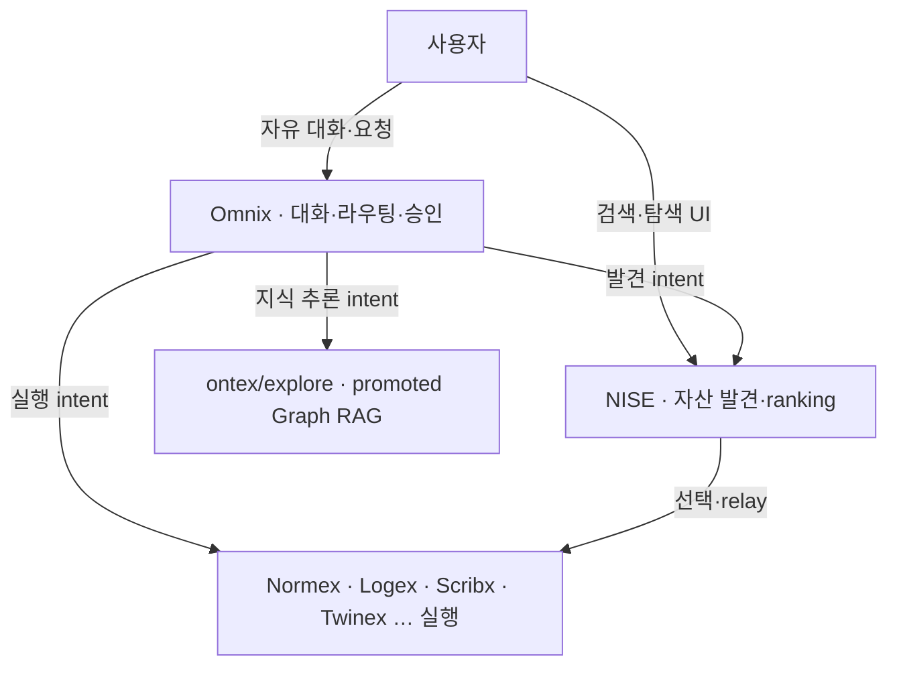
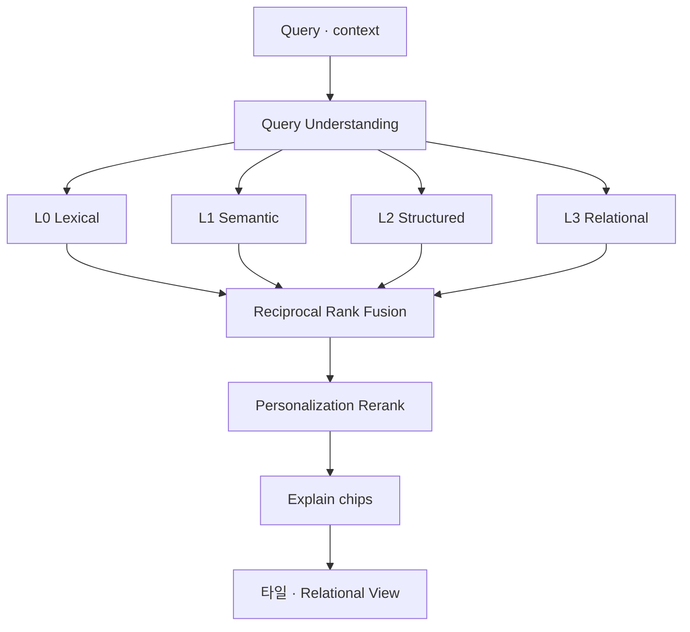
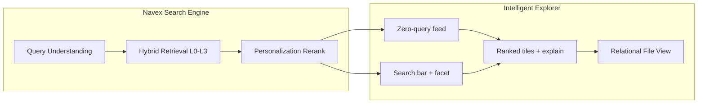

# NEXIA · Navex · 이중 탐색 모드 · 지능형 탐색 v1.0

> **한 줄:** 지능형 Navex 의 **중심 = Navex Intelligent Search Engine** — DB·벡터·그래프·흔적을 **융합**하고 **개인화 rerank** 하는 검색. UI 는 **검색 결과 → 관계 pivot** — 트리·키워드 매칭만으로 **✗**.

**연계:** [`TDD-056` §5.7](../../08_TDD/NEXIA/08_TDD_NEXIA_7탭범위확정_v1.0.md) · [`TDD-065`](../../08_TDD/NEXIA/08_TDD_NEXIA_Navex탐색APIFacet계약_v1.0.md) · [`PRD-013`](./05_PRD_NEXIA_파일메타데이터AI추출.md) · [`PRD-011`](./05_PRD_NEXIA_지식그래프NexusGraph.md)

---

## 1. 배경 · 문제

| 문제 | 설명 |
| :--- | :--- |
| **트리 피로** | InfraTree 는 **운영·디버깅**용. 일상 탐색 UX **✗** |
| **키워드 한계** | `ILIKE`·파일명 검색은 **표면 문자**만 — `source_metadata`·임베딩·관계 **미활용** |
| **동일 결과** | 전 사용자·전 세션 **같은 ranking** — 온톨로지·협업 맥락 **무시** |
| **AI 자산 공백** | [`PRD-013`](./05_PRD_NEXIA_파일메타데이터AI추출.md) 로 쌓인 **메타·벡터**가 Navex **1 차 진입**에 연결되지 않음 |

**전제:** **Infra-Explorer** 유지 · **Intelligent-Explorer** = **검색 엔진 + 개인화** 가 **제품 핵심**.

---

## 2. 이중 모드 (Normative)

| 모드 | 태그 | 중심 | SSOT |
| :--- | :--- | :--- | :--- |
| **지능형 탐색기** | `Intelligent-Explorer` | **Navex Search Engine** · 개인화 · 관계 pivot | **본 문서** |
| **인프라 탐색기** | `Infra-Explorer` | InfraTree · facet · 키워드 `q` | [`UIX-002`](../../07_UIUX/07_UIUX_NEXIA_탐색기UI전략.md) |

| 키 | 값 | 기본 |
| :--- | :--- | :--- |
| `settings.nexia.navexExploreMode` | `'intelligent'` \| `'infra'` | **`intelligent`** |

**경계:** Omnix · ontex/explore · Nexus Map — 본문·검색 **침범 ✗** ([§2.3](#23-도메인-경계-혼동-방지) · [§2.3.1](#231-omnix--nise--ontex--역할-분리-normative)).

### 2.3 도메인 경계 (혼동 방지)

| 표면 | 역할 |
| :--- | :--- |
| **Omnix** | 대화·**의도 분류·탭 위임·승인** — 자산 ranking **소유 ✗** |
| **Navex Search (NISE)** | **발견·ranking·개인화** · 파일·자산 |
| **ontex / explore** | promoted · Graph RAG **전용** |
| **Nexus Map** | 메타포·인과 **편집·서사** |
| **Nexaon ExplorerTree** | 온톨로지 **편집** |

#### 2.3.1 Omnix · NISE · ontex — 역할 분리 (Normative)

> **한 줄:** **Omnix** = 「무엇을 **할지**」 조율 · **NISE** = 「**무엇이** 있는지」 DB 발견 · **ontex/explore** = 「**승격된 지식**」 Graph RAG.

| 구분 | **Omnix** (`tabId=omnix`) | **NISE** (`Navex-Search-Engine`) | **ontex / explore** |
| :--- | :--- | :--- | :--- |
| **핵심 질문** | 무엇을 **해야** 하지? 어디로 **위임**? | **어떤 파일·자산**이 관련? | **승격된** 지식·관계는? |
| **출력** | `.nxchat` · Run · 승인 strip · 탭 handoff | ranked **ExplorerItem[]** · `matchReason` · zero-query feed | subgraph · citation · MOC · wikilink RAG |
| **데이터** | 대화·Envelope · Run 큐 | `files` · `file_embeddings` · `source_metadata` · graph edges · trace | **promoted** 온톨로지 · Neo4j · ontex 인덱스 |
| **엔진** | `apps/agent-graph` · HEXAGON 분류 · 승인 게이트 | hybrid L0–L5 · RRF · **Personalization rerank** | Graph RAG · pgvector · MOC ([`TDD-Ontex`](../../08_TDD/Ontex/08_TDD_Ontex_기술스택운영방침_v1.0.md)) |
| **UI** | 채팅 · Global Flow · 요청 큐 | Navex **검색 Hero** · 타일 · Relational pivot | ontex **explore 전용** — Navex 풀 UI **✗** |
| **개인화** | Intent **입력** (대화·위임 → profile feed) | **Personalization Profile** SSOT — ranking·zero-query | (P2) 팀·MOC 컨텍스트 |
| **Latency** | 멀티턴·추론 (초~) | retrieval p95 **< 800ms** (P0) | 탐색·인용 (중~) |
| **LLM** | 계획·분류·도구 체인·승인 | P0 **결정론 retrieval** · P1 query parse · cross-encoder rerank | RAG synthesis · subgraph |

**SSOT:** Omnix 범위 — [`TDD-056` §5.1](../../08_TDD/NEXIA/08_TDD_NEXIA_7탭범위확정_v1.0.md) · [`TDD-010` §2.4](../../08_TDD/NEXIA/08_TDD_NEXIA_구조기술스택운영방침.md) · Graph RAG **Omnix 범위 외** 명시.

#### 2.3.2 Omnix → NISE 연동 (Normative)

Omnix 는 **자체 DB full-text·벡터 검색 ✗** — **발견 intent** 시 NISE 를 **유일 retrieval SSOT** 로 사용한다.

| intent (HEXAGON·분류) | Omnix 동작 | NISE API |
| :--- | :--- | :--- |
| **Discover** · 「~ 찾아줘」 · 「관련 파일」 | **tool** `navex_search` 호출 → 채팅에 요약·카드 | `POST /api/v1/navex/search` |
| **Discover (deep)** · 「Navex 에서 계속」 | Navex 탭 **deep link** (`q` · facet prefill) | 동일 + UI handoff |
| **Execute** · 「코드 수정해줘」 | Logex/Scribx **위임** — NISE 는 **컨텍스트 파일** 선 supplying 만 | (선택) `related` · seed `fileId` |
| **Knowledge** · 「온톨로지 관계」 · promoted | **ontex/explore** 또는 Nexaon Run — NISE **대체 ✗** | deep link only |
| **Approve / Run** | Omnix strip · agent-graph — ranking **✗** | — |

**tool 계약 (P0):**

| 항목 | 규칙 |
| :--- | :--- |
| **tool name** | `navex_search` (agent-graph MCP/tool registry) |
| **입력** | `q` · `facet` · `limit` · (선택) `projectId` · `seedFileId` |
| **출력** | `ExplorerItem[]` — Omnix 는 **요약·선택 UI** 만 · ranking **재계산 ✗** |
| **trace** | `search.query` 이벤트 — `source: omnix` · [`§5.2`](#52-trace-이벤트-normative) |
| **개인화** | 동일 `user_id` · **Personalization Profile** 공유 — Omnix·Navex **별도 profile ✗** |

상세 Zod·tool schema — **TDD-066** (Navex Search Engine 계약).

#### 2.3.3 시나리오 (혼동 방지)

| 사용자 | 올바른 경로 | 금지 |
| :--- | :--- | :--- |
| Navex 검색창에 「온도 센서 yaml」 | **NISE** primary · 타일·explain | Omnix 채팅으로만 우회 **✗** (primary) |
| Omnix 「온도 센서 yaml 찾아줘」 | `navex_search` tool → 결과 카드 | Omnix LLM 이 **환각 파일명** 생성 **✗** |
| Omnix 「이 정책 Logex 로」 | **Execute** → Logex 위임 | NISE 가 워크플로 **생성 ✗** |
| 「승격된 클래스 A 와 B 관계」 | **ontex/explore** · Nexaon | NISE 가 promoted subgraph **대체 ✗** |
| 빈 Navex 진입 | **zero-query** (개인화 feed) | Omnix 대화 **기본 화면 ✗** |

**체감 흐름 (Normative):**

1. **일상 발견** — Navex 검색 → NISE → relay
2. **목표 지향** — Omnix 대화 → 분류 → (발견) NISE tool / (실행) 탭 / (승인) strip
3. **지식 추론** — ontex · Nexaon Run — NISE·Omnix UI **분리**

---

## 3. Navex Intelligent Search Engine (Normative)

> **태그:** `Navex-Search-Engine` · **별칭:** NISE (문서 내)

**정의:** 플랫폼 **Global Asset Index**(`files` · `file_references` · `source_metadata` · `file_embeddings` · graph edges · `file_action_log`) 를 **단일 쿼리**로 interrogates 하고, **하이브리드 retrieval + fusion + 개인화 rerank** 후 **설명 가능한** ranked list 를 반환하는 **서버 엔진**.

### 3.1 키워드 검색을 넘는다

| 층                 | 수단                       | DB·인덱스                                                                   | 역할                   |
| :---------------- | :----------------------- | :----------------------------------------------------------------------- | :------------------- |
| **L0 Lexical**    | BM25 / trigram / `ILIKE` | `original_name` · `file_path` · tags                                     | 정확어·코드 심볼            |
| **L1 Semantic**   | embedding ANN            | [`file_embeddings`](./05_PRD_NEXIA_파일메타데이터AI추출.md) · pgvector            | **의미·패러프레이즈**        |
| **L2 Structured** | JSON·facet filter        | `source_metadata` · `metadata` · facet                                   | 엔티티·속성·`.nx*`        |
| **L3 Relational** | graph walk · join        | [`PRD-011`](./05_PRD_NEXIA_지식그래프NexusGraph.md) edges · `file_references` | **연관·인과·depends_on** |
| **L4 Contextual** | session·project boost    | `project_id` · active tab · recent pivot                                 | **지금 맥락**            |
| **L5 Personal**   | trace rerank             | `Personalization-Profile` ([§5](#5-개인화-personalization-profile))         | **이 사용자**            |

**원칙:** 채널 **병렬 retrieval** → **fusion** → **personal rerank** · 단일 `ILIKE` **fallback only**.

### 3.2 쿼리 이해 (Query Understanding)

| 입력 | 처리 | Phase |
| :--- | :--- | :---: |
| 키워드·코드 조각 | lexical + semantic dual | P0 |
| 자연어 한 줄 | intent parse · entity extract → facet + embedding | P1 |
| 「이 파일과 비슷한」 | seed `fileId` → **more-like-this** (vector + graph) | P0 |
| 빈 쿼리 (진입) | **Zero-query** = 개인화 feed ([§5.4](#54-zero-query-진입)) | P0 |

모든 LLM 단계 — **`apps/agent-graph`** · 브라우저 직접 **✗**.

### 3.3 Fusion · Ranking

| 단계 | P0 | P1 |
| :--- | :--- | :--- |
| **Fusion** | RRF (Reciprocal Rank Fusion) | + agent-graph **cross-encoder** rerank |
| **Explain** | `matchReason`: lexical \| semantic \| related \| personal | + 자연어 한 줄 |
| **Latency** | p95 < 800ms (warm) | semantic cold < 2s |

### 3.4 검색 ↔ UI 계약

| UI 상태 | Search API |
| :--- | :--- |
| L0 진입 (빈 q) | `POST /api/v1/navex/search/zero-query` |
| L1 입력·facet | `POST /api/v1/navex/search` |
| L2 허브 pivot | `POST /api/v1/navex/search/related` |
| more-like-this | `POST /api/v1/navex/search/similar` |

Infra-Explorer `GET .../explorer/search?q=` — **L0 lexical subset** · intelligent 모드 **primary ✗**.

상세 Zod — [`TDD-065`](../../08_TDD/NEXIA/08_TDD_NEXIA_Navex탐색APIFacet계약_v1.0.md) **§10 확장** (TDD-066).

---

## 4. 지능형 UX 원칙 (검색 중심)

| # | 원칙 | 내용 |
| :-: | :--- | :--- |
| **0** | **Search-first** | 화면 **주인공 = 검색바 + 결과** · 트리 **intelligent ✗** |
| **1** | **점진적 뷰** | 결과 → 허브 → Relational File View |
| **2** | **스키마리스 + DB 정합** | 사용자는 자유 입력 · 엔진이 **DB facet** 으로 **grounding** |
| **3** | **설명 가능** | 모든 타일에 **왜 떴는지** (`matchReason`) |
| **4** | **관계 pivot** | 선택 = 새 검색 seed · 폴더 이동 **✗** |

---

## 5. 개인화 (Personalization Profile)

> **태그:** `Personalization-Profile` · **한 사용자·한 workspace** SSOT — 팀 공유 feed **P2**.

개인화는 **장식 ✗** · ranking·zero-query·Attention **전 축**에 **가중치**.

### 5.1 프로필 축

| 축 | 저장·갱신 | 검색 영향 |
| :--- | :--- | :--- |
| **Identity** | `user_id` · Grade · role | visibility · domain ACL |
| **Focus** | active `project_id` · `folder_id` · `tabId` | boost · default facet |
| **Taste** | domain·category prior (decay) | long-term rerank |
| **Trace** | `file_action_log` · open · relay · preview dwell | short-term boost |
| **Intent** | recent queries · reformulation · Omnix 위임 | query expand · disambiguate |
| **Negative** | dismiss · hide · snooze · 「관련 없음」 | suppress · downrank |
| **Self** (P1) | `nexa_self_*` · 6-COILS mood | Attention·Signal **tone** · rerank nudge |
| **Collaborative** (P2) | team project co-view | optional blend |

### 5.2 Trace 이벤트 (Normative)

| 이벤트 | 필드 | 용도 |
| :--- | :--- | :--- |
| `search.query` | q, facet, result_click_rank | intent · CTR 학습 |
| `search.zero_query_impression` | item_ids[] | cold start 품질 |
| `asset.open` | file_id, dwell_ms, tab_from | Taste · Trace |
| `asset.relay` | file_id, target_tab | tabAffinity boost |
| `asset.dismiss` | file_id, reason | Negative |
| `relation.pivot` | hub_id, edge_type | L3 relational seed |

**저장:** `navex_personalization_events` (append) → batch **profile snapshot** · **실시간 session cache**.

### 5.3 개인화 출력 (UI)

| 출력 | 설명 | Phase |
| :--- | :--- | :---: |
| **「당신을 위한」** strip | Taste + Trace top-N | P0 |
| **「이어서」** | 직전 세션·미완 relay | P0 |
| **「프로젝트 맥락」** | active project boost block | P0 |
| **「주목」** Attention | Signal + personal urgency | P1 |
| **「팀에서 hot」** | collaborative (opt-in) | P2 |

### 5.4 Zero-query 진입

**빈 검색창 L0** = **개인화 -only ranking**:

1. Trace **이어서** (40%)
2. Project **맥락** (25%)
3. Attention **Signal** (20%)
4. Platform **신규 ingest** (15%)

→ 사용자마다 **다른 첫 화면** · 전역 인기 목록 **✗**.

### 5.5 프라이버시 · Grade

| 규칙 | 내용 |
| :--- | :--- |
| **PoLP** | 프로필·trace **본인** (+ admin audit) |
| **Opt-out** | `settings.nexia.personalizationEnabled` (기본 **on**) |
| **Forget** | 프로필·trace 삭제 API · rerank **cold start** |
| **팀** | P2 · project scope **명시 동의** |

---

## 6. AI 표면 (검색 결과 위)

검색 **엔진**과 **표현** 분리 — §4~5 ranking 후 **타일 UX**.

### 6.1 Signal 타일

- **matchReason** = `signal` + personal urgency
- BAX void·Alarm — [`UIX-003`](../../07_UIUX/07_UIUX_BAX_미학적인터페이스UX아키텍처.md) · **전 타일 반짝임 ✗**

### 6.2 Relational File View

- `POST .../search/related` 결과를 orbit 렌더
- 엣지: `depends_on` · `semantic_neighbor` · `same_project` · `cited_in`

### 6.3 Attention Queue

- Zero-query · search **공통** 큐 — **개인화 score** 로 truncate (5~12)

---

## 7. 화면 · 정보 구조

| 영역 | P0 | P1 |
| :--- | :---: | :---: |
| **Hero** | **검색바** (persistent) · explain 칩 · facet | NL query hint |
| **Feed** | Zero-query **개인화** 타일 | + Attention |
| **Results** | Hybrid ranked grid | cross-encoder 품질 |
| **Pivot** | Relational slice | graph depth +1 |
| **트리** | **숨김** | Infra 모드 only |

| 단계 | 행동 | Search |
| :---: | :--- | :--- |
| L0 | 진입 | `zero-query` · **개인화 feed** |
| L1 | q 입력 | hybrid search · facet |
| L2 | 타일 선택 | `related` · explain |
| L3 | pivot | `similar` / graph expand |
| L4 | relay | 탭 handoff |

---

## 8. 데이터 · API (요약)

| API | Phase |
| :--- | :---: |
| `POST /api/v1/navex/search` | P0 |
| `POST /api/v1/navex/search/zero-query` | P0 |
| `POST /api/v1/navex/search/related` | P0 |
| `POST /api/v1/navex/search/similar` | P0 |
| `GET/PUT /api/v1/navex/personalization/profile` | P0 |
| `POST /api/v1/navex/personalization/events` | P0 |
| `POST /api/v1/navex/search/rerank` (agent-graph) | P1 |

**인덱스:** pgvector HNSW on `file_embeddings` · GIN on `source_metadata` · graph edge index ([`PRD-011`](./05_PRD_NEXIA_지식그래프NexusGraph.md)).

---

## 9. 기능 ID · Phase

| ID | 기능 | P |
| :--- | :--- | :---: |
| F-IX-01 | `navexExploreMode` · persist | P0 |
| F-IX-02 | **Navex Search Engine** hybrid L0–L3 + RRF | P0 |
| F-IX-03 | **Zero-query** 개인화 feed | P0 |
| F-IX-04 | **Personalization Profile** + trace events | P0 |
| F-IX-05 | `matchReason` explain chips | P0 |
| F-IX-06 | Relational / similar search pivot | P0 |
| F-IX-07 | NL query understanding | P1 |
| F-IX-08 | cross-encoder rerank · Self mood nudge | P1 |
| F-IX-09 | Signal · Attention (personalized) | P1 |
| F-IX-10 | Infra-Explorer mode | P0 |
| F-IX-11 | Team collaborative boost | P2 |
| F-IX-12 | Omnix **`navex_search` tool** · trace `source: omnix` | P0 |

---

## 10. 비목표

- **키워드 -only** 를 intelligent **주력 ✗**
- 전 사용자 **동일** zero-query
- ontex Graph RAG **UI 복제**
- **Omnix 대화**가 NISE **primary 발견**을 **대체** (채팅 = 보조·위임 · Navex 검색 = SSOT)
- Omnix LLM 이 **파일명·경로 환각** (발견 시 **NISE tool 필수**)
- 개인화 **강제** (opt-out 필수)
- 브라우저 → embedding **직접**

---

## 11. 관련 문서

| 관계 | 문서 |
| :--- | :--- |
| **Omnix 경계** | [`PRD-014` §2.3.1](./05_PRD_NEXIA_Navex이중탐색모드지능형탐색_v1.0.md) · [`TDD-010` §2.4](../../08_TDD/NEXIA/08_TDD_NEXIA_구조기술스택운영방침.md) · [`TDD-056` §5.1](../../08_TDD/NEXIA/08_TDD_NEXIA_7탭범위확정_v1.0.md) |
| API · facet | [`TDD-065`](../../08_TDD/NEXIA/08_TDD_NEXIA_Navex탐색APIFacet계약_v1.0.md) |
| ontex Graph RAG | [`TDD-Ontex`](../../08_TDD/Ontex/08_TDD_Ontex_기술스택운영방침_v1.0.md) |
| 임베딩 · 메타 | [`PRD-013`](./05_PRD_NEXIA_파일메타데이터AI추출.md) |
| 그래프 | [`PRD-011`](./05_PRD_NEXIA_지식그래프NexusGraph.md) |
| Infra UX | [`UIX-002`](../../07_UIUX/07_UIUX_NEXIA_탐색기UI전략.md) |
| 범위 | [`TDD-056` §5.7](../../08_TDD/NEXIA/08_TDD_NEXIA_7탭범위확정_v1.0.md) |
| 용어 | [`TDD-060` §3.6.4](../../용어집_v1.0.md) |
