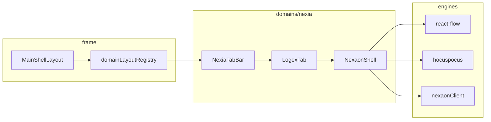

# NEXAON UI — MainShell · domains/nexia 레이아웃 v1.0

> **범위:** Greenfield **Next.js** UI — V2.1 **MainShell 4영역 + SystemStatusBar** 위에 **NEXIA 도메인** 및 **NEXAON(Logex 서브모드)** 레이아웃 SSOT.  
> **기능 상세:** [`05_PRD NEXAON UI 기능 명세`](../05_PRD/05_PRD_NEXAON_UI기능명세_MVPPhaseUI_v1.0.md)  
> **상위:** [`08_TDD LangGraph 플랫폼`](../08_TDD/NEXAON/08_TDD_LangGraph_인간LLM협업형IoT온톨로지플랫폼_v1.0.md) · [`08_TDD 모노레포 폴더 구조`](../08_TDD/NEXAON/08_TDD_NEXAON_모노레포폴더구조_v1.0.md)

---

## 1. 목적

UI **1순위 구현**을 위해 다음을 **한 문서에서 고정**한다.

1. **플랫폼 전역** — `frame/` · `MainShellLayout` · `domainLayoutRegistry`
2. **NEXIA 도메인** — `domains/nexia/` 폴더·슬롯·7탭 셸
3. **NEXAON 작업면** — Logex 탭 내부 **온톨로지 디지털 트윈** 3분할 (캔버스 · 문서 · Run)

---

## 2. 전역 레이아웃 (MainShell)

### 2.1 5대 절대 원칙

| # | 원칙 | 구현 |
| --- | --- | --- |
| **1** | 뷰포트 고정 | `MainShellLayout` = `100vh` · `body` 세로 스크롤 **✗** |
| **2** | Content 단일 스크롤 | `registry.content` **만** `overflow-auto` |
| **3** | 드로어 내부 스크롤 | L/R Drawer 각각 `overflow-y-auto` |
| **4** | Footer 없음 | 하단 = **`SystemStatusBar`** (~30px · expanded ≥300px) |
| **5** | Store-Driven | `useLayoutStore` — 드로어·상태바 SSOT · 정책 = `drawerDefaults` |

### 2.2 4영역 + 상태바 (ASCII)

```text
┌──────────────────────────────────────────────────────────────────────────┐
│ AppHeader                                                                 │
│  GlobalMainMenu (domainKey)          GlobalNavbarRight · headerActions   │
├──────────┬───────────────────────────────────────────────┬───────────────┤
│          │                                               │               │
│  Left    │              Content                          │    Right      │
│  Drawer  │         (유일한 main scroll)                   │    Drawer     │
│          │                                               │               │
│ registry │  domains/{domainKey}/views/content/*          │  registry     │
│  .left   │                                               │  .right       │
│          │                                               │               │
├──────────┴───────────────────────────────────────────────┴───────────────┤
│ SystemStatusBar — StatusBarStrip (~30px)                                  │
│ StatusPanelHost (0 | ≥300px) — StatusOpsPanel + registry.statusPanel     │
└──────────────────────────────────────────────────────────────────────────┘
```

### 2.3 `frame/` 디렉터리 (코드 SSOT)

```text
apps/web/src/frame/
├── navigation/
│   └── globalMenu.ts                 # domainKey · route · label
├── registry/
│   ├── domainLayoutRegistry.ts       # left · content · right · headerActions · status*
│   └── layoutRegistry.ts             # Auth · embed 예외
├── layouts/
│   ├── MainShellLayout.tsx           # (shell) 라우트 그룹
│   ├── AuthLayout.tsx
│   └── U2BeeMinimalLayout.tsx        # embed 전용 — MainShell ✗
├── drawers/
│   ├── LeftDrawer.tsx
│   ├── RightDrawer.tsx
│   └── DrawerResizeHandle.tsx
├── header/
│   ├── AppHeader.tsx
│   ├── GlobalMainMenu.tsx
│   └── GlobalNavbarRight.tsx
├── status/
│   ├── SystemStatusBar.tsx
│   ├── StatusPanelHost.tsx
│   └── panels/                       # StatusOpsPanel · ConnectionBar …
└── views/common/
    ├── DefaultRightPanel.tsx
    └── DefaultStatusPanel.tsx
```

### 2.4 App Router 라우팅

```text
apps/web/src/app/
├── layout.tsx                        # RootLayout
├── (auth)/login · register
├── (embed)/u2bee/…                   # MainShell ✗
└── (shell)/
    ├── layout.tsx                    # → MainShellLayout
    ├── page.tsx                      # home
    └── nexia/
        ├── layout.tsx                # (선택) NexiaProvider
        ├── page.tsx                  # → NexiaContent default tab
        └── [tabId]/page.tsx          # /nexia/logex · /nexia/omnix …
```

### 2.5 `domainLayoutRegistry` — NEXIA 등록 (예시)

```ts
// frame/registry/domainLayoutRegistry.ts
nexia: {
  left: () => import('@/domains/nexia/views/left/NexiaLeftNav'),
  content: () => import('@/domains/nexia/views/content/NexiaContent'),
  right: () => import('@/domains/nexia/views/right/NexiaRightPanel'),
  headerActions: () => import('@/domains/nexia/components/NexiaHeaderActions'),
  statusBar: () => import('@/domains/nexia/views/status/NexiaStatusBar'),
  statusPanel: () => import('@/domains/nexia/views/status/NexiaStatusPanel'),
  themePreset: 'office-light',
  drawerDefaults: {
    left:  { openPolicy: 'recommended', defaultOpen: true },
    right: { openPolicy: 'recommended', defaultOpen: true },
  },
},
```

---

## 3. `domains/nexia/` 전체 구조

### 3.1 역할

| 항목 | 값 |
| --- | --- |
| **domainKey** | `nexia` |
| **역할** | 플랫폼 **핵심 지능** — 7탭 · Omnix 허브 · **Logex → NEXAON** |
| **themePreset** | `office-light` |
| **백엔드 연동** | Nest `modules/nexaon` · `agent-graph` proxy (UI는 REST/SSE만) |

### 3.2 폴더 트리

```text
apps/web/src/domains/nexia/
├── config/
│   └── nexiaTabs.ts                  # 7탭 tabId SSOT · route · icon
├── components/
│   ├── NexiaHeaderActions.tsx        # Run · Save · Sync · Project
│   └── NexiaTabBar.tsx               # Content 상단 탭 스트립
├── views/
│   ├── left/
│   │   └── NexiaLeftNav.tsx          # tabId별 서브 내비 (§4.1)
│   ├── content/
│   │   └── NexiaContent.tsx          # TabBar + activeTab 라우터
│   ├── right/
│   │   └── NexiaRightPanel.tsx       # tabId별 우측 (§4.2)
│   └── status/
│       ├── NexiaStatusBar.tsx        # 1줄 — room · run · sync
│       └── NexiaStatusPanel.tsx      # Run 타임라인 · 협업자 · 메트릭
├── tabs/                             # 탭별 Content 본문 (얇은 셸)
│   ├── omnix/OmnixTab.tsx
│   ├── normex/NormexTab.tsx
│   ├── logex/
│   │   ├── LogexTab.tsx              # Logex 셸 — 서브모드 스위치
│   │   └── NexaonEntry.tsx           # ★ NEXAON 마운트 진입
│   ├── scribx/ScribxTab.tsx
│   ├── vivex/VivexTab.tsx
│   ├── twinex/TwinexTab.tsx
│   └── navex/NavexTab.tsx
├── modules/
│   └── nexaon/                       # ★ NEXAON 기능 모듈 (§5)
│       ├── NexaonShell.tsx           # Toolbar + 3분할 작업면
│       ├── views/ · panels/ · hooks/ · store/
│       └── index.ts
├── hooks/
│   ├── useNexiaTab.ts                # tabId · URL sync
│   └── useNexiaContext.ts            # left/right에 tabId 전달
└── store/
    └── useNexiaTabStore.ts           # activeTabId · logexSubMode
```

### 3.3 7탭 SSOT (`nexiaTabs.ts`)

| tabId | 라벨 | Content | NEXAON 관련 |
| --- | --- | --- | --- |
| `omnix` | Omnix | 허브 · 요청 분류 | 간접 — Run 트리거 |
| `normex` | Normex | 규범 · 용어 | SpecsPreview 연동 |
| **`logex`** | **Logex** | **로직·관계** | **NEXAON 서브모드 ★** |
| `scribx` | Scribx | 문서 · Tiptap | wikilink |
| `vivex` | Vivex | 미디어 | — |
| `twinex` | Twinex | 3D 트윈 | Neo4j 자산 연동(후속) |
| `navex` | Navex | 인프라 | ESPHome 배포(후속) |

**NEXAON 진입 URL (권장)**

```text
/nexia/logex                    # Logex 기본
/nexia/logex/ontology           # NEXAON 서브모드 (명시)
/nexia/logex/ontology/{projectId}
```

---

## 4. NEXIA 슬롯 — tabId별 Left · Right

Left/Right는 **동일 슬롯 컴포넌트**이나 **`useNexiaTabStore.activeTabId`** 로 **내부 패널만 교체**한다.

### 4.1 Left Drawer (`NexiaLeftNav`)

| tabId | Left 패널 | NEXAON(`logex`+ontology) |
| --- | --- | --- |
| omnix | 요청 큐 · 최근 Run | — |
| normex | 용어집 트리 · MOC | specs 링크 |
| **logex** | **프로젝트 · 그래프 목록** | **`ExplorerTree`** — 클래스·자산·핀·edge 필터 |
| scribx | 문서 트리 | wikilink 대상 |
| 기타 | 도메인 기본 트리 | 축소 모드 |

**NEXAON ExplorerTree 구역**

```text
┌ LeftDrawer ─────────────┐
│ ▼ Project: factory-a    │
│   ▼ Ontology            │
│     Classes             │
│     Assets              │
│     PinMaps             │
│   ▼ Specs (read-only)   │
│   ▼ Runs (history)      │
└─────────────────────────┘
```

### 4.2 Right Drawer (`NexiaRightPanel`)

| tabId | Right 기본 | NEXAON 전용 탭 |
| --- | --- | --- |
| omnix | Agent · Time Axis | — |
| **logex + NEXAON** | — | **Properties · Run Chat · Approvals · SHACL · Deploy** |

**NEXAON Right — 세그먼트 탭**

```text
┌ RightDrawer ────────────────────┐
│ [Props][Chat][Approve][SHACL][⚡] │
├─────────────────────────────────┤
│  (선택 패널)                       │
│  · Properties: node/edge 필드     │
│  · Run Chat: SSE 스트림 · 프롬프트  │
│  · Approvals: A/B/C 게이트        │
│  · SHACL: violation 목록          │
│  · Deploy: ESPHome · OTA · Serial │
└───────────────────────────────────┘
```

### 4.3 Header Actions (`NexiaHeaderActions`)

| tabId | 액션 |
| --- | --- |
| 공통 | 프로젝트 선택 · 협업자 아바타 · SYNC 표시 |
| **NEXAON** | **Run ▶ · Export · 승인 · Auto-layout · Deploy** |

### 4.4 Status (`NexiaStatusBar` · `NexiaStatusPanel`)

| Strip (1줄) | Panel (expanded) |
| --- | --- |
| `SYNC 42ms` · `room: ontology:draft` | Run 이벤트 타임라인 |
| `run:#abc · streaming` | 협업 Awareness |
| `nodes:128 · edges:94` | SHACL 요약 · Draft/Audit 단계 |
| `SHACL: OK \| 3 violations` | graph_id · LLM_BACKEND (읽기 전용) |

---

## 5. NEXAON 작업면 (`modules/nexaon/`)

Logex 탭 **서브모드 `ontology`** 일 때 `NexaonEntry` → **`NexaonShell`** 마운트.

### 5.1 Content 내부 레이아웃 (ASCII)

```text
┌─ NexiaTabBar ─────────────────────────────────────────────────────────┐
├─ NexaonToolbar ───────────────────────────────────────────────────────┤
│ [Select][Connect][Delete] │ [Auto-layout] [Fit] [Minimap toggle]      │
│ [Run▶][Stop] [graph: nexaon_ingest ▼]                                 │
├───────────────────────────────┬───────────────────────────────────────┤
│                               │ SpecsPreview (width: 0~40%, resizable)│
│                               │ TipTap · Yjs · wikilink preview       │
│   GraphCanvas                 │ ───────────────────────────────────── │
│   React Flow (@xyflow/react)  │ (접기 시 캔버스 full width)            │
│   · ontology:draft ↔ Yjs      │                                       │
│   · DiffOverlay (SSE)         │                                       │
│   · nodeTypes: class/asset/   │                                       │
│     pin/port/sensor           │                                       │
│   · Background · Controls     │                                       │
│   · MiniMap (optional)        │                                       │
├───────────────────────────────┴───────────────────────────────────────┤
│ RunPanel (height: 0~240px, collapsible)                             │
│ · SSE timeline · step · token chunk · shacl_violation jump            │
└───────────────────────────────────────────────────────────────────────┘
```

### 5.2 `NexaonShell` 컴포넌트 분해

| 컴ponent | 경로 | 역할 |
| --- | --- | --- |
| `NexaonShell` | `modules/nexaon/NexaonShell.tsx` | 분할·리사이즈·키보드 단축키 |
| `NexaonToolbar` | `modules/nexaon/views/NexaonToolbar.tsx` | 그래프 선택 · Run · layout |
| `GraphCanvas` | `modules/nexaon/views/GraphCanvas.tsx` | React Flow host |
| `SpecsPreview` | `modules/nexaon/views/SpecsPreview.tsx` | TipTap collab (선택) |
| `RunPanel` | `modules/nexaon/views/RunPanel.tsx` | SSE 구독 UI |
| `DiffOverlay` | `modules/nexaon/views/DiffOverlay.tsx` | AI 제안 · 위반 highlight |
| `EsphomeDeploy` | `modules/nexaon/views/EsphomeDeploy.tsx` | Right Deploy 탭 본문 |

### 5.3 React Flow · Yjs 바인딩 (레이아웃 관점)

```text
Yjs Map key: ontology:draft
       │
       ├── nodes[]  ──► useNexaonGraph ──► React Flow nodes
       ├── edges[]  ──► useNexaonGraph ──► React Flow edges
       └── meta     ──► viewport · selectedRunId

Hocuspocus room: project:{projectId}:ontology:draft
Provider: engines/hocuspocus/useOntologyRoom.ts
```

**레이아웃 규칙**

- 캔버스 **pan/zoom** = React Flow 내부 — Content scroll과 **분리** (`preventScrolling` 등)
- **Auto-layout** = Dagre — `engines/react-flow/layout/dagreLayout.ts`
- SSE `shacl_violation` → 해당 node/edge **pulse** + Right SHACL 탭 auto-focus (옵션)

### 5.4 `modules/nexaon/` 상세 트리

```text
modules/nexaon/
├── NexaonShell.tsx
├── views/
│   ├── NexaonToolbar.tsx
│   ├── GraphCanvas.tsx
│   ├── SpecsPreview.tsx
│   ├── RunPanel.tsx
│   ├── DiffOverlay.tsx
│   └── EsphomeDeploy.tsx
├── panels/
│   ├── ExplorerTree.tsx              # → Left에 주입 가능
│   ├── NodePropertiesPanel.tsx       # → Right Props
│   ├── RunChatPanel.tsx
│   ├── ApprovalGatePanel.tsx
│   ├── ShaclViolationsPanel.tsx
│   └── DeployPanel.tsx
├── hooks/
│   ├── useNexaonYjs.ts
│   ├── useNexaonGraph.ts
│   ├── useNexaonRun.ts                 # SSE · run_id
│   └── useNexaonWikilink.ts
└── store/
    └── useNexaonStore.ts              # selection · subMode · panel sizes
```

---

## 6. 데이터·상태 흐름 (UI 레이어)



| Store | SSOT | UI 소비 |
| --- | --- | --- |
| `useLayoutStore` | 드로어·상태바 | frame |
| `useNexiaTabStore` | tabId · logexSubMode | left/right/content |
| `useNexaonStore` | selection · split sizes | NexaonShell |
| Yjs `ontology:draft` | 그래프 CRDT | GraphCanvas |
| `useNexaonRun` | SSE events | RunPanel · DiffOverlay |

---

## 7. 반응형 · 브레이크포인트

| viewport | Left | Content | Right | NEXAON 특칙 |
| --- | --- | --- | --- | --- |
| **≥1280px** | open (rec) | 3분할 | open (rec) | SpecsPreview 기본 32% |
| **1024~1279** | overlay | 캔버스 우선 | overlay | SpecsPreview **접음** |
| **<1024** | hidden | full | bottom sheet | RunPanel **drawer**로 승격 |

- NEXAON **1차 MVP** = **≥1280px desktop-first** — tablet는 Phase UI-2.

---

## 8. 구현 순서 (레이아웃만)

| Phase | 산출 | 검증 |
| --- | --- | --- |
| **UI-L0** | `MainShellLayout` + home/nexia registry stub | 4영역·단일 scroll |
| **UI-L1** | `NexiaTabBar` + 7탭 placeholder | URL `/nexia/[tabId]` |
| **UI-L2** | `NexaonShell` + empty `GraphCanvas` | Logex → ontology 진입 |
| **UI-L3** | Left Explorer · Right segment tabs | tabId별 패널 교체 |
| **UI-L4** | Split SpecsPreview · RunPanel resize | `useLayoutStore` + local persist |
| **UI-L5** | StatusBar NEXAON strip | expanded panel |

기능·API 연동 순서는 **PRD §Phase** 참조.

---

## 9. 관련 문서

| 문서 |
| --- |
| [`05_PRD NEXAON UI 기능 명세`](../05_PRD/05_PRD_NEXAON_UI기능명세_MVPPhaseUI_v1.0.md) |
| [`08_TDD 모노레포 폴더 구조`](../08_TDD/NEXAON/08_TDD_NEXAON_모노레포폴더구조_v1.0.md) |
| [`08_TDD LangGraph 플랫폼`](../08_TDD/NEXAON/08_TDD_LangGraph_인간LLM협업형IoT온톨로지플랫폼_v1.0.md) |
| [`07_UIUX v0 프롬프트셋`](./07_UIUX_NEXAON_v0UI프롬프트셋_v1.0.md) |

---

**결론:** **MainShell**은 V2.1 **4영역+상태바**를 그대로 쓰고, **NEXAON**은 `domains/nexia/tabs/logex` → `modules/nexaon/NexaonShell` **3분할 작업면**으로 Content를 채운다. Left/Right는 **tabId·서브모드**에 따라 **패널만 교체** — 레이아웃 셸은 재마운트하지 않는다.
