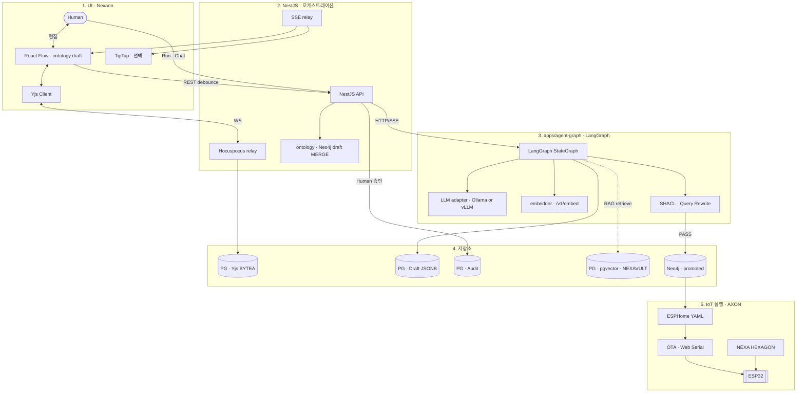

# 인간–LLM 실시간 협업형 IoT 온톨로지 플랫폼

> **범위:** IoT 자산 (클래스 · 핀맵 · 장비 관계) **온톨로지 디지털 트윈** — Human↔AI **실시간 협업** · 하드웨어 배포 (ESPHome) 까지.
> **중심 스택:** **LangGraph** (`apps/agent-graph`) + **React Flow** + **Yjs** — **Rivet 에이전트·rivet-core 배재**.
> **정본 연계:** [`핵심 기술 스택`](./08_TDD_IoT온톨로지AI협력플랫폼_핵심기술스택_v1.0.md) · [`모노레포 폴더 구조`](./08_TDD_LangGraph_모노레포폴더구조_v1.0.md) · NEXA-Platform `docs/NEXA OS/` · `docs/Nexia/` (CSIM·AXON 정본)

---

## 1. 목적

단방향 AI 챗봇·선형 워크플로를 넘어, **인간 엔지니어와 LangGraph 에이전트**가 **같은 React Flow 캔버스**에서 동시에 온톨로지를 다듬고, 검증된 구조만 **Neo4j·ESPHome**으로 이어지는 **팔란티어형 IoT 온톨로지 플랫폼**을 목표로 한다.

| 축                             | 역할                                                                                   |
| ------------------------------ | -------------------------------------------------------------------------------------- |
| **LangGraph**                  | 순환 (Cyclic) 상태 머신 — Extract · SHACL · Query Rewrite · RAG · **SSE 스트리밍** SSOT |
| **React Flow**                 | IoT 온톨로지 **2D 디지털 트윈** — 드래그·연결·Diff·승인 UI                             |
| **Yjs + Hocuspocus**           | Human·AI **공유 편집** (`ontology:draft`)                                              |
| **NestJS**                     | 인증 · Yjs · **agent-graph 프록시/SSE 중계** · 승인 게이트                             |
| **ESPHome + OTA / Web Serial** | 승인된 온톤로지 → **물리 디바이스**                                                    |

---

## 2. 설계 원칙 (NEXA SSOT 에서 이식)

### 2.1 Rivet 없이의 AIP

| 이전 (Rivet 경로)                  | **본 기획 (To-Be)**                            |
| ---------------------------------- | ---------------------------------------------- |
| rivet-core Export → LangGraph 위임 | **NestJS → `apps/agent-graph` HTTP/SSE** 직접  |
| Rivet Run 타임라인                 | **LangGraph Run 패널** + `run_id` · SSE 이벤트 |
| Rivet Chat 노드                    | **금지** — LLM·Streaming = **agent-graph 만**   |

### 2.2 온톨로지 · 지식 층위

```text
RAG → OG-RAG → OAG → AIP
         ↑ Normex · Zod · Human 승인 = 게이트
```

| 용어                | 본 플랫폼에서                                                        |
| ------------------- | -------------------------------------------------------------------- |
| **Nexaon**          | Human↔AI **해석·검수** — `modules/nexaon/` · React Flow + Yjs `ontology:draft` |
| **NEXAVULT**        | **지식 (데이터) 허브** — pgvector · IoT 로그 · FACT (≠ 온톨로지 SSOT) |
| **RAG**             | NEXAVULT 위 **검색·인용** — IoT **제어 루프에 직결 ✗**               |
| **HEXAGON · ACTON** | IoT **실행 경계** — 벡터·미검증 JSON → GPIO **금지**                 |

> **SSOT 우선순위:** Git `docs/specs/` · wikilink > Zod > **승인된 Neo4j promoted** > Yjs 초안 > AI JSON 초안.

### 2.3 온톨로지 표준 (IoT 3 종 + 검증)

기존 기획에서 **Rivet/SPARQL 노드** 대신 **LangGraph Python 노드**로 동일 역할을 수행한다.

| 표준           | 역할                                                      |
| -------------- | --------------------------------------------------------- |
| **RDF / RDFS** | 5W1H·관계 **트리플** 뼈대                                 |
| **OWL**        | 클래스·제약 — **환각 차단 헌법**                          |
| **SKOS**       | 도메인 용어·동의어 (산업/아트/일상)                       |
| **SHACL**      | Neo4j·TTL export **전** 구조 검증 — **BAD → export 중단** |

**LangGraph 담당:** rdflib · SHACL validate · (BAD 시) Query Rewrite 루프 · PASS 시 TTL/Neo4j upsert.

### 2.4 데이터 4 단계 (저장소 격리)

| 단계           | 저장                        | 내용                                               |
| -------------- | --------------------------- | -------------------------------------------------- |
| **① 실시간**   | PostgreSQL BYTEA · Yjs CRDT | `project_yjs_updates` — debounce 스냅샷            |
| **② Draft**    | PostgreSQL JSONB            | LangGraph Extract **초안** · 교차 검증 대기        |
| **③ Audit**    | PostgreSQL                  | 승인 스냅샷 · `run_id` · 롤백                      |
| **④ Promoted** | **Neo4j**                   | Human 승인 + SHACL PASS — **운영 온톨로지 그래프** |

Yjs `ontology:draft` → (선택) Nest **Neo4j draft MERGE** 실시간 미러 → 승인 후 **promoted sync**.

---

## 3. 플랫폼 핵심 기술 스택

| 레이어           | 기술                                              | 역할                                                     |
| ---------------- | ------------------------------------------------- | -------------------------------------------------------- |
| **UI 셸**        | Next.js (`apps/web`)                              | SSR · 라우팅 · Run/SSE 구독                              |
| **디지털 트윈**  | **React Flow** (`@xyflow/react`) + Dagre          | IoT 노드·엣지 · 핀맵·자산 관계 시각화                    |
| **협업 문서**    | TipTap + `@tiptap/extension-collaboration` (선택) | 기획·Normex 미리보기 — Yjs 공유                          |
| **펌웨어 편집**  | Monaco (선택)                                     | ESPHome YAML·스크립트 Diff                               |
| **실시간 CRDT**  | **Yjs** + **Hocuspocus** (`apps/sync`)            | `ontology:draft` — Nest **내장 WS ✗**                    |
| **API·게이트**   | **NestJS** (`apps/backend`)                       | 인증 · nexaon 모듈 · **SSE relay** · 승인 API            |
| **AI 런타임**    | **`apps/agent-graph`** — LangGraph + FastAPI      | Extract · SHACL · RAG · **LLM adapter** · `/v1/embed`    |
| **LLM**          | Ollama (dev) · **vLLM** (prod) — `LLM_BACKEND`    | Chat · Stream · JSON Extract — **브라우저 직접 ✗**       |
| **Embed**        | `embedder` in-process (`nomic-embed-text` 768)    | `/v1/embed` — Ollama Embed **✗**                         |
| **관계·감사 DB** | PostgreSQL + Prisma                               | Yjs · Draft · Audit · `project_knowledge`(pgvector)      |
| **그래프 DB**    | **Neo4j**                                         | promoted 온톨로지 · Cypher — **SSOT 아님**(승인 후 미러) |
| **지식 허브**    | pgvector · **NEXAVULT**                           | RAG 코퍼스 · IoT FACT 적재                               |
| **하드웨어**     | **ESPHome** YAML → build                          | 선언형 — LLM raw C++ **✗**                               |
| **배포**         | Web Serial API · ESPHome OTA                      | USB 플래싱 · Wi-Fi 원격                                  |

---

---

## 핵심 기술 스택 - 임시 참고 자료 (직접 삭제예정이나 삭제 하지 말것, 추후 참고용으로 남겨둠)

| 레이어 (Layer)       | 권장 기술 스택 (Tech Stack) | 플랫폼 내 핵심 역할 및 정체성                                                               | 리벳 (Rivet) 대비 차별점 및 도입 이유                                                                   |
| -------------------- | --------------------------- | ------------------------------------------------------------------------------------------- | ------------------------------------------------------------------------------------------------------ |
| 최상위 사용자 UI     | v0 (by Vercel)              | • 컴포넌트 디자인 고속 UI 생성 AI • 관제 대시보드 및 채팅 레이아웃 초안 마크업              | • 고품질 인터페이스 신속 구현을 통한 프론트엔드 개발 기간 단축                                         |
| 디지털 트윈 UI       | React Flow (TS)             | • 온톨로지 시각화 2D 캔버스 • 사용자의 노드/엣지 드래그·편집 이벤트 처리                    | • 사용자 인터랙션이 불가능한 리벳과 달리, 일반 유저용 시각적 프로그래밍 UI 제공                        |
| 실시간 동시 편집     | Yjs (CRDT)                  | • 공유 의식 체계 (인간과 LLM 의 협업 공간) • 캔버스 내 노드·엣지 상태의 초단위 동시 동기화   | • 단발성 API 요청을 넘어, LLM 이 유저 화면에 실시간 인격체로 개입하는 기반 기술                         |
| 웹 서버 & 통신       | Next.js & Vercel AI SDK     | • 프론트엔드 서빙 및 실시간 대화 스트리밍 • 요금제/플랜별 로컬 및 클라우드 LLM 스위칭       | • 잡담 등 가벼운 대화는 파이썬 서버를 거치지 않고 Next 단에서 즉시 처리하여 자원 절약                  |
| AI 에이전트 런타임   | LangGraph (Python)          | • 플랫폼의 핵심 두뇌 • 순환 (Cyclic) 구조 기반의 온톨로지 추론 및 검증 로직                  | • 선형적 워크플로우만 가능한 리벳의 한계를 극복, 복잡한 상태 머신 (State Machine) 완벽 제어             |
| AI 비즈니스 백엔드   | FastAPI (Python)            | • LangGraph 런타임의 API 엔드포인트화 • Next.js 웹 서버와의 데이터 비동기 중계 껍데기       | • 파이썬 AI 생태계 및 데이터베이스 연동을 위한 상용 등급의 고성능 파이썬 서버 인프라                   |
| 실시간 덤프 DB       | PostgreSQL (BYTEA)          | • 1 단계: Yjs 실시간 바이너리 데이터 백업 • 서버 다운 시 실시간 작업 상태 유실 방지          | • 초단위로 발생하는 인간과 LLM 의 미세한 편집 이력을 부하 없이 메모리 - 디비 간 스냅샷 저장               |
| 구조화 검증 DB       | PostgreSQL (JSONB)          | • 2 단계/3 단계: 마일스톤별 Draft 데이터 적재 • 인간·LLM 교차 검증 및 버전 롤백 (Audit Log)    | • 사람이 읽을 수 있는 JSON 포맷으로 격리 저장하여 Neo4j 로 넘어가기 전 최종 데이터 검증                 |
| 온톨로지 마스터 DB   | Neo4j (Graph DB)            | • 4 단계: 최종 승인된 자산 온톨로지 마스터 데이터 • 디지털 트윈 자산 관계 (자산 - 공장 - 핀) 매핑 | • 오염되지 않은 클린 데이터만 유지하여, 향후 LangGraph 에이전트의 차기 추론 Knowledge Base(RAG) 로 활용 |
| 하드웨어 배포 엔진   | ESPHome (YAML)              | • 온톨로지 구조 기반 선언형 YAML 자동 빌드 • 컴파일러 기반의 firmware.bin 생성 가동         | • LLM 이 C++ 코드를 짜며 발생하는 컴파일 에러를 원천 차단하고 구조화된 규격으로 안전하게 제어           |
| 로컬 배포 인터페이스 | Web Serial API              | • 브라우저 직접 제어형 USB 로컬 펌웨어 플래싱                                               | • 서버 자원을 소모하지 않고 일반 유저의 PC 자원 (브라우저) 을 통해 하드웨어 장치 장착 유선 빌드          |
| 원격 배포 인터페이스 | ESPHome CLI (OTA)           | • 무선 Wi-Fi 망 기반 실시간 원격 펌웨어 업데이트                                             | • 팔란티어식 ' 액션 (Action)' 을 물리 장치에 실시간 투사하는 원격 자산 제어 파이프라인                    |

---

## 4. 아키텍처 및 데이터 흐름



### 4.1 실시간 협업 루프

1. Human 이 React Flow 에서 노드·엣지·핀맵 편집 → **Yjs 즉시 반영**.
2. debounce → Nest **Neo4j draft sync** (피드백용, SSOT ✗).
3. Human 또는 AI 가 **Run** → Nest → **agent-graph** (Extract / Refine / Export).
4. LangGraph 가 **SSE**로 Diff·제안·`shacl_violation` → Nest → UI 하이라이트.
5. Human **승인** → promoted Neo4j · (선택) ESPHome 파이프라인.

### 4.2 LLM · Streaming (단일 SSOT)

```text
Browser → NestJS → agent-graph ──┬── LLM adapter (dev Ollama · prod vLLM)
              ↖ SSE relay ↗      ├── SHACL · Extract · RAG nodes
                                 └── embedder (/v1/embed)
```

- Nest · React Flow · 브라우저 → Ollama/vLLM **직접 호출 금지**.
- Run 패널·TipTap 스트리밍 = **동일 SSE** 스트림.

### 4.3 IoT 실행 경계

- 온톨로지·RAG·벡터 → **기획·검수·자산 모델링** (백오피스).
- GPIO · PWM · 실시간 제어 → **HEXAGON 정규화 → Rule · ACTON** (Neo4j 직접 제어 ✗).
- ESPHome 배포는 **승인된 YAML**만 — LangGraph 가 **구조 생성**, 컴파일은 ESPHome CLI.

---

## 5. LangGraph 그래프 (To-Be · Rivet Export 없음)

| 그래프 ID         | 역할                      | 주요 노드                                   |
| ----------------- | ------------------------- | ------------------------------------------- |
| `nexaon_ingest`   | Yjs 초안 → 관계 Extract   | prompt · LLM json · normalize               |
| `nexaon_refine`   | Human 편집 후 재분석      | Cypher read · LLM · Diff                    |
| `nexaon_export`   | SHACL gate · TTL 버퍼     | shacl_validate · query_rewrite · ttl_export |
| `rag_retrieve`    | NEXAVULT 검색 · citations | embed query · pgvector · OG-RAG             |
| `esphome_compose` | Neo4j → ESPHome YAML      | template · validate                         |

**공통:** `run_id` · Zod `@shared/schemas/nexaon/*` · SSE 이벤트 (`shacl_violation` 등).

---

## 6. Human 승인 게이트 (CP 개념 · Rivet Aux-Human 대체)

| 게이트     | 시점             | 효과                       |
| ---------- | ---------------- | -------------------------- |
| **승인 A** | Draft → Audit    | JSONB 스냅샷 고정          |
| **승인 B** | SHACL PASS 후    | Neo4j **promoted** upsert  |
| **승인 C** | ESPHome build 전 | YAML · OTA/Web Serial 실행 |

> Desktop 파이프라인 **CP-02/06/12 · JOUT**은 [`Desktop Rivet 캔버스 v1.0`](<../Rivet/Desktop Rivet 캔버스(Graph) 설계 v1.0.md>) **공장 전용** — **본 웹 플랫폼 Run 경로와 분리**.

---

## 7. 비목표 · 금지

| 항목                      | 이유                                                                       |
| ------------------------- | -------------------------------------------------------------------------- |
| **Rivet · rivet-core**    | 본 기획 **범위外** — LangGraph 가 AIP SSOT                                  |
| **브라우저 → LLM 직접**   | 보안 · `LLM_BACKEND` 단일화                                                |
| **SHACL BAD → Neo4j/TTL** | 환각 온톨로지 유출 방지                                                    |
| **Vector → ACTON 직결**   | AXON · [`벡터 데이터 처리`](<../Rivet/벡터 데이터 처리 및 아키텍처.md>) §1 |
| **Neo4j = 유일 SSOT**     | normative 는 `docs/specs/` + Human 승인                                     |

---

## 8. 기대 효과

1. **순환 추론:** LangGraph 로 SHACL 실패 → Query Rewrite → 재검증 **루프** (선형 Rivet 한계 회피).
2. **공유 인격체 UX:** Yjs 위 Human·AI **동시 캔버스** — 제안·수정·승인 한 화면.
3. **디지털 트윈 → 현장:** Neo4j 자산 그래프 → ESPHome **선언형** 배포 — 컴파일 안전.
4. **확장:** 산업→아트→일상 — SKOS·OWL 규칙 **추가**로 도메인 확장 (코드 전면 교체 ✗).

---

## 9. 관련 문서

| 주제                           | 문서                                                                                                        |
| ------------------------------ | ----------------------------------------------------------------------------------------------------------- |
| 모노레포 · agent-graph         | [`08_TDD 모노레포 폴더 구조`](./08_TDD_LangGraph_모노레포폴더구조_v1.0.md)                                      |
| IoT · 온톨로지 · AI 스택       | [`08_TDD 핵심 기술 스택`](./08_TDD_IoT온톨로지AI협력플랫폼_핵심기술스택_v1.0.md)                            |
| NEXIA UI (PRD · 레이아웃)      | [`05_PRD`](../../05_PRD/05_PRD_NEXIA_UI기능명세_MVPPhaseUI_v1.0.md) · [`07_UIUX`](../../07_UIUX/07_UIUX_NEXIA_MainShell_레이아웃_v1.0.md) |
| NEXA-Platform 상세 (용어·RAG 등) | `NEXA-Platform/docs/NEXA OS/` · `docs/Nexia/`                                                               |

---

**결론:** 본 플랫폼은 **LangGraph 의 상태 제어**와 **React Flow 의 협업 UI**를 축으로, **Yjs 실시간 공유 → SHACL 검증 → Neo4j promoted → ESPHome**까지 이어지는 IoT 온톨로지 디지털 트윈이다. **Rivet 없이** NestJS·agent-graph·Hocuspocus 3 분할로 NEXA 플랫폼 SSOT 와 정합한다.
---

## 관련 문서

| 관계 | 문서 |
| :--- | :--- |
| 상위 BRD | [NEXA 사업 마스터 플랜 (BRD-001)](../../01_BRD/01_BRD_NEXA_사업마스터플랜.md) |
| 모노레포 구조 | [LangGraph 모노레포 폴더 구조 v1.0 (TDD-007)](./08_TDD_LangGraph_모노레포폴더구조_v1.0.md) |
| 오케스트레이션 | [LangGraph · 오케스트레이션 설계 v1.0 (TDD-058)](./08_TDD_LangGraph_오케스트레이션설계_v1.0.md) |
| 기술 스택 | [IoT·온톨로지·AI 협력 플랫폼 핵심 기술 스택 (TDD-009)](./08_TDD_IoT온톨로지AI협력플랫폼_핵심기술스택_v1.0.md) |
| 제품 PRD | [NEXIA UI 기능 명세 — MVP Phase UI v1.0 (PRD-001)](../../05_PRD/05_PRD_NEXIA_UI기능명세_MVPPhaseUI_v1.0.md) |
