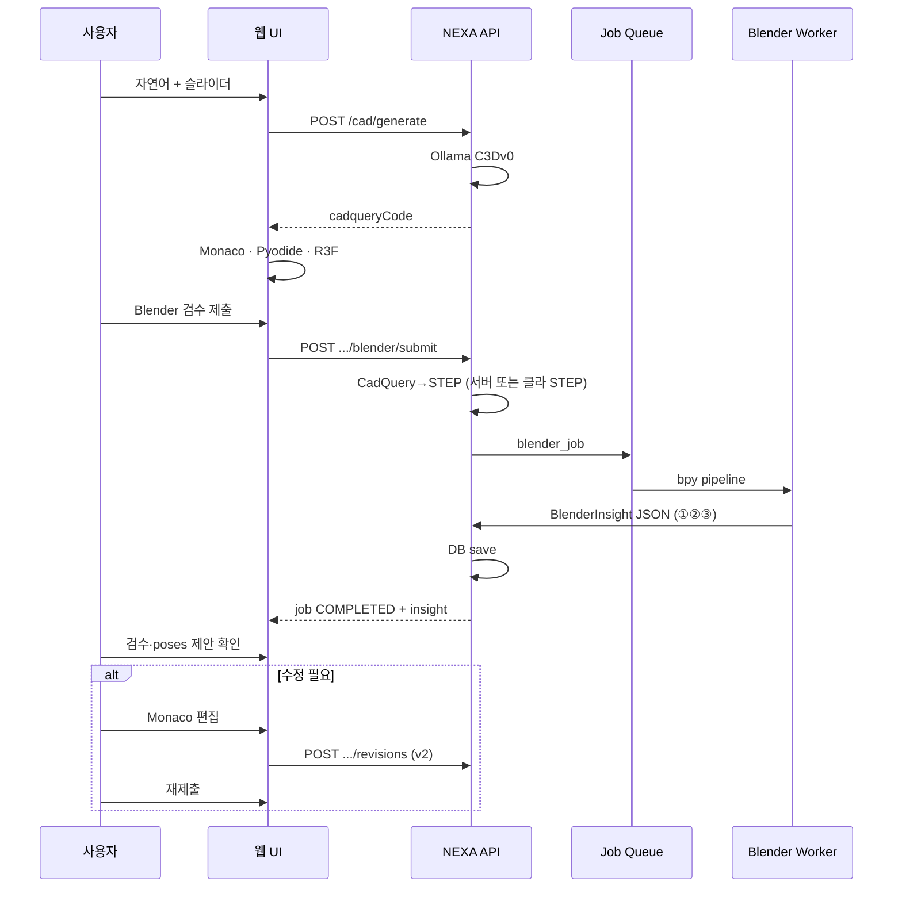

# AI 3D — 웹(CadQuery) 원천 · Blender 백엔드 검수·시뮬레이션 (라인 시나리오)

> **⛔ archived (2026-06-13):** **Phase 2+** Generator · MVP 7탭 P0 밖 · **SSOT ✗**
> **대체:** [TDD-010](../08_TDD_NEXIA_구조기술스택운영방침.md) · [AI협력 파이프라인 (archived)](./08_TDD_NEXIA_AI협력제네레이터파이프라인.md)


**한 줄:** **원천(SoT) = 웹 CadQuery**. Blender는 **메시 형상을 수정하지 않고** STEP을 읽어 **허용 영역**(§2.1) — **A** 조립·리깅(X,Y,Z·회전) · **B** 물리(질량·힌지·모터) · **C** 시각화(조명·카메라·재질, 렌더만) — 만 다룬 뒤 **JSON**으로 DB에 올린다.

> 형제: [`AI 3D 제네레이터.md`](./08_TDD_NEXIA_AI3D제네레이터.md) · [`AI VIDEO 제너레이터.md`](./08_TDD_NEXIA_AIVIDEO제네레이터.md) · [`NEXIA 주요 외부 엔진들과 아키텍쳐.md`](../08_TDD_NEXIA_외부엔진및아키텍처.md)

---

## 1. 두 층 구조 (왜 나누는가)

| 층 | 위치 | 역할 | 속도 | 정확도 |
|----|------|------|------|--------|
| **웹 (원천)** | 브라우저 + 플랫폼 API | CadQuery **코드**·AI·협업·가벼운 3D | ⚡ 즉시 | 설계 의도·대략 치수 |
| **Blender (계산)** | **플랫폼 Blender Worker** (+ 애드온은 JSON 전송만) | STEP **import only** · 간섭·포즈·물리 **JSON 추출** | 🐢 큐 | **조립·시뮬 수치** |

- **브라우저 Pyodide** = 형상 편집·R3F (SoT)  
- **Blender** = **메시 편집기가 아님** — bpy/애드온으로 **데이터만** 회귀 (§2)  
- 사용자 PC Blender + NEXA 애드온: **형상 수정 후 업로드 ❌** — Worker와 동일하게 **JSON push만** (선택)

```
┌─────────────────────────────────────────────────────────────┐
│  NEXA 웹 (React + Monaco + Pyodide + R3F)                     │
│  · partId / revisionId · CadQuery 코드(SoT) · Yjs              │
└───────────────────────────┬─────────────────────────────────┘
                            │ HTTPS (자산·job만)
                            ▼
┌─────────────────────────────────────────────────────────────┐
│  NEXA 플랫폼 API + Asset Store + Job Queue                   │
│  · STEP/glTF · revision 메타 · Rivet/Ethos                     │
└───────────────────────────┬─────────────────────────────────┘
                            │ 내부망
                            ▼
┌─────────────────────────────────────────────────────────────┐
│  Blender Worker Pool (Docker, blender --background)          │
│  · bpy 스크립트 · 템플릿 .blend · ffmpeg                      │
└─────────────────────────────────────────────────────────────┘
```

---

## 2. 절대 원칙 — Blender에서 3D 형상(메시)을 직접 수정하지 않는다

| ✅ Blender가 하는 일 (§2.1) | ❌ Blender에서 하지 않는 일 |
|---------------------|---------------------------|
| STEP **import** (read-only) | 버텍스·Boolean 등 **형상(메시) 편집** |
| **A** 조립·리깅 — 위치·회전·조립 트리 | 간섭을 메시로 “깎아” 해결 |
| **B** 물리 — Mass · Hinge · 모터 테스트 | 변형 메시를 SoT로 **역전송** |
| **C** 시각화 — 조명·카메라·금속/플라스틱 쉐이더 | CadQuery **자동 덮어쓰기** |
| **`BlenderInsight` JSON** (+ 선택 turntable) | 수정 glTF/STEP **공식 revision** 승격 |

**형상이 틀리면:** Blender가 고치지 않음 → JSON(간섭 FAIL 등) + 웹 검수 UI → 사용자가 **Monaco CadQuery** 수정 → 새 `revision` → Blender **재계산**.

**애드온(플러그인) 위치:** 로컬 Blender UI는 **계산·전송 도구**일 뿐. 「저장 → NEXA 업로드」는 **`BlenderInsight` JSON** 만 — 메시 diff 업로드 파이프는 **채택하지 않음**.

### 2.1 Blender의 정당한 역할 (허용 영역)

Blender는 **씬(Scene) 연산·표현** 전용이다. 메시 **토폴로지·치수**는 웹 CadQuery가 담당하고, Blender는 아래 세 영역만 **합법적으로** 다룬다.

```
┌─────────────────────────────────────────────────────────┐
│  웹 CadQuery SoT — 부품 형상(솔리드) 정의                  │
└───────────────────────────┬─────────────────────────────┘
                            │ STEP (frozen mesh)
                            ▼
┌─────────────────────────────────────────────────────────┐
│  Blender 허용 영역 (씬만)                                │
│  A. 조립·리깅  B. 물리 시뮬  C. 시각화 레이아웃            │
└───────────────────────────┬─────────────────────────────┘
                            │ BlenderInsight JSON (+ 선택 PNG)
                            ▼
┌─────────────────────────────────────────────────────────┐
│  웹 — ①②③ DB · 조립코드 제안 · 검수 · Video(렌더만)        │
└─────────────────────────────────────────────────────────┘
```

#### A. 조립 및 리깅 (Assembly & Rigging)

| 허용 | 금지 (형상 편집) |
|------|------------------|
| 부품 **오브젝트** 위치 **X, Y, Z** | 버텍스 드래그로 간섭 “깎기” |
| 회전 각도 (Euler / Quaternion) | Boolean·Solidify로 부품 형상 변경 |
| 부모-자식 **Empty** · 조립 트리 (인스턴스 계층) | 메시를 리깅 **본(Bone)** 으로 변형해 형상 변경 |
| 스냅·정렬·복제 **인스턴스** (동일 partRevision) | STEP/glTF **수정본**을 공식 자산으로 업로드 |

- **의미:** “어디에·어떤 각도로 놓였는가” → JSON **`poses`** (§3.3).  
- **리깅:** 힌지·모터 테스트용 **축(Empty) 위치·방향**은 `physics.constraints[]`에 기록 (§3.4) — **메시 스킨 변형 리깅은 대상 아님**.

**Worker/애드온 예:** `object.location`, `object.rotation_euler` 읽기 → `poses.instances[]` · 조립 트리 `parentId`.

#### B. 물리 시뮬레이션 (Physics)

| 허용 | JSON 반영 |
|------|-----------|
| 부품별 **질량(Mass)** · 마찰·반발(선택) | `physics.bodies[].massKg` |
| **힌지(Hinge)** · 슬라이더·고정 등 **제약(Constraints)** | `physics.constraints[]` |
| **모터 구동** (목표 각도·토크·RPM·테스트 시간) | `physics.motorTests[]` |
| Rigid Body **베이크** · 접촉·안정화 판정 | `physics.summary`, `physics.samples` |

- **의미:** “놓인 뒤 **움직이면** 어떻게 되는가” → JSON **`physics`** (§3.4).  
- **금지:** 시뮬 결과로 **메시 변형**을 SoT로 제출 · Cloth/Fluid로 **형상 자체**를 최종 제품으로 승격.

**전형 시나리오:** 서보모터 힌지 90° 구동 · 진동·이탈 여부 · 최종 정지 각도 → `poses` 최종 프레임와 정합.

#### C. 시각화 레이아웃 (Visualization — 렌더 전용)

| 허용 | 웹 회귀 범위 |
|------|-------------|
| **조명** 배치 (HDRI, Area, Sun) | **렌더 job 메타만** — CadQuery **미반영** |
| **카메라** 구도·FOV·애니 경로 (turntable) | `visualization.camera` (선택 JSON) · PNG/MP4 |
| **재질 쉐이더** (금속·플라스틱·마감) | **프리뷰·마케팅용** — §3.6 |

- **의미:** “어떻게 **보여줄 것인가**” — **형상 데이터가 아님**.  
- **금지:** “Blender에서 금속으로 보이게 **깎았다**”는 이유로 CadQuery 재질·치수 변경을 **자동 연동**하는 것.

**웹 소비:** Physis 검수 썸네일 · [`AI VIDEO`](./08_TDD_NEXIA_AIVIDEO제네레이터.md) turntable · Cockpit 마케팅 승인 — **Monaco 코드에는 들어가지 않음**.

#### 2.1.1 허용 영역 ↔ JSON 매핑

| 허용 영역 | BlenderInsight 필드 | 웹 CadQuery 반영 |
|-----------|---------------------|------------------|
| A. 조립·리깅 | `assembly`, `poses` | **반영** (배치·조립 파라미터) |
| B. 물리 | `physics` | **반영** (질량·제약·시뮬 판정) |
| C. 시각화 | `visualization` (선택) | **미반영** (미디어·렌더만) |

---

## 3. Blender → 웹 — `BlenderInsight` JSON (3종 + 시각화)

Blender Worker(또는 애드온)가 job 완료 시 **한 덩어리 JSON**을 플랫폼 API → **DB** (`blender_insights` 테이블 등)에 저장. 웹은 polling/WebSocket 후 **수치·플래그만** 소비.

### 3.1 구조 개요

```text
[웹] cadqueryCode → STEP
        ↓
[Blender] import STEP (frozen mesh, no edit ops)
        ↓ compute only
        ├─ ① assembly   → interference (A)
        ├─ ② poses      → X,Y,Z · rotation (A)
        ├─ ③ physics   → mass · hinge · motor (B)
        └─ (선택) visualization → camera · lights · materials (C, 렌더만)
        ↓
POST .../blender/jobs/{id}/insight  (or embedded in job COMPLETED)
        ↓
[DB] BlenderInsight { revisionId, jobId, ... }
        ↓
[웹] 검수 패널 · globals/조립 코드 반영 · Rivet/Ethos · Video
```

### 3.2 ① 조립 성공 여부 (간섭 체크)

```json
{
  "assembly": {
    "success": false,
    "toleranceMm": 0.1,
    "collisions": [
      { "a": "bracket_rev3", "b": "shaft_rev1", "penetrationDepthMm": 0.35, "worldPoint": [12.1, 4.0, 8.2] }
    ],
    "clearances": [
      { "a": "cover_rev2", "b": "housing_rev1", "minDistanceMm": 0.82 }
    ],
    "notes": "3 pairs checked, 1 collision"
  }
}
```

| 필드 | 웹 처리 |
|------|---------|
| `success` | `false` → **APPROVED 차단** · 검수 패널 빨강 |
| `collisions[]` | Monaco 주석·AI 수정 제안 · R3F에서 **쌍 하이라이트** (좌표만, 메시 변경 없음) |
| `clearances[]` | WARN 임계 · Ethos 리포트 |

### 3.3 ② 물체 최종 위치 / 각도

조립·스냅·Rigid Body **안정 후** 각 인스턴스의 **월드 변환** (형상 바디는 그대로, **배치만** 결과).

```json
{
  "poses": {
    "coordinateUnit": "mm",
    "angleUnit": "deg",
    "frame": "world",
    "instances": [
      {
        "instanceId": "inst_bracket_01",
        "partRevisionId": "rev_bracket_v3",
        "matrix": [1, 0, 0, 0, 0, 1, 0, 0, 0, 0, 1, 0, 120.5, 0, 45.2, 1],
        "eulerDeg": [0, 0, 90],
        "location": [120.5, 0, 45.2]
      }
    ]
  }
}
```

| 웹 처리 | 설명 |
|---------|------|
| **CadQuery 조립 코드** | `poses.instances` → `cq.Assembly` / 배치 인자·`globals` 제안 (사용자 확인 후 Monaco 저장) |
| **R3F** | 동일 mesh에 **matrix만** 적용해 조립 프리뷰 (Pyodide mesh + JSON pose) |
| **BOM·라벨** | instanceId ↔ partRevisionId 매핑 테이블 |

형상 메시는 웹 Pyodide가 계속 SoT — Blender는 **“어디에 놓였는지” 숫자만** 준다.

### 3.4 ③ 시뮬레이션 물리 결과 (B — Mass · Hinge · Motor)

```json
{
  "physics": {
    "simType": "rigid_body",
    "success": true,
    "durationSec": 5.0,
    "fps": 60,
    "gravity": [0, 0, -9.81],
    "bodies": [
      { "instanceId": "inst_arm_01", "massKg": 0.12, "friction": 0.5 },
      { "instanceId": "inst_base_01", "massKg": 2.4, "friction": 0.6 }
    ],
    "constraints": [
      {
        "type": "hinge",
        "instanceId": "inst_arm_01",
        "pivotWorld": [0, 0, 10],
        "axisWorld": [0, 1, 0],
        "limitDeg": { "min": -10, "max": 95 }
      }
    ],
    "motorTests": [
      {
        "constraintRef": 0,
        "targetAngleDeg": 90,
        "torqueNm": 0.5,
        "durationSec": 2.0,
        "passed": true,
        "maxOvershootDeg": 1.2
      }
    ],
    "summary": {
      "settled": true,
      "contactCount": 12,
      "maxLinearVelMps": 0.42
    },
    "samples": [
      { "t": 0.0, "instances": [{ "instanceId": "inst_arm_01", "location": [0,0,10], "eulerDeg": [0,0,0] }] },
      { "t": 5.0, "instances": [{ "instanceId": "inst_arm_01", "location": [0.1,0,10], "eulerDeg": [0,0,89.5] }] }
    ]
  }
}
```

| 웹 처리 | 설명 |
|---------|------|
| `bodies[]` | 질량·마찰 → 조립/시뮬 **디지털 트윈 메타** (CadQuery `globals` 제안 가능) |
| `constraints[]` | 힌지 축·한계각 — Monaco **조인트 파라미터** 검증 |
| `motorTests[]` | 모터 구동 테스트 **합격/불합격** · Ethos |
| `summary` / `samples` | Video · Aionos 차트 · 최종 `poses`와 각도 정합 |

MVP: `motorTests[0]` + `summary.settled` + 최종 `poses`; 전체 `samples`는 Phase 2.

### 3.5 ② 보강 — 조립·리깅 (A)

`poses`는 §3.3과 동일. 리깅 시 **추가 권장 필드:**

```json
{
  "poses": {
    "instances": [ { "instanceId": "...", "location": [x,y,z], "eulerDeg": [rx,ry,rz], "parentId": null } ],
    "assemblyTree": [
      { "instanceId": "inst_base_01", "parentId": null },
      { "instanceId": "inst_arm_01", "parentId": "inst_base_01" }
    ]
  }
}
```

- `parentId` — 조립 계층만, **본 변형 weights 없음**.

### 3.6 시각화 레이아웃 (C — 선택, 렌더 전용)

```json
{
  "visualization": {
    "camera": {
      "type": "orbit",
      "fovDeg": 45,
      "orbitRadiusMm": 800,
      "elevationDeg": 25,
      "keyframes": [{ "frame": 0, "azimuthDeg": 0 }, { "frame": 36, "azimuthDeg": 360 }]
    },
    "lights": [
      { "type": "sun", "energy": 3.0, "rotationDeg": [45, 0, 30] },
      { "type": "area", "energy": 120, "sizeMm": [200, 200] }
    ],
    "materials": [
      { "instanceId": "inst_housing_01", "preset": "metal_brushed_aluminum" },
      { "instanceId": "inst_cover_01", "preset": "plastic_abs_matte_black" }
    ],
    "renderArtifacts": {
      "turntableZip": "asset://.../turntable.zip",
      "thumbnailPng": "asset://.../hero.png"
    }
  }
}
```

| 항목 | 웹 처리 |
|------|---------|
| `materials[]` | **프리뷰·Video만** — CadQuery 재질 필드 **자동 동기 ❌** |
| `camera` / `lights` | 마케팅 렌더·turntable 재현 |
| `renderArtifacts` | Physis · Video §3.5 TECH_ANIM |

**재질 프리셋 예:** `metal_brushed_aluminum`, `plastic_abs_matte`, `steel_polished`, `glass_clear` — Worker 템플릿 `.blend`에 사전 정의.

### 3.7 통합 페이로드 · API

```json
{
  "schemaVersion": "1.1",
  "partId": "part_abc",
  "revisionId": "rev_v3",
  "jobId": "job_789",
  "computedAt": "2026-05-28T12:00:00Z",
  "assembly": { },
  "poses": { },
  "physics": { },
  "visualization": { },
  "status": "FAIL",
  "statusReason": "assembly.collisions.length > 0"
}
```

- **저장:** `POST /api/v1/cad/blender/insights` 또는 job `COMPLETED` 본문에 포함  
- **조회:** `GET .../revisions/{rev}/blender/insight/latest`  
- **불변:** `revisionId`당 insight 이력 append — 감사·비교

### 3.8 웹 서버 처리 (간단)

```text
Insight 수신
  → DB upsert (revisionId, jobId)
  → Rivet: EthosGuard · NotifyCockpit
  → if !assembly.success → revision.status = BLOCKED
  → if poses → AssemblySuggestionService → Monaco diff 제안 (자동 apply ❌)
  → if physics → MetricsStore · Video simulationSpec 힌트
  → WebSocket → 검수 패널 · R3F pose 갱신
```

### 3.9 이 구조의 장점 (요약)

| 장점 | 설명 |
|------|------|
| **SoT 단일** | 형상은 항상 **웹 CadQuery** — Blender 메시 drift 없음 |
| **충돌 없음** | “Blender에서 고친 mesh” vs “코드” 이중 진실 제거 |
| **가벼운 회귀** | JSON만 오므로 대역·버전·diff가 **코드·수치** 중심 |
| **조립·시뮬 재현** | 같은 STEP + 같은 bpy → 같은 insight (headless) |
| **웹 UX 명확** | FAIL → Monaco 수정 / PASS → poses를 **조립 파라미터**로 반영 |
| **연동 용이** | Aionos·Video·ESPHome이 **숫자 JSON**만 구독 |
| **애드온 단순** | 플러그인은 **export mesh ❌** · `POST insight` 만 |

---

## 4. 마스터 시나리오 — 부품 만들기 → Blender 계산 → 웹 수정 (라운드트립)

### 4.1 전체 생명주기

```text
[1] 웹: 자연어 → Monaco CadQuery (revision v1) → Pyodide/R3F
[2] 「Blender 계산」→ STEP import only
[3] Blender: ①②③ → BlenderInsight JSON → DB
[4] 웹: 검수 패널 — 조립 PASS? · poses 제안 · physics 요약
[5a] PASS → poses 반영(확인 후) · APPROVED · export
[5b] FAIL → Monaco 형상/조립 수정 → v2 → [2] 재계산
```

**SoT:** `cadqueryCode` only. Blender 출력은 **JSON 인사이트** — 메시 역동기 **없음**.

### 4.2 시퀀스 (부품 1개 기준)



---

## 5. 데이터 모델 · 자산 흐름

### 5.1 핵심 엔티티

| 엔티티 | 설명 |
|--------|------|
| `PartProject` | 부품/어셈블리 단위 · `partId` |
| `CadRevision` | `revisionId`, `cadqueryCode`, `monacoRevision`, `author`, `parentRevisionId?` |
| `WebPreview` | Pyodide mesh JSON hash, R3F 스크린샷 (캐시) |
| `CadAsset` | `stepUrl`, `gltfUrl`, `bbox`, `volume` — revision당 1벌 이상 |
| `BlenderJob` | `jobId`, `revisionId`, `pipeline`, `status` |
| **`BlenderInsight`** | **§3 JSON** — `assembly`, `poses`, `physics` (DB SoT for computed facts) |

### 5.2 파일 포맷 (권장)

| 방향 | 포맷 | 이유 |
|------|------|------|
| 웹 → Blender | **STEP** | import only · 형상 동일 |
| Blender → 웹 **(필수)** | **`BlenderInsight` JSON** | §3 ①②③ |
| Blender → 웹 (선택) | turntable PNG | 검수·Video — **메시 변경 없음** |
| Blender → 웹 (비권장 기본) | 수정 glTF/STEP | **채택 안 함** — 원칙 §2 |

### 5.3 revision별 데이터 흐름

```text
cadqueryCode (DB, SoT)
    ├─► Pyodide → R3F (형상 프리뷰)
    ├─► CadQuery runner → STEP (frozen)
    └─► Blender: import only → compute → BlenderInsight JSON → DB
            └─► 웹: poses → R3F matrix / Monaco 조립 제안
```

**STEP 생성 위치 (택일):**

| 방식 | 장점 | 단점 |
|------|------|------|
| **A. 플랫폼 CadQuery runner** (권장) | 브라우저와 **동일 코드** 재현 · STEP 일관 | 서버에 OCP/CadQuery 설치 |
| B. 브라우저 export STEP → 업로드 | 서버 CAD 없음 | 용량·위변조·버전 불일치 위험 |
| C. 하이브리드 | 평소 A, 오프라인은 B | 구현 복잡 |

MVP는 **A** — `blender/submit` 시 플랫폼이 `revision.cadqueryCode`로 STEP 빌드.

---

## 6. Blender 백엔드 — API · bpy 연동

### 6.1 Worker 아키텍처

| 컴포넌트 | 기술 |
|----------|------|
| 컨테이너 | `blender:4.x` headless 이미지 |
| 실행 | `blender -b --python run_job.py -- --job-id ...` |
| 스크립트 | `bpy` + NEXA `scripts/blender/` (import, validate, render, sim) |
| 큐 | Redis/SQS + worker autoscale |
| 스토리지 | S3/MinIO — STEP in, artifacts out |
| 비밀 | Worker는 **Ollama 접근 없음** — STEP만 받음 |

**“Blender API”의 의미 (본 문서):**

- Blender Foundation **REST API가 아님** — **플랫폼이 정의한 HTTP job API** + Worker 내부 **bpy(Python API)**.
- 외부에서 Blender를 직접 제어하지 않음 — **NEXA Job Contract**만 준수.

### 6.2 플랫폼 REST API (웹 ↔ 플랫폼)

| 메서드 | 경로 | 설명 |
|--------|------|------|
| `POST` | `/api/v1/cad/parts` | `partId` 생성 |
| `POST` | `/api/v1/cad/parts/{partId}/revisions` | `{ cadqueryCode, note? }` → `revisionId` |
| `GET` | `/api/v1/cad/parts/{partId}/revisions/{rev}` | 코드·메타·최신 job 요약 |
| `POST` | `/api/v1/cad/parts/{partId}/revisions/{rev}/blender/submit` | Blender job 큐 |
| `GET` | `/api/v1/cad/parts/{partId}/blender/jobs/{jobId}` | 상태 + **`insight`** |
| `GET` | `/api/v1/cad/parts/{partId}/revisions/{rev}/blender/insight/latest` | 최신 ①②③ |
| `GET` | `/api/v1/cad/parts/{partId}/revisions/{rev}/assets/step` | STEP 다운로드 |
| `WS` | `/api/v1/cad/jobs/{jobId}/events` | (선택) 진행률 |

**`blender/submit` 요청:**

```json
{
  "pipeline": "validate_and_preview",
  "options": {
    "renderTurntable": true,
    "turntableFrames": 36,
    "runRigidBodySim": false,
    "exportGltfForWeb": false,
    "thicknessCheckMm": 1.5
  }
}
```

**`pipeline` 프리셋:**

| pipeline | bpy 단계 |
|----------|----------|
| `validate_only` | import → ① assembly JSON |
| `validate_and_preview` | + turntable PNG (optional) |
| `simulate_rigid` | ② poses + ③ physics (mass·hinge·motor) |
| `assembly_and_sim` | ①②③ full insight (MVP 권장) |
| `marketing_preview` | + ③ + **`visualization`** turntable (C) |

**완료 응답:** `insight` = §3.5 통합 페이로드 (`status` = assembly.success ∧ physics.success).

### 6.3 bpy 파이프라인 (Worker 내부)

```text
run_job.py
  1. download STEP → import (NO mesh edit operators)
  2. assembly_check.py → insight.assembly
  3. apply_poses_rig.py → insight.poses (X,Y,Z · rotation · parent)
  4. sim_rigid.py → insight.physics (mass · hinge · motorTests)
  5. [optional] setup_visualization.py → lights · camera · material presets (C)
  5. merge → BlenderInsight JSON → POST DB
  6. [optional] turntable PNG only (read-only viz)
  ※ export_gltf / modified STEP — skip by policy §2
```

**웹에 bpy 직접 노출 ❌** — 보안·결정성·버전 고정.

---

## 7. 웹 UI 로직 (부품 만들고 · 확인하고 · 수정하기)

### 7.1 화면 구성 (3D 제너레이터 확장)

| 영역 | 기능 |
|------|------|
| **Monaco** | CadQuery SoT · AI 생성 · **poses→조립 코드 제안** diff |
| **R3F** | Pyodide mesh + **insight.poses** matrix (형상은 웹 mesh) |
| **검수 패널** | ① 조립 PASS/FAIL · ② poses 테이블 · ③ physics 요약 |
| **액션** | 「Blender 계산」「poses 적용(확인)」「재제출」 |

### 7.2 사용자 플로우 (상세)

**① 부품 만들기 (웹만)**

1. 새 `PartProject` — 이름·재질 메타  
2. 자연어 → `/cad/generate` → Monaco  
3. Ctrl+Run → R3F에서 형상 확인 (수 초 이내)  
4. 만족 시 저장 → `revision v1` 커밋 (자동 또는 「저장」)

**② Blender 검수 제출**

1. 「Blender 검수」— Ethos: 예상 GPU/CPU 시간 표시  
2. 플랫폼: `v1` 코드 → STEP 빌드 → `jobId` 반환  
3. 웹: 진행률 (QUEUED → RUNNING → COMPLETED)  
4. 완료: **insight JSON** — 조립·poses·physics · R3F에 **pose만** 반영  

**③ 실패 시 웹에서 수정**

1. `report.checks` 실패 항목 → Monaco **주석/핀** (AI가 `suggestionsKo` 반영 제안 가능)  
2. Pyodide Run으로 **웹에서 먼저** 재확인  
3. 「revision v2 저장」→ **반드시 새 revision** (v1 STEP은 감사 로그용 보존)  
4. 「재제출」→ 새 `jobId` — Blender는 **항상 최신 revision STEP**만 import  

**④ 통과 후**

- STEP 확정 배지 · 제조 export  
- [`AI VIDEO`](./08_TDD_NEXIA_AIVIDEO제네레이터.md): turntable ZIP → 모드2 TECH_ANIM  
- HYBRID: 모드1 ComfyUI는 **Blender 렌더 PNG**를 레퍼런스로만 (선택)

### 7.3 상태 머신 (Part + Job)

**Revision (웹):**

```text
DRAFT → WEB_PREVIEWED → BLENDER_SUBMITTED → BLENDER_REVIEWED → APPROVED
         ↑______________________________|
              Monaco 수정 시 DRAFT로
```

**BlenderJob:**

```text
QUEUED → RUNNING → COMPLETED | FAILED
```

`FAILED` 시 STEP import 오류·bpy 크래시 — 웹에 로그 tail·「코드 수정 후 재시도」.

---

## 8. Rivet · Ollama · 7탭

| 컴포넌트 | 역할 |
|----------|------|
| **Ollama C3Dv0** | **웹만** — `/cad/generate` · revision 코드 |
| **Rivet** | `ShouldSubmitBlender?` · pipeline 선택 · FAIL 시 Glos 이슈 티켓 |
| **Ethos** | 두께·GPU 시간·승인 · 딥페이크 무관(실제 CAD) |
| **Synapse** | Rivet 그래프 버전 |
| **Glos** | Monaco · (선택) bpy 스크립트 템플릿은 **Worker repo** |
| **Physis** | R3F + 검수 썸네일 · Video handoff |
| **Cockpit** | `marketing_render` pipeline 승인 |

**Rivet 분기 예:**

```text
revision saved
  → if assembly.critical || export.step for manufacturing
       → EthosGuard → SubmitBlender(validate_and_preview)
  → else
       → web only (Pyodide sufficient)
```

---

## 9. 브라우저 Pyodide vs Blender — 역할 정리

| 질문 | 답 |
|------|-----|
| Blender가 mesh 고침? | **❌ 절대 안 함** (§2) |
| Blender가 웹에 주는 것? | **JSON ①②③** only |
| 형상 수정은 어디서? | **웹 Monaco + Pyodide** |
| poses는? | Blender **계산값** → 웹이 **조립 파라미터**로 반영 |
| Video CadQuery 시뮬 | 웹 **형상** 애니 · Blender **물리·조립 숫자** |

---

## 10. 비용 · 보안

| 축 | 웹 | Blender Worker |
|----|-----|----------------|
| 연산 | 클라이언트 Wasm (A) | **CPU/GPU 풀 (C)** — worker 시간 |
| LLM | 플랫폼 Ollama (B) | 없음 |
| 데이터 | 코드·메시 JSON | STEP·blend·렌더 — **감사 로그** |

- Worker 네트워크: **내부망 only** · STEP URL signed short-lived  
- 사용자 `.blend` 다운로드: 권한·워터마크 정책 (Ethos)

---

## 11. MVP vs Phase 2

| MVP | Phase 2 |
|-----|---------|
| 플랫폼 CadQuery→STEP | 클라이언트 STEP 업로드 폴백 |
| pipeline `validate_and_preview` | `simulate_rigid`, Cycles |
| `BlenderInsight` ①②③ + 검수 패널 | physics samples 시계열 · 애드온 JSON-only |
| revision 수동 저장 | Yjs + auto-save revision |
| turntable → Video handoff | 자동 HYBRID 파이프 |
| report → Monaco 주석 AI | 측정 기반 **제안** (자동 merge ❌) |

---

## 12. 구현 체크리스트

1. `BlenderInsight` JSON 스키마 v1 (§3)  
2. DB `blender_insights` + GET latest  
3. CadQuery STEP runner (frozen export)  
4. bpy: `assembly_check` · `poses` · `physics` — **no mesh edit ops**  
5. `/blender/submit` · insight in COMPLETED  
6. 웹 검수 패널 ①②③ · poses → Monaco **제안** (auto-merge ❌)  
7. R3F: Pyodide mesh × insight poses  
8. Rivet · Ethos · (선택) 애드온 JSON push only  

---

## 13. 관련 문서

| 문서 | 연관 |
|------|------|
| [AI 3D 제네레이터.md](./08_TDD_NEXIA_AI3D제네레이터.md) | 웹 Pyodide·R3F·C3Dv0 · §7.2 Video 시뮬 |
| [AI VIDEO 제너레이터.md](./08_TDD_NEXIA_AIVIDEO제네레이터.md) | turntable · TECH_ANIM |
| [WebAssembly 는 무엇인가.md](./WebAssembly%20는%20무엇인가.md) | Pyodide 층 |

---

*상태: v2.1 — 형상 수정 금지 · **허용=A조립·리깅 B물리 C시각화(렌더만)** · JSON ①②③(+visualization).*
---

## 관련 문서

| 관계 | 문서 |
| :--- | :--- |
| 상위 TDD | [AI 3D 제너레이터 (TDD-026)](./08_TDD_NEXIA_AI3D제네레이터.md) |
| 제너레이터 허브 | [AI 협력 제너레이터 파이프라인 (TDD-028)](./08_TDD_NEXIA_AI협력제네레이터파이프라인.md) |
