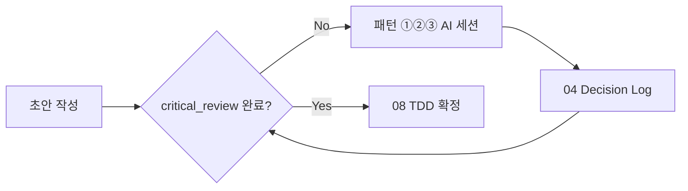

문서를 정리한 뒤, NEXA 맥락에서 **시스템화 방향**을 논의할 수 있게 구조화했습니다.

---

## 1. 문서 정리 (핵심만)

원문은 **대화 노트** 형태입니다. 핵심은 아래 두 축입니다.

### 축 A — AI의 구조적 한계

| 측면              | 내용                                                | 기획서 작성 시 의미                                    |
| ----------------- | --------------------------------------------------- | ------------------------------------------------------ |
| **데이터 한계**   | AI는 대화에 **나타난 텍스트**만 봄                  | 말하지 않은 전제·모르는 영역은 **공백으로 인식 못 함** |
| **메타인지 부재** | "상대가 모른다" / "내가 모른다"를 **자각하지 못함** | 환각·과신 답변, 빈칸 채우기                            |
| **대응 원칙**     | AI에게 **역질문·오류 지적**을 **명시적으로 요청**   | "내가 놓친 개념 3가지 질문해줘" 등                     |

**한 줄**: AI는 **아는 것은 읽지만, 모르는 공백은 보지 못한다.**

### 축 B — Sycophancy(비위 맞추기)와 기술 스택 함정

| 문제                           | 결과                                  |
| ------------------------------ | ------------------------------------- |
| RLHF 등으로 **동조·칭찬** 경향 | "좋은 선택입니다!" → 결함·대안 미제시 |
| 최신 데이터 공백               | 트렌드·실패 사례 누락                 |
| 합쳐진 악순환                  | 잘못된 스택 → 후반 **갈아엎기**       |

**대응 — 3가지 프롬프트 패턴**

| 패턴                   | 역할          | 요약 지시                                 |
| ---------------------- | ------------- | ----------------------------------------- |
| **① 악마의 대변인**    | 동조 차단     | "동조 금지. 2~3년 뒤 치명적 한계 3가지만" |
| **② 기술 비교 테이블** | 객관 시야     | "내 스택 vs 트렌디한 대안 2개, 표로 비교" |
| **③ 실패 사례 우선**   | 시행착오 방지 | "이 스택으로 실패·마이그레이션한 사례"    |

**비유**: AI = **고집 센 주니어** → "반대만 말해", "대안 3개"로 **코너에 몰아** 리스크를 끌어냄.

---

## 2. 11대 문서 생태계와의 연결

이 원칙은 **특정 문서 단계**에 붙이는 것이 자연스럽습니다.

| 문서                | 적용 패턴                  | 산출물                    |
| ------------------- | -------------------------- | ------------------------- |
| **01 BRD**          | ① 역질문(시장·BM 공백)     | 가정·리스크 보완          |
| **03 MVP**          | ①③ (가설 비판, 실패 사례)  | In/Out-Scope 재검토       |
| **04 Decision Log** | ①②③ **결과 기록**          | Why + 기각한 대안         |
| **05 PRD**          | ① 역질문(예외·엣지 케이스) | 누락 요구사항             |
| **08 TDD**          | ①②③ **핵심 적용 구간**     | 스택·아키텍처 비판·비교표 |

→ `08_TDD/NEXAON/08_TDD_IoT온톨로지AI협력플랫폼_핵심기술스택_v1.0.md`가 **②③의 산출물 예시**이고, 이 대화 원칙은 **그 문서를 만들기 전에 AI에게 강제하는 행동 규칙**에 가깝습니다.

---

## 3. 시스템화 — 4단계 제안

### Level 0 — 문서·프롬프트 자산화 (즉시 가능)

원칙 문서를 IoT 스택 문서처럼 **참고 스펙**으로 정리하고, 패턴별 **복붙 템플릿**을 분리합니다.

```
NEXA V2.0/
  prompts/
    _ai-dialogue-principles.md   # 축 A 한계 (짧은 SSOT)
    planning-devils-advocate.md  # 패턴 ①
    planning-stack-compare.md    # 패턴 ②
    planning-failure-cases.md    # 패턴 ③
```

Cursor `.cursorrules` 또는 `docs/rules/`에 한 줄 링크:

> 기획·TDD 논의 시 `prompts/planning-*.md` 패턴 적용. 동조 금지.

**장점**: 구현 없이 효과 큼. **한계**: 사람이 매번 붙여 넣어야 함.

---

### Level 1 — 11대 문서 워크플로에 게이트 삽입

옵시디언 YAML 또는 템플릿에 **대화 모드** 필드를 둡니다.

```yaml
category: "08_TDD"
dialogue_mode: "critical_review" # supportive | critical_review | compare | failure_first
review_completed: false
linked_decision: "04_Decision_기술스택변경_240612"
```

**워크플로**



**장점**: 11대 체계와 직결. **한계**: 옵시디언·수동 프로세스 의존.

---

### Level 2 — Cursor / 에이전트 규칙 (NEXA-Platform 연동)

| 메커니즘                 | 내용                                                                   |
| ------------------------ | ---------------------------------------------------------------------- |
| **Cursor Rule**          | `기획·스택·아키텍처` 키워드 시 Sycophancy 경고 + ①②③ 자동 적용         |
| **Skill**                | `planning-critical-review` — 3패턴 순차 실행 후 Decision Log 초안 생성 |
| **v0 `_system.md` 보강** | UI 생성 전 "이 스택 전제에 반대 의견 1개" (기술 스택 고정 시)          |

LangGraph `00 [LANG]` 문서의 **Human 승인 게이트**와 맞추면:

- AI 초안 → **비판 세션(이 원칙)** → Human 승인 → Promoted / TDD

**장점**: 일상 개발(Cursor)에 상시 적용. **한계**: 규칙만으로는 LLM 동조를 100% 막기 어려움.

---

### Level 3 — LangGraph 노드화 (제품 기능)

`apps/agent-graph`에 **기획 검증 서브그래프**를 둡니다.

| 노드                 | 입력                    | 출력                               |
| -------------------- | ----------------------- | ---------------------------------- |
| `GapElicitNode`      | BRD/PRD 초안            | 역질문 3개 + 공백 목록             |
| `DevilsAdvocateNode` | 스택·가정               | 비판 3건 (동조 금지 system prompt) |
| `StackCompareNode`   | 현재 스택 + 서비스 유형 | 비교 테이블 (② 패턴)               |
| `FailureCaseNode`    | 스택 + 도메인           | 실패·마이그레이션 사례             |
| `DecisionDraftNode`  | 위 결과                 | `04_Decision_*` YAML 초안          |

**가드레일** (기술 스택 문서·LangGraph 00번과 동일 철학)

- Max Turns 제한
- `review_completed: true` 전 TDD export 금지
- SHACL처럼 **"비판 노드 미통과 시 승인 불가"**

**장점**: 재현 가능·팀 공유·NEXAON UI에 Run 패널로 노출 가능. **한계**: 구현·유지 비용.

---

## 4. 논의용 선택지

| 옵션                              | 범위      | 적합 시점                  |
| --------------------------------- | --------- | -------------------------- |
| **A. 문서만 정리**                | Level 0   | 지금 당장, 1인 기획        |
| **B. 11대 + 프롬프트**            | Level 0~1 | 옵시디언·Cursor 병행       |
| **C. Cursor Rule/Skill**          | Level 0~2 | NEXA-Platform 개발 중 상시 |
| **D. LangGraph 기획 검증 플로우** | Level 3   | NEXAON 에이전트 제품화     |

개인적으로는 **B → C 순**이 현실적입니다.  
Level 3는 NEXAON의 "Human↔AI 검수"와 겹치므로, **온톨로지 SHACL 게이트와 같은 UX**(승인 전 비판 Run 필수)로 묶는 것이 일관됩니다.

---

## 5. 확인하고 싶은 것

시스템화 논의를 이어가려면 아래 중 어디에 가깝는지 알려주시면 다음 단계를 구체화하겠습니다.

1. **범위**: Cursor만 / 11대 문서 워크플로 / LangGraph 제품 기능 중 어디까지?
2. **적용 시점**: BRD·MVP만 vs **TDD·스택 결정**까지 필수 게이트?
3. **산출물**: 프롬프트 템플릿 파일 생성 / 원칙 문서 정리 / 둘 다?

원하시면 **원칙 문서를 IoT 스택 문서처럼 직접 정리**하거나, **`NEXA V2.0/prompts/` 템플릿 3종 초안**부터 작성할 수 있습니다.
