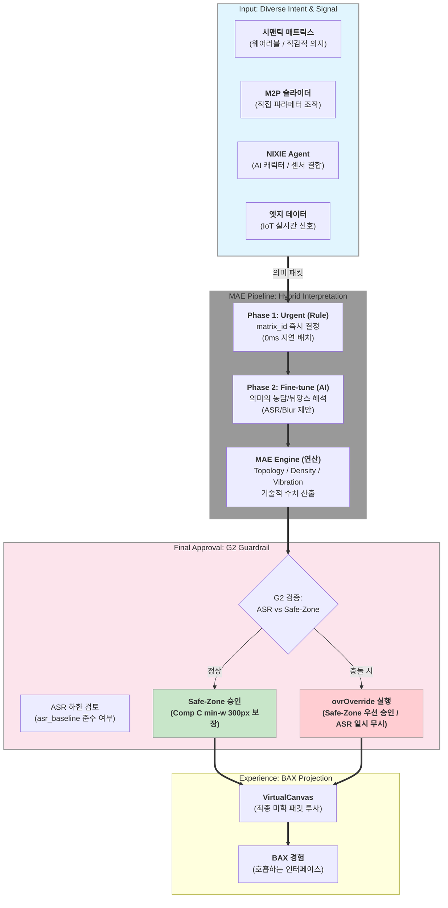

# BAX (Breathing AI Experience) — MVP 개발 사양서 (SSOT)

**BAX** (_Breathing AI Experience_) — **인간의 의지**(M2P·Peripheral)와 **AI의 호흡**(Rule+Ollama)이 결합된 **전체 사용자 경험 브랜드**.  
본 문서는 BAX MVP를 구현하기 위한 **M2P** 프로토콜·**MAE** (_Matrix Aesthetic Engine_) 렌더링 엔진·가드레일 SSOT이다.

```text
BAX  Breathing AI Experience     ← UX 브랜드 (의지 + AI 호흡)
 ├── M2P  Matrix-to-Peripheral   ← 인간 의지 입력 (슬라이더·Serial·WS)
 └── MAE  Matrix Aesthetic Engine ← 3×3 Matrix · ASR · blur 실행 엔진
```

> **문서 유형**: B — MVP 개발 SSOT (Functional Requirements · API · Matrix 중심)  
> **버전**: 0.6 · **상태**: Draft  
> **관련**: NEXA OS V2.1 [`_NEXA-OS-V2.1-설계-표준-및-미션크리티컬-전략-보강본.md`](./_NEXA-OS-V2.1-설계-표준-및-미션크리티컬-전략-보강본.md) — **별도 실험 앱** (`apps/bax-demo` 권장). 장기 흡수 후보: `nexage` content 실험 탭.

| 약어              | 의미                                                                                                          |
| ----------------- | ------------------------------------------------------------------------------------------------------------- |
| **BAX**           | **Breathing AI Experience** — 인간의 의지와 AI 호흡이 결합된 **전체 사용자 경험 브랜드**                      |
| **MAE**           | **Matrix Aesthetic Engine** — BAX를 3×3 Matrix·OVR·blur·진동으로 **구현하는 UI 엔진** (§2.3)                  |
| **M2P**           | Matrix-to-Peripheral — BAX 내 디스플레이(3×3 Matrix) ↔ 조작 장치(Peripheral) 미학 패킷                       |
| **ASR**           | **Aesthetic Space Ratio (마학적 공간율)** — 모드·뷰포트·가드레일이 정하는 **void_ratio 하한** (고정 75% 아님) |
| **VirtualCanvas** | 픽셀이 아닌 **위상·농담·진동**으로 정의한 BAX 단일 페이지 캔버스                                              |

---

---

### **BAX 아키텍처 데이터 흐름 다이어그램**

**인간의 직감적 의지(시맨틱 매트릭스)**와 **시스템의 물리적 신호(엣지 데이터)**가 수렴하여 **MAE(Matrix Aesthetic Engine)**를 통해 감각적인 호흡으로 발현되는 과정을 논리적으로 시각화합니다.



---

## 0. MVP 한 줄 · 범위

**검증 질문**: BAX 경험에서 슬라이더(의지)·가상 센서·(선택) Ollama(AI 호흡)가 **`matrix_id` · `void_ratio` · `focus_blur`** 를 MAE에 내리면, **3×3 주소 기반 UI**가 **≤300ms** easing으로 호흡(수축/이완)하는가?

| In scope (MVP)                               | Out of scope (MVP)                     |
| -------------------------------------------- | -------------------------------------- |
| 단일 SPA · 컴포넌트 A/B/C 3종                | 다페이지 · `domainLayoutRegistry` 전체 |
| **BAX 운영 모드** 4종 + 수동 전환            | nexage 전역 기본값 강제                |
| **ASR** · 뷰포트 밀도 적응 (기본)            | 전 해상도 픽셀 단위 여백 보장          |
| 웹 슬라이더 = Peripheral 대체                | 전용 M2P 하드웨어 대량 생산            |
| 가상 센서 1종 + **Rule→AI 2단계** 하이브리드 | 다중 IoT · SSE · Grade3 제어           |
| **Sparkline** (V1 진동) · Circuit Gate       | 오디오 vibration (V3)                  |
| CSS `backdrop-filter` · Framer/GSAP          | 오디오 레이어 · WCAG 실운영 인증       |

---

## 1. 설계 원칙 (Philosophy )

**명제**: _여백은 자신감이다._ — IoT 관제에서 정보 과부하를 **여백·깊이·선명도**로 통제한다. **BAX**는 운영자 **의지**(M2P)와 **AI 호흡**(Rule+Ollama)이 만나는 UX 브랜드이며, **MAE**가 Matrix·OVR·blur를 실행한다.

| 원소                 | SSOT 변수                                          | MVP 역할                                          |
| -------------------- | -------------------------------------------------- | ------------------------------------------------- |
| **위상 (Topology)**  | `matrix_id` (9칸)                                  | 컴포넌트 주소·z-index·blur 기본값                 |
| **농담 (Density)**   | `void_ratio` · **ASR** (적정여백율)                | 모드·뷰포트별 **하한** — 상한 100 · §2.5·§2.6     |
| **진동 (Vibration)** | §**2.7** — sparkline · micro-motion · (후속) audio | 시각적 **맥박** — Circuit Open 시 **최우선 차단** |

#### 컴포넌트 객체 속성 체계

모든 UI 노드는 **Depth × Mutability × Priority** 3축 메타데이터로 분류한다. `matrix_id`(§2.1)는 **Depth + X(좌/중/우)** 를 주소로 고정한다.

**① 축 정의**

| 축       | 속성명 (코드) | 값           | 설명                                     |
| -------- | ------------- | ------------ | ---------------------------------------- |
| **공간** | `depth`       | `BG`         | 원경 — blur↑ · opacity↓ · 구도·질감      |
|          |               | `MID`        | 중경 — blur 중간 · 맥락·보조 정보        |
|          |               | `FG`         | 근경 — blur 0 · **ESSENTIAL** 가독 정보  |
| **시간** | `mutability`  | `IMMUTABLE`  | 불변 뼈대 — Giant/Micro 등 레이아웃 골격 |
|          |               | `MUTABLE`    | 가변 — IoT 값·`matrix_id` 스위칭 대상    |
| **가치** | `priority`    | `ESSENTIAL`  | 본질 정보 — 경고·핵심 수치 (Comp C)      |
|          |               | `CONTEXTUAL` | 맥락 — 보조 라벨·단위                    |
|          |               | `TEXTURE`    | 시각 질감 — 장식·노이즈 (Comp A/B)       |

**② MVP 컴포넌트 매핑**

| 컴포넌트              | `depth` | `mutability` | `priority` | `matrix_id` (초기)     | 비고                                            |
| --------------------- | ------- | ------------ | ---------- | ---------------------- | ----------------------------------------------- |
| **Comp A** (Giant)    | BG      | IMMUTABLE    | TEXTURE    | BG-L                   | 15vw · opacity 5% · blur 40px                   |
| **Comp B** (Micro)    | FG      | IMMUTABLE    | TEXTURE    | (frame)                | 6px monospace — **데모 전용**                   |
| **Comp C** (IoT Card) | FG → FG | MUTABLE      | ESSENTIAL  | FG-R → **FG-C** (경고) | **min-w 300px** · sparkline(V1) · Entropy Brake |

**③ 타이포그래피 프리셋 (속성 조합 SSOT)**

| 프리셋               | `depth` | `mutability` | `priority` | 시각 규격               | 역할                              |
| -------------------- | ------- | ------------ | ---------- | ----------------------- | --------------------------------- |
| **Micro-Typography** | FG      | IMMUTABLE    | TEXTURE    | ~6px monospace · blur 0 | 프레임 격자·노이즈 질감 (G1 극소) |
| **Giant-Typography** | BG      | IMMUTABLE    | TEXTURE    | ~15vw · opacity ~5%     | 구도 무게중심·여백 균형 (G1 극대) |

> **G1 (극단적 대비)**: `priority=TEXTURE`는 Giant·Micro만 허용. `ESSENTIAL`은 **FG + MUTABLE**만 `matrix_id` 변경 가능 (G3).

**가드레일 5조** (코드 강제 — LLM은 *제안*만):

| #   | 규칙                                                                                                                                            | 구현                                                      |
| --- | ----------------------------------------------------------------------------------------------------------------------------------------------- | --------------------------------------------------------- |
| G1  | **극단적 대비** — Giant·Micro만, 중간 크기 카드 면적 ≤20%                                                                                       | `guardrails/sizePolicy.ts`                                |
| G2  | **ASR + Safe-Zone** — `void_ratio ≥ asr_baseline` (**미학 하한**) **및** Comp C **물리 최소 크기** — **충돌 시 Safe-Zone 우선** (§2.6.1·§2.6.4) | `ovrPolicy.ts` · `readabilitySafeZone.ts`                 |
| G3  | **Entropy Brake** — 동시 `matrix_id` 변경 MUTABLE ≤ **1** / tick                                                                                | `entropyBrake.ts`                                         |
| G4  | **Matrix 점유** — 동일 `matrix_id` 겹침 시 z-index·인접 셀 분산                                                                                 | `matrixOccupancy.ts` — §2.8                               |
| G5  | **진동 차단** — `circuitState !== 'closed'` → Vibration 계층 **전면 OFF**                                                                       | `vibrationGate.ts` — §2.7 · NEXA `TELEMETRY_CIRCUIT_OPEN` |

---

## 2. 3×3 Aesthetic Matrix 구조

M2P(Matrix-to-Peripheral) 프로토콜의 핵심 구성 요소인 **매트릭스(Matrix)**는 단순히 시각적인 틀을 넘어, **3×3 그리드 기반의 9칸 주소 체계**로 정의된 지능형 레이아웃 시스템입니다.

이 매트릭스의 물리적 형태와 시각적 구성은 다음과 같습니다.
AM 전체 화면을 **가로 3칸(L, C, R) × 세로 3개 층(BG, MID, FG)**으로 나눈 총 9개의 고유한 주소(Matrix ID)로 이루어져 있습니다.

| 구분           | L (좌)              | C (중)               | R (우)               |
| :------------- | :------------------ | :------------------- | :------------------- |
| **FG (근경)**  | FG-L                | **FG-C (경고 격상)** | FG-R (기본 IoT 카드) |
| **MID (중경)** | MID-L (기본 위치)   | MID-C                | MID-R                |
| **BG (원경)**  | BG-L (Giant 타이포) | BG-C                 | BG-R                 |

이 구조는 **CSS Grid 3×3**과 레이어별 포지셔닝 및 `z-index`를 결합하여 구현됩니다.

### 시각적 속성: 층(Depth)에 따른 차별화

각 매트릭스 칸은 해당 층의 깊이에 따라 선명도와 투명도가 다르게 설정되어 '호흡'하는 느낌을 줍니다.

- **FG (Foreground, 근경)**: **Blur 0px, Opacity 1.00, z-index 10**. 가장 선명하며 본질적인 정보(ESSENTIAL)를 담는 영역입니다.
- **MID (Middle, 중경)**: **Blur 10px, Opacity 0.40, z-index 5**. 맥락이나 보조 정보를 담으며 부드러운 흐림 효과가 적용됩니다.
- **BG (Background, 원경)**: **Blur 40px, Opacity 0.05, z-index 1**. 구도나 질감을 형성하는 배경 요소들이 배치됩니다.

### 의미론적 구성: 3×3 시맨틱 매트릭스

대화 내용에서 강조된 것처럼, 이 매트릭스는 기술적 좌표를 넘어 인간의 직감과 연결된 **시맨틱 축**을 가집니다.

- **축(Axis)**: 장(Field, 위상), 강도(Magnitude, 농담), 시공간성(Temporal, 진동).
- **층(Layer)**: 신호(Signal, 발생), 맥락(Context, 관계), 투사(Projection, 미래).

M2P의 매트릭스는 **" 위상(Topology)·농담(Density)·진동(Vibration)으로 정의된 VirtualCanvas"**로, 인간의 의지를 시각적 공간에 투사하기 위한 정교한 9칸의 지도.

### 2.1 Matrix ID — 9칸 SSOT

| Matrix ID | Z   | X   | blur (px) | opacity | z-index | 용도 (MVP)             |
| --------- | --- | --- | --------- | ------- | ------- | ---------------------- |
| **BG-L**  | BG  | L   | 40        | 0.05    | 1       | Giant 타이포 (Comp A)  |
| **BG-C**  | BG  | C   | 40        | 0.05    | 1       | (예비)                 |
| **BG-R**  | BG  | R   | 40        | 0.05    | 1       | (예비)                 |
| **MID-L** | MID | L   | 10        | 0.40    | 5       | 경고 전 카드 기본      |
| **MID-C** | MID | C   | 10        | 0.40    | 5       | (예비)                 |
| **MID-R** | MID | R   | 10        | 0.40    | 5       | (예비)                 |
| **FG-L**  | FG  | L   | 0         | 1.00    | 10      | (예비)                 |
| **FG-C**  | FG  | C   | 0         | 1.00    | 10      | **경고 격상** 목표     |
| **FG-R**  | FG  | R   | 0         | 1.00    | 10      | IoT 카드 (Comp C) 기본 |

**Grid**: CSS Grid 3×3 + 레이어볔 `position` / `z-index`. 주소 변경 = `matrix_id` → `MatrixStyles[id]` + layout cell. **동일 셀 다중 점유** → §2.8.

### 2.2 상태 변수 SSOT

| 변수             | 타입  | 범위                              | 설명                                                                                   |
| ---------------- | ----- | --------------------------------- | -------------------------------------------------------------------------------------- |
| `void_ratio`     | int   | 0–100                             | 현재 공백률 — **≥ `asr_baseline`** (단, Safe-Zone 충돌 시 **일시 하회** 가능 — §2.6.4) |
| `asr_baseline`   | int   | —                                 | **적정여백율 하한** — `resolveOvrFloor(bax_mode, viewport_band)` (런타임)              |
| `bax_mode`       | enum  | §2.5                              | **BAX** 운영 모드 — 사용자 선택 또는 이벤트 자동 전환 · MAE preset 입력                |
| `viewport_band`  | enum  | `xl` \| `md` \| `sm`              | `ResizeObserver` 기준 밴드 — Topology 스케일·OVR 보정                                  |
| `canvas_scale`   | float | 0.85–1.15                         | VirtualCanvas 위상 스케일 — `--bax-canvas-scale`                                       |
| `margin_ratio`   | int   | 0–100                             | M2P — 여백 수축/이완 (≈ padding scale)                                                 |
| `focus_blur`     | int   | 0–100                             | FG 외 레이어 blur 강도 스케일                                                          |
| `mid_blur_px`    | int   | 0–40                              | MID 레이어 `backdrop-filter` px                                                        |
| `light_source_x` | int   | 0–100                             | 그림자 각도 X                                                                          |
| `light_source_y` | int   | 0–100                             | 그림자 각도 Y                                                                          |
| `hybrid_phase`   | enum  | `urgent` \| `fine_tune`           | Rule+AI 2단계 반영 — §2.9                                                              |
| `circuit_state`  | enum  | `closed` \| `open` \| `half_open` | NEXA `healthWatchdog` 연동 — §2.7 G5                                                   |

**CSS 전달**: `:root` CSS variables — `--bax-void-ratio`, `--bax-mid-blur`, …

### 2.3 MAE 엔진 데이터 흐름 (BAX 실행 파이프라인)

```text
[Peripheral]  슬라이더 | WebSocket | Web Serial
[UI]          bax_mode selector → useBaxStore | (NEXA) userSettingsStore
[Viewport]    ResizeObserver → viewport_band
       │
       ▼
[VirtualSensor]  mock tick
       │
       ├──(수동)──► BaxState + mode preset
       │
       └──(자동)──► hybridEvaluate(data)  [intelligent · §2.9]
                      ├── Phase 1 urgent: ruleEngine → matrix_id (즉시)
                      └── Phase 2 fine_tune: Ollama → void/blur (지연 허용)
       ▼
[Pipeline]  vibrationGate(circuit_state)     # G5 — sparkline/micro OFF 우선
         → matrixOccupancy.resolve()        # G4
         → resolveOvrFloor + readabilitySafeZone  # G2
         → densityAdaptive
         → runGuardrails (G1–G5)
         → applyAestheticState + canvas_scale
       ▼
[VirtualCanvas]  MatrixStyles · 300ms transition
```

### 2.4 M2P 프로토콜 (MVP)

**Transport 우선순위**: ① 웹 슬라이더 (내장) → ② WebSocket `ws://localhost:*` → ③ Web Serial (Arduino)

**패킷 (JSON, 10–30 Hz 권장)**:

```json
{
  "v": 1,
  "source": "peripheral" | "sim-slider",
  "ts": 1710000000000,
  "margin_ratio": 42,
  "focus_blur": 18
}
```

| 필드           | 타입   | 필수 | 설명             |
| -------------- | ------ | ---- | ---------------- |
| `v`            | int    | ✓    | 스키마 버전      |
| `source`       | string | ✓    | 송신원           |
| `margin_ratio` | 0–100  | ✓    | User-Driven 호흡 |
| `focus_blur`   | 0–100  | ✓    | blur 스케일      |

**Data-Driven (Display → Peripheral, MVP stub)**: 경고 시 `{ "haptic": "pulse", "freq_hz": 2 }` — 하드웨어 없으면 UI 배지만.

**지연 목표**: Peripheral → 화면 반영 **p95 ≤ 50ms** (Zero-latency는 **비목표**).

### 2.5 BAX 운영 모드 (BaxOperationMode)

정보 성격·관리자 목적에 따라 **BAX 미학 기본값**을 묶은 프리셋. MAE 엔진이 preset을 소비한다. MVP는 **수동 선택** + **이벤트 자동 전환**(온도 급증 등)을 지원한다.

| `bax_mode`      | UI 라벨           | 핵심 전략                           | 기본 매개변수 (예시)                                         | `asr_baseline` (기본) |
| --------------- | ----------------- | ----------------------------------- | ------------------------------------------------------------ | --------------------- |
| `meditation`    | **명상/여백**     | 정보 최소화 · 호흡 극대화           | `void_ratio` 85–90 · `focus_blur` 높음 · `mid_blur_px` 20–40 | **85**                |
| `dense_monitor` | **밀집/모니터링** | 다중 지표 동시 관찰                 | `void_ratio` ASR 하한 · `mid_blur_px` 낮음(0–8)              | **75**                |
| `contextual`    | **관계/맥락**     | FG vs MID 대비 · `priority` 축 강조 | `matrix_id` 전환 허용 ↑ (G3 한도 내) · MID opacity↑          | **78**                |
| `intelligent`   | **인텔리전트**    | Ollama/ruleEngine이 상황별 제안     | `MaeDecision` 가변 · 실패 시 `dense_monitor` fallback        | **75** (동적 clamp)   |

**모드 전환 SSOT**

```text
[사용자] DevController · 설정 UI
    → useBaxStore.setMode(bax_mode)          # apps/bax-demo

[NEXA 흡수 시]
    → userSettingsStore.baxOperationMode     # 영속 preference
    → useLayoutStore.baxMode (런타임)        # 도메인 전환 시 유지 여부 정책

[자동] ruleEngine | sensor event
    예: temp ≥ critical → dense_monitor (또는 intelligent if Ollama on)
    예: alarm cleared 5min → meditation (선택 · userSettingsStore.autoBaxMode)
```

> **G3 연동**: `contextual` 모드는 tick당 MUTABLE `matrix_id` 변경 **상한 2**까지 완화 가능 — MVP는 **1** 유지, 흡수 시 플래그 `contextualRelaxedEntropy`.

### 2.6 반응형 — ASR · 밀도 적응 · VirtualCanvas 스케일

**문제**: “시각적 75%”는 해상도·DPI·창 크기에 의존 — **고정 % 금지**, **ASR + 적응**으로 대응.

> **sm(모바일) 정보 영역 좁음**은 **ASR 65% 절대 하한만으로 해결되지 않는다.** `void_ratio`는 **여백 %**이므로 ASR 65%는 “콘텐츠가 차지할 수 있는 면적 ≈ **35%**”까지 허용하는 **미학 하한**이다. sm에서 실제 가독성은 **§2.6.2 밀도 적응** + **§2.6.4 Safe-Zone(픽셀 하한)** 이 담당하며, 두 규칙이 충돌하면 **Safe-Zone > ASR %** (§2.6.4).

#### 2.6.1 `resolveOvrFloor(mode, viewport_band)`

| `viewport_band` | 조건 (innerWidth) | ASR 보정                                 | 밀도 적응                                         |
| --------------- | ----------------- | ---------------------------------------- | ------------------------------------------------- |
| `xl`            | ≥ **1280**        | `mode.asr_baseline` 그대로               | Comp B(Micro) 표시                                |
| `md`            | 768–1279          | **−2** (예: 75→73)                       | Micro opacity 50%                                 |
| `sm`            | < **768**         | **−5** (예: 75→**70**, 하한 **65** 절대) | **Comp B 숨김** · Giant scale↓ · Safe-Zone §2.6.4 |

**`OVR_ABSOLUTE_MIN = 65`의 역할 (오해 방지)**

| 구분               | 설명                                                                                       |
| ------------------ | ------------------------------------------------------------------------------------------ |
| **역할**           | 어떤 모드·밴드에서도 `void_ratio`가 **65% 미만**으로 내려가지 않게 하는 **전역 미학 하한** |
| **아닌 것**        | sm에서 “정보 표시 영역을 넓히는” 장치 **아님** — sm 여백 완화는 `VIEWPORT_DELTA −5`가 담당 |
| **sm 가독성 SSOT** | Comp C **물리 min-width** (280px / 절대 240px) — §2.6.4                                    |

```ts
// guardrails/ovrPolicy.ts (개념)
const VIEWPORT_DELTA = { xl: 0, md: -2, sm: -5 } as const
const OVR_ABSOLUTE_MIN = 65 // 미학 하한 — sm 좁음 해결책 아님 (§2.6.4 Safe-Zone)

function resolveOvrFloor(mode: BaxOperationMode, band: ViewportBand): number {
  const base = BAX_MODE_PRESETS[mode].asr_baseline
  return Math.max(OVR_ABSOLUTE_MIN, base + VIEWPORT_DELTA[band])
}
```

#### 2.6.2 밀도 적응형 알고리즘 (Density Adaptive)

`applyAestheticState` **직전** 실행:

1. `asr_baseline = resolveOvrFloor(bax_mode, viewport_band)`
2. `void_ratio = clamp(proposed, asr_baseline, 100)` — **Safe-Zone 적용 후 충돌 시 `asr_baseline` 미달 허용** (§2.6.4)
3. `sm` → `hideComponents(['Comp_B'])` · `md` → Comp B `opacity: 0.5`
4. 정보 면적 > 가용 영역 30% → 비-MUTABLE MID 항목 blur+1 단계 (G1 유지)
5. `applySafeZone` — Comp C **픽셀 하한** 강제 · ASR 목표 **일시 포기** 가능

#### 2.6.3 VirtualCanvas Topology 스케일링

- **Matrix ID 9칸 주소는 불변** — cell 좌표·`matrix_id` 라우팅 유지
- 뷰포트에 따라 **`--bax-canvas-scale`**, **`--bax-cell-gap`**, **`--bax-blur-scale`** 재계산

| `viewport_band` | `canvas_scale` | `blur_scale` | 효과                                       |
| --------------- | -------------- | ------------ | ------------------------------------------ |
| `xl`            | 1.00           | 1.00         | 기준 호흡 깊이                             |
| `md`            | 0.95           | 0.90         | blur px 소폭 감소 → 가독성                 |
| `sm`            | 0.88           | 0.80         | padding·gap 축소 · FG 카드 full-width 옵션 |

```text
ResizeObserver → viewport_band
    → resolveOvrFloor + setCssVars(canvas_scale, blur_scale)
    → densityAdaptive.filter(visibleComponents)
    → applyAestheticState (기존 300ms transition)
```

#### 2.6.4 가독성 Safe-Zone (물리 하한 · G2 보강)

ASR(% )만으로는 **Comp C**가 지나치게 작아질 수 있음 — **픽셀·rem 하한**을 ASR clamp **이후**에도 강제한다.

| 대상                   | CSS / 규칙   | MVP SSOT                              | `sm` 보정                  |
| ---------------------- | ------------ | ------------------------------------- | -------------------------- |
| **Comp C** (ESSENTIAL) | `min-width`  | **300px**                             | **280px** (절대 **240px**) |
| Comp C                 | `min-height` | **120px**                             | 100px                      |
| Comp C 본문            | `font-size`  | **≥ 1.25rem** (주 수치)               | 동일                       |
| Comp A/B (TEXTURE)     | —            | Safe-Zone **미적용** — 먼저 축소·숨김 |

```ts
// guardrails/readabilitySafeZone.ts (개념)
function applySafeZone(layout: Layout, band: ViewportBand): Layout {
  const minW = band === 'sm' ? 280 : 300
  const absMinW = 240 // sm 초소형 — ASR 65%와 무관하게 ESSENTIAL 폭 보장
  if (layout.compC.widthPx < Math.max(minW, absMinW)) {
    layout = widenEssentialCard(layout, Math.max(minW, absMinW))
    layout.ovrOverride = true // void_ratio < asr_baseline 허용 — G2 예외
  }
  return layout
}
```

**초소형 sm 충돌 예 (375px 뷰포트)**

| 항목               | ASR 65%만 적용 시 | Safe-Zone 적용 후                             |
| ------------------ | ----------------- | --------------------------------------------- |
| 이론적 콘텐츠 면적 | ≈ **131px** (35%) | Comp C **≥280px** (full-width + padding 조정) |
| `void_ratio`       | 65% 고수          | **65% 미만 일시 허용** (`ovrOverride`)        |
| TEXTURE (A/B)      | —                 | Giant 축소 · Micro **숨김** 우선              |

> **우선순위 (G2)**: Safe-Zone **> ASR % 체감** — ESSENTIAL 카드가 읽히지 않으면 `void_ratio` 목표를 **일시 포기**하고 gap·padding만 조정 (`ovrOverride` 감사 로그 optional).

### 2.7 진동 (Vibration) — 기술 SSOT

**진동**은 blur/light 외 **시간축 피드백** — UI가 “살아 breathe”한다는 **저부하** 시각 채널이다.

| 계층                | MVP 구현                                                  | `priority` | Circuit Open       |
| ------------------- | --------------------------------------------------------- | ---------- | ------------------ |
| **V0 정적**         | `focus_blur` · `light_*` · shadow                         | —          | 유지 (Safety 가독) |
| **V1 Sparkline**    | Comp C 하단 **시간 기반 미니 라인** (StatusBar 논의 연계) | CONTEXTUAL | **OFF**            |
| **V2 Micro-motion** | opacity pulse · 1px border breathe (CSS/rAF)              | TEXTURE    | **OFF**            |
| **V3 Audio** (후속) | 청각 레이어                                               | —          | OFF                |

**G5 — 진동 차단 (NEXA 연동)**

```text
useConnectionStore.circuitState === 'open'   (TELEMETRY_CIRCUIT_OPEN)
  OR healthWatchdog.mainFps p50 < 24 (3s)
    → vibrationGate.close()
         · sparkline unmount / canvas freeze
         · micro-animation class removed
         · Comp C **숫자·텍스트만** (보강본 §복구 텍스트 모드와 동형)
    → Safety·matrix_id(rule Phase 1) 경로는 **유지**
```

| bax-demo (MVP)                    | NEXA V2.1                               |
| --------------------------------- | --------------------------------------- |
| `useBaxStore.circuitState` (mock) | `useConnectionStore` · `healthWatchdog` |

> Sparkline 데이터: MVP는 **가상 센서 ring buffer** (60점). 흡수 시 `useTelemetryStore` downsample tail — **Worker ingest 금지** (메인 경량만).

### 2.8 Matrix 점유 · 중첩 (Stacking) 규칙

AI·ruleEngine·수동 배치가 **동일 `matrix_id`** 를 지목하면 **겹침 방지** 파이프라인을 거친다 (`matrixOccupancy.ts`).

**① 동일 셀 내 z-index (stack order)**

| 순위 | `priority` | `mutability` | 동작                 |
| ---- | ---------- | ------------ | -------------------- |
| 1    | ESSENTIAL  | MUTABLE      | 최상단 · 클릭·포커스 |
| 2    | CONTEXTUAL | \*           | 중간                 |
| 3    | TEXTURE    | IMMUTABLE    | 최하단 · 장식        |

동일 priority → **`componentId` lexicographic** (결정적 tie-break).

**② 인접 셀 자동 분산 (Adjacent spillover)**

셀 점유 ≥ **2** MUTABLE/ESSENTIAL **및** 면적 합 > 셀 80%:

```text
1. 인접 후보: 같은 Z-depth 행 · Manhattan distance 1 (±L/C/R, 동일 FG/MID/BG)
2. 빈 셀 우선 · ESSENTIAL은 FG 계열 유지
3. spillover 1건/tick (G3 Entropy와 합치 — matrix **이동** 1건)
4. 후보 없음 → z-index stack (①) + ESSENTIAL min Safe-Zone
```

**③ AI/layout 제안 후 처리**

```text
MaeDecision.matrix_id
  → matrixOccupancy.canPlace(component, matrix_id)
  → false: resolveAdjacent(...) | stackWithZIndex(...)
  → true:  place
```

### 2.9 지능형 하이브리드 반영 (Rule + AI · 시차 극복)

**문제**: Ollama **수백 ms~수 s** 지연 동안 Safety UI가 늦어짐.  
**해결**: **2단계 반영** — 주소는 rule **즉시**, 미학 미세조정은 AI **후속**.

```text
[센서] temp ≥ threshold (예: 80°C)
    │
    ├─ Phase 1 · urgent (0ms, ruleEngine) ─────────────────────
    │     matrix_id  → FG-C
    │     focus_blur → 0
    │     target     → Comp_C
    │     (void_ratio = mode preset 또는 현재값 유지)
    │     applyAestheticState({ phase: 'urgent' })  ≤300ms
    │
    └─ Phase 2 · fine_tune (Ollama 응답 도착, intelligent 모드) ─
          matrix_id  → **변경 금지** (Phase 1 lock, TTL 30s 또는 alarm clear)
          void_ratio · mid_blur_px · focus_blur · light_* → AI 제안
          applyAestheticState({ phase: 'fine_tune' })  ≤300ms ease
```

| Phase           | 주체                  | 허용 필드                                            | 금지                       |
| --------------- | --------------------- | ---------------------------------------------------- | -------------------------- |
| **`urgent`**    | `ruleEngine`          | `matrix_id`, `target_component`, `focus_blur` (0)    | void 대폭 변경 (±5 이내만) |
| **`fine_tune`** | Ollama (+ guardrails) | `void_ratio`, `mid_blur_px`, `focus_blur`, `light_*` | **`matrix_id` 덮어쓰기**   |

**Ollama Prompt 보강**:

```text
Phase fine_tune ONLY. matrix_id is LOCKED to {locked_matrix_id}.
Adjust void_ratio, focus_blur, mid_blur_px for aesthetic balance.
```

**중복 요청**: Phase 1 진행 중 Ollama in-flight → **취소하지 않음** — Phase 2만 merge. Phase 1 후 **새 임계** → Phase 1 re-entrant (G3: 1 tick 1 이동).

**MVP FR**: `intelligent` 모드 + `경고` 버튼 = Phase 1 즉시; Ollama on = Phase 2 대기.

---

## 3. MVP 화면 · 컴포넌트

단일 페이지. **이동·라우팅 없음.**

| ID         | 이름     | Matrix (초기)      | 속성                | MVP 내용                                               |
| ---------- | -------- | ------------------ | ------------------- | ------------------------------------------------------ |
| **Comp A** | Giant    | BG-L               | IMMUTABLE · TEXTURE | `01` — 15vw, opacity 5%, blur 40px                     |
| **Comp B** | Micro    | FG (frame)         | IMMUTABLE · TEXTURE | 6px monospace 노이즈 — **데모 전용**, 실운영 WCAG 제외 |
| **Comp C** | IoT Card | FG-R → FG-C (경고) | MUTABLE · ESSENTIAL | `72°C` · **min-w 300px** Safe-Zone · sparkline(V1)     |

**Dev Controller** (우하단): **BAX 모드 선택** + 슬라이더 3 + `경고 발생` + `가상 센서 tick` + Ollama on/off + viewport band 표시.

---

## 4. 기능 요구사항 (FR)

| ID        | 요구사항               | Acceptance Criteria                                                                 |
| --------- | ---------------------- | ----------------------------------------------------------------------------------- |
| **FR-01** | 3×3 Matrix 레이어 엔진 | 9칸 표 CSS 적용 · Comp C **FG-R**에서 blur 0 · opacity 1 유지                       |
| **FR-02** | 호흡형 blur/void       | `meditation` → void 85–90 · **ASR clamp** · MID blur↑ · **≤300ms**                  |
| **FR-03** | 주소 스위칭            | **Phase 1** 즉시 **MID-L → FG-C** · `focus_blur=0` · **≤300ms**                     |
| **FR-04** | 가드레일 G1–G5         | ASR · **Safe-Zone 300px** · Matrix 점유 · Entropy · **Vibration Gate**              |
| **FR-05** | M2P 수신               | 슬라이더 = 패킷과 동일 효과 · WS 연결 시 외부 패킷 ingest                           |
| **FR-06** | 하이브리드 Rule+AI     | Phase 1 rule 즉시 · Phase 2 Ollama **void/blur만** · `matrix_id` lock               |
| **FR-07** | Fallback               | Ollama fail/timeout → Phase 1만 유지 · ruleEngine SSOT                              |
| **FR-08** | BAX 운영 모드          | 4모드 전환 · preset · 온도 급증 → `dense_monitor` / hybrid Phase 1                  |
| **FR-09** | 반응형 ASR/Topology    | ResizeObserver · OVR·scale · Safe-Zone **sm 280px** · **ASR<65% 허용(ovrOverride)** |
| **FR-10** | Matrix 점유/분산       | 동일 `matrix_id` 2+ → z-index · 인접 셀 spillover · §2.8                            |
| **FR-11** | 진동 + Circuit         | sparkline/micro on · **Circuit OPEN → V1/V2 OFF** · Comp C 텍스트 유지              |

### 4.1 비기능 (NFR)

| ID         | 항목     | 기준                                                                        |
| ---------- | -------- | --------------------------------------------------------------------------- |
| **NFR-01** | FPS      | 전환 중 p50 ≥ **24**                                                        |
| **NFR-02** | Ollama   | timeout **3s** → fallback                                                   |
| **NFR-03** | 오프라인 | Ollama 없이 **수동+규칙+모드 preset** 100% 동작                             |
| **NFR-04** | 반응형   | band 변경 · Comp C **≥ Safe-Zone min-width** · ASR ≥65 **또는 ovrOverride** |
| **NFR-05** | Circuit  | OPEN 시 sparkline/micro **0 frame** 추가 · FPS 회복 후 재개                 |

---

## 5. Ollama 연동 (Phase 2 · Fine-tuning)

### 5.1 역할 분담 (하이브리드)

| 계층                | Phase             | 책임                                                                  |
| ------------------- | ----------------- | --------------------------------------------------------------------- |
| **ruleEngine**      | **1 · urgent**    | 임계 초과 **즉시** `matrix_id` → FG-C · `focus_blur=0`                |
| **Ollama**          | **2 · fine_tune** | `void_ratio` · `mid_blur_px` · `focus_blur` · `light_*` **미세 조정** |
| **guardrails**      | both              | G1–G5 · Phase 2에서 **`matrix_id` strip**                             |
| **matrixOccupancy** | 1·2               | 배치 전 셀 점유·spillover — §2.8                                      |

> `intelligent` 외 모드: Ollama **skip** · Phase 1만 rule 또는 수동.

### 5.2 API

- `POST http://localhost:11434/api/generate`
- `format: "json"` · model: `llama3` (또는 경량 로컬 모델)

### 5.3 출력 스키마 (MaeDecision)

```json
{
  "phase": "fine_tune",
  "target_component": "Comp_C",
  "void_ratio": 78,
  "focus_blur": 8,
  "mid_blur_px": 4
}
```

| 필드          | 검증                                                |
| ------------- | --------------------------------------------------- |
| `phase`       | `fine_tune` — **`matrix_id` 필드 없음** (또는 무시) |
| `void_ratio`  | clamp(ASR floor, 100) + Safe-Zone                   |
| `focus_blur`  | 0–100                                               |
| `mid_blur_px` | 0–40 (optional)                                     |

**Phase 1 (ruleEngine 출력 · 코드 생성)**:

```json
{
  "phase": "urgent",
  "target_component": "Comp_C",
  "matrix_id": "FG-C",
  "focus_blur": 0
}
```

**Prompt (fine_tune)**:

```text
Phase fine_tune ONLY. matrix_id LOCKED: {locked_matrix_id}.
Return JSON: { phase, void_ratio, focus_blur, mid_blur_px? }.
void_ratio >= ASR floor. No matrix_id. No prose.
Input: {sensor} · current void/blur · mode: {bax_mode}
```

### 5.4 시나리오 예

| 입력        | Phase 1 (rule, 0ms) | Phase 2 (Ollama, 지연)       |
| ----------- | ------------------- | ---------------------------- |
| 72°C normal | FG-R · blur 유지    | void 78 · mid_blur 6 (선택)  |
| 85°C (≥80)  | **FG-C · blur 0**   | void 75–80 · focus_blur 0–10 |

---

## 6. 수동 시뮬레이션 (Peripheral 대체)

| 슬라이더        | 변수               | 효과                                    |
| --------------- | ------------------ | --------------------------------------- |
| S0 **BAX 모드** | `bax_mode`         | §2.5 preset 일괄 적용 (OVR·blur 기본값) |
| S1 공백률       | `void_ratio`       | padding scale — **≥ ASR** 로 clamp      |
| S2 중경 흐림    | `mid_blur_px`      | MID `backdrop-filter`                   |
| S3 가상 광원    | `light_source_x/y` | Giant `box-shadow` 각도                 |

> 모드 변경 시 S1–S3는 preset으로 **초기화**할지 **현재값 유지**할지 — MVP 기본: **preset 덮어쓰기**.

---

## 7. 기술 스택 · 저장소

| 항목      | MVP 선택                           | 비고                                                           |
| --------- | ---------------------------------- | -------------------------------------------------------------- |
| App       | **`apps/bax-demo`** (Vite + React) | BAX MVP · NEXA monorepo 내 독립 · `pnpm --filter bax-demo dev` |
| Style     | Tailwind + CSS variables           | semantic은 NEXA `--status-*` **참조만** (선택)                 |
| Motion    | Framer Motion **또는** GSAP        | 300ms transition SSOT                                          |
| AI        | Ollama local                       | 클라우드 API **금지** (MVP)                                    |
| HW (선택) | Web Serial API                     | Arduino pot → M2P packet                                       |

**제안 트리**:

```text
apps/bax-demo/
├── src/
│   ├── canvas/VirtualCanvas.tsx
│   ├── components/
│   │   ├── CompA.tsx
│   │   ├── CompB.tsx
│   │   ├── CompC.tsx
│   │   └── CompSparkline.tsx          # V1 vibration
│   ├── engine/                        # MAE (Matrix Aesthetic Engine)
│   │   ├── matrixStyles.ts
│   │   ├── applyAestheticState.ts
│   │   ├── baxModePresets.ts          # §2.5 BAX 4모드 preset → MAE 입력
│   │   ├── guardrails/
│   │   │   ├── ovrPolicy.ts
│   │   │   ├── readabilitySafeZone.ts # §2.6.4 Comp C min 300px
│   │   │   ├── sizePolicy.ts
│   │   │   ├── entropyBrake.ts
│   │   │   └── vibrationGate.ts       # §2.7 G5
│   │   ├── matrixOccupancy.ts         # §2.8 점유·spillover
│   │   ├── hybridEvaluate.ts          # §2.9 Phase 1/2
│   │   ├── densityAdaptive.ts
│   │   ├── viewportScale.ts
│   │   └── ruleEngine.ts
│   ├── store/useBaxStore.ts           # BAX UX — bax_mode · void_ratio · viewport_band
│   ├── m2p/{wsClient.ts, serialClient.ts, types.ts}
│   ├── ollama/client.ts
│   └── dev/DevController.tsx          # 모드 선택 + 슬라이더
└── package.json
```

**NEXA 흡수 시 store 매핑**

| bax-demo                  | NEXA V2.1                                        |
| ------------------------- | ------------------------------------------------ |
| `useBaxStore.baxMode`     | `userSettingsStore.baxOperationMode` (persist)   |
| `useBaxStore.*` (runtime) | `useLayoutStore.baxMode` · `baxVoidRatio` (선택) |

---

## 8. NEXA OS 정합 (참고)

| BAX MVP           | NEXA V2.1                                  | 관계                                     |
| ----------------- | ------------------------------------------ | ---------------------------------------- |
| VirtualCanvas 3×3 | `nexage` content + `NexaDashboardRenderer` | **후속** — MVP 검증 후 흡수 여부 결정    |
| void_ratio / ASR  | `TELEMETRY_CIRCUIT_OPEN` 텍스트 모드       | Safety semantic 우선 · OVR는 표시 밀도만 |
| **Vibration G5**  | `healthWatchdog` · `circuitState`          | **진동 최우선 OFF** · Safety/matrix 유지 |
| `bax_mode`        | `userSettingsStore` · `useLayoutStore`     | nexage 흡수 시 설정 UI 연동              |
| Ollama JSON       | `nexia` + `packages/shared` Zod            | 흡수 시 MaeDecision → shared schema      |
| M2P WS            | 채널 B Worker WS                           | **별도** — 미학 패킷 ≠ Telemetry flood   |

---

## 9. 현실성 · 리스크 (Review — 채워 나갈 절)

| 항목                | 평가        | 메모                                     |
| ------------------- | ----------- | ---------------------------------------- |
| 3×3 + CSS MVP       | 🟢 높음     | 1–2주 PoC                                |
| ASR · 모드 · 반응형 | 🟢 높음     | §2.5–2.6 — **고정 75% 폐기**             |
| Rule+AI 2단계       | 🟢 높음     | Phase 1 즉시 + Phase 2 fine-tune — §2.9  |
| Matrix spillover    | 🟢 높음     | §2.8 — MVP Comp 3개로 검증               |
| Safe-Zone 300px     | 🟢 높음     | OVR와 **분리** · sm **ovrOverride** 명시 |
| Ollama matrix 결정  | 🟡 **제거** | matrix는 **Phase 1 rule 전용**           |
| 6px Micro 실운영    | 🔴 낮음     | **데모 전용** 명시                       |
| M2P 하드웨어        | 🔴 MVP 이후 | 슬라이더/Serial 먼저                     |

**Go / No-Go (MVP 완료 정의)**:

- [ ] FR-01–11 PASS (하이브리드·Matrix·Vibration·Safe-Zone)
- [ ] NFR-01 PASS (전환 중 FPS)
- [ ] Ollama off 시 FR-07 fallback PASS
- [ ] §9 리뷰 후 nexage 흡수 여부 결정

---

## 부록 A. MatrixStyles (의사코드)

```ts
export const MatrixStyles: Record<MatrixId, CssLayer> = {
  'BG-L': { blurPx: 40, opacity: 0.05, zIndex: 1 },
  'BG-C': { blurPx: 40, opacity: 0.05, zIndex: 1 },
  'BG-R': { blurPx: 40, opacity: 0.05, zIndex: 1 },
  'MID-L': { blurPx: 10, opacity: 0.4, zIndex: 5 },
  'MID-C': { blurPx: 10, opacity: 0.4, zIndex: 5 },
  'MID-R': { blurPx: 10, opacity: 0.4, zIndex: 5 },
  'FG-L': { blurPx: 0, opacity: 1, zIndex: 10 },
  'FG-C': { blurPx: 0, opacity: 1, zIndex: 10 },
  'FG-R': { blurPx: 0, opacity: 1, zIndex: 10 },
}
```

## 부록 B. applyAestheticState (의사코드)

```ts
function applyAestheticState(decision: MaeDecision, ctx: MaeContext) {
  if (!vibrationGate(decision, ctx.circuit_state)) {
    decision = stripVibrationLayers(decision) // G5
  }
  if (decision.phase === 'fine_tune') {
    decision = stripMatrixId(decision, ctx.lockedMatrix) // §2.9
  }
  const placed = matrixOccupancy.resolve(decision, ctx) // G4
  const floor = resolveOvrFloor(ctx.bax_mode, ctx.viewport_band)
  const adapted = densityAdaptive(placed, ctx)
  const safe = runGuardrails(adapted, { asr_baseline: floor })
  const layout = applySafeZone(safe, ctx.viewport_band) // G2 Safe-Zone — may set ovrOverride
  setCssVars(layout.void_ratio, layout.focus_blur, ctx.canvas_scale)
  moveComponent(layout.target_component, layout.matrix_id)
  animate({ durationMs: 300, ease: 'easeOut' })
}
```

## 부록 C. hybridEvaluate (의사코드)

```ts
async function hybridEvaluate(sensor: SensorReading, ctx: MaeContext) {
  if (sensor.value >= THRESHOLD) {
    const urgent = ruleEngine.urgent(sensor) // Phase 1
    ctx.lockedMatrix = urgent.matrix_id
    ctx.lockedUntil = Date.now() + 30_000
    applyAestheticState({ ...urgent, phase: 'urgent' }, ctx)
  }
  if (ctx.bax_mode !== 'intelligent') return

  const fine = await evaluateWithOllama(sensor, ctx) // Phase 2
  if (Date.now() < ctx.lockedUntil) {
    delete fine.matrix_id
  }
  applyAestheticState({ ...fine, phase: 'fine_tune' }, ctx)
}
```

## 부록 D. Ollama fine_tune (의사코드)

```ts
async function evaluateWithOllama(sensor: SensorReading, ctx: MaeContext): Promise<MaeDecision> {
  try {
    const res = await fetch('http://localhost:11434/api/generate', {
      /* … */
    })
    const { response } = await res.json()
    const parsed = JSON.parse(response) as MaeDecision
    parsed.phase = 'fine_tune'
    delete parsed.matrix_id
    return runGuardrails(parsed, ctx)
  } catch {
    return { phase: 'fine_tune', ...ruleEngine.voidPreset(sensor) }
  }
}
```

## 부록 E. 폐기·보류 (Out of doc scope)

- 투자용 대체 문서명 (Orchid Space, Confidence of Void 등) — 브랜딩 시 별도 백서
- 오디오 vibration 레이어 · 다중 IoT · nexage 직접 embed — MVP 이후

---

**변경 이력**

| 버전 | 날짜    | 내용                                                                                                                 |
| ---- | ------- | -------------------------------------------------------------------------------------------------------------------- |
| 0.1  | —       | 기획 메모 통합본                                                                                                     |
| 0.2  | 2026-05 | B 스타일 MVP SSOT 재구성 — 중복 제거 · FR/Matrix/M2P/Ollama 통합                                                     |
| 0.3  | 2026-05 | ASR · BAX 운영 모드 4종 · 반응형 밀도 적응 · VirtualCanvas 스케일                                                    |
| 0.4  | 2026-05 | **Rule+AI 2단계** · **Vibration/G5** · **Matrix 점유** · **Safe-Zone 300px** · **ASR 65%≠sm 가독성** · `ovrOverride` |
| 0.5  | 2026-05 | MAE 엔진 분리 — `MaeDecision` · `engine/` · v0.5 중간 명명 (이후 0.6에서 BAX 브랜드 계층 확정)                       |
| 0.6  | 2026-05 | **BAX UX 브랜드** 확정 — BAX(경험) / MAE(엔진) / M2P(의지) 3계층 · `bax_mode` · `apps/bax-demo`                      |
