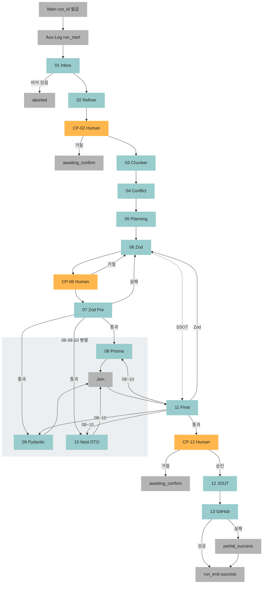

## Desktop Rivet 캔버스(Graph) 설계

> **범위:** 본 문서는 **Ironclad Rivet Desktop(설치형)** 전용이다. **NEXA-Platform** 웹앱에 임베딩되는 **`@ironclad/rivet-core`** 와는 **별개 제품·별개 런타임**이다. **채택 이유·에이전트 툴과의 선** — [`Rivet 파이프라인.md`](./Rivet%20파이프라인.md) 「왜 리벳인가?」 · 배치 — 「NEXA에서 Rivet을 다루는 방식」.

|                 | **Desktop Rivet (본 문서)**                           | **Rivet Core (웹)**                       |
| --------------- | ----------------------------------------------------- | ----------------------------------------- |
| **형태**        | Windows 등에 설치하는 **Rivet 앱**                    | NestJS 안 **npm 엔진** + 브라우저 UI      |
| **주 용도**     | `docs/` **01~14** 배치 파이프라인 · 프롬프트·Sub 설계 | 사용자 **실시간** 채팅·Tiptap·캔버스 협업 |
| **파일 I/O**    | **MCP FileSystem** (To-Be)                            | **NestJS API** (디스크 직접 접근 금지)    |
| **그래프 파일** | `Sub_01`~`Sub_14` **.rivet** 탭                       | `.rivet-project` JSON · Yjs `rivetGraph`  |

### Desktop → `docs/` → 웹 (본 파이프라인의 위치)

이 설계서의 **Main · 01~14** 는 **웹앱을 만들기 위한 일방통행 생산 라인**이다.

```text
inbox → refined → specs/ (05) → Zod (06) → 검증 (07·11) → 코드 (08~10·12) → Git (13)
                              ↘
                    웹 rivet-core용 .rivet / Export JSON (Desktop에서 동시 설계)
```

| 산출            | 경로                                     | 웹(NEXA-Platform)에서                               |
| --------------- | ---------------------------------------- | --------------------------------------------------- |
| **규범·뼈대**   | `docs/specs/**` · `project-core/`        | API·UI·에이전트가 따를 **기획·계약 문서 SSOT**      |
| **실행 계약**   | `packages/shared` · Prisma · Nest DTO 등 | **rivet-core·백엔드**가 로드하는 **코드 SSOT**      |
| **운영 그래프** | Export · 커스텀 노드(레포 반영)          | NestJS **rivet-core**에 등록 — **웹 캔버스 런타임** |

웹 **삼각 동기화**는 사용자 협업용 **세션 레이어**이고, 위 **`docs/`·코드 SSOT를 자동으로 덮지 않는다**. 상세·역방향 정책: [`Rivet 파이프라인.md`](./Rivet%20파이프라인.md) 「Desktop → docs/ → 웹앱」.

메인 캔버스(**Main Orchestrator**)는 **Sub_01~13** 순차 서브그래프·보조(**Aux-Log** · **Aux-Human**)를 조립하는 지휘자입니다. **14** `Sub_Project_Health_Analyzer`는 표·탭 번호만 부여·**Main 미호출**(§14).
웹앱, 백엔드(NestJS), DB(PostgreSQL/Prisma), 파이썬 PC까지 관통하는 Zod 중심 모노레포 파이프라인 설계도입니다. **코드·스키마 되돌리기는 Rivet이 아니라 에디터 Git**이 담당합니다.

**Desktop Rivet** 의 로컬 파일 I/O는 **MCP FileSystem**(`MCP Discovery` → `MCP Tool Call`)으로 구현하는 것을 **To-Be 기본**으로 합니다. 별도 NestJS·Node **External Call** 서버는 **레거시(초기 스케치)** — 운영 웹앱은 `Rivet 파이프라인.md` 대로 **NestJS 내부**에서만 파일시스템을 다룹니다.

> **웹 Rivet UI:** `.rivet-project` = **순수 JSON**. AI는 **연결·노드 의미**만 생성하고 **x,y는 Dagre·Cytoscape.js 등 프론트 레이아웃**이 담당 — `Rivet 파이프라인.md` §삼각 동기화 「Rivet 프로젝트 JSON」.

### `docs/` 생애주기 (모노레포 To-Be)

```text
docs/
├── inbox/     # 날것 — 01 Inbox 스캔 · 02 Refiner 읽기
├── refined/   # 02 출력 · 03 Chunker · 04 Conflict 입력
├── specs/     # 05 Planning MD 트리 · 06 Zod 가이드~ — 11 검증·12(J) 코드 반영
│   ├── project-core/   # vision·glossary·domain-map·constraints (§05)
│   └── requirements/ · api-contract/ · … (§05 독립 폴더)
├── trash/     # 02 — inbox 미러
└── .rivet/
    ├── runs/{run_id}/        # Aux-Log (메인 파이프라인)
    ├── conflicts/{run_id}/   # 04 Conflict · Obsidian MOC
    └── health/{analysis_id}/ # 14 Health · Obsidian MOC
```

> 루트의 `docs/Nexia/` 등 **레거시 폴더**는 `docs/specs/` 로 **수동 이전** 예정. 상세: `_NEXA-OS-V2.1-설계-표준-및-미션크리티컬-전략-보강본.md` §docs-lifecycle.

---

### 모노레포 플랫폼 구축을 위한 표준 Subroutine(서브 캔버스(Graph)) 정의서

**번호 규칙:** **Main** 고정 · **01 → 13** = **메인 실행 순서** · **14** = 서브루틴 **등록 번호**(`.rivet` 1:1 · **수동·메인 미연동** — Main에 넣을지는 추후 판단) · **Aux-Log** / **Aux-Human**(`CP-*`) = 번호 없음.

| 번호 | 서브루틴(캔버스(Graph)) 명칭    | 주요 역할 (Hermes 3 페르소나 및 임무)                                                                                                                             | **Rivet 노드 (To-Be · 권장 흐름)**                                                                                                                                 | 입력 (Input)                                                  | 출력 (Output)                                                                      |
| ---- | ------------------------------- | ----------------------------------------------------------------------------------------------------------------------------------------------------------------- | ------------------------------------------------------------------------------------------------------------------------------------------------------------------ | ------------------------------------------------------------- | ---------------------------------------------------------------------------------- |
| Main | Main Orchestrator               | [지휘] **LLM 없음** — `01→13` · **07 통과 전 08~10 미실행** · **Join→11** · **CP-12 승인→12→13** · 실패: Zod→**06** · 파생→**08~10** · Git 실패 `partial_success` | `Graph Inputs` → `MCP Discovery`(시작 1회) → `Sub-Graph`(01~13) → `Match` / `If/Else` → `Wait`(08~10 Join) → `Sub-Graph`(Aux-Log) → `Graph Outputs`                  | 트리거 · Normex · handoff · Human · Git 정책                  | `run_id` · `pipeline_result` · `written_paths[]` · `git_commit_sha` · `step_log[]` |
| 01   | Sub_Inbox_Inventory_Scanner     | [선행 스캔] `docs/inbox/**` 읽기 전용 · 비면 **aborted**                                                                                                          | `Graph Inputs` → `MCP Tool Call`(`list_directory`) → `Match`(빈 목록→abort) → `Assemble Object` → `Graph Outputs`                                                  | `docs/inbox/**`                                               | `inbox_inventory.json`                                                             |
| 02   | Sub_Doc_Refiner_and_Placer      | [파일 정제] Normex·`refined/`·trash 미러 · **Refined Manifest**                                                                                                   | `Graph Inputs` → `MCP Get Prompt`(Normex) → `MCP Tool Call`(R/W) → `Prompt Shell` → `Chat`(Ollama) → `Extract Object` → `Assemble Object` → `Graph Outputs`     | 01 inventory · inbox · specs 맥락                             | `docs/refined/**` · `refined_manifest.json`                                        |
| 03   | Sub_Doc_Chunker                 | [분할] 도메인별 청크                                                                                                                                              | `Graph Inputs` → `MCP Tool Call`(`read_file`) → `Loop` → `Chunk Text` → `Assemble Object` → `Graph Outputs`                                                       | 02 manifest · `refined/`                                      | 청크 배열                                                                          |
| 04   | Sub_Conflict_Analyzer           | [진단] 누락·모순·타입 충돌 · **Obsidian Graph** MOC (§04·§Obsidian)                                                                                               | `Graph Inputs` → `MCP Tool Call`(R) → `Prompt Shell` → `Chat` → `Extract Object` → `Code`(**04 Report Generator**) → `MCP Tool Call`(W) → `Graph Outputs`         | 03 청크                                                       | `conflict-report.md` · `conflict_report.json` · `.rivet/conflicts/{run_id}/`       |
| 05   | Sub_Planning_Doc_Generator      | [통합 기획] 청크+04 충돌 MOC→**specs MD** (`docs/specs/` · **04·14 wikilink 유지**, §05·§Obsidian)                                                                | `Graph Inputs` → `MCP Get Prompt` → `Loop`(by_folder) → `Prompt Shell` → `Chat` → `Extract Object` → `MCP Tool Call`(W) → `Assemble Object` → `Graph Outputs`     | 03 청크 · 04 리포트 · specs 맥락                              | `docs/specs/**` (폴더별 MD) · **planning_manifest.json**                           |
| 06   | Sub_Zod_Schema_Generator        | [Contract] Zod SSOT **초안** · 코드 디스크는 **12**                                                                                                               | `Graph Inputs` → `MCP Get Prompt` → `MCP Tool Call`(R) → `Prompt Shell` → `Chat` → `Extract Object` → `Code`(Zod emit) → `Graph Outputs`                         | 05 planning · 04 리포트                                       | Zod·가이드 **버퍼**                                                                |
| 07   | Sub_Zod_Syntax_Validator_Pre    | [사전 검증] **06 Zod만** 문법·타입 정적 검사 · **통과 시에만 08~10 게이트**                                                                                       | `Graph Inputs` → `MCP Tool Call`(R) → `Code`(Zod `safeParse`/tsc) → `Match`(pass/fail) → `Graph Outputs`                                                          | 06 Zod 버퍼                                                   | pass/fail · Zod 수정 제안                                                          |
| 08   | Sub_Prisma_Schema_Converter     | [DB] Prisma (**08~10 병렬**)                                                                                                                                      | `Graph Inputs` → `MCP Tool Call`(R) → `Prompt Shell` → `Chat` → `Extract Object` → `Graph Outputs`                                                                 | 06 Zod · **07 통과**                                          | Prisma 블록                                                                        |
| 09   | Sub_Pydantic_Converter          | [PC] Pydantic (병렬)                                                                                                                                              | `Graph Inputs` → `MCP Tool Call`(R) → `Prompt Shell` → `Chat` → `Extract Object` → `Graph Outputs`                                                                 | 06 Zod · **07 통과**                                          | `schemas.py` 등                                                                    |
| 10   | Sub_NestJS_DTO_Generator        | [API] nestjs-zod DTO (병렬)                                                                                                                                       | `Graph Inputs` → `MCP Tool Call`(R) → `Prompt Shell` → `Chat` → `Extract Object` → `Graph Outputs`                                                                 | 06 Zod · **07 통과**                                          | DTO 코드                                                                           |
| 11   | Sub_Syntax_Validator_Final      | [최종 검증] **06 Zod + 08~10 산출물** 크로스·문법 검사 · **Join 완료 후**                                                                                         | `Graph Inputs` → `Wait`(08~10 Join) → `MCP Tool Call`(R) → `Code`(cross-validate) → `Match` → `Graph Outputs`                                                    | 06 Zod · 08~10 버퍼(Join)                                     | pass/fail · 파생물 수정 제안                                                       |
| 12   | Sub_FileSystem_Write (**JOUT**) | [디스크] §J 경로 **atomic write**                                                                                                                                 | `Graph Inputs` → `Match`(CP-12 승인) → `Loop`(`written_paths[]`) → `MCP Tool Call`(`write_file`) → `Assemble Object` → `Graph Outputs`                            | 06·08~10 버퍼 · **CP-12 승인**                                | `written_paths[]`                                                                  |
| 13   | Sub_GitHub_Publish              | [Git] commit·push(·PR)                                                                                                                                            | `Graph Inputs` → `MCP Tool Call`(GitHub: branch/commit/push) → `Match`(실패→`partial_success`) → `Graph Outputs`                                                  | 12 paths · `run_id`                                           | `git_commit_sha` · `pr_url`?                                                       |
| 14   | Sub_Project_Health_Analyzer     | [건강 진단] 질문·점수·보고서 · **Obsidian Graph** MOC · **Main 미호출** §14                                                                                       | `Graph Inputs` → `MCP Tool Call`(R) → `Prompt Shell` → `Chat` → `Extract Object` → `Code`(**14 Report Generator**) → `MCP Tool Call`(W) → `Graph Outputs`         | `analysis_scope` · `categories[]` · specs·refined·(선택) 코드 | `health-report.md` · `health_report.json` · `.rivet/health/{analysis_id}/`         |

> **Rivet 노드 열 규약**
>
> - **표준 노드명** = Ironclad Rivet 순정 (`Chat` · `Chunk Text` · `Sub-Graph` 등) — [`Rivet Engine 노드 분석`](../Nexia/Rivet%20Engine%20노드%20분석.md).
> - **MCP** = `MCP Discovery` · `MCP Tool Call` · `MCP Get Prompt` — §「Rivet MCP 노드」·「FileSystem MCP — 파이프라인 단계별 사용처」.
> - **커스텀** = `04 Report Generator` · `14 Report Generator` · `Code`(Zod emit / cross-validate) — NestJS·Desktop 공통 등록 목표.
> - `→` = 권장 **토폴로지 순서** (좌표·레이아웃은 Dagre 등 프론트 담당).
> - **Human CP** = `Sub-Graph`(Aux-Human) + `User Input` — Main에서 **02·06·12** 직전 호출.

#### 번호 ↔ Rivet 서브 .rivet (1:1)

| 번호 | 권장 .rivet 탭             | 역할 (한 줄)                      |
| ---- | -------------------------- | --------------------------------- |
| 01   | `Sub_01_Inbox_Inventory`   | inbox 스캔                        |
| 02   | `Sub_02_Doc_Refiner`       | refined·trash·manifest            |
| 03   | `Sub_03_Chunker`           | 도메인 청크                       |
| 04   | `Sub_04_Conflict`          | Obsidian 충돌 MOC·JSON            |
| 05   | `Sub_05_Planning`          | `docs/specs/` 트리별 통합 기획 MD |
| 06   | `Sub_06_Zod`               | Zod SSOT 초안                     |
| 07   | `Sub_07_Zod_Validator_Pre` | Zod만 사전 검증                   |
| 08   | `Sub_08_Prisma`            | Prisma 변환                       |
| 09   | `Sub_09_Pydantic`          | Pydantic 변환                     |
| 10   | `Sub_10_Nest_DTO`          | Nest DTO 변환                     |
| 11   | `Sub_11_Validator_Final`   | Zod+파생물 최종 검증              |
| 12   | `Sub_12_File_Write`        | §J 디스크 반영                    |
| 13   | `Sub_13_GitHub`            | commit·push                       |
| 14   | `Sub_14_Health_Analyzer`   | Obsidian 건강 MOC (수동·Main 외)  |

> **14** 탭은 **01~13과 동일 1:1 규칙**으로 두되, **Main Orchestrator의 `01→13` 체인에는 포함하지 않음**. 추후 Main에서 선택 호출로 바꿀지는 별도 결정.

#### 보조 Graph (Aux) — 번호 없음

| Aux ID        | Graph 명칭           | LLM  | **Rivet 노드 (To-Be)**                                                                      | 주요 역할                                              | Input                       | Output                  |
| ------------- | -------------------- | ---- | ------------------------------------------------------------------------------------------- | ------------------------------------------------------ | --------------------------- | ----------------------- |
| **Aux-Log**   | Sub_Pipeline_Logger  | 없음 | `Graph Inputs` → `Assemble Object` → `MCP Tool Call`(append `pipeline.log.jsonl`) → `Graph Outputs` | 각 **01~13** Subgraph 직후 append · 08~10은 `branch`   | `run_id` · `step_id` · 결과 | `pipeline.log.jsonl`    |
| **Aux-Human** | Sub_Human_Checkpoint | 없음 | `Graph Inputs` → `MCP Tool Call`(R, diff) → `User Input` → `Match` → `Graph Outputs`        | **CP-02** · **CP-06** · **CP-12** · REFACTOR→**CP-02** | diff·Manifest·Zod·11 요약   | `approved` / `rejected` |

> **14** `Sub_Project_Health_Analyzer`는 **서브루틴 표**·§14에 정의 (Aux 표 아님).

**인벤토리·산출 2종 (02·05)**

| 이름                  | 시점      | 담당 | 용도                                                                     |
| --------------------- | --------- | ---- | ------------------------------------------------------------------------ |
| **Inbox Inventory**   | **01**    | 01   | inbox 실행 여부                                                          |
| **Refined Manifest**  | **02** 후 | 02   | 03 입력 · `action_type`                                                  |
| **Planning Manifest** | **05** 후 | 05   | 06 입력 · `docs/specs/**` 생성·갱신 경로 목록 (`planning_manifest.json`) |

### 05 — Sub_Planning_Doc_Generator · `docs/specs/` 산출 트리

**05**는 **03** 청크와 **04** 충돌 리포트를 합쳐 **사람이 읽는 명세 MD**를 생성·갱신합니다. 경로는 **2계층**으로 나눕니다.

1. **`project-core/`** — 프로젝트 전역·**파일 4개 고정**(싱글톤 번들). 폴더를 쪼개지 않음.
2. **독립 폴더 9종** — 주제·도메인·버전별로 **다중 MD**가 늘어나는 영역.

**02** `refined/` · **04** 진단과 구분되며, **06** Zod·**08~10** 파생의 **문서 SSOT**입니다. MCP `write_file` 루트 = **`docs/specs/`**.

```text
docs/specs/
├── project-core/          # 전역 4종 (병합·고정 파일명)
│   ├── vision.md
│   ├── glossary.md
│   ├── domain-map.md
│   └── constraints.md
├── user-personas/
├── requirements/
├── architecture/
├── data-model/
├── api-contract/
├── adr/
├── edge-devices/
├── data-flow/
└── control-rules/
```

#### `project-core/` 병합 (4문서 → 1폴더)

| 파일               | 05가 다루는 내용              |
| ------------------ | ----------------------------- |
| **vision.md**      | 비전·목표·범위·성공 기준      |
| **glossary.md**    | 용어·약어 (청크 간 표기 정합) |
| **domain-map.md**  | 바운디드 컨텍스트·모듈·의존   |
| **constraints.md** | 기술·성능·보안·운영 제약      |

#### 독립 폴더 (다중 문서 허용)

| 폴더               | 유지 이유                                           | 05 산출 예                      |
| ------------------ | --------------------------------------------------- | ------------------------------- |
| **user-personas/** | 사용자 유형별 **여러 파일**                         | `operator.md`, `admin.md`       |
| **requirements/**  | 기능·도메인별 **분리**                              | `req-auth.md`, `req-billing.md` |
| **architecture/**  | 레이어·버전별 문서 **증가**                         | `layer-api.md`, `deploy-v2.md`  |
| **data-model/**    | 도메인별 모델 **분리**                              | `model-core.md`                 |
| **api-contract/**  | 엔드포인트·리소스별 **증가** (**06** Zod 문서 선행) | `users-api.md`                  |
| **adr/**           | 결정 **건별** 누적                                  | `0001-store-zod.md`             |
| **edge-devices/**  | 디바이스 종류별                                     | `gateway-pc.md`                 |
| **data-flow/**     | 시나리오별 흐름                                     | `order-pipeline.md`             |
| **control-rules/** | 규칙·상태 전이 **다수**                             | `safety-interlock.md`           |

| 운영 규칙       | 내용                                                                                        |
| --------------- | ------------------------------------------------------------------------------------------- |
| **확장성**      | `project-core/` = **4파일만** 갱신 · 독립 폴더 = **여러 MD**                                |
| **버전 관리**   | 전역 4종은 **Git 이력·문서 내 Revision** 우선 · 독립 폴더는 `req-auth-v2.md` 등 파일명 분기 |
| **도메인 추가** | 신규 **독립 폴더**만 추가 (`specs/manufacturing/` 등) — `project-core`는 **분할하지 않음**  |
| **Git 추적**    | `project-core/` 한 diff로 **“판이 뒤집혔는지”** 판별 · 독립 폴더는 주제별 diff              |

**planning_manifest.json** (05 출력, `.rivet/runs/{run_id}/` 또는 handoff 버퍼)

| 필드              | 설명                                                                             |
| ----------------- | -------------------------------------------------------------------------------- |
| `written_paths[]` | 생성·갱신한 `docs/specs/**` 상대 경로                                            |
| `by_folder`       | `project-core` · `requirements` · `api-contract` … → 경로 배열                   |
| `core_changed`    | (권장) `true` if `project-core/**` 중 1개 이상 갱신 — **CP-06**·안정기 정책 힌트 |
| `conflict_refs[]` | (선택) `C-###` → `[[.rivet/conflicts/{run_id}/conflict-report#C-###]]` · 반영 MD |

#### 설계 메모 (권장 운영)

| 항목                | 권장                                                                                                            |
| ------------------- | --------------------------------------------------------------------------------------------------------------- |
| **05 쓰기 순서**    | **`project-core/` 4파일 먼저** → 독립 폴더. 상위 맥락 고정 후 requirements·api-contract 생성 시 04 모순 감소    |
| **CP-06**           | `core_changed=true` 이면 **전역 규약 변경**으로 간주 · diff에 `project-core/` **우선 표시**                     |
| **중복 방지**       | `requirements/`는 범위·목표 **재서술 금지** — `vision.md` § 참조만. 상세는 requirements, 판은 project-core      |
| **adr/**            | `project-core`와 **분리 유지** — ADR은 시점별 결정 로그, core 4종은 **현재 진실(Current Truth)**                |
| **안정기 프롬프트** | §장기 전략 시나리오 1과 연동 — `project-core/` diff가 잦으면 “보수적 관리자” 전환 검토                          |
| **리스크 판단**     | 시나리오 2 — 기존 규약은 **`project-core/` + `constraints.md`** 를 먼저 읽고, 전면 개편 vs `inbox/` 재입고 결정 |

> **06** Get Prompt: **`project-core/*.md` 전체** + 이번 run `by_folder` 독립 경로만 주입. Zod는 **api-contract/** · **data-model/** 와 맞추고, 용어는 **glossary.md** SSOT.

**05 미니 실습:** `project-core/` 4파일 → `requirements/` 1파일 → `api-contract/` 1파일.

> **05**는 **04**·**14** 산출 MD의 `[[wikilink]]`·`conflict_refs`를 **유지·인용**해야 Obsidian Graph가 끊기지 않음 (§Obsidian).

---

### Obsidian Graph View 산출 규약 (04 · 05 소비 · 14)

**전제:** Obsidian Vault 루트 = **`docs/`** (모노레포에서 `NEXA-Platform/docs`를 Vault로 열거나, `docs`만 심볼릭 링크). Graph View의 **엣지**는 본문·프론트매터의 **`[[wikilink]]`** 로만 만든다 (빈 노트·고아 최소화).

| 규칙           | 내용                                                                                                                                            |
| -------------- | ----------------------------------------------------------------------------------------------------------------------------------------------- |
| **경로 표기**  | Vault 기준 상대 경로 · **확장자 생략** — `[[specs/project-core/vision]]`, `[[refined/auth/login-flow]]`                                         |
| **허브(MOC)**  | Run·분석 단위 **허브 노트 1개** — 모든 충돌·리스크·근거 문서를 허브에서 **최소 1회** 링크                                                       |
| **프론트매터** | 공통 `rivet` 블록 + `tags` (Graph 필터용) — 아래 템플릿                                                                                         |
| **기계 처리**  | 동일 Run의 **`.json`** = SSOT · **`.md`** = 사람·Obsidian (JSON→MD 동기 필드명 통일)                                                            |
| **05 연동**    | Planning MD에 `Related conflicts: [[.rivet/conflicts/{run_id}/conflict-report#C-001]]` 형태로 **역링크**                                        |
| **금지**       | `http://`만 있는 참조 · Vault 밖 절대경로 · 링크 없는 텍스트만 있는 충돌 항목                                                                   |
| **코드 경로**  | Vault=`docs/`만일 때 `packages/**`는 **`specs/architecture/code-bridge/{모듈}.md`** 허브를 두고 14·04가 그 노트를 링크 (Graph에 코드 SSOT 표시) |

**공통 프론트매터 (YAML)**

```yaml
---
rivet:
  step: '04' # 또는 "14"
  run_id: '' # 04·메인 run
  analysis_id: '' # 14만
  graph_role: moc # hub | item | category
tags:
  - rivet/conflict # 04
  - rivet/health # 14
  - severity/high # 선택
aliases: []
---
```

**Obsidian 설정 권장**

| 설정                                    | 값                                                         |
| --------------------------------------- | ---------------------------------------------------------- |
| **New link format**                     | Relative path to vault                                     |
| **Automatically update internal links** | ON (05가 specs 이동 시)                                    |
| **Graph → Tags**                        | `rivet/conflict`, `rivet/health` 색상 구분                 |
| **Excluded files**                      | `.rivet/runs/**` 로그만 제외 (conflicts·health는 **포함**) |

---

### 04 — Sub_Conflict_Analyzer · Obsidian 산출

| 항목           | 내용                                                                                   |
| -------------- | -------------------------------------------------------------------------------------- |
| **쓰기 경로**  | `docs/.rivet/conflicts/{run_id}/conflict-report.md` · `conflict_report.json`           |
| **Graph 역할** | **허브** `conflict-report` — 청크·specs·refined 간 **모순 엣지** 집약                  |
| **05 handoff** | `conflict_report.json` → `conflicts[]` · **05** `conflict_refs[]`에 `C-###` + wikilink |

**`conflict_report.json` (요약)**

| 필드           | 설명                                                                          |
| -------------- | ----------------------------------------------------------------------------- |
| `run_id`       | Main run                                                                      |
| `conflicts[]`  | `{ id, severity, type, summary, nodes[], edges[], suggested_action }`         |
| `nodes[]`      | `{ vault_path, label, role: source\|target\|spec\|chunk }` — MD wikilink 대상 |
| `edges[]`      | `{ from, to, relation: contradicts\|missing\|type_mismatch\|duplicate_term }` |
| `obsidian_hub` | `.rivet/conflicts/{run_id}/conflict-report` (확장자 없음 경로)                |

**`conflict-report.md` 구조 (템플릿)**

```markdown
---
rivet:
  step: '04'
  run_id: '{run_id}'
  graph_role: moc
tags:
  - rivet/conflict
  - rivet/run
---

# Conflict Report · {run_id}

## Graph MOC

- [[specs/project-core/domain-map]] — 전역 맥락
- [[specs/project-core/glossary]] — 용어 기준

## Conflicts

### C-001 · severity/high · type/contradicts

- **A:** [[refined/billing/invoice-rules]]
- **B:** [[specs/requirements/req-billing]]
- **Also:** [[specs/api-contract/billing-api]]
- 요약: …
- 제안: …

## Orphans / Missing links

- [[refined/iot/sensor-v2]] — specs 쪽 미링크
```

| `type`           | Graph 의미                            |
| ---------------- | ------------------------------------- |
| `contradicts`    | 두 노트 간 정면 모순 (굵은 엣지 후보) |
| `missing`        | 한쪽만 존재 → 고아·단절               |
| `type_mismatch`  | Zod·문서·청크 타입 불일치             |
| `duplicate_term` | glossary vs 본문 표기 충돌            |

**04 Report Generator 노드:** JSON 생성 후 **동일 `nodes[]`·`edges[]`를 wikilink로 펼친 MD** 필수 출력 · 링크 0개 항목은 `orphans` 섹션으로 격리.

---

### 14 — Obsidian 산출 (Health · §14 본문 연동)

| 항목                | 내용                                                                                                                         |
| ------------------- | ---------------------------------------------------------------------------------------------------------------------------- |
| **주 출력 (Graph)** | `health-report.md` — 카테고리·리스크·근거 **wikilink 허브**                                                                  |
| **부 출력**         | `health_report.json` — 점수·posture·체크리스트 (§14 스키마)                                                                  |
| **04 연동**         | `recommended_posture` ≥ `refactor` 시 `[[.rivet/conflicts/{latest_run_id}/conflict-report]]` **자동 링크**(해당 run 존재 시) |

**`health-report.md` 구조 (템플릿)**

```markdown
---
rivet:
  step: '14'
  analysis_id: '{analysis_id}'
  graph_role: moc
tags:
  - rivet/health
  - posture/refactor
recommended_posture: refactor
overall_score: 3.8
---

# Health Report · {analysis_id}

## Overview MOC

| Category     | Score | Hub               |
| ------------ | ----- | ----------------- |
| architecture | 3.2   | [[#Architecture]] |
| docs_ssot    | 4.1   | [[#Docs SSOT]]    |

## Architecture

### Q-A03 · score 4

- 근거: [[specs/project-core/domain-map]] · [[specs/architecture/code-bridge/shared-schemas]]
- 요약: Zod vs Prisma 불일치 …

## Risks

### R-01 · severity/high

- [[specs/api-contract/users-api]] ↔ [[specs/data-model/model-core]]
- 조치: …

## Related

- [[.rivet/conflicts/20250604-abc/conflict-report]]
- [[specs/project-core/constraints]]
```

**14 Report Generator 노드:** `answers[]`·`risks[]`마다 **`evidence_paths[]` → wikilink 1개 이상** · 카테고리 섹션마다 **내부 헤딩 링크**(`[[#Architecture]]`)로 MOC 계층 형성.

**`health_report.json` 추가 필드**

| 필드               | 설명                                            |
| ------------------ | ----------------------------------------------- |
| `obsidian_hub`     | `.rivet/health/{analysis_id}/health-report`     |
| `wikilinks[]`      | 보고서에 삽입한 모든 `[[...]]` 목록 (05·검색용) |
| `linked_conflicts` | (선택) 참조한 04 hub 경로 배열                  |

### Rivet MCP 노드 — Desktop 파일 I/O (External Call 대체)

Rivet에 **MCP Discovery** · **MCP Tool Call** · **MCP Get Prompt** 가 있으면, Desktop 개발 환경의 **로컬 파일·디렉터리 작업**은 NestJS External Call **없이** 구현 가능합니다.

| 환경                                | 파일 I/O                          | 비고                                                                    |
| ----------------------------------- | --------------------------------- | ----------------------------------------------------------------------- |
| **Desktop Rivet (Windows)**         | **MCP FileSystem** + Tool Call    | 모노레포 루트를 MCP `roots`에 고정                                      |
| **운영 웹앱 (NestJS + Rivet Core)** | **NestJS 서비스** (API·Path 검증) | 브라우저·Rivet Core가 디스크 직접 접근 **금지** — `Rivet 파이프라인.md` |

**완전 대체가 되는 범위**

- `docs/inbox` · `refined` · `trash` · `specs` · `.rivet/runs` · `.rivet/conflicts` · `.rivet/health` 스캔·읽기·쓰기
- **12 JOUT** — §J 경로 **write** (MCP FS)
- **13 GitHub** — `written_paths[]` **commit · push** (·선택 PR)
- **Aux-Log** — `pipeline.log.jsonl` append

**대체가 어렵거나 별도인 범위**

- **운영 배포** 시 동일 MCP를 클라이언트에 노출하는 것 (보안상 NestJS 유지)
- **HTTP 전용** 외부 엔진(ComfyUI 등) — FileSystem MCP와 무관 · HTTP Call 유지
- **07·11** 각 그래프에서 `tsc`·Prisma validate 등 — MCP FS만으로 부족 시 **Code** 노드 또는 CI

**MCP 노드 역할 (Main 1회 + 단계별 Tool Call)**

| Rivet 노드         | 용도                                                                                                                           |
| ------------------ | ------------------------------------------------------------------------------------------------------------------------------ |
| **MCP Discovery**  | **FileSystem** + **GitHub** MCP 등록(시작 1회, 또는 JOUT 직전 GitHub만 추가 Discovery) · FS roots = 모노레포 루트              |
| **MCP Tool Call**  | FS: `list_directory` · `read_file` · `write_file` · GitHub: `create_branch` · `commit` · `push` · (선택) `create_pull_request` |
| **MCP Get Prompt** | (선택) Normex·경로 규약 — **02·05·06** Chat **앞**에 주입                                                                      |

**보안 (Desktop도 필수)**

- MCP `roots`를 NEXA 모노레포로 **제한** · 상위 `..` Path Traversal 차단
- **12**는 `CP-12` 승인 **이후에만** `write_file` Tool Call 연결
- 민감 파일(`.env`·키) 경로는 Discovery 단계에서 **exclude** 목록

#### FileSystem MCP — 파이프라인 단계별 사용처

| 단계                | MCP Tool (예)                  | 경로·대상                                 | R/W    | 비고                                 |
| ------------------- | ------------------------------ | ----------------------------------------- | ------ | ------------------------------------ |
| **Main 시작**       | Discovery                      | 모노레포 루트                             | —      | FS + GitHub                          |
| **Aux-Log**         | `write_file`                   | `.rivet/runs/.../pipeline.log.jsonl`      | W      | 횡단                                 |
| **01 Inbox**        | `list_directory`               | `docs/inbox/**`                           | R      | 빈 배열 → aborted                    |
| **02 Refiner 입력** | `list_directory` · `read_file` | inbox · refined · specs 맥락              | R      | §1 재료                              |
| **02 Refiner 출력** | `write_file`                   | `refined/**` · `trash/inbox/…`            | W      | manifest                             |
| **03 Chunker**      | `read_file`                    | `docs/refined/**`                         | R      |                                      |
| **04 Conflict**     | `write_file`                   | `.rivet/conflicts/{run_id}/`              | W      | Obsidian `conflict-report.md` + JSON |
| **05 Planning**     | `write_file` · `read_file`     | `docs/specs/**` (§05 트리)                | W/R    | 폴더별 통합 기획 MD                  |
| **06 Zod**          | `read_file`                    | planning · specs 맥락                     | R      | 출력 버퍼                            |
| **07 Zod Pre**      | `read_file`                    | 06 Zod 버퍼 · (선택) `packages/shared`    | R      | 사전만                               |
| **11 Final**        | `read_file`                    | 06 Zod · 08~10 버퍼                       | R      | Join 후                              |
| **08~10 병렬**      | `read_file`                    | 06 Zod SSOT                               | R      | 버퍼 → Join                          |
| **CP-02/06/12**     | `read_file`                    | Manifest · Planning · Zod · 11 요약       | R      | Human                                |
| **12 JOUT**         | `write_file`                   | §J 전 경로                                | W      | CP-12 후                             |
| **13 GitHub**       | GitHub Tool Call               | `written_paths[]`                         | W(Git) | 12 직후                              |
| **14** (수동)       | `read_file` · `write_file`     | `specs/**` · `refined/**` · (선택) 스키마 | R/W    | `.rivet/health/` Obsidian MD + JSON  |

> **02·05** = `docs/` 선행 쓰기 · **12** = 코드·스키마 실경로 · **13** = 원격. **14** = 메인 **미연동** · GitHub **호출 없음**.

---

### 메인 캔버스 (Desktop Rivet) 에서의 유기적인 흐름 (작동 시나리오)

0.  **Main** — `run_id` · **Aux-Log** `run_start`.
1.  **01 Inbox** — 스캔 · 비면 **aborted**.
2.  **02 Refiner** — `refined/` · trash · **Refined Manifest**.
3.  **CP-02** — 배치·REFACTOR 확인 · 거절 → `awaiting_confirm`.
4.  **03 Chunker** → **04 Conflict** — Obsidian `conflict-report.md` · JSON (§04).
5.  **05 Planning** — `docs/specs/` 트리별 통합 기획 MD (§05 · `planning_manifest.json`).
6.  **06 Zod** — Contract **초안**(버퍼).
7.  **CP-06** — Zod·Planning 검토 · 거절 → **06**.
8.  **07** (`Sub_07_Zod_Validator_Pre`) — Zod만 검증 · 실패 → **06**.
9.  **08·09·10** 병렬 → **Join** → **11** (`Sub_11_Validator_Final`) · Zod→**06** · 파생→**08~10** 재진입.
10. **CP-12** — 최종 diff 승인 · 승인 시만 **12 JOUT**.
11. **13 GitHub** — commit·push(·PR).
12. **Aux-Log** `run_end` · `success` / `partial_success`.

> **07**·**11** = **별도 .rivet 2개**. **Aux-Log** = 01~13 각 직후 append.

**Human Checkpoint 운영 모드**

| 모드       | CP-02        | CP-06 | CP-12 |
| ---------- | ------------ | ----- | ----- |
| **초반**   | ON           | ON    | ON    |
| **안정기** | ON(REFACTOR) | OFF   | ON    |

```text
run_start
    ↓
01 Inbox ──(비어 있음)──→ aborted
    ↓
02 → CP-02 ──(거절)──→ awaiting_confirm
    ↓
03 → 04 → 05 Planning → 06 Zod → CP-06 ──(거절)──→ 06
    ↓
07 Zod Pre ──(실패)──→ 06
    ↓
08+09+10 → Join → 11 Final
    ├─(Zod)──→ 06
    ├─(08~10)──→ 08~10 재실행
    └─(통과)──→ CP-12 ──(거절)──→ awaiting_confirm
              └─(승인)──→ 12 JOUT → 13 GitHub → run_end
```

### 12 — 파일 시스템 반영 · JOUT (`CP-12` 승인 후)

Rivet 그래프 **밖**(모노레포 실경로)에 검증된 산출물을 씁니다. **`docs/specs/`만이 아닙니다** — `specs/`는 **문서·도메인 명세 SSOT** 구역이고, 실행·DB·PC 계약 코드는 **각 앱·패키지**에 둡니다.

| 출처            | 기록 대상 (To-Be 예)                    | 성격              |
| --------------- | --------------------------------------- | ----------------- |
| **06** Zod      | `packages/shared/src/schemas/**`        | **Contract SSOT** |
| **06** 가이드   | `docs/specs/**` (Zod 가이드·D8 등)      | 명세 문서         |
| **05** Planning | `docs/specs/**` (§05 트리, 05에서 기록) | 통합 기획 MD      |
| **08** Prisma   | `apps/backend/prisma/schema.prisma`     | DB SSOT           |
| **09** Pydantic | `apps/desktop/.../bridge/dto/`          | PC gate           |
| **10** Nest DTO | `apps/backend/src/**` (DTO 모듈)        | API 경계          |

- **`docs/refined/`** · **`docs/inbox/`** — **12** 대상 **아님** (02·03·04에서 처리).
- **`CP-12` 거절** 시 **12** 미실행.
- **MCP FS** `write_file` · **atomic write** · 다이어그램 **12 JOUT**.

### 13 — Git 반영 (12 직후)

로컬 디스크 반영(**12**) 다음, **13 GitHub MCP**로 VCS·원격 반영합니다. Rivet **MCP Discovery**에 GitHub 서버가 등록되어 있어야 합니다.

| 항목               | 내용                                                                                                                     |
| ------------------ | ------------------------------------------------------------------------------------------------------------------------ |
| **입력**           | `run_id` · `written_paths[]` · 커밋 메시지 템플릿(예: `rivet({run_id}): pipeline SSOT update`) · (선택) 대상 브랜치·base |
| **Tool Call (예)** | 변경 파일 스테이징 → `create_commit` / `push` → (선택) `create_pull_request`                                             |
| **출력**           | `git_commit_sha` · `branch` · (선택) `pr_url` — Main·`pipeline.log.jsonl`·`step_log[]`에 기록                            |
| **실패**           | **12**는 완료 — `partial_success` + `git_error` · 수동 `git commit`                                                      |
| **롤백**           | Rivet undo 없음 · **revert**는 `git revert` / PR close — §롤백                                                           |

**Main 설정 (권장)**

| 플래그                       | 동작                              |
| ---------------------------- | --------------------------------- |
| `github.enabled=true` (기본) | **12** 성공 후 **13** 실행        |
| `github.enabled=false`       | **12** 후 **run_end** — 수동 커밋 |
| `github.pr=optional`         | push만 또는 PR 자동 생성          |

> **CP-12** = 디스크 승인 · **13** = 이력 고정(생략 가능).

### 롤백 정책

| 구분              | 정책                                                                                  |
| ----------------- | ------------------------------------------------------------------------------------- |
| **파이프라인**    | Rivet Graph에 **undo / rollback 서브루틴 없음** — 실패·거절 시 **재실행·수동 수정**만 |
| **되돌리기 SSOT** | **Git** — **13** 이전 uncommitted · **13** 이후 `revert` / PR                         |
| **12 이후**       | `written_paths[]` → `git restore` / 커밋 후 `revert`                                  |
| **13 실패**       | 로컬은 **12** 유지 — 수동 커밋                                                        |
| **문서**          | **02** 이동·**05** `docs/specs/**` — **Git** 또는 trash 복구                          |

### Aux-Log — `pipeline.log.jsonl` 행 스키마 (요약)

| 필드             | 설명                                               |
| ---------------- | -------------------------------------------------- |
| `run_id`         | Main 시작 시 UUID                                  |
| `step_id`        | `01`~`13` · `CP-02`·`CP-06`·`CP-12` · `run_end`    |
| `git_commit_sha` | **13** 성공 시                                     |
| `status`         | `success` / `fail` / `skipped`                     |
| `duration_ms`    | Subgraph wall time                                 |
| `branch`         | 병렬 시 `prisma` / `pydantic` / `nest` (해당 시만) |
| `error_message`  | 실패 시                                            |
| `retry_count`    | 루프 회차                                          |

로그 기록 실패는 **비즈니스 실패로 간주하지 않음** (best-effort).

### 전체 흐름 다이어그램



> **Aux-Log** = 01~13 각 직후 append (생략). **그레이** = 제어·대기 · **청록** = 산출 **01~13** · **회색 박스** = **08~10** · **주황** = **CP-02·06·12**. REFACTOR → **CP-02**. **14** Health는 다이어그램 **밖**(수동 트리거).

---

## Sub_Doc_Refiner_and_Placer 캔버스에서 요구사항 상세

초기 기획 단계에서는 날것의 아이디어 하나 때문에 기존에 짜두었던 데이터 규약(Zod 스키마)이나 폴더 구조 전체를 뒤엎고(Refactoring) 판을 새로 짜야 하는 일이 빈번하게 발생합니다.
Hermes 3가 이 작업을 완벽하게 수행하려면, 단순히 날것의 문서 하나만 봐서는 절대 안 됩니다.

"현재 정제되어 있는 기존 문서 전체의 맥락"과 "우리가 합의한 아키텍처 규약"을 양손에 쥐고 있어야 올바른 판단을 내릴 수 있습니다.
리벳(Rivet)의 Sub_Doc_Refiner_and_Placer 캔버스(Graph) 내부 구조를 어떻게 고도화해야 하는지 전략을 다음과 같이 정리

---

## 1. Hermes 3에게 공급해야 할 3가지 필수 재료

이 서브루틴의 Graph Input 노드는 날것의 문서 외에도 기존 데이터의 전반적인 상태를 AI에게 주입해 주어야 합니다.

1.  날것의 신규 문서 (raw_input_text): 기획자님이 방금 던진 두서없는 메모.
2.  현재 정제된 핵심 기획서 및 규약 요약본 (current_system_context): 기존에 통과된 핵심 도메인 정보와 현재의 Zod 스키마 표준 가이드라인.
3.  현재 문서고 폴더 트리 구조 (directory_structure): 파일들이 어디에 위치해 있는지 보여주는 맵.

---

## 2. 초반 대격변(판 뒤집기)을 감당하기 위한 Hermes 3 프롬프트 설계법

초반에 규약 전체를 뒤바꾸는 유연성을 발휘하게 하려면, Hermes 3의 행동 강령(System Prompt)에 "기존 규칙을 파괴할 권한"을 명시적으로 부여해야 합니다. Hermes 3는 검열이 없고 지시를 매우 잘 따르므로 아래와 같은 가이드라인이 효과적입니다.

- 프롬프트에 주입할 핵심 행동 지침 (예시):

"당신은 단순한 비서가 아니라, 플랫폼 전체를 설계하는 수석 아키텍트입니다. 신규 메모의 요구사항이 기존 시스템 규약과 정면으로 충돌할 경우, 다음 두 가지 선택지 중 하나를 엄격하게 판단하세요."

- 옵션 A (단순 추가/수정): 기존 규약의 틀 안에서 소폭 수정이나 파일 배치가 가능한 경우 ➡️ action_type: "CREATE" 또는 "APPEND"로 처리.
  - 옵션 B (시스템 아키텍처 리팩토링): 신규 요구사항이 워낙 중요하여 기존 데이터 구조나 규약(Zod 표준 등) 전체를 전면 수정해야 하는 경우 ➡️ action_type: "REFACTOR"로 응답하고, 어떤 기존 문서들을 어떻게 수정해야 하는지 '구조 개편 제안서'를 함께 출력할 것.

---

## 3. action_type: "REFACTOR" 발생 시 리벳의 제어 흐름

**02**가 `action_type: REFACTOR` 를 Refined Manifest에 넣으면, Main은 **03 이전**에 **CP-02** 로 보냅니다.

[02 완료 → CP-02]
│
┌─────────┴─────────┐
▼ CREATE / APPEND ▼ REFACTOR
[승인 → 03…] [구조 개편 제안서 · 승인 전 03 미시작]
[거절 → awaiting_confirm · Git으로 refined/trash 정리]

> Human 모드: §작동 시나리오 **CP-02·06·12** 표 참고.

## 장기적인 안정화 전략 · **14** Sub_Project_Health_Analyzer

메인 파이프라인(**01~13**)과 **분리**된 **14번 진단 Graph**로, “지금 **소폭 수정**·**백업 후 개편**·**inbox 재기획**” 중 무엇이 맞는지 **사람이 판단할 근거**를 만듭니다. LLM은 점수·근거·리스크를 내고, **최종 결정·실행 승인은 Human**입니다.

| 시나리오          | 상황                             | Health Analyzer 활용                                               | 사람이 취할 수 있는 조치                                                              |
| ----------------- | -------------------------------- | ------------------------------------------------------------------ | ------------------------------------------------------------------------------------- |
| **1 안정기**      | 중반 이후 **판 뒤집기**가 독     | `stability_mode` 권고 · `project-core/` 변경 빈도·규모 적정성 점검 | **02** Refiner 프롬프트에 _“안정기 — 기존 규약 파괴 최소”_ 한 줄 · **CP-06** 강화     |
| **2 규약 재검토** | 신규 요구가 **규약 전체**와 충돌 | `project-core/`·`constraints.md`·`domain-map.md` 중심 재분석       | **부분 수정**(05·06만) · **REFACTOR**(CP-02) · **inbox/refined 하향 후 01~05 재실행** |

> 시나리오 1·2는 **Health 보고서의 `recommended_posture`** 필드로 요약 가능: `conservative` · `patch` · `refactor` · `replan`.

---

### 14 — Sub_Project_Health_Analyzer (독립 Graph)

| 항목                | 내용                                                                                                                                       |
| ------------------- | ------------------------------------------------------------------------------------------------------------------------------------------ |
| **번호**            | **14** (서브루틴 표·`.rivet` 1:1 · **Main `01→13` 체인 제외** — Main 연동 여부는 추후)                                                     |
| **Graph 명**        | `Sub_Project_Health_Analyzer`                                                                                                              |
| **권장 .rivet 탭**  | `Sub_14_Health_Analyzer` (Main·01~13 **호출 없음**)                                                                                        |
| **트리거**          | Rivet Desktop **수동 Run** · 스프린트 종료 · 대규모 inbox 투입 **전** · REFACTOR 논의 **전**                                               |
| **입력**            | `analysis_scope` · `categories[]` · (선택) `include_code_snapshot`                                                                         |
| **읽기 경로**       | `docs/specs/**` (우선 `project-core/`) · `docs/refined/**` · (선택) `packages/shared/src/schemas/**` · `apps/backend/prisma/schema.prisma` |
| **쓰기 경로**       | `.rivet/health/{analysis_id}/health-report.md` (Obsidian MOC) · `health_report.json` · §Obsidian                                           |
| **파이프라인 연동** | **없음** (결과를 보고 사람이 **02·05·CP-02** 프롬프트·운영만 조정)                                                                         |

#### LLM vs Human

| LLM (Analyzer)                | Human (운영자)                              |
| ----------------------------- | ------------------------------------------- |
| 문서·(선택) 코드 스냅샷 분석  | **최종 판단** (유지 / 소폭 / 개편 / 재기획) |
| 카테고리·질문별 **점수·근거** | **수정 범위**·일정·백업 여부 결정           |
| **리스크·모순** 목록          | **02·05·06** 프롬프트·CP 모드 변경 승인     |
| `recommended_posture` 초안    | inbox·refined 이동 · Git revert 실행        |

#### 노드 구성

```mermaid
flowchart LR
    GI["Graph Input\nanalysis_scope · categories"]
    DC["Doc Reader\nMCP read: specs/ + refined/\n(선택) schemas · prisma"]
    QG["Question Selector\n범위·카테고리별 질문 세트"]
    AN["Ollama Chat\n문서·스냅샷 기반 답변"]
    SC["Score Generator\n질문별 1~5 · 신호등"]
    RP["Report Generator\nObsidian MD MOC\n+ health_report.json"]
    GO["Graph Output\nHuman 검토용"]

    GI --> DC
    DC --> QG
    QG --> AN
    AN --> SC
    SC --> RP
    RP --> GO

    classDef defaultNode fill:#b4b4b4,stroke:#b4b4b4,color:#212121
    classDef healthNode fill:#db874b,stroke:#e09662,color:#eeeeee,stroke-width:2px
    class GI,DC,QG,AN,SC,RP,GO healthNode
```



| 노드                  | 역할                                                                                     |
| --------------------- | ---------------------------------------------------------------------------------------- |
| **Graph Input**       | `analysis_scope`: `full` \| `specs_only` \| `core_only` · 활성 `categories[]`            |
| **Doc Reader**        | MCP `list_directory` · `read_file` — 토큰 상한 시 `project-core/` + 최근 `refined/` 우선 |
| **Question Selector** | 아래 **질문 뱅크**에서 범위에 맞는 항목만 JSON 배열로 전달                               |
| **Ollama Chat**       | 질문별 **답변·인용 경로·불확실성** (환각 시 `evidence: weak`)                            |
| **Score Generator**   | 1=양호 3=주의 5=위험 · 카테고리 평균 · `overall_score`                                   |
| **Report Generator**  | **`health-report.md`** (wikilink MOC) + JSON · `wikilinks[]` · §Obsidian                 |
| **Graph Output**      | 파일 경로 + Human용 1페이지 요약                                                         |

#### 점수·권고 매핑 (권장)

| `overall_score` (평균) | `recommended_posture` | 시나리오 대응                                                        |
| ---------------------- | --------------------- | -------------------------------------------------------------------- |
| 1.0 ~ 2.2              | `conservative`        | **시나리오 1** — 02 안정기 프롬프트 · CP-06 ON 유지                  |
| 2.3 ~ 3.2              | `patch`               | specs·Zod **국소 수정** · 메인 파이프라인 일반 Run                   |
| 3.3 ~ 4.0              | `refactor`            | **CP-02 REFACTOR** · `project-core/` 개정 검토                       |
| 4.1 ~ 5.0              | `replan`              | **시나리오 2** — 핵심 문서 **inbox/refined** 하향 · **01~05** 재기획 |

#### 질문 뱅크 (카테고리 · Q-ID)

**아키텍처 안정성** (`architecture`)

- Q-A01 현재 **도메인 경계**가 `domain-map.md`·코드 모듈과 일치하는가?
- Q-A02 **순환 의존성**(패키지·모듈·도메인)이 있는가?
- Q-A03 **SSOT(Zod)** 와 Prisma·Nest DTO·Pydantic 간 **불일치**가 있는가?
- Q-A04 `packages/shared`·`apps/*` 경계가 Normex·폴더 규약과 맞는가?
- Q-A05 **ADR** 미기록인데 이미 코드에 반영된 “숨은 결정”이 있는가?

**데이터 흐름** (`data_flow`)

- Q-D01 입력→출력이 **단방향**(사이클·무방향 누수 없음)인가?
- Q-D02 **병목** 구간(큐·DB·동기 API)이 문서·코드에 식별되는가?
- Q-D03 **IoT 엣지 → 백엔드 → UI** 체인에 단절·누락 이벤트가 있는가?
- Q-D04 `data-flow/` 명세와 실제 **이벤트·메시지** 이름이 일치하는가?
- Q-D05 오프라인·재시도·**idempotency** 전략이 정의되어 있는가?

**보안** (`security`)

- Q-S01 외부 노출 **엔드포인트**에 인증·인가가 있는가?
- Q-S02 **디바이스 제어** 명령에 검증·속도 제한·역할 검사가 있는가?
- Q-S03 **민감 데이터**가 로그·`pipeline.log.jsonl`·에러 응답에 노출될 여지가 있는가?
- Q-S04 MCP·Desktop **roots**·Path Traversal 방어가 문서·설정과 일치하는가?
- Q-S05 **CP-12** 미승인 경로에 쓰기가 가능한 우회가 없는가?

**리소스 관리** (`resources`)

- Q-R01 **컨테이너**(Next / Nest+Core / Ollama) 역할 분리가 명확한가?
- Q-R02 **Ollama** 동시 요청·타임아웃·큐 전략이 있는가?
- Q-R03 **중복 저장**(동일 엔티티 DB+캐시+로컬) 불필요 사본이 있는가?
- Q-R04 Rivet·MCP **동시 Run** 시 디스크·GPU 경합 대비가 있는가?
- Q-R05 대용량 `refined/`·inbox 적체로 **스캔·청크** 비용이 폭증하지 않는가?

**규모 적정성** (`scale_fit`)

- Q-F01 현재 기능 범위가 `vision.md`·초기 비전과 **일치**하는가?
- Q-F02 도메인 간 경계가 `domain-map.md`에서 **유지**되는가?
- Q-F03 **기술 부채**가 쌓이는 영역(테스트·문서·TODO)이 식별되는가?
- Q-F04 **우선순위 흔들림** 징후(병렬 요구·상충 requirements)가 있는가?
- Q-F05 팀·파이프라인이 **감당 가능한 규모**인가 (CP 대기·실패율)?

**문서·SSOT 정합** (`docs_ssot`) — _추가_

- Q-O01 `docs/specs/project-core/` 4파일이 **최신**이고 서로 모순되지 않는가?
- Q-O02 `refined/` vs `specs/` **이중 진실** 구간이 있는가?
- Q-O03 **05 Planning** 산출(`planning_manifest`)과 실제 `specs/` 트리가 일치하는가?
- Q-O04 레거시 `docs/Nexia/` 등 **미이전** 문서가 판단을 흐리는가?
- Q-O05 `glossary.md`와 **api-contract/** 용어가 불일치하는가?

**파이프라인·거버넌스** (`pipeline_gov`) — _추가_

- Q-P01 최근 Run에서 **`project-core/` diff 빈도**가 과도한가 (`core_changed`)?
- Q-P02 **07·11 Validator** 실패·루프 횟수가 증가 추세인가?
- Q-P03 **CP-02·06·12** 거절·`awaiting_confirm` 체류가 길어지는가?
- Q-P04 **12 JOUT** 없이 버퍼만 쌓인 채 운영되는가?
- Q-P05 **13 GitHub** `partial_success`가 반복되는가?

**관측·운영** (`observability`) — _추가_

- Q-B01 `run_id`·`step_log[]`로 **실패 지점** 추적이 가능한가?
- Q-B02 Aux-Log **best-effort** 누락 시 감사 공백이 허용 가능한가?
- Q-B03 프로덕션 **헬스체크**·메트릭이 `architecture/`·배포 문서와 맞는가?
- Q-B04 Ollama·Nest **장애 시** degrade 전략이 정의되어 있는가?

#### `health_report.json` (요약 스키마)

| 필드                  | 설명                                                               |
| --------------------- | ------------------------------------------------------------------ |
| `analysis_id`         | UUID                                                               |
| `created_at`          | ISO8601                                                            |
| `analysis_scope`      | Input echo                                                         |
| `answers[]`           | `{ q_id, category, score, evidence_paths[], summary, confidence }` |
| `category_scores{}`   | 카테고리 평균                                                      |
| `overall_score`       | 전체 평균                                                          |
| `risks[]`             | `{ severity, title, evidence, suggested_owner }`                   |
| `recommended_posture` | `conservative` \| `patch` \| `refactor` \| `replan`                |
| `action_checklist[]`  | Human용 체크리스트 (파이프라인 자동 실행 **아님**)                 |
| `scenario_hints`      | `{ scenario_1_stable: bool, scenario_2_replan_candidate: bool }`   |
| `obsidian_hub`        | `.rivet/health/{analysis_id}/health-report`                        |
| `wikilinks[]`         | MD에 삽입한 `[[...]]` 전체 목록                                    |
| `linked_conflicts[]`  | (선택) 참조한 **04** hub 경로                                      |

#### Graph Input 예시

```json
{
  "analysis_scope": "full",
  "categories": ["architecture", "data_flow", "security", "resources", "scale_fit", "docs_ssot", "pipeline_gov"],
  "include_code_snapshot": true,
  "max_files": 80
}
```

#### Human 판단 체크리스트 (보고서 수신 후)

1. `recommended_posture`에 **동의**하는가? (아니면 카테고리별 재검토)
2. **백업·브랜치** 필요 여부 (Git tag / PR 전용 브랜치)
3. **02** 프롬프트만 바꿀지 · **05·06** Run 할지 · **inbox 재투입** 할지
4. **CP-02·06·12** ON/OFF (§Human Checkpoint 표) 조정
5. 다음 스프린트 **금지 영역**(예: `project-core/` 무단 대규모 수정) 합의

---

### 후보 Graph (미구현 · 적용 여부 추후)

**번호 미할당** · Main **미연동** · Rivet 탭·실제 제작은 **나중에 판단** (현실성은 로컬 LLM·템플릿 품질 등 **학습 후** 검토).

| (후보) | Graph                       | 역할 (한 줄)                            |
| ------ | --------------------------- | --------------------------------------- |
| —      | **Sub_Code_Generator**      | 검증된 Contract 기반 **실제 코드** 생성 |
| —      | **Sub_Test_Generator**      | 테스트 코드 생성                        |
| —      | **Sub_Deploy_Configurator** | Docker·Compose 등 **배포 설정** 생성    |

**장기 검토 메모** (별도 바이브 코딩 에디터 대비): **보안** — 생성까지 로컬(Ollama+MCP) 가능 · **통제** — 생성 패턴을 Graph·Normex로 고정 · **NEXA OS** — IoT·ESP32 등 전용 패턴을 파이프라인에 축적.

> 현재 SSOT는 **06 Zod → 08~10 → 12 JOUT** 까지. 위 3종은 **12 이후·13 전/후** 슬롯 후보일 뿐 확정 아님.

---

## Rivet(리벳) 구현 로드맵

### 사전학습 - 대량 문서 정제를 위한 리벳(Rivet) 핵심 학습 로드맵

리벳 공식 문서나 튜토리얼을 보실 때, 수많은 노드 종류에 압도당하지 마시고 딱 3단계의 핵심 개념만 순서대로 마스터하세요.

#### 1단계: '입출력' 제어하기 (I/O)

처음에는 AI를 연결하지 말고, 컴퓨터의 파일을 리벳으로 가져오고 내보내는 흐름부터 만듭니다.

- 학습 노드: Read Directory (폴더 내 파일 목록 가져오기), Read File (텍스트 읽기), Write File (결과 저장)
- 목표: 지정한 폴더에 있는 마크다운(.md) 파일들을 리벳이 인식하고 내용을 화면에 띄우는 것까지 성공하기.

#### 2단계: '루프(반복문)' 완성하기 (Sub-graph & Loop)

리벳에서 대량 데이터를 처리할 때 가장 중요한 개념입니다. 리벳은 하나의 큰 도면(Graph) 안에 작은 도면(Sub-graph)을 넣어서 반복시키는 구조를 씁니다.

- 학습 노드: Sub-graph 노드, Loop 제어
- 목표: 파일 200개의 리스트를 받아서, 한 번에 하나씩 Sub-graph(파일 1개 처리용 도면)로 던져주며 200번 반복 동작시키는 구조 이해하기.

#### 3단계: '헤르메스(Hermes) LLM API' 연결하고 프롬프트 입히기 (Chat Node)

파이프라인이 완성되면, 비로소 그 중간에 AI 두뇌를 갈아 끼웁니다.

- 학습 노드: Chat 노드 (API 연동)
- 목표: 1단계에서 읽은 파일 내용을 프롬프트 템플릿에 꽂아 넣고, 헤르메스 API로 던져서 정제된 답변(JSON 등)을 받아오기.

#### 리벳 구조가 완성되었을 때 누리게 될 강력한 장점

이렇게 구조를 짜놓으시면, 나중에 문서가 200개에서 2,000개, 20,000개로 늘어나도 시스템이 터지지 않습니다.

1.  이어하기(Checkpoint) 가능: 돌리다가 150번째에서 멈춰도 처음부터 다시 할 필요 없이 151번부터 재개하는 로직을 노드로 쉽게 짤 수 있습니다.
2.  비용의 선형화: 문서가 아무리 많아져도 첫 번째 문서 처리 비용과 400번째 문서 처리 비용이 똑같습니다. (토큰 누적이 없으므로 비용 예측 가능)
3.  두뇌 교체의 용이성: 나중에 헤르메스보다 더 똑혹하거나 저렴한 신형 AI 모델이 나오면, 리벳 도면에서 Chat 노드의 모델명 하나만 바꾸면 시스템 전체가 바로 업그레이드됩니다.

---

### 실무 적용을 위한 단계·완료 기준

설계서 **Main · 01~13 · Aux** 를 Rivet Desktop에 옮길 때의 단계·완료 기준입니다.

### Rivet 물리 배치 (권장 · 하이브리드)

| 논리          | Rivet 구현                              | 비고                                    |
| ------------- | --------------------------------------- | --------------------------------------- |
| **Main**      | `Main.rivet`                            | 01~13 Subgraph 호출                     |
| **01~14**     | 서브그래프 **14탭** (번호 = .rivet 1:1) | **01~13** = Main 호출 · **14** = 수동만 |
| **Aux-Log**   | Main · MCP append                       | 횡단                                    |
| **Aux-Human** | Subgraph 1탭                            | CP-02·06·12                             |

예상 **신규 .rivet**: Main + **Sub_01 ~ Sub_14** (14) + Human (1) = **16탭**.

---

### 1단계 — Main · 01 Inbox · Aux-Log

| 항목     | Rivet                      | 완료 기준                 |
| -------- | -------------------------- | ------------------------- |
| `run_id` | Context UUID               | log 첫 행                 |
| **01**   | MCP `list_directory` inbox | inventory · empty→aborted |
| Aux-Log  | MCP append                 | best-effort               |

---

### 2단계 — CP-02 · CP-06 · CP-12

| CP        | 승인     | 거절              |
| --------- | -------- | ----------------- |
| **CP-02** | → 03     | awaiting · Git    |
| **CP-06** | → 07     | → **06**          |
| **CP-12** | → **12** | awaiting · 미기록 |

---

### 3단계 — 02 Refiner ~ 06 Zod (+ **05 Planning**)

| #      | 서브         | 완료 기준                                           |
| ------ | ------------ | --------------------------------------------------- |
| 02     | Refiner      | manifest · REFACTOR                                 |
| 03     | Chunker      | 청크                                                |
| 04     | Conflict     | `conflict-report.md` + JSON · Obsidian MOC          |
| **05** | **Planning** | `docs/specs/**` §05 트리 · `planning_manifest.json` |
| 06     | Zod          | 버퍼                                                |

---

### 4단계 — 07 · 08~10 · 11 (Validator 2탭)

| #     | .rivet                     | 완료 기준            |
| ----- | -------------------------- | -------------------- |
| 07    | `Sub_07_Zod_Validator_Pre` | fail→06 · pass→08~10 |
| 08~10 | `Sub_08`~`Sub_10`          | Join → 11            |
| 11    | `Sub_11_Validator_Final`   | Zod→06 · 파생→08~10  |

---

### 5단계 — 12 JOUT · 13 GitHub

| #   | 완료 기준                          |
| --- | ---------------------------------- |
| 12  | `written_paths[]`                  |
| 13  | `git_commit_sha` / partial_success |

---

### 학습·구현 순서 (권장)

1. **06 미니** — Chat → Zod JSON.
2. **05 미니** — `project-core/` 4파일 → `requirements/` · `api-contract/` 각 1파일.
3. **CP-06** · **07** 게이트.
4. **08~10 + Join + 11**.
5. **01 + 02** inbox·refiner.
6. **12 + 13** MCP FS·GitHub.
7. **14** — `core_only` 스코프로 **Sub_14_Health_Analyzer** 1회 (메인과 병행 가능).

### 단계 ↔ mermaid

| 로드맵 | mermaid                 |
| ------ | ----------------------- |
| 1      | M → L0 → S01            |
| 2      | CP2 · CP6 · CP12        |
| 3      | S02→S03→S04→**S05**→S06 |
| 4      | S07 → PAR → S11         |
| 5      | S12 → S13 → L1          |
