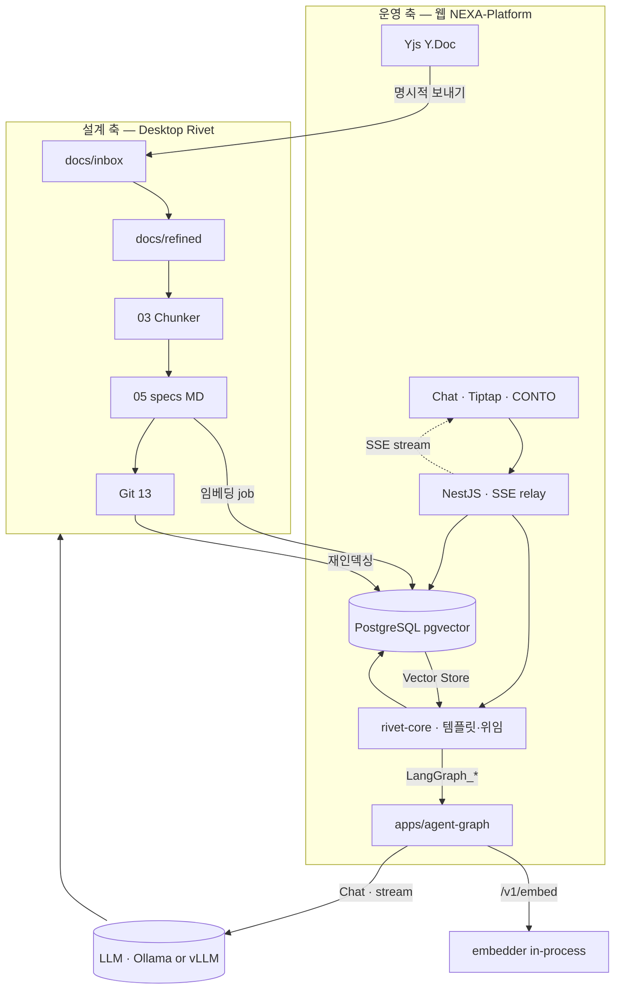

# NEXA RAG 아키텍처 — Rivet·PostgreSQL·Ollama

> **범위:** NEXA에서 RAG(검색 증강 생성)가 **어디에 쓰이고**, **무엇이 코퍼스이며**, **Rivet 그래프 설계에 어떻게 반영되는지**를 정의한다.  
> **위치:** `docs/NEXA OS/Rivet/` — Desktop Rivet(설계·배치)과 **웹 rivet-core(운영)** 가 **같은 그래프 규격**으로 PostgreSQL 운영 데이터까지 읽도록 설계한다. **운영 LLM·Streaming = `apps/agent-graph` 단일 SSOT** — rivet-core는 **템플릿·위임만**. — [`온톨로지 관리 툴`](./리벳(Rivet)%20중심의%20'온톨로지%20관리%20툴%20개발.md) §2.2.2.

| 문서 | 역할 |
| ---- | ---- |
| **[본 문서]** | RAG **스택 연결** · 코퍼스 이원화(파일 + DB) · Rivet 노드·그래프 설계 규약 |
| [`Rivet 파이프라인.md`](./Rivet%20파이프라인.md) | Desktop vs 웹 배치 · 일방통행 `docs/` · 삼각 동기화 · Ollama 경로 |
| [`Desktop Rivet 캔버스(Graph) 설계 v1.0.md`](./Desktop%20Rivet%20캔버스(Graph)%20설계%20v1.0.md) | Main · Sub_01~14 · MCP · Obsidian MOC |
| [`DDL 00 SCHEMA … v5.md`](../Database/DDL%200%20SCHEMA%20NEXA%20Platform%20DB%20설계%20명세%20v5.md) | `project_knowledge` · pgvector · 삼각 편대 |
| [`NEXA AIS RAG 및 페르소나 아카이브 전략서`](../AI/NEXA%20AIS%20RAG%20및%20페르소나%20아카이브%20전략서%20(RAG%20&%20Persona%20Strategy).md) | 아톰·5W1H·페르소나 **철학** (본 문서는 **경로·테이블·노드** SSOT) |
| [`Rivet Engine 노드 분석.md`](../Nexia/Rivet%20Engine%20노드%20분석.md) | Chunk Text · Vector Store · 커스텀 노드 후보 |
| [`벡터 데이터 처리 및 아키텍처.md`](../NEXA%20OS/벡터%20데이터%20처리%20및%20아키텍처.md) | **§1 Non-Negotiable** — JSONB 최소화 · AI 온톨로지 환각=독 · Embed/Retrieve Rivet 가이드 |
| [`CSIM · AXON 프로토콜 (정본)`](../Nexia/_Cosmic%20Semantic%20Interface%20Matrix%20v2%20—%20CSIM%20·%20AXON%20프로토콜%20(정본).md) | **NEXA HEXAGON 프로토콜** — IoT 고정 스키마 vs 백오피스 지식 분리 |
| [`RAG · OAG · AIP — 지능 층위와 오케스트레이션`](../NEXA%20OS/RAG%20·%20OAG%20·%20AIP%20—%20지능%20층위와%20오케스트레이션.md) | **RAG → OG-RAG → OAG → AIP** 층위 · rivet-core + LangGraph = **AIP** |

> **층위:** 본 문서 = **RAG**(+ **OG-RAG** 검색 구간) 구현 SSOT. **OAG** · **AIP** — [지능 층위 문서](../NEXA%20OS/RAG%20·%20OAG%20·%20AIP%20—%20지능%20층위와%20오케스트레이션.md) §3 **OG-RAG**.

---

## 1. 핵심 주장 — RAG는 Rivet 그래프 안에서 설계된다

NEXA의 RAG는 **벡터 DB만 붙인 채팅**이 아니다. 다음 **두 종류의 지식**을 **agent-graph LLM adapter**(dev: Ollama · prod: vLLM)로 읽고, **Rivet 그래프**로 **검색·템플릿·위임** 흐름을 고정한다.

| 지식 축 | 출처 | 주로 쓰이는 런타임 | 생명주기 |
| ------- | ---- | ----------------- | -------- |
| **설계·규범 코퍼스** | `docs/inbox` → `refined` → `specs/` · Git | **Desktop** Sub_01~05 · MCP Get Prompt | 배치 · PR · 감사 |
| **운영·런타임 코퍼스** | **PostgreSQL** (`project_knowledge` 등) | **웹 rivet-core** + **agent-graph** | 사용자 협업·IoT·에이전트 실행 중 축적 |

**설계 시 반영 원칙**

1. **Desktop에서 만드는 그래프**는 `docs/`만 가정하지 않는다. **웹 운영 그래프**는 **DB 조회·검색 노드** + **`LangGraph_*` 위임**을 포함한다.
2. **LLM (운영):** **agent-graph만** 호출 — dev **Ollama** · prod **vLLM** (`LLM_BACKEND`). rivet-core Export에 **Chat/Embed 노드 금지**. Nest · 브라우저 직접 호출 금지. **Desktop Studio** 배치는 로컬 Chat 허용(공장) — 웹과 **분리**.
3. **Git + `docs/specs/` + Zod**는 문서·계약 SSOT이고, **pgvector**는 검색 가속 레이어다. 운영 DB만 블랙박스 SSOT로 두지 않는다 — **ref_ids·wikilink·Run 로그**로 근거를 되돌린다.

> **상위 규범:** JSONB는 보조만 · **검증 전 AI 온톨로지·AI 답변은 SSOT·실행에 넣지 않음** — [`벡터 데이터 처리 및 아키텍처`](../NEXA%20OS/벡터%20데이터%20처리%20및%20아키텍처.md) **§1**.



---

## 2. SSOT 계층 — 동시에 단일 진실로 두지 않는 것

| 레이어 | 저장소 | Rivet에서의 역할 | RAG에서의 역할 |
| ------ | ------ | ---------------- | -------------- |
| **협업 세션** | Yjs `document` · `rivetGraph` | 실시간 기획·그래프 편집 | **단기 맥락** (파일·DB 미반영) |
| **파일 코퍼스** | `docs/specs/**` · `refined/` | Desktop MCP 읽기·05 산출 | **인용 정본** · 기획 RAG |
| **계약** | Zod(06) · Prisma/DTO(08~10) | 검증 Sub · Tool 스키마 | 구조 검증용 — **본문 RAG와 분리** |
| **운영 지식** | `project_knowledge` 등 | **웹 Vector Store 노드** | 유사도 검색·요약 아톰 |
| **대화·실행** | `project_chats` · `project_orchestra` | Chat 노드 · Tool Calling | **현재 맥락** · **미래 액션** |

> **주의:** Yjs 세션 SSOT와 `docs/specs/` 파일 SSOT를 **동시에 단일 진실**로 두지 않는다. 확정·보내기 시에만 `inbox`/`refined`로 재유입 후 Desktop 01~05·(재)임베딩. — [`Rivet 파이프라인.md`](./Rivet%20파이프라인.md) §삼각 동기화.

---

## 3. 코퍼스 A — 설계·배치 (Desktop Rivet 01~05)

Desktop **Main · 01~14**는 웹 뼈대를 만드는 **공장**이면서, 동시에 **RAG 코퍼스 전처리 라인**이다.

| Sub | RAG 관점 역할 | 산출 |
| --- | ------------- | ---- |
| **01** Inbox | 수집 대상 인벤토리 | `inbox_inventory.json` |
| **02** Refiner | Normex·경로·manifest | `docs/refined/**` |
| **03** Chunker | **의미 단위 청크** (도메인·제목·코드 블록) | 청크 배열 → 임베딩 입력 |
| **04** Conflict | 검색 전 **품질 게이트** · Obsidian MOC | `conflict-report.md` |
| **05** Planning | **RAG 1차 인용원** MD 트리 | `docs/specs/**` · wikilink |
| **14** Health (수동) | 코퍼스 건강·재기획 근거 | `health-report.md` |

**Desktop Rivet 그래프 설계 체크리스트**

- [ ] Sub_03 출력 스키마가 **임베딩 job**(`project_jobs`) 입력과 호환되는가
- [ ] Sub_05 `planning_manifest.json` 경로가 `ref_ids`·wikilink와 매핑되는가
- [ ] MCP **read** roots에 `specs/`·`refined/`·`.rivet/runs`가 명시되는가
- [ ] 04·14 MOC가 **근거 추적** 노드(Get Prompt)와 연결되는가

상세 MCP·Obsidian: [`Desktop Rivet 캔버스(Graph) 설계 v1.0.md`](./Desktop%20Rivet%20캔버스(Graph)%20설계%20v1.0.md).

---

## 4. 코퍼스 B — 운영·런타임 (PostgreSQL)

웹앱이 돌아가며 쌓이는 데이터는 **Rivet 운영 그래프의 1급 입력**이다. 설계 단계 그래프만으로는 **실제 사용자·디바이스·에이전트 맥락**을 답할 수 없다.

### 4.1 AI 협업 삼각 편대 (과거·현재·미래)

DDL §2.1 **AI 협업 삼각 편대**를 Rivet 노드 세트로 대응시킨다.

| 개념 | 테이블 (DDL) | Rivet 그래프에서 |
| ---- | ------------ | ---------------- |
| **과거 / 지식** | `project_knowledge` | **Vector Store** · Embed · 5W1H Filter |
| **현재 / 대화** | `project_chats` | **LangGraph_RagGround** (agent-graph) · Prompt Shell | **세션 Context** |
| **미래 / 실행** | `project_orchestra` | Tool Calling · Sub-Graph · Match 분기 |

보조 레이어:

| 테이블 | RAG·그래프 용도 |
| ------ | --------------- |
| `project_logs` | 유사 이력 검색(`embedding`) · why_chain 근거 |
| `project_agent_sessions` | UNLOGGED · 24h TTL — **단기 에이전트 상태** (장기 RAG 원천 아님) |
| `project_jobs` | RAG 임베딩·FFmpeg 등 — **백그라운드 노드** 진행률 |
| `project_yjs_updates` | 협업 종료 후 스냅샷 → (선택) `project_knowledge` 아톰화 |
| `global_knowledge_base` | 마켓·템플릿 검색 — 프로젝트 외 RAG |

### 4.2 `project_knowledge` — 운영 RAG의 중심

| 필드 | RAG 용도 |
| ---- | -------- |
| `nature_tag` | ROUTINE / INTENT / RULE 등 — 검색 필터 |
| 5W1H SMALLINT 6컬럼 | DB 레벨 **90% 프리필터** 후 벡터 검색 |
| `content_fact` | **요약 아톰** — LLM 컨텍스트 1차 (토큰 절약) |
| `raw_content` | 원문 보강 · 인용 확장 |
| `embedding` | pgvector · **`nomic-embed-text`** (768) — agent-graph **`embedder` in-process** |
| `ref_ids` | `source_log_ids` · multimodal ref — **근거 역추적** |
| `confidence_score` | 유사도와 함께 랭킹·ASK 유도 |

**임베딩 모델 SSOT:** **`nomic-embed-text`** (768) — agent-graph **`embedder.py` in-process** (Ollama Embed **✗**). 모델·VECTOR 차원 변경 시 DDL·재인덱싱 정책을 함께 갱신한다.

### 4.3 파일 코퍼스 → DB 동기화 (설계와 운영의 접합)

```text
docs/specs/** (05) ──임베딩 job──▶ project_knowledge
Git 13 commit ────────────────▶ source_hash 갱신 → 재임베딩
Yjs 확정본 ──inbox──▶ 01~05 ──▶ specs ──▶ project_knowledge
웹 채팅·에이전트 Run ──────────▶ project_logs / project_chats ──▶ (승격 시) project_knowledge
```

- **Chokidar / Doc Sync Crawler** — `DOCS_PATH` 변경 감지 → N-PATH `anchor_id`로 rename 후에도 동일 청크 유지 (부록: [`NEXA 부록-협업 스택…`](../Nexion/NEXA%20부록-협업%20스택·큐·오케스트레이션%20흐름·머메이드.md) §B.2).
- **BullMQ** — 안전(1) · 사용자(2) · 일상(4) 우선순위로 벡터화 배칭.

---

## 5. Ollama — LLM · Streaming SSOT (`apps/agent-graph`)

> **운영 웹:** Chat·Stream = **agent-graph LLM adapter**만. rivet-core · NestJS · 브라우저 **직접 호출 금지**.  
> **추론 백엔드:** **dev** Ollama · **production** **vLLM**(권장) — `LLM_BACKEND` env · Nest/rivet **무변경**.  
> **Desktop 배치:** Ironclad Studio 로컬 Chat — **공장 전용** (웹 Export 그래프에 Chat 노드 **복사 금지**).

| 용도 | 호출 경로 | Rivet / LangGraph 맥락 |
| ---- | --------- | ------------------------ |
| **임베딩** | Nest **`Embed_Pipeline`** → agent-graph **`/v1/embed` → `embedder`** (in-process) | pgvector upsert · **Ollama Embed ✗** |
| **채팅·RAG·Extract** | Nest → rivet → **agent-graph LLM adapter** → Ollama \| vLLM | rivet **`LangGraph_*` 래퍼** |
| **배치 문서 정제** | Desktop Rivet → Ollama (로컬 Chat) | Sub_02~05 — Embed는 **`/v1/embed` 수렴** |
| **Streaming (토큰)** | agent-graph SSE → Nest relay → UI | rivet Run 타임라인 = **위임 스텝**만 |

```text
[운영 — 웹]
  [브라우저] ─HTTP/SSE─▶ [NestJS] ─run─▶ [rivet-core: Get Prompt · LangGraph_*]
                                              │
                                              ├──HTTP/SSE──▶ [agent-graph LLM] ──▶ [Ollama | vLLM]
                                              └──POST /v1/embed──▶ [embedder in-process]

[배치 — Desktop]
  [Desktop Rivet Studio] ─로컬─▶ [Ollama]   (Export 시 Chat 노드 → LangGraph_* 로 교체)
```

- **금지:** Next.js·브라우저·**rivet-core Chat 노드** → Ollama · **Ollama `/api/embed`** (웹).
- **Docker Compose:** Next · Nest+rivet-core · **agent-graph** · **Ollama(dev) / vLLM(prod)** — [`Rivet 파이프라인.md`](./Rivet%20파이프라인.md) §도커.
- **`LLM_BACKEND`:** `ollama` \| `vllm` … — **agent-graph 내부만**.
- **`OLLAMA_BASE_URL`:** `LLM_BACKEND=ollama` 일 때.
- **`VLLM_BASE_URL`:** `LLM_BACKEND=vllm` 일 때 — OpenAI-compatible `/v1`.
- **`EMBED_MODEL` / `EMBED_DIM`:** agent-graph **`embedder`** — **추론 백엔드와 독립**.

시스템 프롬프트에 고정할 컨텍스트 예:

```text
- 임베딩: **embedder** `nomic-embed-text` (768) → project_knowledge (pgvector, cosine) — **Ollama `/api/embed` ✗**
- 검색 전: 5W1H SMALLINT 필터 → vector search → content_fact 우선
- 근거: ref_ids · docs/specs wikilink · conflict-report
- 파일 SSOT: docs/specs · 계약 SSOT: Zod — 혼동 금지
```

---

## 6. Rivet 그래프 설계 — Desktop vs 웹

### 6.1 이중 그래프 (같은 JSON 규격 · 다른 I/O)

| | **Desktop 그래프** | **웹 rivet-core 그래프** |
| --- | --- | --- |
| **주 목적** | `docs/` 배치 · 규범 생성 · Export | 사용자·운영 **실시간 RAG·에이전트** |
| **파일 I/O** | MCP FileSystem | **NestJS API** (Path Traversal 검증) |
| **DB I/O** | (간접) 임베딩 job 트리거 설계 | **Vector Store Connector** · Prisma 직접 |
| **LLM** | Desktop Studio **로컬 Chat** (배치) | **`LangGraph_*` → agent-graph** — rivet **Chat 없음** |
| **세션** | Run ID · `.rivet/runs` | Yjs · `project_agent_sessions` |
| **공통** | `.rivet-project` JSON · 노드 type | Export 토폴로지 · Get Prompt · **동일 Graph I/O 계약** |

Desktop에서 **웹용 운영 그래프**를 함께 설계하고, Export·커스텀 노드 코드를 레포에 넣어 NestJS 기동 시 rivet-core에 등록한다. — [`Rivet 파이프라인.md`](./Rivet%20파이프라인.md) 「Desktop에서 웹용 Rivet Core 그래프도 설계한다」.

### 6.2 RAG 표준 노드 체인 (권장 토폴로지)

**배치 (Desktop · 또는 NestJS 스케줄)**

```text
Graph Inputs (manifest)
  → Chunk Text (또는 AST Chunker)
  → (Desktop) agent-graph /v1/embed (권장) | (레거시) Desktop Ollama Embed
  → (웹 job) agent-graph embedder in-process
  → PG Upsert (project_knowledge)
  → Graph Outputs (job_id)
```

**운영 (웹 rivet-core · RAG — LLM은 agent-graph)**

```text
Graph Inputs (query, project_id, session_id)
  → Get Session (project_chats / Yjs 요약)
  → 5W1H Filter (Code 노드 또는 Nest 서비스)
  → Vector Store (pgvector · project_knowledge)
  → Get Prompt — specs 인용 (rivet 템플릿)
  → Assemble Object (근거 패킷 · prompt_bundle)
  → LangGraph_RagGround  ──HTTP/SSE──▶  agent-graph (Ollama · stream)
  → Graph Outputs (answer + citations)
```

| 노드 | 출처 | 비고 |
| ---- | ---- | ---- |
| Chunk Text | Rivet 표준 | Desktop 03과 동일 규칙 |
| Vector Store | Rivet 표준 | **pgvector 백엔드**로 커스텀 |
| Vector Store Connector | 커스텀 (To-Be) | 검색만 — **embed = agent-graph `embedder`** |
| Get Prompt (MCP/rivet) | Desktop · rivet-core | `docs/specs/` — **템플릿 조립** |
| **`LangGraph_*`** | rivet 커스텀 | **LLM 위임** · SSE 중계 — [`온톨로지 툴`](./리벳(Rivet)%20중심의%20'온톨로지%20관리%20툴%20개발.md) §5.1 |
| ~~Chat (Ollama)~~ | — | **웹 Export 금지** — agent-graph로 대체 |

노드 카탈로그: [`Rivet Engine 노드 분석.md`](../Nexia/Rivet%20Engine%20노드%20분석.md).

### 6.3 Graph Inputs / Outputs 계약 (웹 Run 시)

NestJS `runGraph` 호출 시 **반드시 넘길 context**:

| 키 | 설명 |
| -- | ---- |
| `project_id` | RLS·코퍼스 스코프 |
| `user_id` | capability_id · Normex 검증 |
| `session_id` | `project_chats` · `project_agent_sessions` |
| `query` | 사용자 질의 (또는 에이전트 trigger) |
| `coil_template_id` | GOVERN/RAG 가중 (`project_settings`) |

**Graph Outputs (권장):**

| 키 | 설명 |
| -- | ---- |
| `answer` | 최종 자연어 |
| `citations[]` | `{ type: 'knowledge'|'spec'|'log', id, path?, score }` |
| `tokens_used` | 감사·quota |

### 6.4 삼각 동기화와 RAG

웹 **LangGraph_RagGround → agent-graph → (stream) → Y.Doc** 루프는 **세션 내 RAG**다. PostgreSQL의 장기 지식을 쓰려면 운영 그래프에 **Vector Store 분기**를 넣고, Yjs `document`는 **질의 보조**로만 쓴다.

| 흐름 | 데이터 |
| ---- | ------ |
| agent-graph stream → Doc → Rivet | 단기 — Yjs |
| Rivet **Retrieve** → LangGraph_RagGround | **장기** — `project_knowledge` + specs 인용 |
| 확정 → inbox | 파일 코퍼스 재구축 → 재임베딩 |

---

## 7. 검색 파이프라인 (Retrieval) 상세

> **층위:** 1~5 = **RAG**(1차 벡터 검색) · 6~7 = **OG-RAG**([Ontology-Grounded RAG](../NEXA%20OS/RAG%20·%20OAG%20·%20AIP%20—%20지능%20층위와%20오케스트레이션.md) §3 — 관계·MOC grounding) · 8 = **OAG** 입력(Prompt Shell·specs).

```text
[RAG — 1차]
1. 질의 정규화 (English Kernel IR — 선택)
2. project_chats 최근 N턴 병합 (현재)
3. 5W1H 토큰 추론 → SQL WHERE (90% 축소)
4. nature_tag · confidence_score · capability 필터
5. pgvector cosine Top-K (content_fact 임베딩)

[OG-RAG — 2차 온톨로지 grounding]
6. ref_ids · wikilink 확장 — project_logs · specs path · vault_path
7. 04 conflict MOC (14 health MOC) — 모순 청크 제외/하향 · 관계도 랭킹

[OAG 입력]
8. Get Prompt(specs/) · Prompt Shell → **agent-graph** Ollama (json | stream)
```

| 단계 | 층 | Desktop 연관 | 웹 연관 |
| ---- | -- | ------------ | ------- |
| 1~5 | RAG | 03 청크 품질 | ingest job 동일 규칙 |
| 6~7 | **OG-RAG** | 04 MOC · wikilink | `ref_ids` + vault_path 확장 |
| 8 | OAG 게이트 | 05 Planning · Normex | Get Prompt · citations |

| 항목 | 비고 |
| ---- | ---- |
| **금지** | 5번 Vector Store 결과만으로 **agent-graph 답변 단독 종료** (OG-RAG·specs 인용 생략) |
| **금지** | rivet-core **Chat 노드** · Nest/브라우저 → Ollama **직접** |
| **GraphRAG** | 업계 프레임과 **별개** — NEXA OG-RAG = specs wikilink + 04/14 MOC + `ref_ids` |
| 페르소나 | 코일·GOVERN — [페르소나 전략서](../AI/NEXA%20AIS%20RAG%20및%20페르소나%20아카이브%20전략서%20(RAG%20&%20Persona%20Strategy).md) §2~3 |

**Redis** — 동일 질의·동일 5W1H 필터 캐시 (부록 §A).

---

## 8. Contract SSOT vs RAG SSOT

| | Zod / 06~11 | specs MD / 05 | project_knowledge |
| --- | --- | --- | --- |
| **목적** | API·DB·폼 **계약** | 사람·AI **기획·서사** | 검색·요약 **아톰** |
| **Rivet** | Validator Sub | Get Prompt · Planning | Vector Store |
| **변경** | CP-06 · 07·11 | CP-02 · 04 MOC | ingest job · TTL 정책 |

LLM 컨텍스트에 **Zod 스키마 전체**를 넣기보다, **specs 요약 + 검색된 knowledge fact**를 넣고, Tool Calling 시에만 Zod 검증 노드를 거친다.

---

## 9. 근거 추적 (Grounding) — OG-RAG 산출

**OG-RAG**의 목표는 벡터 Top-K를 **검증 가능한 관계·파일 경로**에 **ground** 하는 것이다. RAG 응답은 다음 중 **최소 하나**로 되돌릴 수 있어야 한다.

| 근거 유형 | 연결 |
| --------- | ---- |
| 파일 | `[[specs/...]]` · `planning_manifest.json` 경로 |
| DB | `project_knowledge.id` · `ref_ids.source_log_ids[]` |
| 진단 | `.rivet/conflicts/` · `conflict-report.md` |
| 실행 | `.rivet/runs/{run_id}/` · `git_commit_sha` |

Rivet **Graph Outputs `citations[]`** 와 UI 인용 칩을 동일 스키마로 맞춘다.

---

## 10. 피지컬 AI(IoT) vs 백오피스 지식 — NEXA HEXAGON 프로토콜

> **한 줄:** **NEXA HEXAGON**은 모호한 의도를 **5W1H 6축 정수 토큰**으로 정규화해, **백오피스**(CONTO/KORE·온톨로지·RAG)와 **피지컬 AI**(IoT·ACTON·Rule-based 고정 스키마)가 **서로 다른 데이터**를 쓰면서도 맞물리게 하는 AXON의 **기계 간 공통 문법·경계 프로토콜**이다.

NEXA는 **두 평면을 절대 섞지 않는다.** 이 분리를 구현하는 **공식 프로토콜**이 **NEXA HEXAGON 프로토콜**(5W1H 6축 정수 토큰 · AXON 스택 L2)이다.

| 평면 | 스키마·저장 | AI 온톨로지 · JSONB | Rivet 그래프 |
| ---- | ----------- | ------------------- | ------------ |
| **피지컬 AI 제어 (IoT·엣지)** | **규칙 기반(Rule-based)** · **딱딱한 고정 스키마** — HEXAGON SMALLINT 6컬럼 · APEX 패킷 · Zod 검증 · ACTON/`programRef` | **사용 금지** — 말단·제어 루프에 넣지 않음 | **ACTON·Reflex·Normex** 서브그래프 — Vector Store **없음** |
| **백오피스 지식 관리 (허브)** | `project_knowledge` · pgvector · `docs/specs/` · CONTO/KORE | **보조** `metadata`/`extra_data` JSONB · AI 온톨로지는 **초안·학습용** | **RAG_Retrieve** · Embed_Pipeline · Desktop 01~05 |

```text
[ 백오피스 — 지식·RAG ]
  AI 온톨로지(초안) · JSONB 메타 · pgvector · specs MD
        ↑↓ CONTO · KORE (해석·저장·순환 정교화)
              │
       HEXAGON (5W1H 정수 토큰)  ←── NEXA HEXAGON 프로토콜 (경계)
              │
[ 피지컬 AI — IoT 제어 ]
  Rule-based · Zod · APEX Header/Body · ACTON · Reflex
  (엣지는 온톨로지·JSONB·벡터 검색을 모름)
```

### 10.1 NEXA HEXAGON 프로토콜이 하는 일

**HEXAGON**(Six-Axis Tokenized Interaction Standard)은 인간·AI의 **모호한 의도**와 기계의 **결정론적 실행** 사이 **번역층**이다.

| AXON 구성 | 역할 | RAG·벡터 문서와의 관계 |
| --------- | ---- | ---------------------- |
| **HEXAGON (L2)** | 5W1H **정수 토큰** · 기계 간 공통 포맷 · Zod 스키마 검증 | DDL `project_*` SMALLINT 6컬럼과 **동일 골격** |
| **CONTO** | Human↔AI **온톨로지 해석** — 백오피스 | agent-graph · rivet Get Prompt · 충돌 검토 **여기** |
| **KORE** | 지식 저장·벡터·재사용 — 백오피스 | `project_knowledge` · Embed 파이프라인 **여기** |
| **ACTON** | 디지털→**물리 실행** — 피지컬 | Rule·Ethos·`programRef` — **RAG 검색 없음** |

신호 흐름 (CSIM 정본):

```text
APEX → HEXAGON → CONTO → KORE  (백오피스: 온톨로지·지식·RAG)
              ↘
               HEXAGON → ACTON → 물리 (IoT: 고정 스키마만)
```

> **세포는 두뇌를 모름** (AXON §2.3): ESP32·센티널은 **HEXAGON·FACT·Reflex** 만 보내고, **JSONB 온톨로지·pgvector를 읽지 않는다.**

상세: [`CSIM · AXON 프로토콜 (정본)`](../Nexia/_Cosmic%20Semantic%20Interface%20Matrix%20v2%20—%20CSIM%20·%20AXON%20프로토콜%20(정본).md) §11 HEXAGON · §12 CONTO/KORE · §13 Intent to Act.

### 10.2 왜 AI 온톨로지·JSONB는 백오피스만인가

| | **백오피스 (허용)** | **IoT 제어 (금지)** |
| --- | --- | --- |
| **AI 온톨로지** | CONTO에서 **가설·초안** · 04 Conflict 후 specs 승격 | 실행 조건·상태 머신 **SSOT 아님** — 환각=독 |
| **JSONB** | `metadata`/`extra_data` **보조** · ref 키 | 제어 패킷·펌웨어 설정 **본문 아님** |
| **pgvector / RAG** | 질의·기획·사후 분석 | **제어 루프 인라인 검색 금지** |
| **스키마** | 진화 가능(승격·Git) | **고정** — Rule·Zod·Domain Profile whitelist |

**못 박는 문장**

> **피지컬 AI 제어에는 규칙 기반 고정 스키마만.** AI 온톨로지와 JSONB는 **백오피스 지식 관리** 전용이며, 둘을 이어 주는 프로토콜이 **NEXA HEXAGON** 이다.

### 10.3 Rivet 그래프 설계 — 두 갈래 분리

| 그래프 (권장 명) | 런타임 | 포함 노드 | **포함하지 않음** |
| ---------------- | ------ | --------- | ----------------- |
| **`RAG_Retrieve`** · **`Embed_Pipeline`** | NestJS · Desktop 배치 | Vector Store · **LangGraph_*** · specs · KORE upsert | ACTON · GPIO · 펌웨어 write |
| **`HEXAGON_Route`** · **`ACTON_Execute`** | NestJS · 엣지 게이트웨이 | Linguistic Routing · HEXAGON encode · Zod · Ethos · ACTON-GM | Vector Store · Extract JSON→온톨로지 SSOT |

**금지:** 하나의 Rivet 그래프에서 `Vector Store → LangGraph_* → ACTON` **직결** (RAG 답변이 곧바로 물리 실행).

**권장 흐름**

```text
사용자 의도
  → (백오피스) RAG_Retrieve · Omnix · CONTO — 조언·기획
  → (승인) Normex · Ethos · Human CP
  → (피지컬) HEXAGON 정규화 → Zod → ACTON — 고정 스키마만 실행
```

- 엣지 **COLD:** 벡터·JSONB 온톨로지 **미배포** — HEXAGON·Rule·Reflex만 ([`벡터 데이터 처리 및 아키텍처`](../NEXA%20OS/벡터%20데이터%20처리%20및%20아키텍처.md) §3).
- [`The Wave of AI Innovation`](../NEXA%20OS/The%20Wave%20of%20AI%20Innovation(AI%20혁신의%20물결).md) §5 피지컬 AI — **허브=기억·규범 · 엣지=Fact·Reflex**.

### 10.4 체크리스트 (HEXAGON · Rivet)

- [ ] IoT/ACTON 그래프에 **Vector Store·RAG LangGraph 종단**이 없는가
- [ ] 백오피스 RAG 그래프가 **ACTON·펌웨어 write** 로 **직결되지 않는가**
- [ ] 제어 경로가 **HEXAGON SMALLINT / APEX / Zod / Rule** 고정 스키마인가
- [ ] AI 온톨로지 산출이 **CONTO·KORE·specs** 에만 머무는가 (JSONB 본문 적재 X)
- [ ] Ethos·Normex·Omnix 승인 후에만 HEXAGON→ACTON 인가

---

## 11. 보안·격리·Normex

| 항목 | RAG 영향 |
| ---- | -------- |
| **RLS** | `project_id` 밖 knowledge 검색 금지 |
| **Normex 선행** | MUST 미통과 시 Logex/Scribx 실행 차단 → **검색 결과를 액션에 사용하지 않음** |
| **MCP roots** | Desktop — `docs/` 허용 트리만 |
| **NestJS** | DB·파일 API 단일 창구 · secrets는 `project_secrets` BYTEA |
| **COLD 프로필** | 저사양 — 벡터 페이로드 금지 · 10KB 필수 데이터만 ([로드맵](../_NEXA%20GUIDE%20플랫폼%20구현%20단계%20및%20로드맵.md)) |

---

## 12. 운영 — 재인덱싱·드리프트

| 트리거 | 동작 |
| ------ | ---- |
| Git 13 push | `source_hash` 변경 청크 재임베딩 |
| 05 planning_manifest 갱신 | 해당 paths만 upsert |
| Yjs → inbox 재유입 | 01~05 후 전량 또는 delta job |
| `nomic-embed-text` 변경 | `project_jobs` 전량 재빌드 |
| 14 Health REFACTOR | inbox 재기획 → 코퍼스 전면 재구축 |

**드리프트 점검:** Yjs 세션 기획 vs `docs/specs/` vs `project_knowledge` 최신 `ref_ids` 불일치 시 04·14 MOC 수동 실행.

---

## 13. 에이전트 툴과의 선 (RAG 관점)

| 외부 패턴 | NEXA 대응 |
| --------- | --------- |
| Pinecone-only 에이전트 메모리 | **pgvector + Git specs** 하이브리드 |
| 세션만 기억하는 채팅 | **삼각 편대** + Rivet Retrieve 노드 |
| 새 RAG SaaS | **Vector Store Connector** 커스텀 노드로 흡수 — Main 01→13 유지 |

— [`Rivet 파이프라인.md`](./Rivet%20파이프라인.md) 「트렌디한 에이전트 툴과의 선」.

---

## 14. 로드맵 · 미구현

| 항목 | 상태 |
| ---- | ---- |
| Vector Store Connector (pgvector) | To-Be |
| LangChain in `server/package.json` | 미도입 — 도입 시 본 문서 §6 갱신 |
| AST Chunker (Unified) @ NestJS | 부록 §B.3 설계 |
| `docs/Nexia/` → `docs/specs/` 이전 후 재임베딩 | 수동 이전 예정 |
| Neo4j vs Obsidian wikilink + pgvector | **후자** 채택 (04·14 MOC) |

---

## 15. 부록

### A. 최소 운영 RAG 서브그래프 예 (의사 JSON)

```json
{
  "nodes": [
    { "id": "in", "type": "Graph Inputs", "data": { "keys": ["query", "project_id"] } },
    { "id": "chats", "type": "HTTP Request", "data": { "path": "/internal/chats/recent" } },
    { "id": "filter", "type": "Code", "data": { "label": "5W1H Filter" } },
    { "id": "vec", "type": "Vector Store", "data": { "backend": "pgvector", "table": "project_knowledge" } },
    { "id": "spec", "type": "HTTP Request", "data": { "path": "/internal/specs/resolve" } },
    { "id": "asm", "type": "Assemble Object", "data": {} },
    { "id": "lg", "type": "LangGraph_RagGround", "data": { "graph_id": "rag_ground" } },
    { "id": "out", "type": "Graph Outputs", "data": { "keys": ["answer", "citations"] } }
  ],
  "edges": [
    { "source": "in", "target": "chats" },
    { "source": "in", "target": "filter" },
    { "source": "filter", "target": "vec" },
    { "source": "vec", "target": "asm" },
    { "source": "spec", "target": "asm" },
    { "source": "chats", "target": "asm" },
    { "source": "asm", "target": "lg" },
    { "source": "lg", "target": "out" }
  ]
}
```

좌표 없음 — 웹 UI는 Dagre·Cytoscape 레이아웃. — [`Rivet 파이프라인.md`](./Rivet%20파이프라인.md) §Rivet 프로젝트 JSON.

### B. `specs/` 경로 ↔ `project_knowledge.metadata` 매핑 (권장)

| metadata 키 | 예 |
| ----------- | -- |
| `vault_path` | `specs/project-core/vision` |
| `planning_manifest_id` | 05 run의 manifest 항목 id |
| `chunk_id` | 03 청크 id |
| `git_sha` | 13 commit |
| `source` | `desktop_pipeline` \| `yjs_export` \| `runtime_log` |

### C. 교차 참조 인덱스

- Desktop 파이프라인 · 일방통행 · 삼각 동기화 → [`Rivet 파이프라인.md`](./Rivet%20파이프라인.md)
- Sub_01~14 · MCP · Obsidian → [`Desktop Rivet 캔버스(Graph) 설계 v1.0.md`](./Desktop%20Rivet%20캔버스(Graph)%20설계%20v1.0.md)
- pgvector · 삼각 편대 · project_jobs → [`DDL 00 SCHEMA … v5.md`](../Database/DDL%200%20SCHEMA%20NEXA%20Platform%20DB%20설계%20명세%20v5.md)
- 아톰·5W1H·페르소나 철학 → [`NEXA AIS RAG 및 페르소나 아카이브 전략서`](../AI/NEXA%20AIS%20RAG%20및%20페르소나%20아카이브%20전략서%20(RAG%20&%20Persona%20Strategy).md)
- Chunk · Vector Store · 커스텀 노드 → [`Rivet Engine 노드 분석.md`](../Nexia/Rivet%20Engine%20노드%20분석.md)
- JSONB 최소화 · 환각 차단 · 임베딩 정책 · Rivet Embed/Retrieve → [`벡터 데이터 처리 및 아키텍처.md`](../NEXA%20OS/벡터%20데이터%20처리%20및%20아키텍처.md) §1·§5
- HEXAGON · IoT 고정 스키마 vs 백오피스 → 본 문서 §10 · [`CSIM · AXON (정본)`](../Nexia/_Cosmic%20Semantic%20Interface%20Matrix%20v2%20—%20CSIM%20·%20AXON%20프로토콜%20(정본).md)
- RAG·OG-RAG·OAG·AIP 층위 → [`RAG · OAG · AIP — 지능 층위와 오케스트레이션`](../NEXA%20OS/RAG%20·%20OAG%20·%20AIP%20—%20지능%20층위와%20오케스트레이션.md)
- Hocuspocus · Chokidar · BullMQ → [`NEXA 부록-협업 스택…`](../Nexion/NEXA%20부록-협업%20스택·큐·오케스트레이션%20흐름·머메이드.md)

---

**결론:** NEXA RAG는 **Desktop이 만든 파일 코퍼스**와 **웹이 쌓은 PostgreSQL 코퍼스**를 **agent-graph**(dev Ollama · prod vLLM)로 읽고, **rivet-core**는 Retrieve·Get Prompt·**LangGraph 위임**으로 경로를 고정한다. **LLM·Streaming SSOT = agent-graph** · rivet = **오케스트레이션·템플릿**. **피지컬 AI(IoT)는 Rule-based 고정 스키마**, **AI 온톨로지·JSONB는 백오피스만** — 경계는 **NEXA HEXAGON 프로토콜**(§10). **JSONB·미검증 AI 온톨로지에 진실을 맡기지 않는다** — [`벡터 데이터 처리 및 아키텍처`](../NEXA%20OS/벡터%20데이터%20처리%20및%20아키텍처.md) §1.
