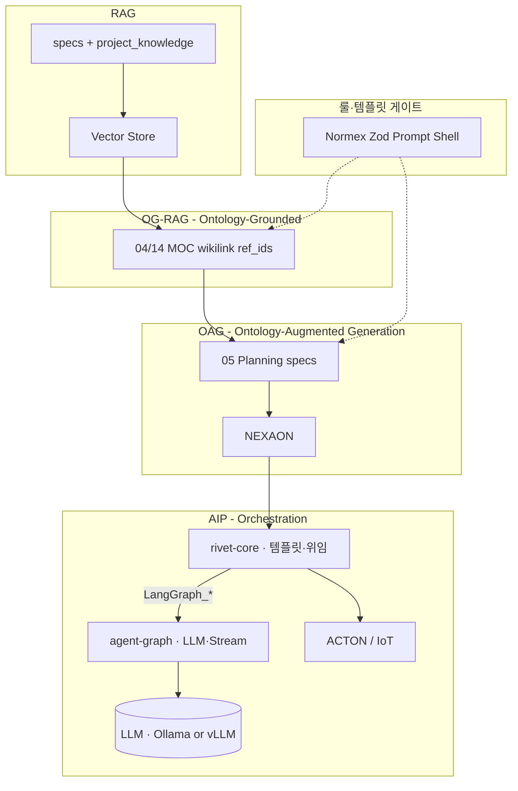

# RAG · OAG · AIP — 지능 층위와 오케스트레이션

> **한 줄:** NEXA 지능 스택은 **RAG** → **OG-RAG** → **OAG** → **AIP** 로 신뢰도·통제가 올라간다. **OG-RAG**는 벡터 검색 위 **2차 관계도(온톨로지 grounding)** · **OAG**는 구조화된 생성 · **AIP**는 **rivet-core**(템플릿·위임) + **`apps/agent-graph`**(LLM·Streaming) 실행이다.

| 약어        | 정식 명칭                         | 한 줄                                                                 |
| ----------- | --------------------------------- | --------------------------------------------------------------------- |
| **RAG**     | Retrieval-Augmented Generation    | 코퍼스에서 **근거 청크를 검색**해 생성에 넣는다                         |
| **OG-RAG**  | **Ontology-Grounded RAG**         | 벡터 결과로 **관계도·2차 온톨로지**를 잡고 검색·인용을 **땅에 박는다** |
| **OAG**     | **Ontology-Augmented Generation** | 관계·도메인 **구조로 생성을 보강** — specs·Planning·NEXAON             |
| **AIP**     | AI Orchestration (Platform)       | 구조화된 의도를 **그래프·에이전트·도구**로 **실행·감사**한다          |

> **용어 주의:** LLM이 지켜야 할 **룰·템플릿**(Normex · Zod · Prompt Shell)은 **OAG가 아니다** — OAG·AIP **입구 게이트**이다. (§4.1)

---

## 0. 본 문서의 위치

| 문서                                                                                                                         | 역할                                                            |
| ---------------------------------------------------------------------------------------------------------------------------- | --------------------------------------------------------------- |
| **[본 문서]**                                                                                                                | **RAG → OG-RAG → OAG → AIP** 층위 · NEXA 매핑 · rivet-core vs LangGraph |
| [`NEXA RAG 아키텍처`](../Rivet/NEXA%20RAG%20아키텍처%20—%20Rivet·PostgreSQL·Ollama.md)                                       | RAG **구현** (코퍼스 · pgvector · Rivet 노드)                   |
| [`벡터 데이터 처리 및 아키텍처`](./벡터%20데이터%20처리%20및%20아키텍처.md)                                                  | 임베딩 · JSONB·환각 원칙 · HEXAGON 경계                         |
| [`Rivet 파이프라인`](../Rivet/Rivet%20파이프라인.md)                                                                         | rivet-core · Desktop · 일방통행 `docs/`                         |
| [`Desktop Rivet 캔버스 설계 v1.0`](<../Rivet/Desktop%20Rivet%20캔버스(Graph)%20설계%20v1.0.md>)                              | OAG·AIP에 해당하는 **Sub_01~14** · Rivet 노드                   |
| [`CSIM · AXON (정본)`](<../Nexia/_Cosmic%20Semantic%20Interface%20Matrix%20v2%20—%20CSIM%20·%20AXON%20프로토콜%20(정본).md>) | NEXAON · HEXAGON · ACTON                                         |
| [`NEXIA 00`](../Nexia/00%20인공지능%20NEXIA%20구조와%20기술%20스택과%20운영방침.md)                                          | LangGraph · Omnix 3단계                                         |

---

## 1. 네 단계 — 기능이 아니라 **신뢰도·통제의 단계**

```text
질의 · 의도
    ↓
[RAG]     무엇을 읽을까?           — pgvector · specs 청크 · citations
    ↓
[OG-RAG]  관계·엔티티는?          — wikilink · MOC · ref_ids · 2차 관계도
    ↓
[OAG]     어떤 구조로 생성할까?    — 04·05 · NEXAON · specs MD (검증 후)
    ↓        ↑ Normex · Zod · Prompt Shell = 룰·템플릿 (게이트, OAG 아님)
[AIP]     누가 어떻게 실행할까?    — rivet-core · agent-graph · MCP · CP
    ├─ 백오피스: RAG~OAG 허용
    └─ IoT: HEXAGON·Rule·ACTON만 (승인 후)
```

| 층         | 질문           | SSOT 성격                                      | 환각·독                          |
| ---------- | -------------- | ---------------------------------------------- | -------------------------------- |
| **RAG**    | 관련 청크는?   | pgvector · `content_fact` · specs 인용         | 벡터 Top-K만으로 답 종료 금지    |
| **OG-RAG** | 관계·연결은?   | **2차 관계도** — 04/14 MOC · wikilink · `ref_ids` | AI가 만든 그래프만 SSOT 금지     |
| **OAG**    | 구조·계획은?   | **05 specs** · planning_manifest · NEXAON       | 미검증 온톨로지 JSON = 독         |
| **AIP**    | 실행·순서는?   | Rivet JSON · Run 로그 · Git                    | RAG/OG-RAG→ACTON 직결 금지       |

> **RAG · OG-RAG · OAG · AIP** 는 대체 관계가 아니다. **OG-RAG**는 RAG **안의 하위 기법**이면서 OAG **입력**이 된다.

---

## 2. RAG — Retrieval-Augmented Generation

**역할:** “**무엇을 읽고 인용할까**” — 생성 전 코퍼스에서 근거를 꺼낸다.

| 항목       | NEXA                                                      |
| ---------- | --------------------------------------------------------- |
| **코퍼스** | 설계: `docs/specs/` · 운영: `project_knowledge`(pgvector) |
| **처리**   | Desktop 01~05 · Embed_Pipeline · `RAG_Retrieve`           |
| **Rivet**  | Chunk Text · Vector Store · Get Prompt · **`LangGraph_*` 위임** | agent-graph = Chat · Embed · Stream |
| **원칙**   | pgvector = 검색 가속 · 진실 = Git + specs + `ref_ids`     |

상세: [`NEXA RAG 아키텍처`](../Rivet/NEXA%20RAG%20아키텍처%20—%20Rivet·PostgreSQL·Ollama.md). 벡터만으로 끝나지 않으려면 다음 **§3 OG-RAG** 구간이 필수다.

---

## 3. OG-RAG — Ontology-Grounded RAG (RAG 하위 · 2차 온톨로지)

> **한 줄:** **OG-RAG**는 벡터로 1차 검색한 뒤, **관계·엔티티·엣지(2차 온톨로지)** 로 근거를 **땅에 박고(ground)** 인용·다음 단계로 넘긴다.

| 단계 | 내용 | NEXA |
| ---- | ---- | ---- |
| **1차** | 유사도·청크 검색 | pgvector · 5W1H 필터 · `content_fact` |
| **2차** | 관계도·연결 확장 | **04** `conflict-report` MOC · **14** health MOC · wikilink · `ref_ids` |
| **정본** | 그래프가 가리키는 MD | `docs/specs/` · Git — **2차 그래프만 SSOT 아님** |

**GraphRAG 등 외부 프레임과의 선**

| | GraphRAG (업계) | NEXA **OG-RAG** |
| --- | --- | --- |
| **그래프** | 커뮤니티·엔티티 자동 추출 중심 | **specs wikilink + 04/14 MOC** + `ref_ids` (검증 가능) |
| **저장** | 종종 별도 그래프 DB | PostgreSQL + **파일 specs** — Neo4j 단독 SSOT 아님 |
| **위치** | RAG 제품 전체 | **RAG → OAG 사이** 하위 모듈 |

**Rivet (OG-RAG 구간)**

- Retrieve 후 **ref_ids · vault_path 확장** · Get Prompt(`specs/`) · 04 MOC 랭킹/제외
- **금지:** Vector Store → **agent-graph 답변 단독 종료** (OG-RAG·specs 인용 생략)

---

## 4. OAG — Ontology-Augmented Generation

**역할:** “**읽은 것을 어떤 구조·관계·계획으로 해석할까**” — 자유 형식 채팅이 아니라 **온톨로지·그래프·명세 구조**를 거친 뒤 생성한다.

| 항목        | NEXA                                                                       |
| ----------- | -------------------------------------------------------------------------- |
| **AXON**    | **NEXAON** — Human↔AI 온톨로지 해석 (백오피스)                             |
| **Desktop** | **03** Chunker → **04** Conflict(Obsidian MOC) → **05** Planning(`specs/`) |
| **검증**    | Normex · CP-02/06 · 04·14 MOC · specs + Git                                |
| **Rivet**   | Get Prompt · **`LangGraph_*`** · Extract (agent-graph) · **04/14 Report Generator** |
| **금지**    | Extract JSON → 곧바로 SSOT/실행 (OAG 생략)                                 |

**OAG와 “AI 온톨로지”의 구분**

|               | OAG (정상)                                     | AI 온톨로지 환각 (독) |
| ------------- | ---------------------------------------------- | --------------------- |
| **출력**      | specs MD · planning_manifest · wikilink 그래프 | 검증 없는 JSON/그래프 |
| **저장**      | Git · 고정 DDL 컬럼                            | JSONB 덩어리 · 벡터만 |
| **다음 단계** | 06 Zod · AIP(승인 후 실행)                     | 즉시 DB·ACTON         |

> **OAG**는 “온톨로지를 **만든다**”가 아니라, **OG-RAG**로 grounded 된 내용을 **도메인·계획·명세 구조로 증강(augment)** 하는 단계다. 최종 정본은 **`docs/specs/`** 이다.

### 4.1 룰·템플릿 ≠ OAG (혼동 금지)

LLM이 데이터를 다룰 때 **엄격히 지켜야 할 룰·템플릿**은 **OAG가 아니다.**

| 구분 | 역할 | NEXA |
| ---- | ---- | ---- |
| **룰·템플릿** | 형식·금지·MUST — **입구 게이트** | **Normex** · `constraints.md` · **Prompt Shell** · **Zod** · MCP Get Prompt |
| **OAG** | 관계·구조로 **생성 보강** | **05 Planning** · NEXAON · specs 트리 |
| **OG-RAG** | 검색 결과 **관계 grounding** | 04·14 MOC · wikilink |

```text
Normex / Zod / Template  →  (게이트)  →  OG-RAG  →  OAG  →  AIP
```

---

## 5. AIP — AI Orchestration (오케스트레이션)

**역할:** “**누가·어떤 순서로·어떤 도구로 실행할까**” — 구조화된 의도를 **런타임**에서 돌린다.

### 5.1 구현 이중축 — LLM · Streaming 단일화

| 런타임         | 역할 in AIP                                                          | LLM · Streaming |
| -------------- | -------------------------------------------------------------------- | --------------- |
| **rivet-core** | **가시적 그래프 SSOT** — Export 토폴로지 · Get Prompt · **`LangGraph_*` 위임** · Run 로그 | **없음** |
| **agent-graph** | **LangGraph** — LLM adapter(Ollama·vLLM) · Extract · RAG · rdflib · Neo4j · **SSE SSOT** | **단일 SSOT** |

```text
[AIP — 운영 웹]
  rivet-core   — 무엇을 어떤 노드 순서로 · prompt_bundle · LangGraph_* 위임 (감사·JSON·MCP)
  agent-graph  — LLM adapter (dev Ollama · prod vLLM) · Streaming · Python 노드 연산 (상태·분기·Extract)
       ↓
  NestJS 단일 오케스트레이터 · SSE relay (브라우저·rivet-core → LLM 서버 직접 금지)
```

**선 (흔들림 방지)**

- **AIP 그래프 설계·감사 = Rivet Export** — [`Rivet 파이프라인`](../Rivet/Rivet%20파이프라인.md).
- **AIP 연산·LLM = agent-graph** — rivet Export에 **Chat/Embed 노드 금지**.
- **LangGraph Studio** = 개발용 — 운영 UI는 NEXAON Run 타임라인 + SSE.

### 5.2 AIP 그래프 갈래 (Rivet)

| 그래프                            | 층                         | 용도                                           |
| --------------------------------- | -------------------------- | ---------------------------------------------- |
| `Embed_Pipeline` · `RAG_Retrieve` | RAG + **OG-RAG**           | Vector Store · ref/specs 확장 · citations      |
| Desktop **Main · 01~14**          | OG-RAG(04) + OAG(05) + AIP | specs·Zod·JOUT·Git                             |
| `HEXAGON_Route` · `ACTON_Execute` | AIP (피지컬)               | Rule · HEXAGON · ACTON — **Vector Store 없음** |

### 5.3 Human · Normex · HEXAGON (경계)

| 게이트             | 층               | 역할                                     |
| ------------------ | ---------------- | ---------------------------------------- |
| **CP-02/06/12**    | OAG→AIP          | 사람 승인 후 디스크·Git                  |
| **Normex · Ethos** | AIP              | MUST 미통과 시 실행 차단                 |
| **NEXA HEXAGON**   | OAG↔AIP(피지컬) | 5W1H 정수 토큰 — 백오피스와 IoT **경계** |

상세: [`NEXA RAG 아키텍처`](../Rivet/NEXA%20RAG%20아키텍처%20—%20Rivet·PostgreSQL·Ollama.md) §10 · [`벡터 데이터 처리 및 아키텍처`](./벡터%20데이터%20처리%20및%20아키텍처.md) §1.3.

---

## 6. NEXA 전체 매핑 표

| 층         | 질문           | 주요 자산                         | Rivet / 런타임                              |
| ---------- | -------------- | --------------------------------- | ------------------------------------------- |
| **RAG**    | 무엇을 읽나    | pgvector · specs 청크             | Chunk · Vector · **`LangGraph_RagGround`** (rivet 위임) |
| **OG-RAG** | 관계는 무엇인가 | 04/14 MOC · wikilink · `ref_ids`  | Retrieve 확장 · Get Prompt · 04 Report Gen    |
| **OAG**    | 어떻게 구조화  | 05 specs · NEXAON                  | 05 Sub · agent-graph Extract · Planning            |
| **AIP**    | 어떻게 실행    | Main · MCP · Zod · Git · ACTON    | rivet-core(토폴로지) · **agent-graph**(LLM) · CP |
| **게이트** | 룰·템플릿      | Normex · Zod · Prompt Shell       | CP-02/06/12 · Validator (OAG **아님**)      |



---

## 7. AI 혁신 물결과의 관계

| 물결 (요약)                          | NEXA 층                                  |
| ------------------------------------ | ---------------------------------------- |
| **3단계 생성형 AI** (LLM·RAG)        | **RAG** · **OG-RAG**                     |
| **4단계 에이전틱 AI** (Planning·MCP) | **OAG** + **AIP**                        |
| **5단계 피지컬 AI**                  | **AIP** ACTON 갈래만 (Rule·HEXAGON)      |

— [`The Wave of AI Innovation`](<./The%20Wave%20of%20AI%20Innovation(AI%20혁신의%20물결).md>).

---

## 8. 요약 (못 박기)

1. **RAG** — 청크·벡터 검색·인용. SSOT는 specs·Git.
2. **OG-RAG** — **Ontology-Grounded RAG**. 벡터 위 **2차 관계도**(MOC·wikilink·ref_ids). GraphRAG 대체가 아니라 **검증 가능한 grounding**.
3. **OAG** — **Ontology-Augmented Generation**. 구조·계획으로 **생성 보강** — 05 specs.
4. **룰·템플릿** — Normex·Zod·Prompt Shell. **OAG 아님** — OG-RAG·OAG **게이트**.
5. **AIP** — **rivet-core**(토폴로지·위임) + **agent-graph**(LLM·Streaming) 오케스트레이션.
6. **IoT** — RAG·OG-RAG·OAG 결과는 **승인·HEXAGON** 후 AIP(ACTON)만.

---

## 관련 문서

| 주제                   | 문서                                                                                                                         |
| ---------------------- | ---------------------------------------------------------------------------------------------------------------------------- |
| RAG 구현               | [`NEXA RAG 아키텍처`](../Rivet/NEXA%20RAG%20아키텍처%20—%20Rivet·PostgreSQL·Ollama.md)                                       |
| 벡터 · JSONB · HEXAGON | [`벡터 데이터 처리 및 아키텍처`](./벡터%20데이터%20처리%20및%20아키텍처.md)                                                  |
| Rivet · rivet-core     | [`Rivet 파이프라인`](../Rivet/Rivet%20파이프라인.md)                                                                         |
| Sub · Rivet 노드       | [`Desktop Rivet 캔버스 설계 v1.0`](<../Rivet/Desktop%20Rivet%20캔버스(Graph)%20설계%20v1.0.md>)                              |
| NEXAON · ACTON          | [`CSIM · AXON (정본)`](<../Nexia/_Cosmic%20Semantic%20Interface%20Matrix%20v2%20—%20CSIM%20·%20AXON%20프로토콜%20(정본).md>) |
