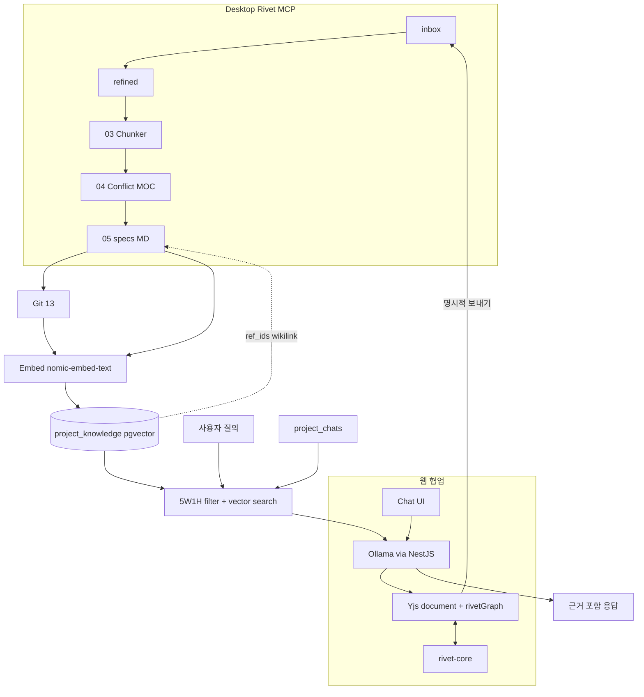

> **⚠️ 구버전 목차 초안** — **구현 SSOT**는 [`NEXA RAG 아키텍처 — Rivet·PostgreSQL·Ollama.md`](./NEXA%20RAG%20아키텍처%20—%20Rivet·PostgreSQL·Ollama.md) 이다.  
> **층위 정의**(RAG → **OG-RAG** → OAG → AIP)는 [`RAG · OAG · AIP — 지능 층위와 오케스트레이션`](../NEXA%20OS/RAG%20·%20OAG%20·%20AIP%20—%20지능%20층위와%20오케스트레이션.md) 를 따른다.

---

NEXA에서 RAG는 **한 곳의 벡터 DB**가 아니라, `docs/` 파이프라인 · DB · Rivet 그래프 · Yjs 세션 · Ollama가 겹치는 **다층 구조**입니다. 아래 목차는 그 연결을 SSOT 기준으로 정리한 **초기 제안**(보관용)입니다.

---

## 문서 제안

| 항목                      | 제안                                                                                                                                                                                                                 |
| ------------------------- | -------------------------------------------------------------------------------------------------------------------------------------------------------------------------------------------------------------------- |
| **제목**                  | `NEXA RAG 아키텍처 — 코퍼스·검색·협업 SSOT` (가칭)                                                                                                                                                                   |
| **위치**                  | `docs/Rivet/` (Desktop 01~05·Rivet 노드 중심) 또는 `docs/NEXA OS/` (pgvector·Normex·M.O.S.E.S. 중심)                                                                                                                 |
| **기존 문서와 역할 분담** | [`NEXA AIS RAG 및 페르소나 아카이브 전략서`](NEXA-Platform/docs/AI/NEXA AIS RAG 및 페르소나 아카이브 전략서 (RAG & Persona Strategy).md) = **아톰·5W1H·페르소나 철학** / **본 문서** = **스택·파이프라인·운영 연결** |

---

## 목차 (제안)

### 0. 서두 — 이 문서가 답하는 질문

- RAG가 NEXA에서 **무엇을 검색하고**, **어디에 쓰이며**, **무엇이 SSOT인지**
- 범위: Desktop Rivet · Embedded Rivet · NestJS · PostgreSQL(pgvector) · Yjs · Ollama
- 제외: 펌웨어 Reflex, Nexnap 패킷 상세 (별도 문서 링크)
- **관련 SSOT 맵** (한 장 표)

| 축                  | SSOT 문서                                                         |
| ------------------- | ----------------------------------------------------------------- |
| Desktop 파이프라인  | `Rivet 파이프라인.md`, `Desktop Rivet 캔버스(Graph) 설계 v1.0.md` |
| DB·벡터             | `DDL 00 SCHEMA … v5.md` §`project_knowledge`                      |
| 협업 세션           | `00_[AIS] Yjs·Hocuspocus 협업 SSOT.md`                            |
| 아톰·5W1H RAG 철학  | `NEXA AIS RAG 및 페르소나 아카이브 전략서`                        |
| Rivet 노드 카탈로그 | `Rivet Engine 노드 분석.md`                                       |
| 규범·경로           | `M.O.S.E.S. … v2.0.md`, Normex 표준                               |

---

### 1. NEXA에서의 RAG 정의 — 두 축

- **축 A — 배치 코퍼스 (Corpus)**: `inbox` → `refined` → `specs/` (Desktop **01~05**)
- **축 B — 런타임 검색 (Retrieval)**: `project_knowledge` · 채팅 맥락 · Rivet **Vector Store** 노드
- **원칙**: Git + `docs/specs/` + Zod가 **문서·계약 진실**; 벡터는 **가속·랭킹 레이어** (블랙박스 단독 SSOT 아님)
- 에이전트 툴과의 선: Rivet = **노드로 흡수**, Main·`docs/` 라인 유지 (`Rivet 파이프라인.md` 「왜 리벳인가?」)

---

### 2. SSOT 계층 — 동시에 “단일 진실”로 두지 않는 것

| 레이어          | 저장소                                 | 수명     | RAG 역할                               |
| --------------- | -------------------------------------- | -------- | -------------------------------------- |
| **세션**        | Yjs `Y.Doc` (`document`, `rivetGraph`) | 협업 중  | 단기 맥락·기획 초안                    |
| **파일 코퍼스** | `docs/inbox` · `refined` · `specs/`    | Git 영구 | 사람·AI가 읽는 명세 SSOT               |
| **계약**        | Zod(06) · Prisma/DTO(08~10)            | Git 영구 | 구조 검증·Tool Calling (RAG 본문 아님) |
| **아톰 지식**   | `project_knowledge` (pgvector)         | DB       | 유사도 검색·요약 아톰                  |
| **대화·도구**   | `project_chats` · `project_orchestra`  | DB       | 현재·가용 도구 (삼각 편대)             |

- **확정 경로**: Yjs → (명시적 보내기) → `inbox`/`refined` → 01~05 → specs → (선택) 재임베딩
- **자동 역류 없음** (`Rivet 파이프라인.md` §Desktop → docs → 웹)

---

### 3. 코퍼스 생애주기 — Desktop Rivet 01~05와 RAG

- **01 Inbox**: 스캔·인벤토리 (`inbox_inventory.json`)
- **02 Refiner**: Normex·경로 배치·`refined_manifest.json`
- **03 Chunker**: **의미 단위 청크** (도메인·제목·코드 블록) — RAG 품질의 1차 관문
- **04 Conflict**: 모순·누락 MOC — **검색 전 품질 게이트** (Obsidian `conflict-report.md`)
- **05 Planning**: `docs/specs/**` + wikilink 그래프 — **RAG가 인용해야 할 “정본 MD”**
- **14 Health** (수동): 코퍼스 건강·inbox 재기획 판단 (`health-report.md`)
- 산출물 ↔ 임베딩 트리거 시점 (05 후 / Git 13 후 / Chokidar 감지)

---

### 4. 청킹·메타데이터 규약

- **Normex**: 경로·금지·MUST — 청크 경계·파일 배치 규칙
- **Unified(Remark/Rehype) AST 청킹** (웹 백엔드; `NEXA 부록` §B.3)
- **Obsidian wikilink**: `[[specs/...]]`, `[[refined/...]]` — 청크 간 **그래프 메타**
- **Manifest 3종**: Inbox / Refined / Planning — 임베딩 job 입력 스키마
- `glossary.md` · `domain-map.md` — 동의어·도메인 태그 (검색 필터)

---

### 5. 임베딩·벡터 저장

- **모델 SSOT**: Ollama **`nomic-embed-text`** (DDL 고정; 차원 일치)
- **호출 경로**: Desktop(MCP) · NestJS → Ollama · **브라우저 직접 접근 금지**
- **저장소**:
  - `project_knowledge.embedding` (프로젝트 지식)
  - `project_logs.embedding` (유사 이력)
  - `global_knowledge_base` (마켓·템플릿)
  - `project_tags.tag_vector` (시맨틱 태그)
- **인덱스**: HNSW · cosine (`DDL v5` §RAG·시맨틱 검색)
- **장기 작업**: `project_jobs` (RAG 임베딩 큐) · BullMQ 우선순위 (안전 > 사용자 > 일상 벡터화)
- (선택) TurboQuant · OpenCL — 대규모 시 (`stack-and-dependencies.md`)

---

### 6. 검색 파이프라인 (Retrieval)

```text
질의/세션 맥락
  → 5W1H SMALLINT 프리필터 (90% 축소)
  → nature_tag · domain · confidence_score 가중
  → pgvector 유사도 (content_fact 우선, raw_content 보조)
  → ref_ids · wikilink로 근거 확장
  → LLM 컨텍스트 조립
```

- **HEXAGON·코일 템플릿**: GOVERN/RAG 반영 (`project_settings.current_coil_template_id`)
- **English Kernel / Multilingual Shell**: IR·아톰 영문, Summary 한국어 (페르소나 전략서 §4 연동)
- Redis 시맨틱 캐시 (동일 질의 방어)

---

### 7. Rivet 그래프 — RAG를 노드로 표현

- **Desktop Sub_03 Chunker** · **Sub_05 Planning** = 배치 RAG 전처리 그래프
- **표준 노드** (`Rivet Engine 노드 분석.md`): Chunk Text · Vector Store · Chat · Extract JSON
- **커스텀 노드 (To-Be)**:
  - Vector Store Connector (Ollama embed → pgvector)
  - Contextual Chunking (AST 입력)
  - **Get Prompt (MCP)** — `specs/`·`refined/` 읽기 전용 주입
- **웹 rivet-core**: 검색·채팅 그래프 런타임; Export JSON = Desktop과 **토폴로지 공유**, 좌표는 Dagre
- LangChain vs Embedded Rivet 역할 분담 (도입 시 §갱신)

---

### 8. Yjs · 삼각 동기화와 RAG 맥락

- **세션 SSOT**: `yText('document')` + `yMap('rivetGraph')`
- Chat → Ollama → `applyUpdate` — **세션 내 RAG** (파일 미반영)
- Rivet `onGraphChange` ↔ Yjs `observe` — 노드가 **검색 단계**를 그래프로 노출
- **확정 시**: Tiptap MD → `inbox` → Desktop 01~05 → specs → (재)임베딩
- Hocuspocus · `project_yjs_updates` 스냅샷 vs `project_knowledge` 장기 기억

---

### 9. Ollama — 생성 vs 임베딩

| 용도                  | 호출자                 | 모델 예               |
| --------------------- | ---------------------- | --------------------- |
| 채팅·기획·그래프 JSON | NestJS / Desktop Rivet | Hermes 등             |
| 임베딩                | NestJS · 워커          | nomic-embed-text      |
| Sub 01~14 배치        | Desktop + MCP          | 파이프라인별 페르소나 |

- Docker Compose 3컨테이너 · Path Traversal 검증
- sLLM + 요약 아톰 우선 스캔 (토큰 효율; 페르소나 전략서 §2.3)

---

### 10. AI 협업 삼각 편대 (DB 관점)

- **과거** `project_knowledge` — RAG 원천
- **현재** `project_chats` — 대화 맥락
- **미래·도구** `project_orchestra` — Tool Calling
- `project_agent_sessions` (UNLOGGED, TTL) vs 장기 아톰
- CSIM **KORE** (Knowledge Origin and Retrieval Engine)와의 이름·역할 대조

---

### 11. 근거 추적·설명 가능성 (Grounding)

- `project_knowledge.ref_ids` (`source_log_ids`, multimodal ref)
- Obsidian MOC: **04 Conflict** · **14 Health** — 모순·리스크가 검색 결과에 미치는 영향
- Rivet Run · `.rivet/runs` · Git SHA — “이 답의 출처” 체인
- **confidence_score** 낮은 청크: 랭킹 하향·ASK 유도

---

### 12. Contract SSOT vs RAG SSOT (혼동 방지)

- **06 Zod / 07·11 Validator**: 실행·API **계약** — RAG가 “읽는 문서”와 별개
- **05 specs MD**: 사람·에이전트 **기획·서사** — RAG 1차 인용원
- 검색 결과에 Zod 스키마를 넣을 때 vs specs를 넣을 때 가이드

---

### 13. 글로벌 vs 프로젝트 · NEXIA 7탭

- `global_knowledge_base` / `global_tags` — 마켓·템플릿 발견
- **Normex 선행**: 규범 미통과 시 Logex/Scribx 실행 차단 → RAG 결과도 실행에 쓰이지 않음
- Nexion 지식 데스크 vs Logex 추론 그래프 — 각각 어떤 코퍼스를 검색하는지
- Doc Sync Crawler · Chokidar · N-PATH `anchor_id` (파일 rename 후에도 동일 청크)

---

### 14. 운영 — 재인덱싱·버전·동기화

- 트리거: Git 13 push · `source_hash` 변경 · 수동 “재임베딩”
- **COLD 프로필**: 10KB 미만 필수만, 벡터 금지 (`로드맵`)
- 실패·재시도: `project_jobs` · ADAPTER_TIMEOUT
- Desktop만 vs 웹 협업 후 **코퍼스 drift** 점검 체크리스트

---

### 15. 보안·격리

- MCP roots (`docs/` 허용 경로) · NestJS 파일시스템 단일 창구
- RLS · 프로젝트 `origin` · capability_id
- V8 Isolate (에이전트 청크 정제 샌드박스; 부록 §A)
- 로컬 Ollama — SSOT가 모노레포 밖으로 나가지 않는 RAG 전제

---

### 16. Rivet vs 외부 RAG/에이전트 툴 (비교 한 절)

- Pinecone-only 에이전트 vs **Git+specs+pgvector** 하이브리드
- 새 툴 도입 시: Vector Store·MCP 노드로 **흡수**, Main 01→13 유지

---

### 17. 로드맵·미구현

- LangChain 도입 여부 (`package.json` 없음)
- Vector Store Connector 커스텀 노드
- `docs/Nexia/` → `docs/specs/` 이전 후 임베딩 재구축
- Graph DB(Neo4j) vs Obsidian wikilink + pgvector (현재 선택)

---

### 18. 부록

- **A.** Rivet RAG 미니 그래프 예시 (Chunk → Embed → Store → Chat)
- **B.** `project_knowledge` 필드 ↔ `specs/` 경로 매핑 표
- **C.** 임베딩 job 페이로드 (Manifest → BullMQ)
- **D.** 교차 참조 전체 인덱스

---

## 한눈에 보는 연결 다이어그램 (문서 §1용 초안)



---

## 작성 순서 제안

1. **§0~2** — SSOT 맵 (충돌 방지, 가장 먼저 고정)
2. **§3~5** — Desktop 01~05 ↔ 임베딩 (실무 연결)
3. **§6~9** — 검색·Rivet·Yjs·Ollama (런타임)
4. **§10~13** — DB 삼각편대·NEXIA 탭
5. **§14~17** — 운영·로드맵

기존 **페르소나/RAG 전략서**는 §6·§10에서 “아톰·5W1H·코일”만 링크하고, 본문은 **경로·테이블·노드 ID** 위주로 두면 중복을 줄일 수 있습니다.

원하시면 다음 단계로 **§0~2 초안 Markdown**을 `docs/Rivet/`에 바로 쓸 수 있는 형태로 작성해 드리겠습니다.
