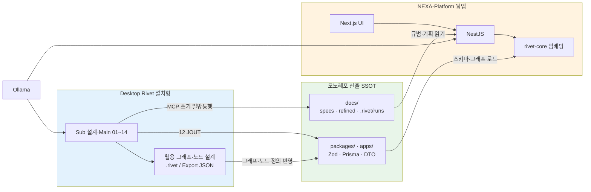
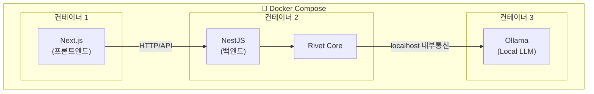

# Rivet 기반 격리 및 자동화 아키텍처

## 왜 리벳인가?

NEXA는 **채팅 한 줄로 코드·기획이 나오는 에이전트 툴**을 플랫폼의 중심으로 두지 않는다. **그래프로 고정된 오케스트레이션(AIP)** 위에 `docs/`·Zod·Git SSOT를 올리고, 웹은 **rivet-core**로 실행하는 구조를 택했고, 그 구현 수단으로 **Ironclad Rivet**을 채택했다. 지능 층위 **RAG → OG-RAG → OAG → AIP** — [`RAG · OAG · AIP — 지능 층위와 오케스트레이션`](../NEXA%20OS/RAG%20·%20OAG%20·%20AIP%20—%20지능%20층위와%20오케스트레이션.md).

### 채택 이유 (현재 아키텍처와의 정합)

| 이유                  | Rivet이 해주는 것                         | NEXA에서의 쓰임                                                                             |
| --------------------- | ----------------------------------------- | ------------------------------------------------------------------------------------------- |
| **가시적 파이프라인** | 노드·엣지·분기가 **눈에 보임**            | **01~14** Sub · Main — inbox→specs→Zod→JOUT이 **설계도**로 남음                             |
| **JSON SSOT**         | `.rivet-project` = **순수 JSON**          | Git diff · 웹 `loadGraph` · AI는 **토폴로지만** 생성(좌표는 Dagre 등)                       |
| **통제권**            | 프롬프트·흐름을 **그래프에 고정**         | Normex·CP-02/06/12 — 안정기·REFACTOR 정책을 **노드/프롬프트 한 줄**로 전환                  |
| **로컬·보안**         | Desktop + Ollama + MCP FS                 | 코드·문서 생성이 **모노레포 안**에서 끝남 — 클라우드 에이전트 블랙박스에 SSOT를 맡기지 않음 |
| **이중 런타임**       | Desktop(설계) · **rivet-core**(웹 임베딩) | Desktop → **`docs/`·코드 일방통행** · 웹은 **규범 소비 + 협업 UI**                          |
| **확장**              | **커스텀 노드**                           | NestJS·MCP·도메인(IoT·ESP32·Nexia) 로직을 **노드로 캡슐화**                                 |
| **감사**              | Run·`pipeline.log.jsonl` · 04/14 리포트   | 「왜 이렇게 나왔는지」를 **그래프·문서·로그**로 추적                                        |

### 트렌디한 에이전트 툴과의 선 (대체하지 않음)

|               | **요즘 많은 에이전트 툴** (예시 성격)     | **NEXA + Rivet**                                                        |
| ------------- | ----------------------------------------- | ----------------------------------------------------------------------- |
| **목표**      | 과제 **한 번 끝내기** · PR·코드 조각 생성 | **플랫폼 뼈대·규범** — `docs/specs/` · Zod · 모노레포 **장기 SSOT**     |
| **상태**      | 대화 스레드·세션 메모리                   | **`docs/` + Git** — 확정본만 SSOT                                       |
| **구조**      | 프롬프트·툴 체인을 **매번 바꾸기 쉬움**   | **Sub 그래프·번호(01~14)** — 변경은 설계·PR 단위                        |
| **UI**        | 채팅이 전부                               | 채팅 + Tiptap + 캔버스(**삼각 동기화**) — 채팅은 **입력 채널**일 뿐     |
| **코드**      | 레포 전역 에이전트가 **직접 수정**        | **12 JOUT** · Human **CP-12** — 디스크 반영은 **승인 후**               |
| **대안 유혹** | 「○○ Agent가 더 편하다」 → **중심 교체**  | 새 툴은 **노드·Ollama 호출·MCP**로 **흡수** — **Main·docs 라인은 유지** |

> **LangGraph / CrewAI / Cursor·Claude Code 에이전트 / Open SWE** 등은 **파이프라인 안의 엔진·보조**로 쓸 수는 있으나, **NEXA의 규범 SSOT·일방통행 `docs/`·Zod 중심 모노레포**를 **대체하는 중심축으로 삼지 않는다.**

### 고정할 방향 (흔들림 방지)

1. **Rivet = 오케스트레이션 표준** — LLM 호출·분기·검증·파일 I/O를 **그래프 노드**로 명시한다.
2. **Desktop = 공장** — 웹·IoT·NEXA OS **규범·코드·rivet-core 그래프**를 **여기서 설계·산출**한다.
3. **웹 = 런타임** — **rivet-core** 임베딩 + API; 유혹되는 「올인원 에이전트 IDE」로 **플랫폼 뼈대를 바꾸지 않는다**.
4. **최종 진실 = Git + `docs/specs/` + Zod** — Rivet Run은 **과정**; 롤백·감사는 **Git** (본 설계서 전제).

다음 절부터 **Desktop vs Rivet Core** · **일방통행 라인** · 배포·삼각 동기화의 **구체 배치**를 다룬다.

---

## NEXA에서 Rivet을 다루는 방식

NEXA는 Rivet을 **한 가지 제품이 아니라, 역할이 갈린 두 축**으로 씁니다. 이름에 「Rivet」이 같을 뿐 **실행 환경·배포 단위·파일 I/O·UI**가 다르며, **서로 대체하지 않습니다.**

| 축                | 실체                                                        | 어디서                                      | 무엇을 하는가                                                                                                              |
| ----------------- | ----------------------------------------------------------- | ------------------------------------------- | -------------------------------------------------------------------------------------------------------------------------- |
| **Desktop Rivet** | **Ironclad Rivet Desktop**(Windows 등 **설치형** 앱)        | 개발자 PC                                   | **그래프·프롬프트 설계** · Sub 캔버스 테스트 · **MCP FileSystem**으로 `docs/inbox`→`specs` **문서 파이프라인(01~14)** 실행 |
| **Rivet Core**    | **`@ironclad/rivet-core`**(npm 패키지, **브라우저 임베딩**) | **NEXA-Platform** 웹앱(Next.js UI + NestJS) | 사용자·운영자가 보는 **협업 캔버스** · 채팅·Tiptap(Yjs)과 **삼각 동기화** · API 경유 실행(Ollama)                          |

### 왜 별개인가

- **Desktop** = 독립 IDE. `.rivet` / `.rivet-project` 파일을 **로컬에서** 열고 편집한다.
- **Rivet Core** = **웹앱 안에 끼워 넣은 엔진**. NestJS 서비스 레이어에서만 구동하고, 브라우저는 **HTTP API**로만 접근한다.
- **그래프 JSON·노드 타입·Ollama 호출** 개념은 맞추되, **프로젝트 파일 경로·Run ID·MCP roots**는 Desktop 파이프라인 SSOT(`Desktop Rivet 캔버스(Graph) 설계 v1.0.md`)와 **웹 세션(Y.Doc)** 이 **분리**된다.
- Desktop에서 검증한 Subgraph 설계를 **웹에 이식**할 때는 JSON 스키마·커스텀 노드를 **명시적으로 이식**한다. Desktop 앱이 웹에 「자동으로 붙는」 구조가 **아니다**.

### 공통으로 맞추는 것

- **그래프 = 순수 JSON**(`.rivet-project` / Export). AI는 **연결·노드 의미** 위주, **좌표는 프론트 레이아웃**(Dagre·Cytoscape.js) — §삼각 동기화.
- **로컬 LLM** = Ollama(개발·운영 컨테이너). 브라우저가 Ollama에 **직접** 붙지 않음.
- **최종 코드·스키마 SSOT** = 모노레포 `docs/` · Zod · Git — Rivet은 **생성·검증 파이프라인**이지 롤백 SSOT가 아님.

### Desktop → `docs/` → 웹앱 (일방통행 설계 라인)

웹앱(NEXA-Platform) 실현을 위한 **주된 데이터 흐름은 일방통행**이다. **Desktop Rivet = 공장(설계·생성)** · **모노레포 `docs/` + 코드 = 산출물·규범 SSOT** · **웹 = 그 SSOT를 읽고 실행·협업하는 런타임**이다.

```text
[ Desktop Rivet ]  ──일방통행──▶  docs/ · packages/ · apps/
        │                              │
        │  (동시에 설계 가능)            ▼
        └──────────────────────▶  웹 Rivet Core용 그래프·노드 정의
                                       │
                                       ▼
                            [ NEXA-Platform 웹앱 ]
                            Next.js + NestJS + rivet-core
```

| 단계                  | 주체                                           | 산출                                                       | 웹에서의 역할                                                         |
| --------------------- | ---------------------------------------------- | ---------------------------------------------------------- | --------------------------------------------------------------------- |
| **설계·실행**         | Desktop **Main · 01~14**                       | `docs/inbox` → `refined` → **`docs/specs/**`·`.rivet/runs` | **뼈대·규범** — vision·domain-map·api-contract·Zod 가이드 등          |
| **계약·코드**         | **06~12** (Zod → Prisma·Nest·PC → **12 JOUT**) | `packages/shared` · `apps/backend` · `apps/desktop` …      | **실행 SSOT** — API·DB·PC 게이트                                      |
| **이력**              | **13** GitHub                                  | commit·PR                                                  | 배포·감사                                                             |
| **그래프(웹 런타임)** | Desktop에서 **동일 앱**으로 설계               | `.rivet` / Export **JSON** · 커스텀 노드·시스템 프롬프트   | NestJS가 **rivet-core**에 로드·등록 — **운영 캔버스·에이전트 그래프** |

**`docs/`가 웹의 뼈대·규범이 되는 이유**

- **05 Planning** — `specs/project-core/` · requirements · api-contract 등 **사람·AI가 따를 기획 SSOT**
- **06 Zod** — Contract 초안 → 검증 후 **12**가 코드로 반영; 웹 API·폼·rivet-core 노드가 **같은 스키마**를 참조
- **04·14** — 충돌·건강 리포트(Obsidian MOC)로 **구조 변경 전 검토**
- 웹 **삼각 동기화(Yjs)** 는 **세션 중 협업 UI**이지, `docs/specs/` **파일 SSOT를 대체하지 않음** — 확정·보내기 시에만 다시 Desktop 라인(`inbox` 등)으로 **재유입** 가능

**Desktop에서 웹용 Rivet Core 그래프도 설계한다**

- Desktop은 **설치형 Rivet**이지만, **Export JSON·노드 정의·프롬프트**는 **웹 `@ironclad/rivet-core`와 동일 규격**으로 맞출 수 있다.
- 개발자는 Desktop에서 **운영/제품용 그래프**(예: Nexia 에이전트, 파이프라인 보조)를 만들고, 검증 후 **레포에 포함**(`*.rivet-project` · 커스텀 노드 코드) → NestJS 기동 시 **rivet-core**에 등록.
- 즉 Desktop은 **`docs/` 문서 파이프라인**과 **웹 임베딩 엔진용 그래프 설계**를 **한 PC·한 도구**에서 수행하고, 웹은 **별 런타임**으로 **그 결과만 소비·실행**한다.

**역방향 기본 정책**

| 방향                   | 정책                                                     |
| ---------------------- | -------------------------------------------------------- |
| Desktop → `docs/`·코드 | **기본·권장** — MCP **12 JOUT** · Git **13**             |
| 웹(Yjs) → `docs/`      | **명시적 보내기/승인** 후만 — 자동 역류 없음             |
| 웹 → Desktop `.rivet`  | **수동 이식** — Export·PR로 그래프 JSON·노드 코드 동기화 |

상세 Sub 단계: `Desktop Rivet 캔버스(Graph) 설계 v1.0.md`.

### 문서 역할

| 문서                                           | 범위                                                                     |
| ---------------------------------------------- | ------------------------------------------------------------------------ |
| **본 문서**                                    | Desktop vs 웹 **배치** · **일방통행 라인** · NestJS·Docker · 삼각 동기화 |
| **`Desktop Rivet 캔버스(Graph) 설계 v1.0.md`** | **Desktop 전용** Main · Sub_01~14 · MCP · Obsidian · CP                  |



---

### Node.js는 별도가 아니라 NestJS 안에 통합

```
Next.js  (프론트엔드)
NestJS   (백엔드) ← 여기 안에 Rivet Core + 파일시스템 작업 모두 포함
```

Desktop Rivet은 **MCP Discovery / MCP Tool Call**(FileSystem)으로 로컬 I/O를 처리하는 것을 To-Be로 합니다(`Desktop Rivet 캔버스(Graph) 설계 v1.0.md` §MCP). 별도 Node.js 서버(External Call)는 **레거시 스케치**이며, 웹앱에서는 **NestJS가 파일시스템 역할을 흡수**합니다.

---

### 보안 관점

| 항목                | 내용                                                   |
| ------------------- | ------------------------------------------------------ |
| **Rivet Core**      | NestJS 서비스 레이어 안에서만 실행, 외부 노출 없음     |
| **Ollama**          | NestJS → Ollama 내부 통신, 브라우저에서 직접 접근 불가 |
| **파일시스템 작업** | NestJS 내부에서만 처리, API 엔드포인트로 제어          |
| **Next.js**         | NestJS API만 호출, Ollama/Rivet 직접 접근 불가         |

---

### 도커 배포 구조



---

### 핵심 정리

- **Node.js는 NestJS가 곧 Node.js**이므로 별도 서버 불필요
- **컨테이너 3개**로 깔끔하게 분리
- **Ollama는 AI 컨테이너로 독립**시키면 교체/업그레이드 용이
- 외부에서는 **Next.js 포트만 노출**, NestJS/Ollama는 내부 통신만

이 구조면 보안도 깔끔하고 도커 배포도 용이

---

### Rivet 설계만 잘하면 되는 이유

```
Rivet 그래프 (명확한 지시)
        ↓
LLM이 구조를 이해하고
        ↓
Next.js / NestJS /
        ↓
Docker 코드 생성
```

---

### LLM에게 컨텍스트를 명확히 줘야 함

Rivet 그래프 안에서 이런 내용을 시스템 프롬프트로 고정해두면 LLM이 매번 올바른 구조로 생성

```
- 프론트: Next.js (컨테이너 1)
- 백엔드: NestJS + Rivet Core (컨테이너 2)
- LLM: Ollama (컨테이너 3)
- 배포: Docker Compose
- 파일시스템 작업: NestJS 내부에서만
- Path Traversal 검증 필수
```

---

## 삼각 양방향 동기화 아키텍처

**범위:** 웹앱(NestJS + Rivet Core) **협업 UI** — 채팅 · Tiptap(Yjs) · Rivet 캔버스.  
**제외:** Monaco 등 **펌웨어·실코드**는 삼각 루프 밖 **최종 산출물**.

### Desktop 파이프라인과의 정합 (충돌 없음)

| 구분     | 삼각 동기화 (본 절)               | Desktop Rivet (`설계 v1.0`)                   |
| -------- | --------------------------------- | --------------------------------------------- |
| **환경** | 브라우저 · `@ironclad/rivet-core` | Rivet Desktop · MCP FileSystem                |
| **SSOT** | 세션 중 **Y.Doc** (CRDT)          | **`docs/`** · Zod(06) · 12 JOUT               |
| **실행** | 실시간 · 양방향                   | 01→13 배치 · 14/Aux 수동                      |
| **연결** | —                                 | Yjs 확정본 → `inbox/`·`refined/` → 01~05 입력 |

두 축은 **병행**: UI에서 기획·노드 편집 → (보내기/커밋 시) 파일 파이프라인으로 검증·배포.

> **주의:** 삼각 동기화의 Y.Doc SSOT와 `docs/specs/` 파일 SSOT를 **동시에 단일 진실**로 두지 않는다. 확정 시점에만 파일 파이프라인으로 **보내기**.

---

### 1. 데이터 흐름

SSOT는 **Yjs `Y.Doc`** (CRDT)이다.

```text
        [ Chat UI ]
           ▲   ▲
           ▼   ▼
[ Tiptap · Yjs Doc ] ◀──▶ [ Rivet Canvas · rivet-core ]
     yText('document')         yMap('rivetGraph')
```

| 방향               | 흐름                                             |
| ------------------ | ------------------------------------------------ |
| Chat → Doc → Rivet | LLM이 Yjs 갱신 → `observe` → `loadGraph`         |
| Rivet → Doc → Chat | 노드·엣지 변경 → Yjs Map 갱신 → 문서·채팅 피드백 |

---

### 2. 구현 요약

**Yjs Shared Types**

- `y.getText('document')` — 기획 Markdown
- `y.getMap('rivetGraph')` — 노드·엣지 JSON (`map.set` / `observe`)

**rivet-core 브릿지**

| 방향        | 이벤트             | 비고                     |
| ----------- | ------------------ | ------------------------ |
| Rivet → Yjs | `onGraphChange`    | 노드 ID·엣지 즉시        |
| Rivet → Yjs | `onDragEnd`        | 좌표는 드래그 종료 시만  |
| Yjs → Rivet | `graphMap.observe` | `editor.loadGraph(data)` |

**Ollama (NestJS)** — 채팅 → Ollama → Y.Doc `applyUpdate` (Agent 협업자).

---

### Rivet 프로젝트 JSON · AI 산출 · 자동 레이아웃

Rivet **프로젝트 파일**(`.rivet-project` 및 Export)은 내부적으로 **순수 JSON**이다. 웹앱 Rivet UI에서 노드를 구성하는 핵심은 **「AI가 자연어·기획 문서를 읽고, Rivet 규격에 맞는 그래프 JSON을 생성한다」**는 점이다. 좌표·픽셀 배치는 AI 책임이 아니다.

| 계층            | 담당          | 내용                                                                                                                        |
| --------------- | ------------- | --------------------------------------------------------------------------------------------------------------------------- |
| **AI (Ollama)** | 토폴로지·의미 | `nodes[]`(id·type·data) · `edges[]`(source·target·kind) · 노드 파라미터·프롬프트                                            |
| **AI 금지**     | —             | **x, y** 정밀 좌표 계산·「캔버스 픽셀 위치 지정」 지시                                                                      |
| **프론트엔드**  | 기하 배치     | AI가 준 **연결 관계**만 받아 **Dagre** 또는 **Cytoscape.js** 등 레이아웃 엔진으로 좌표 산출 후 `rivet-core` / 캔버스에 반영 |
| **사용자**      | 미세 조정     | 드래그 종료(`onDragEnd`) 시에만 수동 좌표를 Yjs·프로젝트 JSON에 기록 (§2 브릿지)                                            |

```text
자연어·Tiptap 문서
        ↓  (LLM)
Rivet 규격 JSON { nodes, edges }   ← 좌표 필드 없음 또는 무시
        ↓  (Dagre / Cytoscape layout)
{ nodes + x,y }  →  loadGraph / .rivet-project 저장
```

**AI 출력 스키마 (최소·권장)**

```json
{
  "nodes": [{ "id": "dht11", "type": "SensorNode", "data": { "label": "DHT11" } }],
  "edges": [{ "id": "e1", "source": "dht11", "target": "code_gen", "kind": "data" }]
}
```

| 규칙            | 설명                                                                                                      |
| --------------- | --------------------------------------------------------------------------------------------------------- |
| **좌표**        | AI 응답에 `position`·`x`·`y`가 있어도 **프론트에서 레이아웃 엔진 결과로 덮어씀**                          |
| **재배치**      | 엣지 추가·삭제 후 **레이아웃 재실행** (Dagre `rankdir` 등 프로젝트 설정)                                  |
| **정합**        | Desktop **Sub_01~14** `.rivet` 탭도 동일 JSON 직렬화 — 웹·Desktop **그래프 스키마 공유** 목표             |
| **Nexion 참고** | Nexion 중앙 캔버스 Dagre 운영 — `[NXN] [UIUX] Nexion 5대 지능 — Vue Flow·Dagre·ExplorerTree 구현 정리.md` |

> **선행 과제(§4)** 는 위 **좌표 없는** 최소 JSON 스키마를 Normex·Rivet 노드 타입 목록과 함께 고정하는 것이다.

---

### 3. 무한 루프 방지 — Transaction Origin

| 단계           | 규칙                                       |
| -------------- | ------------------------------------------ |
| Rivet UI → Yjs | `doc.transact(fn, 'rivet-ui-origin')`      |
| Yjs → Rivet    | origin이 `rivet-ui-origin`이면 재렌더 생략 |

---

### 4. UX 시나리오 (ESP32)

1. 채팅: 온습도 센서 요구
2. AI: Tiptap 사양 MD · Rivet `[DHT11]`·`[Ollama Code Gen]` 노드 연결
3. 사용자: Rivet 노드 파라미터 수동 조정
4. AI: Yjs 변경 감지 → 사양 갱신 · Monaco 펌웨어 갱신 안내 (코드는 삼각 밖)

**선행 과제:** §「Rivet 프로젝트 JSON」— 토폴로지만·좌표는 레이아웃 엔진.

---

### 5. 기술 검증 · MVP

| 항목       | 근거                         |
| ---------- | ---------------------------- |
| Rivet JSON | Export/Import · ms 단위 갱신 |
| Yjs        | `Y.Map` 그래프 CRDT          |
| Ollama     | NestJS Agent · `applyUpdate` |
| Origin     | Yjs 공식 루프 차단           |

| 단계 | 내용                                     |
| ---- | ---------------------------------------- |
| 1    | 브라우저 Rivet ↔ NestJS JSON (Yjs 없음) |
| 2    | Yjs — `document` + `rivetGraph`          |
| 3    | Ollama 채팅 Agent                        |

---

## 📋 리벳(Rivet)용 프롬프트 템플릿 구조

리벳(Rivet)의 Chat 노드나 Prompt 노드에 들어갈 지시문을 작성할 때, 제약조건과 공리를 명확히 분리하고 이를 구조화된 템플릿(XML/Markdown 태그 형식)으로 전달하는 것은 LLM의 성능을 극대화하는 최고의 프롬프트 엔지니어링 기법입니다.
자연어로 길게 쓰면 AI가 규칙을 뭉뚱그려 이해하거나 망각하지만, 템플릿으로 구조를 쪼개주면 트랜스포머의 어텐션(Attention) 가중치가 각 영역에 정확히 분산되어 오작동이 극적으로 줄어듭니다.
리벳의 Prompt 노드에 아래와 같이 구조화된 템플릿을 배치하고, {{current_document}}와 {{accumulated_knowledge}} 부분에 이전 노드에서 읽어온 파일 데이터를 연결(Inlet)해 주면 됩니다.

# [역할 시스템 지시문]

너는 입력된 문서를 분석하여 지식 기틀(온톨로지)에 맞게 정제하는 '지식 구조화 엔진'이다. 다음 가이드를 엄격히 준수하여 판단하라.

==================================================

1. 핵심 세계관 규범 (공리 / Axioms)- AI가 전체 맥락을 해석하고 추론할 때 반드시 참으로 전제해야 하는 규칙입니다.

---

<공리*지침>-
[상속성]: 특정 부품(A)이 상위 장비(B)에 속하면, 상위 장비의 관리 주체(C)는 자동으로 해당 부품(A)의 관리 주체가 된다.-
[인과성]: '장애 발생' 이벤트는 항상 '원인 분석' 또는 '조치 결과' 문맥과 연결되어야 하며, 독립적으로 존재할 수 없다.-
[배타성]: 하나의 기계 ID는 동시에 '정상 가동' 상태와 '정비 필요' 상태를 가질 수 없다.
</공리*지침>

==================================================

2. 데이터 입력 및 형식 규범 (제약조건 / Constraints)- 최종 출력 데이터의 형태와 값의 범위를 제한하는 미시적 규칙입니다.

---

<제약조건*지침>-
[형식]: 모든 출력은 오직 JSON 포맷으로만 작성해야 하며, 앞뒤로 미사여구나 설명 문장을 절대 붙이지 마라.-
[날짜]: 문서 내 날짜는 예외 없이 `YYYY-MM-DD` 형식으로 변환하여 기록하라.-
[결측치]: 문서에서 확인할 수 없는 정보는 빈칸으로 두지 말고 반드시 `"UNKNOWN"`으로 명시하라.
</제약조건*지침>

## ==================================================

3. 입력 데이터 (Context)

<현재*분석*문서>
{{current_document}}
</현재*분석*문서>

<이전까지*합산된*지식*지형>
{{accumulated_knowledge}}
</이전까지*합산된*지식*지형>

================================================== 4. 최종 출력 형태 (Output Template)- 위 공리를 바탕으로 맥락을 파악하고, 제약조건을 준수하여 아래 구조를 채워라.

---

```json
{
"document_id": "",
"context_analysis": {
"deduced_relations": ["(공리를 통해 새롭게 추론해낸 관계나 사실을 기술)"]
},
"extracted_data": {
"date": "YYYY-MM-DD",
"status": ""
}
}

---

## 💡 이렇게 분리했을 때 리벳 파이프라인이 얻는 이점

1.  디버깅과 유지보수의 단순화:

- 만약 AI가 출력한 JSON에 날짜 오타가 나면, 템플릿의 <제약조건\_지침> 영역만 수정하면 됩니다.
  - 반면 AI가 "A 부품이 왜 C 공장 소속인지 모르겠다"며 문맥을 엉뚱하게 짚으면, <공리\_지침> 영역의 논리를 정교하게 다듬으면 됩니다. 어디를 고쳐야 할지 직관적으로 알 수 있습니다.

2.  미래 피지컬 AI 룰셋으로의 직행:

- 이 템플릿 구조를 그대로 유지한 채, 나중에 기계 제어로 넘어가면 내용만 바꾸면 됩니다.
  - 공리에는 [물리 법칙: 로봇 팔은 벽을 통과할 수 없다], 제약조건에는 [하드웨어 제한: 모터 속도 값은 0~255 사이의 정수여야 한다]를 넣는 식으로 매끄럽게 확장됩니다.
```
