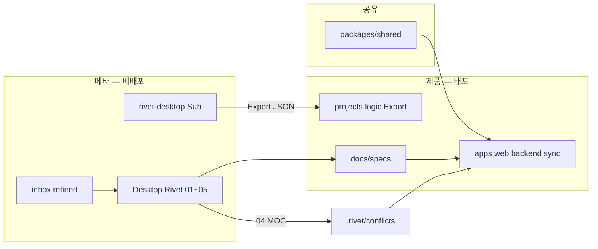
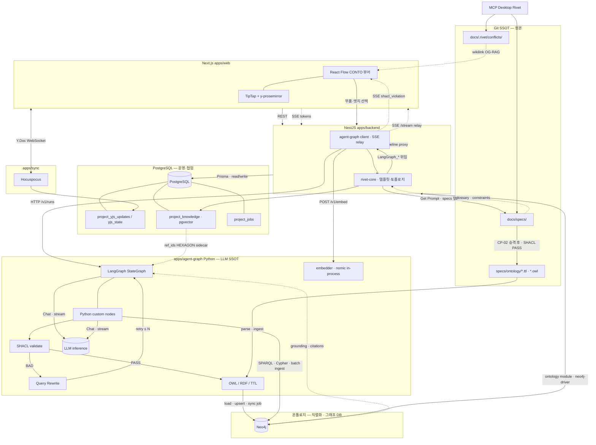

# Rivet 중심 온톨로지 관리 툴 — 1단계 설계 (NEXA 스택 정본)

> **한 줄:** **인간–AI 협업 온톨로지 뷰어(CONTO)** 는 Yjs 실시간 초안 + **React Flow** 관계 시각화 + **rivet-core**(프롬프트·그래프 구조) → **`apps/agent-graph`**(LLM·Streaming) 위임 파이프라인으로 동작하며, **최종 SSOT는 AI JSON이 아니라 `docs/specs/` MD · wikilink · 04/14 MOC** 이다.  
> **층위:** RAG → **OG-RAG**(2차 관계도) → **OAG**(05 Planning) → AIP — [`RAG · OAG · AIP`](./RAG%20·%20OAG%20·%20AIP%20—%20지능%20층위와%20오케스트레이션.md)

| 문서                                                                                                                         | 역할                                                                     |
| ---------------------------------------------------------------------------------------------------------------------------- | ------------------------------------------------------------------------ |
| **[본 문서]**                                                                                                                | 온톨로지 **관리 툴** 1단계 — 스택 매핑 · 데이터 흐름 · Rivet 그래프 · UI |
| [`Desktop Rivet 캔버스 설계 v1.0`](<./Desktop%20Rivet%20캔버스(Graph)%20설계%20v1.0.md>)                                     | 배치 온톨로지 — **Sub_03~05** · Obsidian MOC 규약                        |
| [`NEXA RAG 아키텍처`](./NEXA%20RAG%20아키텍처%20—%20Rivet·PostgreSQL·Ollama.md)                                              | 운영 검색 — **RAG_Retrieve** · OG-RAG §7                                 |
| [`Yjs·Hocuspocus 협업 SSOT`](../AI/00_[AIS]%20Yjs·Hocuspocus%20협업%20SSOT.md)                                               | Y.Doc 영속화 · Hocuspocus Hook                                           |
| [`CSIM · AXON (정본)`](<../Nexia/_Cosmic%20Semantic%20Interface%20Matrix%20v2%20—%20CSIM%20·%20AXON%20프로토콜%20(정본).md>) | **CONTO** — Human↔AI 온톨로지 해석                                      |

---

## 📊 온톨로지 언어 및 표준 규격 순위 표

| 순위] | 언어/표정 명칭     | W3C 표준 여부 | 주요 특징 및 현대적 용도                                                                                                                  |
| ----- | ------------------ | ------------- | ----------------------------------------------------------------------------------------------------------------------------------------- |
| 1     | OWL                | 예            | 현재 글로벌 표준. AI 추론, 지식 그래프 핵심.                                                                                              |
| 2     | RDF / RDFS         | 예            | 지식 표현의 뼈대(주어-동사-목적어). OWL의 기반.                                                                                           |
| 3     | SHACL              | 예            | 2017년 제정. RDF 데이터 구조 및 품질 검증 규격.                                                                                           |
| 4     | SKOS               | 예            | 동의어, 상하위 개념 등 분류 체계(Taxonomy) 구축용.                                                                                        |
| 5     | Common Logic       | 아니오        | 1차 술어 논리 기반의 교환 표준.                                                                                                           |
| 6-20  | SWRL, CycL, KIF 등 | -             | RIF, CycL(상식), F-Logic, DAML+OIL, KIF(초기 논리), Ontolingua, OCML, SHOE, XOL, OIL, OML, LOOM, KL-ONE, OKBC 등 레거시 및 학술용 언어들. |

---

## 💡 리벳(Rivet) AI 에이전트 설계자를 위한 핵심 요약

구축하시려는 IoT 웹 플랫폼 관점에서는 위의 복잡한 언어를 다 공부하실 필요가 전혀 없습니다. 딱 3가지만 조합하면 끝납니다.

1.  데이터 적재(5W1H): 원시 데이터 문맥을 저장할 때는 RDF(트리플) 구조로 쪼갭니다.
2.  AI 환각 방지(규칙 정의): 시스템의 절대적인 개념 헌법을 세울 때는 OWL로 상하관계와 불가능한 조건을 규정합니다.
3.  리벳(Rivet)에서의 활용: 리벳 에이전트 노드에서는 그래프 DB에 저장된 RDF/OWL 지식을 SPARQL이라는 표준 쿼리 언어로 끄집어내어 AI에게 프롬프트 주입(Context Injection)을 수행합니다.

## IOT 관점 온톨로지 아키텍처

5W1H 원시 데이터 발생 하면 부가적인 데이터와 함께 데이터 파이프라인을 통해 처리된다.
⬇️

1.  RDF (관계 뼈대) : "누가, 언제, 어디서, 무엇을, 왜, 어떻게"를 트리플([주어]-[동사]-[목적어])로 쪼개어 무한 연결
    ⬇️
2.  OWL (논리/헌법) : "이 센서는 저 아트 작품과만 연결될 수 있다" 같은 엄격한 규칙과 제약조건(제한 범위)을 덮어씌움
    ⬇️
3.  LLM (리벳 에이전트) : 사람이 질문하면 RDF/OWL에서 '검증된 팩트'만 쏙 빼서(SPARQL 쿼리) 환각 없이 안전하게 답변

### NEXA 플랫폼 확장

NEXA 플랫폼은 [산업 ➡️ 아트 ➡️ 일상]으로 확장을 목표로 합니다.

- 환각 제로 (Zero Hallucination): LLM은 자신이 모르는 영역을 추측하지 않고, 오직 OWL이 허용하고 RDF가 증명한 5W1H 데이터의 테두리 안에서만 사고하게 됩니다.
- 유연한 확장성: '산업'에서 '아트'로 도메인이 바뀔 때, 프로그램 코드를 갈아엎는 것이 아니라 OWL의 규칙과 RDF의 관계망만 새로 추가해 주면 리벳 AI 에이전트가 알아서 새로운 맥락을 이해합니다.

---

## 지식 기반 OS 플랫폼 핵심 아키텍처 4단계

[산업 ➡️ 아트 ➡️ 일상]으로 확장되는 IoT 기반 지식 기반 OS 웹 플랫폼의 최적화된 최종 아키텍처를 다음과 같이 정리할 수 있다.
이 아키텍처는 RDF, OWL, SKOS 세 가지 언어가 각자의 전문 영역을 맡아 완벽한 삼박자로 맞물려 돌아가는 구조입니다.
데이터가 하드웨어에서 발생하여 리벳(Rivet) AI 에이전트를 거쳐 사용자에게 전달되기까지의 흐름입니다.

[단계 1: 데이터 레이크] ➡️ [단계 2: 지식 가상화 및 적재] ➡️ [단계 3: 지식 커널 (OS)] ➡️ [단계 4: 리벳 AI 에이전트]
(5W1H 날것의 로그) (RDF 트리플 변환) (SKOS 사전 + OWL 헌법) (SPARQL 기반 환각 제로 답변)

### 단계 1: 데이터 레이크 (원시 데이터 수집)

- 역할: IoT 하드웨어 센서에서 초단위로 쏟아지는 시계열 데이터(전류량, 진동, RGB 값)와 앱 로그를 날것(Raw Data) 그대로 받아내는 그릇입니다.
- 5W1H 적용: 데이터가 적재될 때 가능하면 언제(When), 어디서(Where), 누가(Who), 무엇을(What), 왜(Why), 어떻게(How)에 대한 메타데이터 꼬리표가 함께 기록됩니다.

### 단계 2: 지식 가상화 및 적재 (RDF 영역)

- 역할: 대용량 수치 데이터는 가볍고 빠른 저장소에 두고, 5W1H 문맥 데이터만 쏙 뽑아 기계가 읽을 수 있는 지식의 뼈대로 만듭니다.
- 구현 방식: [로그_001] - [발생장소] - [공장_A구역], [로그_001] - [측정값] - [85도]와 같이 RDF의 [주어-동사-목적어] 트리플 구조로 쪼개어 그래프 데이터베이스에 무한히 연결(Graph Mapping)합니다.

### 단계 3: 지식 커널 (SKOS + OWL 영역)

이 플랫폼이 '일관성 있는 똑똑한 OS'로 작동하게 만드는 심장부입니다.

- 인간 언어의 백과사전화 (SKOS):
- [산업/아트/일상] 각 도메인의 수많은 전문 용어와 개념, 동의어를 정리합니다. 사용자가 "AI 센서", "스마트 센서" 등 어떤 동의어로 말해도 시스템이 동일한 개념(ex:IoTSensor)으로 인식하도록 SKOS의 prefLabel, altLabel, broader/narrower 구조로 개념 사전을 구축합니다.
- 기계 행동의 제약·추론 (OWL):
- "A 구역의 온도가 80도를 넘으면(산업), 미디어아트의 조명을 붉은색으로 바꾸고(아트), 관리자에게 경고를 보낸다(일상)"와 같은 도메인 간 융합 규칙과 절대적인 제약 조건(헌법)을 OWL로 정의합니다. LLM이 엉뚱한 상상을 하지 못하도록 차단하는 강력한 논리 필터 역할을 합니다.

### 단계 4: 리벳 AI 에이전트 (인간-AI 협력 구동부)

- 역할: 사용자의 자연어 명령을 받아 지식 커널(OS)과 소통하고 하드웨어를 안전하게 제어합니다.
- 구현 방식: 리벳의 노드 워크플로우 안에서 표준 쿼리 언어인 SPARQL을 사용해 지식 커널(RDF/OWL/SKOS)에 질문을 던집니다.
- 결과: AI는 추측(환각)하지 않고, 검증된 5W1H 팩트 데이터와 OWL의 안전 규칙 안에서만 사고하여 사용자에게 완벽하고 일관된 답변을 제공하거나 하드웨어를 제어합니다.

### 아키텍처 요약 및 강점

1.  SKOS가 인간의 모호한 단어를 명확한 개념으로 치환하고,
2.  RDF가 그 개념들을 5W1H 문맥으로 촘촘하게 엮어주며,
3.  OWL이 그 위에 안전한 논리적 규칙을 덮어씌워,
4.  리벳(Rivet) 안의 LLM이 완벽하게 통제된 '지식 기반 OS' 위에서 영리하게 작동하게 됩니다.

---

## NEXA 지식 OS와 날리지 그라운딩

날리지 그라운딩(Knowledge Grounding)'은 NEXA 플랫폼의 '지식 OS'의 존재 이유이자 핵심 작동 원리를 설명하는 가장 핵심적인 최신 AI 용어입니다.
RAG(검색 증강 생성)의 한계를 뛰어넘어 AI가 진짜 지식을 다루게 만드는 원리이기도 합니다. 이것이 왜 '지식 OS'와 직결되는지 그 맥락을 명쾌하게 짚어드리겠습니다.

---

### '날리지 그라운딩(Knowledge Grounding)'이란?

그라운딩(Grounding)은 사전적으로 '땅에 발을 붙이게 한다'는 뜻입니다.
AI 생태계에서 날리지 그라운딩이란, 확률적으로 붕 떠 있는 LLM의 언어적 추론을 현실 세계의 '절대적인 팩트와 논리 구조(지식)'라는 단단한 땅에 확실하게 결착시키는 행위를 의미합니다.

- 그라운딩이 안 된 AI: 현실 세계의 규칙(온톨로지)을 모르기 때문에, 그럴싸한 거짓말(환각)을 하며 허공에 발을 구릅니다.
- 그라운딩이 된 AI: 자신이 답변하거나 행동하기 전에 시스템에 구축된 '지식 헌법'을 확인하고, 그 조건에 발을 딱 붙인 채 움직입니다.

---

### '지식 OS'와 '날리지 그라운딩'의 관계

대표님이 구상하신 지식 OS가 전체 시스템의 '인프라와 뼈대'라면, 날리지 그라운딩은 리벳(Rivet) AI 에이전트가 그 OS 위에서 안전하게 작동하는 '방식'입니다.

| 개념                                  | 비유                               | 플랫폼에서의 역할                                                                                                                     |
| ------------------------------------- | ---------------------------------- | ------------------------------------------------------------------------------------------------------------------------------------- |
| 지식 OS (RDF/OWL/SKOS)                | 법전과 정부 시스템                 | [산업 ➡️ 아트 ➡️ 일상]의 모든 하드웨어 상태, 5W1H 문맥, 절대적인 제약 조건을 일관되게 규정하고 관리하는 커널.                         |
| 날리지 그라운딩 (Knowledge Grounding) | 법전(OS)에 기반한 판사의 재판 행위 | 리벳 AI 에이전트가 사람의 명령을 받았을 때, 지식 OS의 데이터(SOSA/SAREF 스키마)를 조회하여 현실의 정밀한 규칙에 기반해 사고하는 과정. |

---

### 🆚 일반 RAG와 '온톨로지 기반 그라운딩'의 결정적 차이

RAG와 온톨로지의 차이를 이미 감 잡으셨다니, 그라운딩의 관점에서 두 방식이 왜 격이 다른지 쉽게 이해하실 수 있습니다.

1.  텍스트 기반 RAG (불완전한 그라운딩):

- 단순히 회사 매뉴얼 PDF나 텍스트 문서(Corpus)를 유사도 기반으로 검색해서 LLM에게 넘겨주는 방식입니다.
  - 맥락이 끊어진 문장 파편만 넘어가기 때문에, IoT 하드웨어를 정밀하게 제어하거나 "이 장비가 과열될 때 아트 조명을 어떻게 바꿀지"에 대한 복잡한 인과관계를 추론할 때 여전히 환각을 일으킵니다. 땅이 아니라 자갈밭에 발을 디딘 꼴입니다.

2.  온톨로지 기반 그라운딩 (완벽한 지식 OS형 그라운딩):

- 리벳 에이전트가 RDF(5W1H 관계망)와 OWL(논리 규칙)로 이루어진 단단한 콘크리트 땅(지식 OS) 위에서 작동합니다.
  - AI가 "2층 전시장 온도가 85도"라는 팩트(SOSA 스키마)를 인식하고, "과열 시 행동 요령"이라는 논리(SAREF 규칙)를 지식 OS에서 정확히 찾아내어 하드웨어를 제어합니다. 환각이 끼어들 틈이 없는 완벽한 그라운딩이 일어납니다.

---

## 0. 1단계 목표 (코딩 제외)

**성공 조건 한 문장**

> 인간이 기획 문서를 넣으면 → AI가 **관계 초안(OG-RAG)** 을 뽑고 → 웹에서 **실시간 그래프**로 보이며 → 인간이 엣지·노드를 고치면 → **승인 후 `docs/specs/` MD + wikilink** 로 승격된다.

| 1단계 **한다**                               | 1단계 **안 한다**                |
| -------------------------------------------- | -------------------------------- |
| CONTO 뷰어 · 관계 편집 · 충돌 표시           | Sub_06~13 코드·Zod·Git 자동 반영 |
| Yjs 초안 동기화 · Human **CP-02**            | 미검증 JSON을 DB SSOT로 저장     |
| Desktop **03~05** 배치 + 웹 **RAG_Retrieve** | Claude/클라우드 LLM 기본 경로    |
| Obsidian 호환 MOC (`docs/.rivet/conflicts/`) | Neo4j 단독 그래프 DB             |

---

## 1. NEXA에서 「온톨로지 관리 툴」의 정의

| 용어                 | NEXA 정의                       | SSOT                                       |
| -------------------- | ------------------------------- | ------------------------------------------ |
| **온톨로지 (운영)**  | 도메인 개념·관계·계획 구조      | `docs/specs/**` · `planning_manifest.json` |
| **OG-RAG**           | 벡터·청크 위 **2차 관계도**     | 04/14 MOC · wikilink · `ref_ids`           |
| **CONTO**            | Human↔AI **해석·검수** UI/세션 | Yjs 초안 + CP 승인 이력                    |
| **AI 온톨로지 JSON** | Extract Object **초안**         | **독** — Git·specs 승격 전 금지            |

```text
[초안]  Yjs Y.Map (세션)  +  conflict_report.json  +  Extract Object 버퍼
           ↓ CP-02 · 04 MOC 검토
[정본]  docs/specs/*.md  +  [[wikilink]]  +  Git
```

> **룰·템플릿**(Normex · Zod · Prompt Shell)은 OAG가 아니라 **입구 게이트**이다.

### 1.1 배포 · DB · UI (합의 요약)

| 주제              | 정책                                                                                                    |
| ----------------- | ------------------------------------------------------------------------------------------------------- |
| **UI 코드**       | 개발·배포 모두 **`domains/nexia/modules/conto/`** · 진입 **Logex** 탭 — `domainKey` 별도 분리 **안 함** |
| **보안**          | 경로가 아니라 **RBAC · CP-02 · Grade** (`NEXIA 01`)                                                     |
| **Git**           | 모노레포 **하나** · 배포(Docker/CI)는 **Platform 런타임 + 생산물**만                                    |
| **docs**          | `inbox`/설계서 → **비배포** · **`specs/` + `conflicts/`** → prod 이미지 **포함**(1단계 기본)            |
| **DB 스키마**     | Prisma **동일** (dev·prod 공통)                                                                         |
| **DB 인스턴스**   | **물리 2개** — `nexa_dev`(검증) · `nexa_prod`(운영) · `DATABASE_URL`만 다름                             |
| **Desktop Rivet** | **공장** — MCP→`docs/` · Export · Sub_03~05 (DB **기본 미접속**)                                        |
| **DB 반영**       | **`Embed_Pipeline`** 등 backend job이 env로 **한 DB만** ingest                                          |

```text
[업그레이드 — 끊임없이]
  Desktop 01~05 → specs/ · Export → (선택) Embed → nexa_dev 검증
  → CP/CI → Deploy → Embed → nexa_prod → 사용자 domains/nexia/ 동일 UI

[격리 — 철저히]
  inbox · 미검증 JSON · IoT Vector→ACTON · dev 데이터 → prod DB/이미지 **금지**
```

---

## 2. 확정 기술 스택 매핑

### 2.1 계층별 스택 (To-Be)

| 계층                   | 채택 스택                                                    | NEXA 패키지/경로                           |
| ---------------------- | ------------------------------------------------------------ | ------------------------------------------ |
| **UI**                 | **Next.js** (App Router) + Tailwind                          | `apps/web`                                 |
| **그래프 뷰**          | **React Flow** (`@xyflow/react`) + Dagre 레이아웃            | NEXIA **Logex** 탭 · CONTO 서브모드        |
| **문서 편집**          | **TipTap** + `y-prosemirror`                                 | specs 미리보기·주석                        |
| **실시간 협업**        | **Yjs** + **Hocuspocus**                                     | `apps/sync` (collab-server)                |
| **API·오케스트레이션** | **NestJS**                                                   | `apps/backend`                             |
| **그래프 실행**        | **rivet-core** — **프롬프트 템플릿 · 노드 구조 해석 · Run 로그** | NestJS 내 Embedded Rivet · **LLM 호출 없음** |
| **배치 설계**          | **Ironclad Rivet Desktop** + MCP FileSystem                  | Sub_01~05 `.rivet`                         |
| **LLM · Streaming**    | **`apps/agent-graph`** — **추론 어댑터** (dev: Ollama · prod: **vLLM** 등) | Chat · SSE · Extract · RAG |
| **임베딩**             | **`apps/agent-graph`** → **`embedder`** — **in-process** `nomic-embed-text` (768) | `/v1/embed` · `Embed_Pipeline` · pgvector · **Ollama Embed ✗** |
| **DB**                 | **PostgreSQL** ×2 인스턴스 · Prisma·pgvector **스키마 동일** | `nexa_dev` / `nexa_prod`                   |
| **Yjs 영속**           | `project_yjs_updates` + `yjs_state` 스냅샷                   | y-postgresql 패턴, 단일 컬럼 덮어쓰기 금지 |
| **에이전트·추론 (AIP)** | **LangGraph (Python)** + **FastAPI** — **별 프로세스**         | `apps/agent-graph`                         |
| **그래프 오케스트레이션** | **rivet-core** — Export 토폴로지 · `Get Prompt` · **`LangGraph_*` 래퍼만** | NestJS `apps/backend`                      |

> **역할 분리 (To-Be):** **LLM·Streaming·Python 노드 = `apps/agent-graph` 단일** · **rivet-core = 템플릿·구조·위임·Run 타임라인** · **인증·Yjs·CP-02 = NestJS**. [`기술 스텍`](../기술%20스텍.md) · [`RAG · OAG · AIP`](./RAG%20·%20OAG%20·%20AIP%20—%20지능%20층위와%20오케스트레이션.md) §5.

### 2.2 이중 런타임 (Desktop vs Web)

|              | **Desktop Rivet**                                        | **Web rivet-core**                      |
| ------------ | -------------------------------------------------------- | --------------------------------------- |
| **역할**     | `inbox` → `specs/` **배치** (파일·Export)                | CONTO **실시간** · RAG · Embed job      |
| **DB**       | **접속 없음**(기본) — 산출은 `docs/`                     | **`DATABASE_URL`** → dev 또는 prod      |
| **파일 I/O** | MCP FileSystem                                           | NestJS API (브라우저 디스크 직접 X)     |
| **그래프**   | `Sub_03_Chunker` · `Sub_04_Conflict` · `Sub_05_Planning` | `CONTO_*` · `RAG_Retrieve` — **래퍼·템플릿만** (Chat 노드 **없음**) |
| **산출**     | `.rivet/conflicts/` MOC · `docs/specs/**`                | citations · Yjs 그래프 패치 제안        |

```text
Desktop 01~05  ──▶  docs/specs/  +  .rivet/conflicts/  +  Export graphs
       │                      │              │
       │                      │              └──▶ (job) Embed → nexa_dev | nexa_prod
       ▼                      ▼
Web nexia/Logex/CONTO ── Yjs ── rivet-core ── HTTP ── apps/agent-graph ──┬── Ollama (Chat·Stream)
                              │                      │                    └── embedder (in-process · /v1/embed)
                              │                      └── Streaming SSE ──▶ Nest ──▶ UI
                              └── Get Prompt · specs (템플릿만) ── project_knowledge (env별 DB)
```

### 2.2.1 삼중 런타임 (Desktop · rivet-core · agent-graph)

| | **Desktop Rivet** | **rivet-core (NestJS)** | **agent-graph (Python)** |
| --- | --- | --- | --- |
| **역할** | 배치 `docs/` · Export | **Run 호스트** · CP · SSE **중계** · **프롬프트·토폴로지 해석** | **LangGraph** · **LLM·Streaming SSOT** · rdflib 등 |
| **그래프** | Sub_03~05 `.rivet` | `CONTO_*` · `RAG_Retrieve` — **`Get Prompt` + `LangGraph_*` 래퍼** | `graphs/conto_extract` 등 **StateGraph + Ollama** |
| **UI에 보이는 것** | Desktop Studio | **Rivet Run 타임라인** · Graph I/O | (운영 UI **직접 노출 X**) · LangGraph Studio=**개발용** |
| **DB** | 없음(기본) | PostgreSQL · Prisma | **직접 X**(기본) — Nest/specs 경유 |
| **Ollama** | (로컬 Studio · **dev** 기본) | **호출 금지** | **dev** Chat·Stream 백엔드 |
| **vLLM 등** | — | **prod** agent-graph **추론 어댑터** | **production** Chat·Stream (교체 가능) |

**래퍼 패턴 (확정 방향):**

```text
rivet-core        =  Export 토폴로지 해석 · Get Prompt 템플릿 조립 · LangGraph_* 위임 · Run 로그
agent-graph       =  LangGraph · **LLM inference adapter** (Ollama|vLLM) · embedder · Python 노드
Rivet Custom Node =  HTTP/SSE 어댑터 — Graph I/O 계약만 (연산 없음)
React Flow CONTO  =  온톨로지 초안 그래프 (Yjs) — LangGraph 내부 그래프와 1:1 아님
```

> 사용자 채팅·CONTO 편집 → NestJS → **rivet-core.run** → `Get Prompt` · **`LangGraph_*` 래퍼** → **agent-graph** (LLM·Streaming) → Zod JSON → Diff UI · Yjs merge.

### 2.2.2 LLM · Streaming 단일화 (Non-Negotiable)

| 주체 | **한다** | **안 한다** |
| ---- | -------- | ----------- |
| **rivet-core** | Export **노드 배선** 해석 · `Get Prompt` / Normex **템플릿 조립** · Graph Inputs→Outputs **계약** · `LangGraph_*` **HTTP/SSE 위임** · Run 타임라인 | **Ollama Chat/Embed 노드** · **임베딩 직접** · 토큰 생성 |
| **agent-graph** | **Chat/Completion** (추론 어댑터) · **SSE Streaming** · **`embedder`** · `/v1/embed` · JSON Extract · RAG · rdflib·Neo4j | Yjs/specs **직접 쓰기** · **추론 백엔드 직접** (Nest/rivet) · **Ollama Embed API** |
| **NestJS** | 인증 · `rivet-core.run` · agent-graph **프록시** · `/v1/embed` · Streaming **SSE 중계** · CP-02 | Ollama · vLLM · **임베딩 직접** |
| **브라우저** | CONTO UI · Run 타임라인 **구독** | Ollama · agent-graph **직접** |

```text
[Streaming 경로 — 추론 백엔드는 env로 교체]
  {Ollama | vLLM | …} ──token──▶ agent-graph (LangGraph · inference adapter)
       ──SSE──▶ FastAPI /v1/runs/{id}/stream
       ──SSE──▶ NestJS conto.controller (relay)
       ──SSE──▶ Next.js useContoRivetRun (TipTap · Run 패널)
```

### 2.2.3 임베딩 — in-process 분리 (Ollama Embed ✗)

> **Chat(Ollama)** 와 **Embed(Python in-process)** 를 agent-graph 안에서 **분리**한다. 진입점은 동일하게 **`/v1/embed`** — Nest `Embed_Pipeline`만 호출.

| | **Ollama (`ollama_client`)** | **`embedder` (in-process)** |
| --- | --- | --- |
| **용도** | Chat · Completion · Streaming | 벡터화 · `Embed_Pipeline` |
| **모델** | Qwen2.5 · Llama3.1 등 (운영 선택) | **`nomic-embed-text`** (768) SSOT |
| **구현** | HTTP → `OLLAMA_BASE_URL` | `sentence-transformers` / ONNX 등 **프로세스 내 로드** |
| **리소스** | GPU/VRAM (생성) | CPU/GPU **배치** — Chat과 **경합 최소화** |

```text
[Embed — 웹 운영]
  Nest Embed_Pipeline (BullMQ)
    → POST agent-graph/v1/embed  { texts[], project_id }
    → embedder.encode()  →  float[768][]
    → Nest/pgvector upsert → project_knowledge

[Desktop 배치 — 과도기]
  Sub_03 청크 → (권장) 동일 /v1/embed 위임
  (레거시) Desktop Ollama Embed — Export 시 agent-graph 경로로 **수렴 예정**
```

**Non-Negotiable:** 웹·Nest·rivet → **Ollama `/api/embed` 금지**. 차원 **768** · 모델 변경 시 [`NEXA RAG` §12](./NEXA%20RAG%20아키텍처%20—%20Rivet·PostgreSQL·Ollama.md) **전량 재인덱싱**.

### 2.2.4 추론 백엔드 — dev(Ollama) · production(vLLM 등)

> **Chat·Streaming SSOT = agent-graph** 는 고정. **실제 LLM 서버**는 환경별 **어댑터 교체**만 허용 — Nest · rivet · UI 코드 **변경 없음**.

| 환경 | `LLM_BACKEND` (예) | 백엔드 | 비고 |
| ---- | ------------------ | ------ | ---- |
| **로컬 · dev** | `ollama` (기본) | **Ollama** `OLLAMA_BASE_URL` | 빠른 반복 · Desktop Studio와 동일 스택 |
| **production** | `vllm` (권장) | **vLLM** OpenAI-compatible `/v1` | GPU 배치·동시성 · PagedAttention |
| **production (대안)** | `tgi` · `llama_cpp` · `openai` | HuggingFace TGI · llama.cpp server · (선택) 클라우드 API | **동일 어댑터 인터페이스** |

```text
[agent-graph adapters/llm/]
  base.py          # chat(stream) · complete(json) — LangGraph 노드가 이 인터페이스만 사용
  ollama.py        # dev
  vllm.py          # prod — VLLM_BASE_URL + OpenAI 호환 클라이언트
  factory.py       # LLM_BACKEND env → 구현체 선택

[배포]
  nexa_dev   → LLM_BACKEND=ollama
  nexa_prod  → LLM_BACKEND=vllm   (Compose/K8s에 vLLM 서비스 추가)
  rivet-core · Nest · Next  →  변경 없음 (여전히 agent-graph HTTP/SSE만)
```

**교체 시 유지할 것:** 모델명·`temperature`·JSON Extract 프롬프트 · SSE 이벤트 스키마 · **embedder는 별도**(vLLM과 **독립**).  
**교체 시 재검증:** 동일 `ContoRunOutput` Zod · Streaming 지연 · SHACL/Query Rewrite 루프.

> **1단계 기본값:** 로컬 **Ollama** · prod **vLLM** — §0 「Claude/클라우드 LLM **기본 경로 ✗**」와 **양립**(자체 호스팅 vLLM).

### 2.3 모노레포 파일 구조 — 공유 · 메타 · 배포 경계

> **SSOT:** [`M.O.S.E.S. v2.0` §7.2 B1](<./M.O.S.E.S.(Meta-Operating%20System%20for%20Engineering%20&%20Synthesis)%20v2.0.md>) · [`정체성 SSOT`](../../_NEXA-플랫폼·메타-OS·NEXIA·도메인%20—%20정체성%20SSOT.md) · [`V2.1 보강본`](../_NEXA-OS-V2.1-설계-표준-및-미션크리티컬-전략-보강본.md)  
> **As-Is:** `NEXA-Platform/src/`(Quasar+Vue) · `server/`(Express). 아래 To-Be는 **동일 Git 모노레포** 안에서 **역할·배포 경계**를 나눈 것이다.

#### 2.3.1 세 겹으로 읽기 (공장 · 제품 · 배송)

물리적으로 `NEXA-Development/` 저장소를 **당장** 쪼개지 않아도 된다. **Git은 하나**, **배포(Docker/CI)는 Platform 런타임만** 담는다.

```text
[① 공유]     packages/shared  — Zod · commands · Yjs keys (메타·제품 공통)
[② 메타]     M.O.S.E.S. 공장  — inbox · Desktop Rivet · 설계 docs · Generate
[③ 제품]     NEXA-Platform    — apps 3종 · specs 정본 · Export 그래프 (배포 대상)
```

| 겹         | M.O.S.E.S.      | 물리 경로 (예)                                                      | 배포                   |
| ---------- | --------------- | ------------------------------------------------------------------- | ---------------------- |
| **공유**   | Spec 계약       | `packages/shared/`                                                  | **O** (번들·workspace) |
| **메타**   | Spec · Generate | `rivet-desktop/` · `docs/inbox` · `docs/NEXA OS/` · `NEXA-Desktop/` | **X**                  |
| **제품**   | Execute · 3b    | `apps/{web,backend,sync}/` · `projects/*/logic/`                    | **O**                  |
| **생산물** | Generate 산출   | `docs/specs/**` · `docs/.rivet/conflicts/`                          | **△** (§2.3.3)         |



> **동형(isomorphic):** 메타에서 만드는 **모듈 경계·Rivet Contract·Zod** 와 제품 런타임이 **같은 경로 규칙**을 쓴다. Platform **전체 복제**는 하지 않는다.

#### 2.3.2 Git 트리 (범례: ◆공유 · ▲배포 · ■메타·비배포 · ★CONTO)

```text
NEXA/                                         # Git 루트 (단일)
│
├── packages/                                 ◆ 공유 — Development·Platform 공통
│   └── shared/
│       └── src/
│           ├── schemas/conto/                # ontology-node · conflict-report · citation …
│           ├── schemas/agent-graph/          # ◆ RunRequest/Response · graph I/O (OpenAPI↔Zod)
│           ├── schemas/conto/shacl-event.ts  # ◆ SSE shacl_violation · node/edge highlight
│           ├── yjs/map-keys/conto.keys.ts
│           └── commands/conto-cp02.command.ts
│
├── NEXA-Platform/                            ▲ 제품 루트 — CI·Docker context
│   ├── pnpm-workspace.yaml
│   │
│   ├── apps/                                 ▲ 배포 3앱 + agent-graph
│   │   ├── web/                              # Next.js · domainKey: nexia
│   │   │   └── src/
│   │   │       ├── domains/nexia/
│   │   │       │   ├── tabs/logex/           # ★ CONTO 진입 — NEXIA Logex 탭
│   │   │       │   │   └── ContoEntry.tsx    # Logex → 온톨로지 서브모드
│   │   │       │   └── modules/conto/        ★ UI·상태 (도메인 분리 X, 모듈만)
│   │   │       │       ├── views/            # GraphCanvas · SpecsPreview · RunTimeline
│   │   │       │       ├── panels/           # ExplorerTree · Cp02Panel
│   │   │       │       └── hooks/            # useContoYjs · useContoRivetRun · useContoWikilink
│   │   │       ├── engines/                  # react-flow · tiptap · hocuspocus
│   │   │       └── system/api/contoClient.ts
│   │   │
│   │   ├── backend/                          # NestJS
│   │   │   ├── prisma/
│   │   │   └── src/modules/
│   │   │       ├── rivet/                    # graphs/*.json · custom nodes
│   │   │       │   ├── graphs/               # CONTO_* · RAG_Retrieve Export
│   │   │       │   └── nodes/
│   │   │       │       └── langgraph-bridge/ # ★ Rivet→agent-graph 래퍼 · SSE 중계 (LLM 없음)
│   │   │       ├── agent-graph/              # HTTP 클라이언트 · run_id · **Streaming SSE 중계**
│   │   │       ├── conto/                    # Yjs↔Rivet 브릿지 · CP-02 · React Flow→Neo4j 미러
│   │   │       ├── ontology/                 # ★ Neo4j driver · Cypher read/write · 실시간 미러
│   │   │       │   ├── neo4j.service.ts      # neo4j-driver (Prisma **아님**)
│   │   │       │   └── conto-graph.sync.ts   # Yjs draft delta → MERGE/DELETE
│   │   │       ├── specs/                    # DOCS_VAULT_ROOT → specs 읽기
│   │   │       ├── knowledge/                # pgvector · Embed job
│   │   │       └── jobs/
│   │   │
│   │   ├── agent-graph/                      ▲ Python FastAPI + LangGraph (별 프로세스)
│   │   │   ├── pyproject.toml                # 또는 requirements.txt
│   │   │   └── src/agent_graph/
│   │   │       ├── main.py                   # FastAPI · health · /runs · /runs/{id}/stream
│   │   │       ├── api/routes/runs.py        # POST /v1/runs/{graph_id}
│   │   │       ├── api/routes/stream.py      # GET /v1/runs/{run_id}/stream (SSE)
│   │   │       ├── api/routes/embed.py       # POST /v1/embed → embedder (Ollama **미사용**)
│   │   │       ├── graphs/                   # ★ LangGraph StateGraph 정의
│   │   │       │   ├── conto_extract.py      # CONTO_Ingest 대응
│   │   │       │   ├── conto_refine.py       # CONTO_Refine 대응
│   │   │       │   ├── conto_export.py       # SHACL gate · TTL export (PASS만)
│   │   │       │   └── rag_ground.py         # OG-RAG 확장 (선택)
│   │   │       ├── nodes/                    # ★ Python 커스텀 노드 (로직 SSOT)
│   │   │       │   ├── chunk_normalize.py
│   │   │       │   ├── relation_extract.py
│   │   │       │   ├── shacl_validate.py     # ★ SHACL — PASS | BAD
│   │   │       │   ├── query_rewrite.py      # ★ BAD 시 교정 루프 (max N)
│   │   │       │   ├── ttl_export.py         # PASS 후 .ttl 직렬화 (디스크 X — Nest job)
│   │   │       │   └── sidecar_hexagon.py    # HEXAGON sidecar 태깅 (선택)
│   │   │       └── adapters/
│   │   │           ├── llm/                   # ★ 추론 어댑터 — ollama · vllm · …
│   │   │           │   ├── base.py
│   │   │           │   ├── ollama.py          # dev 기본
│   │   │           │   ├── vllm.py            # production 권장
│   │   │           │   └── factory.py         # LLM_BACKEND
│   │   │           ├── embedder.py           # ★ nomic-embed-text in-process
│   │   │           └── specs_reader.py       # specs 읽기
│   │   │
│   │   └── sync/                             # Hocuspocus (Nest 프로세스 분리)
│   │       └── src/rooms/ontologyRoomName.ts
│   │
│   ├── projects/{projectId}/logic/           ▲ Rivet Export Contract
│   │       ├── conto-ingest.rivet-project
│   │       ├── conto-refine.rivet-project
│   │       ├── conto-export.rivet-project    # LangGraph_ContoExport · SHACL gate
│   │       ├── rag-retrieve.rivet-project
│   │       └── embed-pipeline.rivet-project
│   │
│   ├── tools/generate/                       ■ 메타 — Platform으로 밀어넣기 (선택)
│   │
│   └── docs/
│       ├── inbox/          ■ 비배포 — 01 입력
│       ├── refined/        ■ 비배포 — 02 출력
│       ├── trash/          ■ 비배포
│       ├── NEXA OS/        ■ 비배포 — 설계·아키텍처 (본 문서 등)
│       ├── Rivet/          ■ 비배포 — (레거시 경로 · specs로 이전 중)
│       ├── specs/          △ 배포 — OAG 정본 (Get Prompt · CONTO 트리)
│       │   ├── project-core/
│       │   ├── requirements/
│       │   └── planning_manifest.json
│       └── .rivet/
│           ├── conflicts/{run_id}/   △ OG-RAG MOC (wikilink·JSON)
│           ├── health/{analysis_id}/ △ 14 수동
│           └── runs/{run_id}/        ■ 감사 로그 — 운영은 DB·선택 미러
│
├── rivet-desktop/          ■ 메타 — Sub_01~14 .rivet (Git 추적)
├── NEXA-Desktop/           ■ 메타 — Ironclad Rivet 설치형 · MCP FS
├── DEV/                    ■ 메타 — 내부 스크립트
└── NEXA-Edge/              ▲(별 이미지) — HEXAGON·ACTON만 · CONTO·벡터 없음
```

**CONTO UI 위치 (도메인 정책)**

- **코드:** `domains/nexia/modules/conto/` — `domainKey: nexia` 유지 (개발·운영 **동일 코드**).
- **UX 진입:** NEXIA **Logex** 탭 → 「온톨로지 / CONTO」서브모드.
- **보안:** 별도 `domainKey` 분리가 아니라 **RBAC · CP-02 · Grade** (`NEXIA 01`).

#### 2.3.3 `docs/` 배포 매트릭스

> **`docs/` 전체 비배포가 아님.** 런타임이 **파일 SSOT**로 읽는 경로만 Production 이미지에 실린다.

| 경로                                     | 메타/제품  | Production 이미지      | 대안                                        |
| ---------------------------------------- | ---------- | ---------------------- | ------------------------------------------- |
| `docs/inbox` · `refined` · `trash`       | 메타       | **제외**               | —                                           |
| `docs/NEXA OS/` · `docs/Rivet/` (설계서) | 메타       | **제외**               | —                                           |
| **`docs/specs/**`\*\*                    | **생산물** | **포함** (기본)        | ingest 후 DB만 — 이미지에서 specs 제외 가능 |
| `docs/.rivet/conflicts/`                 | 생산물     | **포함** (OG-RAG 기본) | JSON만 DB화 시 제외                         |
| `docs/.rivet/runs/`                      | 감사       | **제외** (기본)        | `project_jobs` · audit DB                   |

**안 B (미래):** `Embed_Pipeline` 이후 **pgvector + ref_ids** 만으로 운영하고 specs는 **빌드 시점 스냅샷** — 이미지 슬림화. 1단계는 **안 A(specs + conflicts 포함)** 권장.

#### 2.3.4 배포 아티팩트 · `.dockerignore` (요약)

**CI/Docker `context: NEXA-Platform/` — COPY 대상**

```text
apps/web/dist · apps/backend/dist · apps/sync/dist   (또는 multi-stage 빌드)
apps/agent-graph/                                  # Python 이미지 (별 Dockerfile 권장)
packages/shared                                    (workspace)
prisma/migrations
projects/*/logic/*.rivet-project                   (또는 backend/src/modules/rivet/graphs/)
docs/specs/**                                      # 안 A
docs/.rivet/conflicts/**                           # 안 A
```

**agent-graph 컨테이너 (요약):** `:8100`(예) · Nest **내부망만** · **`LLM_BACKEND`** · **`EMBED_MODEL`** — prod 예: `vllm` + vLLM sidecar.

**명시 제외 (`.dockerignore` 예)**

```text
docs/inbox/**
docs/refined/**
docs/trash/**
docs/NEXA OS/**
docs/Rivet/**
rivet-desktop/**
../NEXA-Desktop/**
../DEV/**
../NEXA-Edge/**
```

> **NEXA-Development** 물리 폴더가 없어도, 위 제외 목록이 **메타 레이어 경계** 역할을 한다.

#### 2.3.5 경로 ↔ 지능 층

| 경로                            | 역할               | 층                  |
| ------------------------------- | ------------------ | ------------------- |
| `docs/inbox` · `refined`        | 배치 입력          | RAG 코퍼스 (메타)   |
| `docs/specs/**`                 | 정본 MD · wikilink | OAG                 |
| `docs/.rivet/conflicts/`        | 04 MOC             | OG-RAG              |
| `packages/shared/.../conto/`    | Zod 계약           | 게이트              |
| `backend/modules/conto/` | Yjs↔Rivet · **Neo4j 세션 미러 트리거** | CONTO |
| `backend/modules/ontology/` | Neo4j **read/write** · `neo4j-driver` | OG-RAG · 실시간 피드백 |
| `domains/nexia/.../conto/`      | CONTO UI           | CONTO               |
| `domains/nexia/tabs/logex/`     | 진입·탭 셸         | CONTO (UX)          |
| `backend/modules/rivet/graphs/` | Export **토폴로지** · Get Prompt · **LangGraph 래퍼** (LLM **없음**) | AIP (오케스트레이션) |
| `apps/agent-graph/`             | LangGraph · **LLM adapter** · **embedder** · Streaming | AIP (추론·LLM SSOT) |
| `packages/shared/.../agent-graph/` | Run I/O **Zod ↔ OpenAPI**   | 게이트              |
| `apps/sync/`                    | Yjs                | CONTO 초안          |
| `rivet-desktop/Sub_03~05`       | Desktop 설계       | OG-RAG → OAG (메타) |

#### 2.3.6 Import 경계 (B2)

| 허용                                                 | 금지                           |
| ---------------------------------------------------- | ------------------------------ |
| `apps/web` → `@shared`                               | `apps/web` → `@prisma/client`  |
| `apps/backend` → `@shared` · `rivet-node`            | `apps/sync` → NestJS import    |
| `apps/backend/modules/agent-graph` → agent-graph HTTP only | `apps/agent-graph` → Prisma 직접 **금지**(기본) |
| `domains/nexia/modules/conto` → `engines/react-flow` | `engines/` → `domains/` 역참조 |
| `domains/conto` → `tabs/logex` (탭 셸만)             | 브라우저 → Ollama · agent-graph **직접** |
| `apps/backend/modules/ontology` → neo4j-driver read/write | Neo4j를 **Prisma로** 접근 |
| `conto` → `ontology` (세션 미러 upsert)                | 브라우저 → Neo4j **직접** |
| rivet-core Export 그래프에 **Chat/Embed 노드**         | rivet-core → Ollama · **임베딩 직접** |
| Nest · rivet → **Ollama `/api/embed`**                 | 웹 Embed = **`/v1/embed` → embedder** 만 |

#### 2.3.7 As-Is → To-Be

| As-Is                          | To-Be                               | 비고              |
| ------------------------------ | ----------------------------------- | ----------------- |
| `src/domains/nexia/` (Vue)     | `apps/web/.../nexia/modules/conto/` | React Flow        |
| `src/domains/dev/` (문서 도구) | 메타 — **CONTO 제품 UI와 분리**     | dev = 내부 도구만 |
| `server/` (Express)            | `apps/backend/`                     | NestJS            |
| `src/system/schemas/`          | `packages/shared/schemas/conto/`    | Zod SSOT          |
| `docs/Nexia/` 등 루트          | `docs/specs/`                       | 수동 이전         |

#### 2.3.8 환경 변수 (`.env.example` 키만)

| 키                 | 소비자         | 용도                                                    |
| ------------------ | -------------- | ------------------------------------------------------- |
| `DATABASE_URL`     | backend · sync | `nexa_dev` \| `nexa_prod` (스키마 동일)                 |
| `LLM_BACKEND`      | **agent-graph** | `ollama` \| `vllm` \| `tgi` … — **Chat·Stream 어댑터** |
| `OLLAMA_BASE_URL`  | agent-graph (`ollama`) | dev 기본 |
| `VLLM_BASE_URL`    | agent-graph (`vllm`) | prod — OpenAI-compatible (예 `http://vllm:8000/v1`) |
| `LLM_MODEL`        | agent-graph | Chat 모델 id — env별 (Qwen2.5 · Llama3.1 등) |
| `EMBED_MODEL`      | **agent-graph** | 기본 `nomic-embed-text` — **추론 백엔드와 독립** |
| `EMBED_DIM`        | **agent-graph** | **768** — DDL pgvector와 **일치 필수**                    |
| `RIVET_GRAPHS_DIR` | backend        | Export `graphs/`                                        |
| `DOCS_VAULT_ROOT`  | backend specs  | **`docs/` 루트** — prod는 specs+conflicts만 마운트 가능 |
| `DOCS_SPECS_ROOT`  | backend        | (선택) `specs`만 좁힌 경로                              |
| `HOCUSPOCUS_URL`   | web            | collab WS                                               |
| `REDIS_URL`        | backend        | BullMQ · `Embed_Pipeline`                               |
| `REDIS_URL`        | backend        | BullMQ · `Embed_Pipeline`                               |
| `AGENT_GRAPH_URL`  | backend rivet  | `http://agent-graph:8100` — LangGraph Run API           |
| `AGENT_GRAPH_API_KEY` | backend · agent-graph | (선택) 내부망 M2M                              |
| `NEO4J_URI`        | backend ontology | Bolt — **read/write** (세션 미러 · 검증 조회)          |
| `NEO4J_USER` / `NEO4J_PASSWORD` | backend ontology | (선택) 인증                              |
| `DEPLOY_PROFILE`   | CI             | `meta` \| `production` — 로컬은 전체 `docs/` 마운트     |

#### 2.3.9 LangGraph (Python) ↔ Rivet 래퍼 — UI·계약 · LLM 위임 (To-Be)

> **확정:** **모든 LLM 호출·토큰 Streaming = `apps/agent-graph`**. rivet-core는 **프롬프트 템플릿·Export 노드 구조 해석·위임·Run 로그**만.

| 그래프 | 보이는 UI | 내용 |
| ------ | --------- | ---- |
| **CONTO React Flow** | Logex · 온톨로지 탭 | `ontology:draft` nodes/edges — **인간·승인 대상** |
| **Rivet Run 타임라인** | CONTO 하단 · Run 패널 | rivet-core **스텝** — `Get Prompt` · `LangGraph_*` **래퍼 1칸 = agent-graph 1 Run** |
| **LangGraph (Python)** | **LangGraph Studio** (개발만) | StateGraph + **Ollama 노드** — **운영 LLM SSOT** |

**구현 분리:**

| 층 | 만드는 것 | 담당 |
| -- | --------- | ---- |
| **Python `nodes/`** | 청크·관계·**LLM Extract**·**SHACL**·**Query Rewrite**·sidecar·rdflib · **Streaming emit** | `apps/agent-graph` |
| **Python `graphs/`** | 노드 **배선·상태·분기** · 모델 파라미터 | LangGraph |
| **Rivet `langgraph-bridge` 노드** | Graph I/O · `run_id` · **SSE 구독·중계** · citations 패스스루 — **연산 없음** | rivet-core (TS) |
| **Rivet `Get Prompt` / Normex** | specs·glossary **템플릿 조립** → agent-graph `prompt_bundle` | rivet-core (TS) |
| **Export `.rivet-project`** | 운영자용 **파이프라인 토폴로지** (Chat 노드 **제거**) | `projects/.../logic/` |

**1 Run 흐름:**

```text
CONTO UI  →  NestJS conto.service
  →  rivet-core.run(CONTO_Ingest)
       →  [Rivet] Get Prompt (specs 템플릿만)
       →  [Rivet] LangGraph_ContoExtract  (래퍼 — LLM 없음)
            →  POST agent-graph/v1/runs/conto_extract  { input: ContoRunInput, prompt_bundle }
            →  GET  .../runs/{run_id}/stream  (SSE — Nest가 UI로 relay)
            →  Python LangGraph: chunk → Ollama → relation_extract
            →  rdflib → **SHACL validate** → PASS | BAD
            →  BAD: **Query Rewrite** 루프 (≤N) + SSE `shacl_violation` → Nest → React Flow
            →  PASS: ttl_export (버퍼) → Nest CP-02 job만 디스크
            →  { output: ContoRunOutput, citations[], shacl: PASS|BAD }  (@shared Zod)
       →  Graph Outputs  →  Diff UI  →  Yjs merge (승인 후)
```

**매핑 (1단계):**

| Rivet Export 그래프 | rivet-core 노드 (LLM 없음) | agent-graph `graph_id` | Python graphs |
| ------------------- | -------------------------- | ---------------------- | ------------- |
| `CONTO_Ingest` | `Get Prompt` → `LangGraph_ContoExtract` → `Code`(normalize) | `conto_extract` | `graphs/conto_extract.py` |
| `CONTO_Refine` | `Get Prompt` → `LangGraph_ContoRefine` → `Match`(Zod shape) | `conto_refine` | `graphs/conto_refine.py` |
| `CONTO_Export` (CP-02 전) | `LangGraph_ContoExport` | `conto_export` | `graphs/conto_export.py` — **SHACL gate** |
| `RAG_Retrieve` | Vector/ref_ids prep → `LangGraph_RagGround` | `rag_ground` | `graphs/rag_ground.py` |

**주의 (Non-Negotiable):**

- rivet-core Export에 **Ironclad `Chat`/`Embed` 노드 사용 금지** — 위임만.
- agent-graph가 **Yjs·specs 디스크에 직접 쓰지 않음** — CP-02는 Nest/conto만.
- **브라우저 → agent-graph · Ollama 직접 호출 금지** — Nest SSE 중계.
- **SHACL BAD → `.ttl` export 금지** — PASS 또는 **사람 Diff 승인 후**만 export (§3.3).
- **Neo4j/RDF SSOT 아님** — 정본은 `specs` + wikilink; Python RDF는 **export·검증 sidecar**만.

---

## 3. 아키텍처 — 컴포넌트 연결



| 계층 | LLM · Streaming |
| ---- | --------------- |
| **rivet-core** | **없음** — 템플릿·토폴로지·위임만 |
| **agent-graph** | **단일 SSOT** — LLM adapter (Ollama|vLLM) · **embedder** · SSE |
| **NestJS** | agent-graph **프록시** · SSE **중계** |

| 저장소 | 역할 | SSOT |
| ------ | ---- | ---- |
| **Git `specs/` + wikilink** | OAG · CONTO 정본 | **○** |
| **PostgreSQL** | Yjs · pgvector · jobs · HEXAGON 6컬럼 | 운영 **○** (벡터 가속) |
| **OWL / RDF / TTL** | **SHACL PASS** 후 직렬화 · CP-02 경유 디스크 | △ (export 산출) · **BAD 시 export ✗** |
| **Neo4j** | **세션 미러**(Nest write) · batch ingest(Python) · SPARQL/Cypher · OG-RAG | **✗** — 정본=`specs` · 미러=`draft` scope |

> **흐름:** React Flow → Yjs + Neo4j 미러 → agent-graph **SHACL** → PASS만 TTL export. **BAD** → Query Rewrite + SSE 경고 → export ✗ (§3.3).

---

### 3.1 Yjs ↔ Rivet 브릿지 (핵심 맹점 해소)

Rivet Studio에는 **Yjs 노드가 없다.** NestJS가 브릿지를 담당한다.

| 이벤트                | 트리거                      | NestJS 동작                                              |
| --------------------- | --------------------------- | -------------------------------------------------------- |
| 인간이 노드/엣지·**부품 선택** | Y.Map `ontology:draft` 변경 | ① Yjs 즉시 반영 ② debounce **`ontology`→Neo4j MERGE/DELETE** (실시간 미러) ③ `rivet-core.run(CONTO_Refine)` → agent-graph |
| SHACL **BAD** (회로·온톨로지 모순) | agent-graph Run · export 직전 | **Query Rewrite** 루프 (≤N) · SSE `shacl_violation` → RF 하이라이트 · **`.ttl` export 중단** |
| AI 분석 완료          | agent-graph Run 완료 · SHACL PASS | rivet Graph Outputs → **Diff 레이어** → 사용자 승인 → Yjs merge        |
| CP-02 승인            | Aux-Human `approved`        | specs 쓰기 job · (선택) TTL export → Neo4j **정본 sync**               |
| 배치 완료             | Desktop 05 종료             | Chokidar/BullMQ → `Embed_Pipeline` 재인덱싱              |

```typescript
// 의사코드 — 브릿지 계약 (구현 SSOT는 Nest 모듈)
interface ContoRunInput {
  projectId: string
  yjsSnapshot: Uint8Array // 또는 직렬화된 nodes[]/edges[]
  promptBundle: string // rivet Get Prompt 산출 — agent-graph LLM 입력
  trigger: 'human_edit' | 'ingest' | 'rag_expand'
  refPaths: string[] // specs vault_path
}
```

**원칙:** AI 출력은 Yjs에 **즉시 덮어쓰지 않음** — [`Yjs SSOT`](../AI/00_[AIS]%20Yjs·Hocuspocus%20협업%20SSOT.md) §4 「Diff → 승인 → merge」.

### 3.2 Neo4j — 실시간 미러 vs 정본 동기화 (Write 경로)

> **SSOT는 Yjs `ontology:draft` + CP-02 후 `specs/`** 이다. Neo4j Write는 **운영 미러·OG-RAG 피드백**용 — Prisma가 아니라 **`neo4j-driver`** (`backend/modules/ontology`).

| Write 주체 | 시점 | Cypher 역할 | SSOT |
| ---------- | ---- | ----------- | ---- |
| **NestJS `ontology`** | React Flow **부품·엣지 선택** · Yjs delta | `:DraftNode` / `:DraftEdge` **MERGE · SET · DELETE** · `session_id` 스코프 | **✗** 미러 |
| **agent-graph `PN`** | Run 중 · SHACL **PASS** 후 ingest | SPARQL/Cypher · bulk upsert · TTL 파싱 | **✗** |
| **Nest job** (CP-02 후) | specs → `*.ttl` export 완료 | `:SpecNode` **정본 sync** · draft→promoted 라벨 전환 | specs **에서 유도** |

```text
[실시간 피드백 루프]
  RF 부품 선택 → Yjs draft (SSOT) ─┐
                    REST/debounce  → conto.service → ontology.neo4j MERGE
                    ← read ────────  제약·연결·OG-RAG 하이라이트 (UI)
  CONTO_Refine Run → agent-graph → Cypher read + LLM → Diff UI

[정본 동기화 — CP-02 후]
  specs MD → export TTL → agent-graph ingest → Neo4j promoted graph
  (세션 draft 노드는 TTL 또는 명시 DELETE로 정리)
```

**역할 분리:** Nest = **세션 단위 실시간 Write** · Python PN = **무거운 ingest·검증·grounding Read(+batch Write)** · **브라우저→Neo4j 직접 금지**.

### 3.3 SHACL 검증 · Query Rewrite · SSE 경고 (export 게이트)

> agent-graph가 rdflib로 그래프를 직렬화한 뒤 **SHACL**로 검증한다. **BAD**면 `.ttl` 파일·`specs/ontology/` 디스크 **쓰기 전에 중단**한다.

```text
relation_extract → in-memory RDF graph
       → shacl_validate
            ├─ PASS → ttl_export (버퍼) → Graph Outputs → (CP-02 후) Nest 디스크 job
            └─ BAD  → ┬─ query_rewrite (+ LLM adapter) ──retry──▶ shacl_validate  (max N, 기본 3)
                      └─ SSE shacl_violation ──▶ Nest relay ──▶ React Flow (즉시 경고)
                           · violates[]: { nodeId?, edgeId?, shape, message, severity }
                           · RF: contradicts 엣지·노드 빨간 하이라이트 (04 MOC와 동일 UX)
                      → N회 후仍 BAD → Run status=BAD · export ✗ · Diff UI (수정 제안만)
```

| 단계 | 주체 | Yjs/specs 자동 쓰기 |
| ---- | ---- | ------------------- |
| **Query Rewrite** | agent-graph (LLM) | **✗** — 제안만 · Diff 경로 |
| **SSE 경고** | agent-graph → Nest → UI | **✗** — `severity` 메타만 |
| **ttl_export** | agent-graph → Nest job | **△** — SHACL **PASS** + CP-02 후 |

**SSE 이벤트 (Zod `@shared/schemas/conto/shacl-event`):**

```typescript
type ShaclStreamEvent =
  | { type: 'shacl_violation'; runId: string; violates: ShaclViolation[]; retry: number }
  | { type: 'shacl_pass'; runId: string }
  | { type: 'token'; delta: string } // 기존 LLM stream과 동일 채널 multiplex
```

**Non-Negotiable:** SHACL BAD 상태 `.ttl`을 Git·`specs/ontology/`에 **넣지 않음**. Query Rewrite로 고친 그래프도 **Diff → 승인 → Yjs merge** 없이 SSOT 반영 금지.

---

## 4. 데이터 모델 — 네 겹 저장

| 겹              | 저장소                                | 수명               | 용도                                 |
| --------------- | ------------------------------------- | ------------------ | ------------------------------------ |
| **① 세션 초안** | Yjs `Y.Map` / `Y.Array`               | 실시간 · 롤백 가능 | CONTO 편집 중 관계도 — **SSOT**      |
| **①b 세션 미러** | Neo4j `:Draft*` (scoped by `session_id`) | Run·세션 TTL   | OG-RAG **실시간** · 제약 검증 · UI 피드백 — **SSOT ✗** |
| **② 기계 중간** | `conflict_report.json` · Extract 버퍼 | Run 단위           | 04 Report Generator · Rivet 노드 I/O |
| **③ 정본**      | `docs/specs/*.md` · wikilink · Git    | 영구               | OAG · RAG 인용 · 감사                |
| **③b 정본 그래프** | Neo4j `:Spec*` (CP-02 sync)          | 영구               | specs export **미러** — SSOT=`specs` |

### 4.1 Yjs CONTO 스키마 (권장)

Hocuspocus 룸: `{project_id}:ontology:{resource_id}`

```text
Y.Doc
├── ontology:draft
│   ├── nodes: Y.Array<{ id, label, vault_path?, role, status }>
│   └── edges: Y.Array<{ id, from, to, relation, severity? }>
├── ontology:meta
│   ├── run_id, last_rivet_run, cp02_status
│   └── conflict_hub: ".rivet/conflicts/{run_id}/conflict-report"
└── document:tiptap  (Y.XmlFragment — 선택, 주석·서사)
```

| `relation` enum | 의미      | OG-RAG 대응                 |
| --------------- | --------- | --------------------------- |
| `contradicts`   | 모순      | 04 Conflict                 |
| `depends_on`    | 의존      | specs 트리                  |
| `defines_term`  | 용어 정의 | glossary.md                 |
| `implements`    | 구현 매핑 | requirements → api-contract |
| `refines`       | 정교화    | refined → specs             |

### 4.2 PostgreSQL — dev / prod 분리

|               | **nexa_dev**                     | **nexa_prod**                    |
| ------------- | -------------------------------- | -------------------------------- |
| **스키마**    | Prisma **동일**                  | 동일                             |
| **쓰기 주체** | 로컬·CI · `Embed_Pipeline`(검증) | Deploy 후 job · rivet-core · Yjs |
| **Desktop**   | **직접 쓰기 없음**(기본)         | **접근 없음**                    |
| **데이터**    | 테스트 ingest · CONTO 실험       | 사용자 · 운영 코퍼스             |

공통 테이블: `project_knowledge` · `project_yjs_updates` · `project_jobs` · `ref_ids`(키).  
pgvector = 검색 가속 · **진실 = Git + specs + ref_ids**.

---

## 5. Rivet 그래프 구성 (1단계)

### 5.1 웹 rivet-core — 3개 Sub-Graph (LLM 없음 · agent-graph 위임)

> rivet Export 그래프에서 **Ironclad `Chat`/`Embed` 노드는 사용하지 않는다.** LLM·Streaming은 대응 **`LangGraph_*` 래퍼**가 agent-graph로 위임.

| 그래프 ID          | 층         | rivet-core 노드 흐름 (To-Be)                                                                                       | agent-graph `graph_id` | 출력                              |
| ------------------ | ---------- | ------------------------------------------------------------------------------------------------------------------ | ---------------------- | --------------------------------- |
| **`CONTO_Ingest`** | OG-RAG     | `Graph Inputs` → `Get Prompt` → **`LangGraph_ContoExtract`** → `Code`(edge normalize) → `Graph Outputs`            | `conto_extract`        | `draft_nodes[]` · `draft_edges[]` |
| **`CONTO_Refine`** | OG-RAG     | `Graph Inputs` → `Get Prompt` → **`LangGraph_ContoRefine`** → `Match`(Zod shape only) → `Graph Outputs`            | `conto_refine`         | 수정 제안 · conflict 플래그       |
| **`RAG_Retrieve`** | RAG+OG-RAG | Vector/ref_ids prep → **`LangGraph_RagGround`** → `Graph Outputs`                                                  | `rag_ground`           | `citations[]` · 답변 (stream)     |

**rivet-core 노드 (템플릿·구조만)**

- `Get Prompt` — `docs/specs/project-core/constraints.md` · glossary → **`prompt_bundle`** (agent-graph 입력)
- `LangGraph_*` — HTTP Run + **SSE stream 구독** · Graph Outputs 매핑 · **Ollama 미호출**
- `Match` / `Code` — Zod shape · edge normalize (**결정론적** TS/Python 후처리만)

**agent-graph 노드 (LLM·연산 SSOT)**

- `llm` adapter — Chat · **`format: json`** · **SSE token stream** — `LLM_BACKEND=ollama|vllm` (§2.2.4)
- `embedder` — **`nomic-embed-text`** in-process · `/v1/embed` · 768차원
- `relation_extract` · `chunk_normalize` — Extract Object **초안**; PG SSOT upsert **금지**
- `shacl_validate` · `query_rewrite` · `ttl_export` — **§3.3** · BAD → export ✗ · SSE `shacl_violation`
- `Graph Outputs.citations[]` — [`NEXA RAG` §9](./NEXA%20RAG%20아키텍처%20—%20Rivet·PostgreSQL·Ollama.md) 스키마 준수

### 5.2 Desktop — 기존 Sub 재사용 (신규 그래프 최소화)

| Sub             | 온톨로지 툴 연동                                              |
| --------------- | ------------------------------------------------------------- |
| **03 Chunker**  | CONTO Ingest와 **동일 청크 규칙** 공유 (스키마 호환 필수)     |
| **04 Conflict** | 웹 뷰어가 읽는 **Obsidian MOC** · `conflict_report.json` 생산 |
| **05 Planning** | CP-02 후 **specs MD** 정본 · wikilink 유지                    |

04 산출 경로: `docs/.rivet/conflicts/{run_id}/conflict-report.md` — [`Desktop 설계 §Obsidian`](<./Desktop%20Rivet%20캔버스(Graph)%20설계%20v1.0.md>).

### 5.4 Embed · DB 반영 (Desktop와 분리)

| job / 그래프         | 실행             | LLM 경로                          | `DATABASE_URL`                    |
| -------------------- | ---------------- | --------------------------------- | --------------------------------- |
| **`Embed_Pipeline`** | backend (BullMQ) | **agent-graph** `/v1/embed` → **embedder** | job env → **dev 또는 prod 한 대** |
| Desktop Main 01~05   | Desktop MCP      | **없음** — LLM·DB 미사용          | **없음** — specs·Export만         |
| Desktop 05 후 (선택) | CI가 job enqueue | Embed job → agent-graph           | dev 검증 → 승인 → prod            |

---

### 5.5 Human 게이트 (Aux-Human)

| CP           | 시점                 | 온톨로지 툴 동작                                  |
| ------------ | -------------------- | ------------------------------------------------- |
| **CP-02**    | specs 디스크 반영 전 | React Flow에서 **승인/거절** → 05 또는 Yjs만 유지 |
| **CP-06**    | (2단계) Zod          | 1단계 범위 외                                     |
| **REFACTOR** | 구조 변경 감지       | 자동 **CP-02** 라우팅                             |

---

## 6. UI — CONTO 뷰어 (Next.js)

**위치:** `domains/nexia/modules/conto/` · Logex 탭 진입 · dev/prod **동일 코드** · 접근은 **RBAC·Grade** (`NEXIA 01`).

### 6.1 화면 구성

| 영역     | 컴포넌트                                        | 데이터 소스                   |
| -------- | ----------------------------------------------- | ----------------------------- |
| **중앙** | React Flow — 노드=개념·문서, 엣지=relation      | Yjs `ontology:draft`          |
| **좌측** | Explorer — `docs/specs/` 트리 (Nest API)        | Git + planning_manifest       |
| **우측** | TipTap — 선택 노드의 MD 미리보기 / AI 제안 Diff | Get Prompt · vault_path       |
| **하단** | Run 타임라인 — rivet `run_id` · **SSE token stream** · citations | `.rivet/runs/` · project_jobs · agent-graph stream |

### 6.2 인터랙션 규칙

1. **드래그·연결·부품 선택** → Yjs 즉시 반영 → debounce Nest **Neo4j draft sync** → Rivet `CONTO_Refine`
2. **노드 클릭** → `vault_path` 있으면 TipTap으로 specs 본문 로드
3. **충돌 엣지** (04 · SHACL) — `contradicts` / `shacl_violation` 빨간색 · MOC 허브로 점프
4. **승인 버튼** → Aux-Human CP-02 → 성공 시 specs 쓰기 job (Desktop 05와 동일 경로 규약)

### 6.3 Obsidian Graph와의 관계

- Vault 루트 = `docs/` — Desktop 04·05와 **동일 wikilink 규칙**
- 웹 React Flow = **세션용 뷰**; 장기 Graph SSOT = **MD wikilink** (Obsidian·Logex와 호환)
- 14 Health MOC = 수동 진단 — Main 미호출, 툴 메뉴에서 실행

---

## 7. LLM · Streaming · 임베딩 · 구조화 출력 (agent-graph SSOT)

| 항목               | 정책                                                                |
| ------------------ | ------------------------------------------------------------------- |
| **LLM 호출 경로**  | **agent-graph LLM adapter만** — rivet-core · Nest · 브라우저 → Ollama/vLLM **직접 금지** |
| **추론 백엔드**    | **dev:** Ollama · **production:** **vLLM** 등 — `LLM_BACKEND` env (§2.2.4) · Nest/rivet **무변경** |
| **Streaming**      | agent-graph SSE → Nest **relay** → Run 패널 · TipTap · **RF SHACL 경고** |
| **임베딩**         | `Embed_Pipeline` → agent-graph **`/v1/embed` → `embedder` (in-process)** → pgvector · **Ollama Embed ✗** |
| **임베딩 SSOT**    | **`nomic-embed-text`** · **768차원** — 변경 시 전량 재인덱싱 ([`NEXA RAG` §12](./NEXA%20RAG%20아키텍처%20—%20Rivet·PostgreSQL·Ollama.md)) |
| **Chat (Extract)** | agent-graph · `format: "json"` · 스키마는 Prompt Shell + Zod **형식 검증만** |
| **모델·파라미터**  | `temperature` · `top_p` 등 — **LangGraph 노드에서만** 설정          |
| **모델 선택**      | 로컬 **Ollama** · prod **vLLM** — 동일 `LLM_MODEL` 계약 · **클라우드 API 기본값 ✗** |
| **rivet-core**     | `Get Prompt` **템플릿 조립** · Export **토폴로지** · `LangGraph_*` 위임 |
| **의미 진실**      | JSON 통과 ≠ 올바른 온톨로지 — **CP-02 + specs MD** 필수             |

```text
[Extract — 구조화]
  rivet Get Prompt  →  agent-graph LLM(json)  →  Zod safeParse  →  04 MOC  →  specs MD

[답변 — Streaming]
  rivet LangGraph_RagGround  →  agent-graph LLM(stream)  →  SSE token  →  UI

[SHACL BAD — Streaming]
  shacl_validate BAD  →  SSE shacl_violation  →  Nest  →  React Flow 하이라이트
                      →  (병렬) query_rewrite 루프  →  재검증 or Run BAD 종료

[Embed — in-process]
  Nest Embed_Pipeline  →  POST /v1/embed  →  embedder.encode  →  pgvector upsert
```

---

## 8. 개발 순서 (권장 스프린트)

### Sprint A — 협업 골격 (코딩 없이 CONTO만)

1. Hocuspocus + `project_yjs_updates` 영속 ([`Yjs SSOT`](../AI/00_[AIS]%20Yjs·Hocuspocus%20협업%20SSOT.md))
2. Next.js React Flow ↔ Yjs `ontology:draft` 바인딩
3. NestJS `GET /specs/tree` — planning_manifest 읽기

### Sprint B — Rivet 브릿지 · agent-graph LLM

4. `CONTO_Ingest` Export — **`LangGraph_*` 래퍼** · rivet **Chat 노드 제거** · agent-graph `conto_extract` 등록
5. Yjs 변경 → debounce `rivet-core.run` → agent-graph Run · **SSE Diff UI**
6. CP-02 승인 플로우 (Aux-Human 동일 계약)

### Sprint C — OG-RAG · 배치 연동

7. Desktop **04** 산출 MOC를 웹에서 로드 (wikilink 파싱)
8. `RAG_Retrieve` + ref_ids 확장 — 질의 시 그래프 하이라이트
9. Desktop 05 완료 → BullMQ `Embed_Pipeline` 연동

### Sprint D — 감사·운영

10. `citations[]` · run_id 타임라인
11. 04·14 MOC 수동 실행入口 (드리프트 점검)
12. HEXAGON 경계 검증 — IoT 그래프에 Vector Store 없음 ([`NEXA RAG` §10](./NEXA%20RAG%20아키텍처%20—%20Rivet·PostgreSQL·Ollama.md))

---

## 9. 맹점 · 금지 (NEXA Non-Negotiable)

| 맹점                           | NEXA 대응                                            |
| ------------------------------ | ---------------------------------------------------- |
| Rivet이 Yjs를 직접 해석 못 함  | **NestJS 브릿지** — External Variable 대신 typed API |
| rivet-core에서 Ollama·Streaming | **금지** — **agent-graph LLM adapter 단일** (§2.2.2) |
| Nest/rivet → **vLLM·Ollama 직접** | **금지** — `LLM_BACKEND`는 **agent-graph 내부만** |
| Ollama **`/api/embed`** (웹·Nest) | **금지** — **`embedder` in-process** (§2.2.3)        |
| AI JSON을 DB SSOT로 저장       | **독** — specs MD + Git만 정본                       |
| MD 파일만으로 실시간 공동 편집 | Yjs CRDT + Hocuspocus; MD는 **승인 후 export**       |
| Vector Top-K만으로 CONTO 종료  | **OG-RAG** — MOC·wikilink·citations 필수             |
| 온톨로지 JSON → ACTON 직결     | **HEXAGON·Rule** 경유 — IoT는 벡터·JSONB 모름        |
| SQLite·y-leveldb 단독 영속     | **PostgreSQL** DDL v5 스키마                         |
| Neo4j **단독 SSOT**            | **거부** — wikilink + specs + Yjs draft; Neo4j = **미러·쿼리층** (Nest write 허용 §3.2) |
| SHACL BAD `.ttl` export        | **금지** — Query Rewrite + SSE → Diff/CP-02 (§3.3)   |
| Neo4j Write **없이** CONTO 실시간 피드백 | **거부** — React Flow 선택 시 Nest `ontology` **MERGE** 필수 |

---

## 10. 체크리스트 (1단계 완료 정의)

- [ ] Yjs CONTO 세션 multi-user 동기화 (Hocuspocus)
- [ ] React Flow 편집이 `ontology:draft`에 반영되고 타임라인 롤백 가능
- [ ] React Flow **부품·엣지 선택** → Yjs + Nest **Neo4j draft MERGE** 실시간 피드백
- [ ] CP-02 후 specs → Neo4j **promoted sync** (draft 정리)
- [ ] Rivet `CONTO_Ingest` / `CONTO_Refine` Run 로그·`run_id` 추적 — **Chat 노드 없음** · agent-graph 위임
- [ ] SHACL **BAD** 시 `.ttl` export **중단** · SSE `shacl_violation` → React Flow 하이라이트
- [ ] Query Rewrite 루프 **max N** · 최종 BAD → Diff UI만 (Yjs 자동 merge ✗)
- [ ] CONTO Run 패널 **SSE Streaming** — agent-graph → Nest → UI
- [ ] Desktop 04 MOC와 웹 그래프 **동일 wikilink** 로 연결
- [ ] CP-02 없이 `docs/specs/` 디스크 쓰기 **불가**
- [ ] `Embed_Pipeline` → `/v1/embed` → **embedder** (Ollama Embed **미사용**) · 768차원 검증
- [ ] RAG 질의 시 citations + specs 경로 표시 (Vector 단독 종료 없음)
- [ ] IoT/ACTON 그래프와 CONTO 그래프 **분리**
- [ ] `nexa_dev` / `nexa_prod` **스키마 동일** · Embed job env로 **한 DB만** ingest
- [ ] `nexa_prod` **`LLM_BACKEND=vllm`** · agent-graph ↔ vLLM 연동 · Nest/rivet **무변경** 확인
- [ ] Desktop Rivet **DB 미접속**(기본) · specs Export → (선택) dev 검증 → prod

---

## 관련 문서

| 주제                      | 문서                                                                                                            |
| ------------------------- | --------------------------------------------------------------------------------------------------------------- |
| 층위 RAG·OG-RAG·OAG·AIP   | [`RAG · OAG · AIP`](./RAG%20·%20OAG%20·%20AIP%20—%20지능%20층위와%20오케스트레이션.md)                          |
| Rivet 파이프라인·일방통행 | [`Rivet 파이프라인`](./Rivet%20파이프라인.md)                                                                   |
| DB·벡터                   | [`DDL v5`](../Database/DDL%200%20SCHEMA%20NEXA%20Platform%20DB%20설계%20명세%20v5.md)                           |
| NEXIA 스택                | [`NEXIA 00`](../Nexia/00%20인공지능%20NEXIA%20구조와%20기술%20스택과%20운영방침.md)                             |
| 모노레포 레이아웃 B1      | [`M.O.S.E.S. v2.0` §7.2](<./M.O.S.E.S.(Meta-Operating%20System%20for%20Engineering%20&%20Synthesis)%20v2.0.md>) |

---

**결론:** NEXA 온톨로지 관리 툴은 「JSON 뷰어」가 아니라 **CONTO + OG-RAG + specs SSOT** 파이프라인이다. **Yjs**는 실시간 협업 초안, **Rivet**은 분석·검증 흐름 고정, **React Flow**는 인간이 관계를 고치는 조종석, **`docs/specs/` + wikilink** 가 유일한 장기 기억이다. **Desktop**은 파일·Export 공장, **Embed job**만 env별 DB에 반영하며, **UI는 nexia/Logex 한 경로**로 dev·prod를 맞춘다.

---

## 온톨로지 오픈 스키마

이미 W3C(월드와이드웹 컨소시엄)나 ETSI(유럽전기통신표준협회) 같은 글로벌 표준 기구에서 RDF/OWL/SKOS 기반으로 완벽하게 작동하는 오픈소스 IoT 표준 스키마를 제공하고 있습니다. [1, 2]
NEXA 플랫폼의 목표로 하는 [산업 ➡️ 아트 ➡️ 일상] 확장형 플랫폼에 결합하여 바로 재사용할 수 있는 3가지 핵심 오픈 스키마를 강력히 추천해 드립니다.

---

### 1. SSN / SOSA (W3C 공식 표준) : "하드웨어와 데이터 레이크의 뼈대" [3]

W3C와 OGC(개방형공간정보컨소시엄)가 공동으로 제정한 가장 권위 있는 IoT 및 센서 네트워크 표준 온톨로지입니다. [3]

- SOSA (Sensor, Observation, Sample, and Actuator): 매우 가볍고 직관적인 핵심 모듈로, 웹 개발자와 AI 에이전트가 다루기에 최적화되어 있습니다. [3, 4]
- SSN (Semantic Sensor Network): 추론(OWL)을 위한 정밀한 제약 조건이 추가된 확장형 모듈입니다. [3]
- 플랫폼 적용 방식:
- 센서의 값 측정(Observation), 기계 제어(Actuation), 센서 장치(Sensor), 제어 장치(Actuator) 등의 관계가 완벽하게 정의되어 있습니다.
  - [1단계: 산업] 영역에서 센서 데이터(5W1H)를 RDF 트리플로 적재할 때 기본 스키마 뼈대로 삼기에 가장 완벽합니다. [3]
- 공식 주소: [W3C SSN/SOSA Ontology](https://www.w3.org/TR/vocab-ssn/) [4, 5]

---

### 2. SAREF (ETSI 유럽 표준) : "일상(스마트홈/스마트시티)으로의 확장" [6, 7]

유럽 연합 주도로 가전제품, 빌딩, 스마트홈 등 '실제 기기들의 상호 운용성'을 위해 만든 핵심 산업 표준 온톨로지입니다. [1, 6]

- 특징: 기기(Device)의 상태(State), 명령(Command), 서비스(Service), 전력 소비량 등 실생활과 비즈니스에 직결되는 고차원적인 개념들이 OWL로 촘촘히 정의되어 있습니다. [1, 7, 8]
- 플랫폼 적용 방식:
- [3단계: 일상]으로 플랫폼이 확장될 때, 집 안의 스마트 가전, 웨어러블 기기 등을 인간의 언어와 연결하는 매핑 기준서로 쓰기에 가장 좋습니다. [9, 10]
- 공식 주소: [ETSI SAREF Portal](https://saref.etsi.org/) [11]

---

### 3. SEAS (Smart Energy AwarenessS) / QUDT : "아트(감성) 영역을 위한 물리 단위"

예술 작품과 하드웨어를 연결할 때는 "전류량 2A를 미디어아트 조명의 밝기 80%로 치환한다"와 같은 물리적 단위 및 수치 표현 규칙이 필요합니다.

- QUDT (Quantities, Units, Dimensions and Types): 데이터의 단위(Celsius, Volt, Ampere 등)를 표현하는 글로벌 표준 온톨로지 규격입니다.
- 플랫폼 적용 방식:
- [2단계: 아트] 영역에서 "진동 센서의 헤르츠(Hz) 단위를 미디어아트의 주파수 노드로 번역"할 때, AI가 숫자의 성격을 헷갈리지 않고 정확히 계산(환각 방지)하도록 물리적 스펙을 규정해 줍니다.

---

### 오픈 스키마 활용 로직

실무에서는 이 오픈 스키마들을 하나만 골라 쓰는 것이 아니라, 상단에 네임스페이스(Namespace)를 선언하고 비빔밥처럼 조합해서(Reuse & Alignment) 사용합니다. [6]

### 실제 Protege나 코드에서 오픈 스키마를 가져와 융합하는 형태

@prefix sosa: <http://www.w3.org/ns/sosa/> . # W3C의 IoT 기본 뼈대 가져오기
@prefix saref: <http://etsi.org> . # ETSI의 스마트 장치/명령 스키마 가져오기
@prefix ex: <http://example.com> . # 대표님이 만드실 고유의 '아트/일상' 온톨로지

### NEXA 시스템 고유의 조명 노드가 W3C와 ETSI의 표준을 동시에 상속받음

ex:MyArtLight a sosa:Actuator, saref:Device ;
saref:hasState saref:OnState .

이렇게 SOSA/SSN으로 데이터 레이크의 센서 수집 기반을 다지고, SAREF로 일상 제어 논리를 가져온 뒤, 대표님의 고유한 예술적 감성 개념(SKOS)을 융합하는 것이 가장 이상적인 아키텍처입니다. [2, 3, 6, 12]
바닥부터 스키마를 짜지 마시고, W3C의 SOSA/SSN 공식 문서의 클래스 다이어그램을 슥 살펴보시는 것부터 출발하는 것을 적극 추천해 드립니다! [4, 13]

[1] [https://www.mdpi.com](https://www.mdpi.com/1424-8220/22/11/4131)
[2] [https://www.mdpi.com](https://www.mdpi.com/2076-3417/16/2/843)
[3] [https://dl.acm.org](https://dl.acm.org/doi/abs/10.3233/SW-180320)
[4] [https://www.w3.org](https://www.w3.org/TR/vocab-ssn/)
[5] [https://www.maxime-lefrancois.info](https://www.maxime-lefrancois.info/docs/Janowicz-JWS-SOSA.pdf)
[6] [https://saref.etsi.org](https://saref.etsi.org/core/)
[7] [https://ceur-ws.org](https://ceur-ws.org/Vol-2636/04paper.pdf)
[8] [https://saref.etsi.org](https://saref.etsi.org/core/v3.2.1/)
[9] [https://research.vu.nl](https://research.vu.nl/ws/portalfiles/portal/152825403/VanDerWeerdt2021_Chapter_ValidatingSAREFInASmartHomeEnvironment.pdf)
[10] [https://www.ncbi.nlm.nih.gov](https://www.ncbi.nlm.nih.gov/pmc/articles/PMC7971887/)
[11] https://saref.etsi.org
[12] [https://medium.com](https://medium.com/@nfigay/combined-usage-of-skos-and-owl-an-experimentation-on-the-digital-europa-thesaurus-41ae9d488512)
[13] [https://www.w3.org](https://www.w3.org/TR/vocab-ssn-2023/)

> > **다음 단계**
> > 이 표준 스키마들을 기반으로 리벳 AI 에이전트와 연동할 그래프 데이터베이스(Graph DB) 환경 구축에 대해 알아보기

---

## 🛠️ AI 플랫폼 개발 핵심 도구 표준 가이드북

| 개발 단계              | 도구 이름                            | 핵심 역할 및 기능                                                                                                           | 우리 플랫폼에서의 실전 활용                                                                                                                 |
| ---------------------- | ------------------------------------ | --------------------------------------------------------------------------------------------------------------------------- | ------------------------------------------------------------------------------------------------------------------------------------------- |
| 🆕 1단계 기획 및 규격  | 커서(Cursor) (또는 VS Code)          | 전체 프로젝트의 디렉토리 구조를 만들고, 모든 언어(TS/Python)의 소스코드 파일을 밑바닥부터 대량 집필하는 '메인 메이커 공장'  | 플랫폼의 첫 단추인 웹앱용 Zod 스키마를 설계하고, 파이썬으로 가공될 기본 스펙 규격서를 작성하는 단계 🆗                                      |
| 🧪 2단계 초고속 실험   | 주피터 노트북 (Jupyter Notebook)     | 코드를 상자(Cell) 단위로 쪼개어 부분 실행하고, 설명글과 출력 결과를 즉시 확인하는 'AI/데이터 직통 시뮬레이터 실험실'        | 백엔드(NestJS)를 켜지 않고, [파이썬 ➔ pgvector ➔ Neo4j ➔ 올라마]를 다이렉트로 꽂아 온톨로지 핵심 추론 함수들을 초고속 검증하는 단계 🆘      |
| 🏭 3단계 서비스 코딩   | 커서(Cursor) + 클로드 코드           | 2단계에서 성공한 알맹이 소스코드를 기반으로 NestJS, Next.js(React Flow/Tiptap), FastAPI 서버 전체를 완성하는 'AI 코딩 위임' | 주피터에서 검증된 파이썬 함수들을 Pydantic 기반 최신 랭그래프 노드로 감싸고, 프론트-백엔드 간 연동 배관을 LLM 협력으로 자동 빌드하는 단계 🅪 |
| 📊 4단계 비주얼 디버깅 | 랭그래프 스튜디오 (LangGraph Studio) | 파이썬 코드로 작성된 랭그래프의 구조를 분석하여 화면에 지도로 시각화해 주는 '에이전트 전용 비주얼 IDE 툴'                   | 3단계 기획서대로 대화록(raw_messages)이 깎여나가며 3단계 기억 상자(CompactedMemory)에 꽉 조여지는지 눈으로 보며 튜닝하는 단계 🆕            |
| 👁️ 5단계 현미경 감시   | 랭스미스 (LangSmith)                 | AI 에이전트가 구동될 때 발생하는 세부 텍스트 로그, API 통신 지연 시간, 토큰 비용을 현미경처럼 추적하는 'CCTV 감시실'        | 올라마(Ollama)가 모나코용 회로도 코드를 뽑아낼 때 어느 함수 구간에서 병목이나 오류가 생기는지 백그라운드 로그를 최종 분석하는 단계 🆗       |

---

## 💡 장기적 진화를 위한 보너스 무기창 (향후 탑재)

- React Flow / Tiptap / Monaco: 일반 사용자가 마주할 웹 화면의 3대 핵심 껍데기(UI) 컴포넌트 캔버스.
- Yjs: 위의 3대 껍데기 안에서 사람과 AI가 동시 편집을 할 때 충돌을 막아주는 실시간 협업 엔진.
- Copilot Kit (Co-Agents): React Flow(화면)와 랭그래프(파이썬 서버) 간의 복잡한 실시간 웹소켓 통신 코드를 자동 연결해 주는 통신 브릿지 라이브러리.
