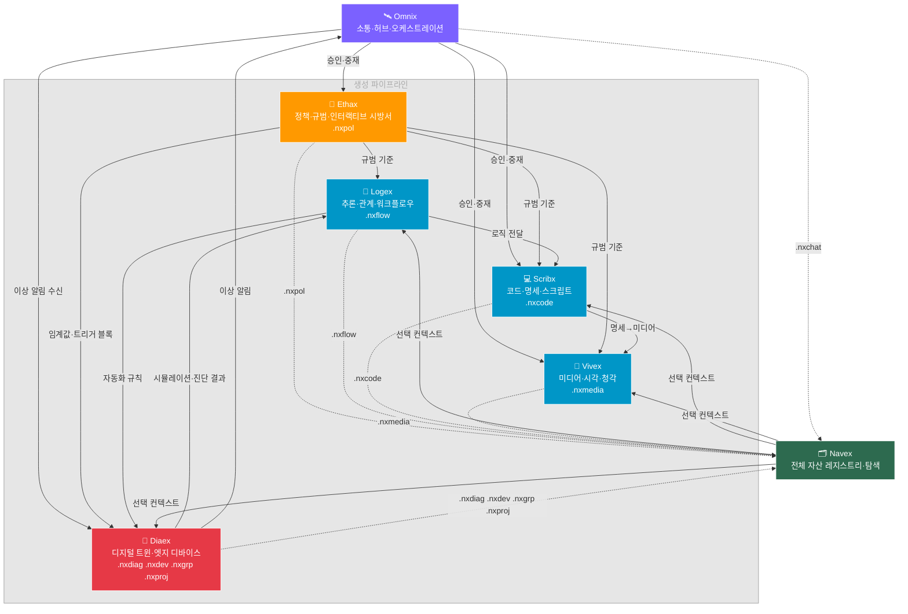

# 00 인공지능 NEXIA 구조와 기술 스택과 운영방침

## 0. 문서 목적

본 문서는 NEXIA 도메인의 상위 통합 인덱스다.  
세부 정책은 하위 문서(`01~13` 및 외부 엔진 아키텍처 문서)를 단일 기준으로 참조한다.

---

## 1. 기준 체계

- 기본 운영 프로파일: `7개 탭 체계`
  - `1. Cockpit`: Chat UI 기반의 전 탭과 도메인을 지휘/승인/모니터링하는 통합 조종석.
  - `2. Ethos`: Tiptap 에디터 기반 목표, 가치, 규범, 페르소나를 정의하는 정책 설계 문서를 작성하는 탭.
  - `3. Synapse`: Rivet+Vue Flow 기반 관계 모델과 추론 워크플로우를 설계하는 로직 탭.
  - `4. Glos`: Monaco Editor 기반 설계된 로직을 코드와 실행 규약으로 명세화하는 탭.
  - `5. Physis`: ComfyUI, Media Pipeline 기반 시각·청각·미디어 결과물을 생성/발현하는 탭.
  - `6. Sense`: Topology View, I/O/Health/권한 진단 중심의 분석 탭.
  - `7. Navis`: 파일/네트워크 자산을 탐색하고 선택 대상을 Sense/Synapse로 릴레이하는 내비게이션 탭.
- 구조 원칙: 탭 체계는 도메인/운영 단계에 따라 축소·확장 가능한 모듈 구조로 설계한다.
- 표기 원칙:
  - 기본값을 지칭할 때는 `7개 탭(기본 프로파일)`로 표기한다.
  - 탭 **순서 번호는 `1`부터 시작**한다. `1`은 Cockpit, `2~7`은 전문 탭(Ethos~Navis)이다.
  - 코드·DB의 0-based 인덱스와 문서·UI 라벨의 탭 순서는 별도 계층이며, 본 문서와 §3 테이블은 **1-based 순서**를 기준으로 한다.

---

## 2. 아키텍처 개요

### 2.1 레이어 구조

- Presentation: `Vue 3 + Quasar`
- Collaboration: `Yjs`
- Orchestration: `LangGraph.js`
- Logic Runtime: `Rivet Core (rivet-node)`
- External Engines: `Ollama`, `ComfyUI`, `ESPHome`

### 2.2 핵심 원칙

- 단일 오케스트레이션: 모든 엔진 호출은 백엔드 오케스트레이터를 경유한다.
- 상태 일관성: 협업 상태는 Yjs를 중심으로 관리한다.
- 로직 자산화: Rivet 그래프와 Subgraph를 버전 관리한다.
- 승인 우선: 고위험 작업은 Cockpit 승인 단계를 강제한다.

---

## 2.3 핵심 철학 (Core Philosophy)

- 지식 OS 지향: 단순 기능 모음이 아니라, 인지-분석-규범-실행이 순환하는 운영체계로 설계한다.
- 인간 중심 조종권: AI는 대체자가 아니라 보조자이며, 최종 결정권은 항상 사용자에게 있다.
- 투명한 지능: 시스템의 판단/실행 경로는 기록 가능하고 검증 가능해야 한다.
- 맥락 연속성: 사용자는 탭/창/디바이스를 이동해도 작업 흐름이 끊기지 않아야 한다.
- 가변 구조: 탭 수와 기능 구성은 고정이 아니라 목적과 운영 단계에 맞게 증감 가능해야 한다.

---

## 2.4 사용자 UI/UX 관점 작동 원리

### 사용자 기준 기본 흐름

1. 사용자는 `Cockpit`에서 요청을 입력한다.
2. 시스템은 요청 성격(정책/로직/코드/신호/미디어/인프라)을 분류한다.
3. 적절한 전문 탭으로 작업을 위임하고 진행 상태를 실시간으로 보여준다.
4. 결과는 다시 Cockpit으로 집계되어 확인/승인/수정 루프로 이어진다.

### UI 구성별 체감 동작

- Top Bar: "지금 어디서 무엇이 돌아가는지"를 한눈에 파악하게 한다.
- Left Drawer: "무엇을 불러와 이어 작업할지"를 빠르게 찾게 한다.
- Center Main: "실제 생산/실행"이 일어나는 집중 영역으로 유지한다.
- Right Drawer: "어떻게 조정/최적화할지"를 맥락 기반으로 제시한다. **시간·이력·타임라인 UI**는 전 탭 공통으로 이 영역의 **Time Axis Panel**에 모은다(§3.2).

### 상호작용 원칙

- 즉시성: 탭 전환과 상태 반영은 지연이 체감되지 않도록 설계한다.
- 가시성: Listening/Processing/Error/Approval 상태를 명확히 표시한다.
- 복원성: 창 분리/재접속/오류 이후에도 이전 맥락을 복구한다.
- 안전성: 고위험 동작은 자동 실행하지 않고 승인 게이트를 거친다.

---

## 2.5 Cockpit 3레이어 작동 원리 (Global Flow / Crew / Solo)

### 2.5.1 핵심 정의 (사용자 설명 반영)

| 레이어      | 성격         | 쓰기 권한       | 핵심 목적                                         |
| ----------- | ------------ | --------------- | ------------------------------------------------- |
| Global Flow | 전역 단톡 뷰 | 불가(Read-Only) | 모든 솔로 채팅/도메인 흐름을 한눈에 관찰          |
| NEXIA Crew  | 통합 단톡 뷰 | 가능            | 여러 Solo 채팅을 동시에 지휘/대화                 |
| NEXIA Solo  | 개별 1:1 뷰  | 가능            | 특정 에이전트(탭 또는 타 도메인)와 직접 실행 대화 |

### 2.5.2 Solo 채팅 리스트 구성 규칙

- 기본 리스트는 `NEXIA 6개 전문 탭 채팅`으로 구성한다.
- 여기에 `타 도메인 미니 채팅`을 동급으로 추가할 수 있다.
- 단, 타 도메인 채팅은 해당 도메인에서 실제 대화를 시작한 이후에만 Solo 리스트에 노출한다.
- Solo 리스트는 좌측에 항상 고정 노출하고, 클릭 시 즉시 Solo 모드로 전환한다.

### 2.5.3 Crew 작동 원리

- Crew는 하나의 방에서 여러 Solo를 동시에 다루는 "지휘 단톡방"이다.
- 사용자 입력 1건을 다중 태스크로 분해해 관련 Solo에 병렬/순차 라우팅한다.
- Crew는 Solo 결과를 집계해 충돌을 정리하고 최종 응답을 제공한다.
- 고위험 실행은 Crew에서 승인 요청을 띄운 뒤 진행한다.

### 2.5.4 Global Flow 작동 원리

- Global Flow는 읽기 전용이며 직접 실행/수정 입력을 받지 않는다.
- 표시 대상:
  - NEXIA 6개 전문 탭 Solo 흐름
  - 타 도메인에서 활성화된 미니 채팅 흐름
  - Crew 집계 이벤트/승인 이벤트/오류 이벤트
- 목적은 "현재 전체 지능 흐름 가시화"이며, 실행은 Crew/Solo에서 수행한다.

### 2.5.5 페르소나/태스크/스킬 전환 규칙

- 페르소나 전환:
  - 레이어 전환 시 자동 전환(Global Persona -> Crew Persona -> Solo Persona)
  - Solo 진입 시 해당 에이전트에 설정된 페르소나를 우선 적용
- 태스크 전환:
  - Crew가 사용자 요청을 분해하고 Solo별 태스크로 라우팅
  - Solo 완료/실패 이벤트를 Crew가 재계획 또는 집계
- 스킬 전환:
  - Solo 진입 시 해당 에이전트 기본 스킬셋 자동 로드
  - 실행 중 스킬 교체는 Crew 승인 정책을 따름

### 2.5.6 멀티모달/우주언어 입력 원칙

- 입력/출력은 텍스트 전용이 아니라 멀티모달(텍스트/음성/이미지/신호)을 기본 지원한다.
- 특수 우주언어 프로토콜은 별도 규격 확정 전까지 "확장 가능한 입출력 채널"로 예약한다.
- 우주언어 프로토콜은 자연어를 물리 신호(파동) 패킷으로 치환하는 구조화 언어이며, 상세 Draft는 `13 우주언어 프로토콜 개념 정리`를 기준으로 한다.
- 레이어 간 전환(Global/Crew/Solo) 시 입력 채널 상태와 컨텍스트를 유지한다.
- NIXIE는 Cockpit의 기본 시각화 계층으로서, Global Flow/Crew/Solo 전환 이벤트를 실시간 반영해야 한다.
- NIXIE는 단순 장식이 아니라 상태 가시성(대기/처리/승인/오류) 전달을 담당하는 운영 UI로 취급한다.

### 2.5.7 유지성/인지성 목표 (향후 연구 항목)

- 전환 비용 최소화: Global <-> Crew <-> Solo 전환은 1~2 클릭 내 완료
- 인지 속도 향상: 현재 활성 레이어/에이전트/태스크를 즉시 식별 가능
- 지속성 보장: 세션 재접속/창 전환 후에도 Solo 리스트와 문맥 복원

---

## 2.6 무엇이 다른가 (Differentiators)

| 관점        | 일반적인 앱 구조    | NEXIA 구조                                    |
| ----------- | ------------------- | --------------------------------------------- |
| 사용자 역할 | 기능 사용 중심      | 지휘/승인 중심의 조종사 역할                  |
| AI 위치     | 단일 챗봇 기능      | 탭별 전문 지능 + Cockpit 오케스트레이션       |
| 작업 흐름   | 화면 단위 단절      | 탭/창/세션 간 맥락 연속성 유지                |
| 실행 통제   | 자동 실행 비중 높음 | 고위험 실행은 승인 게이트 필수                |
| 확장 방식   | 기능 추가 중심      | 탭 프로파일(Lite/Standard/Extended) 기반 확장 |
| 운영 가시성 | 결과 중심 표시      | 상태/근거/이력까지 추적 가능한 운영형 UI      |

요약하면, NEXIA는 "기능을 소비하는 UI"가 아니라 "지능을 조율하고 통제하는 UI/UX"를 목표로 한다.
또한 Cockpit은 NIXIE를 통해 지능 상태를 실시간으로 시각화하는 "살아있는 조종석"으로 동작한다.

---

## 3. 기본 7개 탭 규정 테이블

**1차 7개 탭 규정 테이블**

| 순서 | 탭 라벨         | 핵심 가치               | 하위 구성                                  | 주요 도구(Tech Stack)                                                        | 데이터 성격                                | 상호작용(연계)                                        | 운영 포인트                                |
| ---- | --------------- | ----------------------- | ------------------------------------------ | ---------------------------------------------------------------------------- | ------------------------------------------ | ----------------------------------------------------- | ------------------------------------------ |
| 1    | Cockpit(콕핏)   | 통합 지휘/커뮤니케이션  | Global Flow, NEXIA Crew, NEXIA Solo        | Ollama, NIXIE, HEXAGON(5W1H), Nexnap Stream                                  | 텍스트, 이미지, 음성, 이벤트 로그          | 모든 탭과 도메인을 오케스트레이션                     | 승인 게이트, 상태 가시성, 비상 정지 진입점 |
| 2    | Ethos(에토스)   | 가치/규범/목표 정의     | 정책 문서, 페르소나, 시방서 템플릿         | Tiptap, 템플릿 엔진                                                          | 비정형 텍스트, 정책 규칙                   | 전 탭의 의사결정 기준 제공                            | 가드레일 규칙 버전 관리, 정책 승인 이력    |
| 3    | Synapse(시넵스) | 사고/관계/추론 설계     | Graph(온톨로지), Logic(워크플로우)         | Rivet Core, Vue Flow, Yjs                                                    | 지식 그래프, 워크플로우 상태               | Sense 입력을 분석해 Glos/Physis로 전달                | 로직 재사용(Subgraph), 충돌 없는 협업 편집 |
| 4    | Glos(글로스)    | 규범의 실행 명세화      | 코드 편집, 규칙 변환, 실행 스크립트        | Monaco Editor, Lint/Formatter 체인                                           | 정형 텍스트, 코드, 실행 규약               | Synapse 설계를 실행 가능한 산출물로 변환              | 코드 리뷰/버전 추적, 배포 전 검증          |
| 5    | Physis(피시스)  | 실체적 발현/미디어 생성 | 시각·청각 현상화, 결과물 제작              | ComfyUI, 미디어 파이프라인                                                   | 이미지, 영상, 오디오 소스                  | Glos 규칙/명세를 실제 결과물로 발현                   | 고비용 작업 큐잉, 결과물 품질 게이트       |
| 6    | Sense(센스)     | 인프라/장치 분석        | Topology View, I/O 진단, 권한/헬스 제어    | ESPHome, Network Graph Engine, Diagnostics Pipeline                          | 장치 상태, I/O, 권한, 진단 로그            | Navis 선택 대상을 분석하고 Synapse로 전달             | 정밀 진단, 권한 검사, 이상 탐지            |
| 7    | Navis(나비스)   | 자산/노드 탐색          | File Explorer, Network Tree, Relay Trigger | IndexedDB, OPFS, File System Access API, S3(MinIO) 메타 연동, Tree UI Engine | 파일 자산 메타, 노드 인덱스, 선택 컨텍스트 | 선택된 객체 ID/컨텍스트를 Sense/Synapse로 즉시 릴레이 | 탐색 속도 최적화, 컨텍스트 정확도          |

**2차 7개 탭 규정 테이블 (연계 규칙 정리)**

| #   | 라벨       | 역할                                 | 기술 스택                                                                                 | 데이터 성격                                                                              | 상호작용(연계)                                                                                         | 운영 포인트                                                                                       |
| --- | ---------- | ------------------------------------ | ----------------------------------------------------------------------------------------- | ---------------------------------------------------------------------------------------- | ------------------------------------------------------------------------------------------------------ | ------------------------------------------------------------------------------------------------- |
| 1   | **Omnix**  | 소통·허브·오케스트레이션             | Ollama, NIXIE, HEXAGON(5W1H), Nexnap Stream, Yjs                                          | 텍스트, 이미지, 음성, 이벤트 로그, 멀티유저 세션                                         | 모든 탭의 진입점·오케스트레이터, 승인 게이트 중계                                                      | 승인 게이트, 상태 가시성, 비상 정지 진입점, 멀티유저 세션 관리                                    |
| 2   | **Ethax**  | 정책·규범·인터랙티브 시방서 생성물   | Tiptap, Tiptap 커스텀 노드 확장, 템플릿 엔진, Yjs                                         | 비정형 텍스트, 정책 규칙, 규범 문서, 인터랙티브 블록, 버전 이력                          | 전 탭의 의사결정 기준 제공, Omnix를 통해 승인 이력 공유, 문서 내 블록이 Logex·Scribx·Diaex와 직접 연동 | 가가드레일 규칙 버전 관리, 정책 승인 이력, 공동 편집 충돌 방지, 블록 실행 권한 관리               |
| 3   | **Logex**  | 추론·관계·워크플로우 로직 생성물     | Rivet Core, Vue Flow, Yjs                                                                 | 지식 그래프, 워크플로우 상태, 노드 관계 데이터                                           | Navex 선택 컨텍스트를 입력받아 Scribx·Vivex로 로직 전달                                                | 로직 재사용(Subgraph), 충돌 없는 협업 편집, 버전 스냅샷                                           |
| 4   | **Scribx** | 코드·명세·실행 스크립트 생성물       | Monaco Editor, Lint/Formatter 체인, Yjs                                                   | 정형 텍스트, 코드, 실행 규약, 린트 결과                                                  | Logex 로직을 실행 가능한 코드·명세로 변환, Omnix로 배포 승인 요청                                      | 코드 리뷰·버전 추적, 배포 전 검증, 공동 편집                                                      |
| 5   | **Vivex**  | 미디어·시각·청각 생성물              | ComfyUI, 미디어 파이프라인, Yjs(파라미터 동기화)                                          | 이미지, 영상, 오디오, 파라미터 설정값                                                    | Scribx 규칙·명세를 실제 미디어 결과물로 발현, Omnix로 결과 공유                                        | 고비용 작업 큐잉, 결과물 품질 게이트, 파라미터 동기화                                             |
| 6   | **Diaex**  | 디지털 트윈·엣지 디바이스 인터페이스 | Three.js / Babylon.js, ESPHome, MQTT, WebSocket, Network Graph Engine, Yjs Awareness, Yjs | 디바이스 실시간 상태, 트윈 객체 데이터, 공간 토폴로지, 사용자 의도·시선, 시뮬레이션 결과 | Navex .nxproj .nxdev .nxgrp 선택 시 트윈 뷰 활성, Logex로 진단·시뮬레이션 결과 전달, Omnix로 이상 알림 | 트윈↔실제 디바이스 동기화, 시뮬레이션 격리 환경, 사용자 의도 공유(Awareness), 디바이스 권한 검사 |
| 7   | **Navex**  | 파일·자산·노드 탐색                  | IndexedDB, OPFS, File System Access API, S3(MinIO), Tree UI Engine, Yjs                   | 파일 자산 메타, 노드 인덱스, 선택 컨텍스트, 멀티유저 탐색 상태                           | 선택된 객체 ID·컨텍스트를 Logex·Diaex로 즉시 릴레이, Omnix로 선택 상태 공유                            | 탐색 속도 최적화, 컨텍스트 정확도, 멀티유저 선택 충돌 방지                                        |

---

**Yjs 적용 레이어 요약**

| 탭     | Yjs 적용 범위                                     |
| ------ | ------------------------------------------------- |
| Omnix  | 멀티유저 채팅·이벤트 스트림 동기화                |
| Ethax  | 정책 문서 공동 편집                               |
| Logex  | 그래프·워크플로우 협업 편집                       |
| Scribx | 코드 공동 편집                                    |
| Vivex  | 파라미터·설정값 동기화                            |
| Diaex  | 사용자 의도·시선 공유(Awareness) + 진단 로그 협업 |
| Navex  | 파일 트리·선택 컨텍스트 동기화                    |

**Yjs 협업 강도 — Solo 없음, Duo가 최소 단위**

Ollama LLM을 협업 인격체로 대우, 항상 참여자로 포함:

| 강도          | 참여자       | 설명                              |
| ------------- | ------------ | --------------------------------- |
| 🟡 **Duo**    | 사람 1 + LLM | 기본 상태, 최소 협업 단위         |
| 🟢 **Collab** | 사람 N + LLM | 멀티유저 완전 공동 편집           |
| 🔵 **Review** | 사람 N + LLM | 편집 가능, Omnix·LLM 승인 후 반영 |

**LLM Awareness 객체**

```typescript
awareness: {
  clientId: "ollama-nexia",
  type: "llm",
  name: "NEXIA",
  focus: string | null,
  intent: string | null,
  status: "idle" | "thinking" | "writing" | "waiting"
}
```

---

**탭별 고유 확장자 정의**

| #   | 라벨       | 생성 확장자                              | 수용 가능 외부 확장자          |
| --- | ---------- | ---------------------------------------- | ------------------------------ |
| 1   | **Omnix**  | `.nxchat`                                | `.json`, `.md`                 |
| 2   | **Ethax**  | `.nxpol`                                 | `.md`, `.html`, `.json`        |
| 3   | **Logex**  | `.nxflow`                                | `.json`, `.yaml`               |
| 4   | **Scribx** | `.nxcode`                                | `.js`, `.ts`, `.py`, `.sh`     |
| 5   | **Vivex**  | `.nxmedia`                               | `.png`, `.jpg`, `.mp4`, `.wav` |
| 6   | **Diaex**  | `.nxdiag`, `.nxdev`, `.nxgrp`, `.nxproj` | `.yaml`, `.cfg`, `.log`        |
| 7   | **Navex**  | 확장자 생성 없음                         | 전체 확장자 인덱싱             |

`nx` prefix로 시스템 고유 파일임을 명시하고, 외부 범용 확장자도 수용.

---

**뷰 상태 × 파일 권한 구조**

> 뷰 레이어 — 어디서 발현되었는가

| 뷰 소유권        | 상태   | 설명                                     |
| ---------------- | ------ | ---------------------------------------- |
| `owner: "omnix"` | 진행중 | Omnix에서 현재 생성·스트리밍 중인 결과물 |
| `owner: "navex"` | 구성됨 | Navex에서 선택된 이미 저장된 자산        |

두 뷰는 UI상 완전 분리, 절대 침범 불가.

> 파일 레이어 — 무엇을 할 수 있는가

| 권한      | 플래그            | 설명                       |
| --------- | ----------------- | -------------------------- |
| 읽기 전용 | `readonly: true`  | 열람만 가능, 편집 불가     |
| 편집 가능 | `readonly: false` | 해당 탭에서 편집·저장 가능 |

```typescript
asset: {
  id: string,
  ext: string,
  path: string,
  readonly: boolean,
  projectId: string | null,
  groupId: string | null
}
```

**탭 파이프라인 다이어그램**



---

** Omnix 범위 제어 — 3단계 분리 구조 **

```
Omnix (마스터 에이전트 + 승인 게이트)
└──→ Ethax (규범 검증 레이어)
     └──→ 탭별 서브 에이전트 (도메인 실행)
```

| 레이어              | 역할                |
| ------------------- | ------------------- |
| Omnix               | 승인·라우팅만 담당  |
| Ethax               | 규범 검증 필터 담당 |
| 각 탭 서브 에이전트 | 도메인 실행 담당    |

---

### 3.1 해석 규칙

- `1 Cockpit`은 실행 허브이며, `2~7`은 전문 탭(기능 실행 유닛)이다.
- 사용자 요청은 기본적으로 Cockpit에서 수신하고, 탭별 파이프라인으로 위임한다.
- 고위험 작업(IoT 제어/대량 수정/배포)은 Cockpit 승인 단계를 통과해야 한다.
- 기본 프로파일 외 탭 증감은 탭 레지스트리(`tabId`, `capability`, `owner`, `riskLevel`, `status`)에 등록 후 활성화한다.
- 프로파일 예시:
  - Lite: 4~5개 탭
  - Standard: 7개 탭(기본)
  - Extended: 8개 이상(도메인 특화 탭 포함)

### 3.2 시간 전제 (전 탭 공통)

시간은 별도 탭이 아니라 **플랫폼·탭 전반의 전제 축**으로 다룬다. 종류를 구분해 적용한다.

| 구분            | 내용                                                                    | 적용 범위                                                                                                     |
| --------------- | ----------------------------------------------------------------------- | ------------------------------------------------------------------------------------------------------------- |
| **운영 시간**   | 생성·수정 시각, 버전, 승인·감사 이력, 세션·이벤트 순서, Yjs 동기화 시점 | **모든 탭·모든 산출물** — UI에 노출하지 않아도 저장·추적·복원은 기본                                          |
| **도메인 시간** | 시계열·스트림·주파수·에너지 흐름, 파형·타임라인 분석                    | **데이터가 시간축을 본질 속성으로 가질 때만** — 우측 드로어 Time Axis Panel에서 `capability`에 따라 깊이 확장 |

- **전 탭 공통**: 맥락 연속성(§2.3)·감사 로그(§4)·협업 상태(Yjs)는 운영 시간을 항상 전제한다.
- **UI 배치 (Right Drawer)**: 타임라인·버전·히스토리·스트림·파형 뷰는 **Center Main 탭 본문에 고정하지 않는다**. Cross-Tab 유틸리티인 **Time Axis Panel**(시간·이력 패널)을 우측 드로어에 두고, `activeTabId`·선택 객체·세션 맥락에 맞춰 내용을 바꾼다. 레이아웃·아코디언·Pin 규칙은 `11 NEXA Nexia 통합 레이아웃 구조 규격` §11.4.4를 따른다.
- **패널 표시 계층** (기본 → 확장):
  - **항상**: 운영 시간 — 최근 변경·버전·승인/감사 스냅샷, 세션 이벤트 요약
  - **맥락 연동**: 활성 탭별 — Ethos/Glos 정책·코드 이력, Synapse 실행·스냅샷, Physis 렌더 큐, Sense/Navis 진단·선택 시점
  - **capability ON 시**: 도메인 시간 — 시계열·스트림·주파수·파형(예: `timeSeries`, `streamView`, `spectralAnalysis`)
- **Cockpit Global Flow와의 구분**: Global Flow는 **대화·지휘 이벤트의 시간 순서**(관찰·조종). Time Axis Panel은 **작업 산출물·장치·자산의 시간축**(이력·분석). 둘은 보완 관계이며 UI를 중복 배치하지 않는다.
- **팝아웃**: 고밀도 스트림·장시간 타임라인만 멀티윈도우/팝아웃으로 분리 가능(§8·§14). 기본 진입점은 우측 드로어다.
- **역할 분리(기본 7탭, 순서 `1~7`)**:
  - `1` Cockpit: 대화·실행·승인 **이벤트의 시간 순서** 가시화
  - `2` Ethos / `4` Glos: 정책·코드 **버전·승인 이력**
  - `3` Synapse: 그래프·워크플로 **실행 순서·스냅샷**
  - `5` Physis: 렌더·미디어 **큐·구간 타임라인**(필요 시)
  - `6` Sense: 장치 **스냅샷·진단** 데이터 공급; 연속 신호·스트림 표시는 Time Axis Panel + `capability`
  - `7` Navis: 탐색·선택 **컨텍스트 시점** 메타 공급; Time Axis Panel에 선택·릴레이 이력 표시
- **capability 표기**: 탭 레지스트리에 `timeSeries`, `streamView`, `spectralAnalysis` 등으로 등록한다. Standard에서는 도메인 시간 뷰 기본 접힘·요약만, Extended 또는 작업 맥락에서 패널 확장.
- **파이프라인**: `Navis/Sense(수집·진단) → [도메인 시간 가공: Time Axis Panel·워크플로우 노드] → Synapse(의미·관계) → Glos/Physis` — 시간 가공은 **전용 탭이 아닌 우측 패널·파이프라인 단계**로 표현한다.

---

## 4. 운영 기준 요약

| 항목           | 기준                     |
| -------------- | ------------------------ |
| UI 응답        | P95 150ms 이하           |
| 상태 전파 지연 | 평균 50ms 이하           |
| 가용성         | 월 99.9% 이상            |
| 백업           | 일 1회 전체 + 1시간 증분 |
| 복구 목표      | RPO 1시간 / RTO 4시간    |
| 감사 로그      | 180일 이상 보존          |

---

## 5. 상세 문서 맵 (Single Source of Truth)

- `01 보안 및 권한 관리 체계 (Security & Governance).md`
  - 인증/인가(RBAC), AI 가드레일, 감사 추적
- `02 인프라 구축 및 확장성 (Infrastructure & Scalability).md`
  - 배포 토폴로지, SLO, 용량 계획, 관측성
- `03 데이터 생애주기 및 형상 관리 (Data Lifecycle & Versioning).md`
  - 데이터 분류, 버전 관리, 백업/복구, 파기 정책
- `04 사용자 경험(UX)의 포용성 및 확장 (Inclusivity & UX Expansion).md`
  - 접근성, 디바이스 확장, 피드백 UI 표준
- `05 에코시스템 및 협업 세부 규칙 (Ecosystem & Collaboration Details).md`
  - 협업 역할, 충돌 해결, 플러그인/리소스 정책
- `06 예외 상황 처리 (Exception Handling).md`
  - 장애 등급, 공통 대응 절차, 비상 정지/복구 검증
- `07 음성 인풋 자동화 및 확장 로직 (Voice Input Automation & Expansion).md`
  - 웨이크 워드, 연속 대화 루프, STT/TTS, PiP 제어권 정책
- `08 멀티윈도우 아키텍처 규격 (Multi-Window Architecture Specification).md`
  - 창 분리/동기화/복원 정책, 제어권 이양, 충돌 방지
- `09 Document PiP 운영 규격 (Document Picture-in-Picture Operations Spec).md`
  - PiP 생명주기, 메인-보조 제어권, 프라이버시 표시 정책
- `10 멀티윈도우 vs Document PiP 선택 가이드 (Decision Matrix).md`
  - 선택 기준, 혼합 전략, 모드별 권장안
- `11 NEXA Nexia 통합 레이아웃 구조 규격 (Integrated Layout Specification).md`
  - Top/Left/Center/Right, Solo 리스트, Cockpit 레이어, 이벤트·SLO
- `12 NEXIA 기술 스택 기준서 (Technology Stack Baseline).md`
  - 코어·외부 엔진·탭별 스택, 파일 자산, 관측성·배포
- `13 우주언어 프로토콜 개념 정리 (Cosmic Language Protocol Draft).md`
  - 우주언어 매트릭스·패킷·프로파일 계층, 미확정 항목
- `NEXIA 주요 외부 엔진들과 아키텍쳐.md`
  - 외부 엔진 계약, 데이터 흐름, ADR 요약

---

## 6. 구현 로드맵

- Phase 1 (MVP): Cockpit/Synapse/Glos 중심 운영 안정화
- Phase 2 (확장): 기본 7개 탭 연동 + 멀티윈도우 + 협업 동기화
- Phase 3 (고도화): PiP 상시 보조 인터페이스 + 플러그인 생태계 + 비용 최적화

---

## 7. 변경 관리 규칙

- 정책 변경은 반드시 해당 상세 문서(01~13)에 먼저 반영한다.
- `00` 문서는 인덱스/요약 역할만 수행하고 상세 규칙을 중복 기재하지 않는다.
- 용어 변경 시 7개 탭 표기 일관성을 최우선으로 검증한다.

---

## 8. NEXIA 구조 보완 및 설계 결정 사항

---

**3. Diaex 디지털 트윈**

구현 수준은 단계적으로 검토하되 MVP는 트윈 뷰어 먼저, 실시간 바인딩은 이후 단계에서 추가.

---

**4. 구현 순서**

```
1단계 — 기반 구축
├── Navex 자산 트리 (로컬 IndexedDB·OPFS)
├── Scribx 코드 편집 (Monaco)
├── Ethax 문서 편집 (Tiptap)
└── Yjs 코어 + LLM Awareness 동시 도입
    └── Duo를 기본값으로 Scribx에서 먼저 검증

2단계 — 협업 레이어 확장
├── Logex 워크플로우 (Vue Flow)
├── Yjs → Ethax·Logex·Navex 확장
└── 협업 강도 UI 기초 (Duo·Collab·Review)

3단계 — 핵심 파이프라인
├── Vivex 미디어 파이프라인 (ComfyUI)
├── Yjs → Vivex 파라미터 동기화
├── Omnix 기본 소통 허브 (채팅·스트림)
└── Yjs Awareness 전 탭 확장

4단계 — 플랫폼 심장부
├── Diaex 디지털 트윈 MVP (Three.js 뷰어)
├── Diaex MQTT 실시간 바인딩
├── Yjs Awareness → Diaex 디바이스 의도 공유
└── Omnix 서브 에이전트 체계 (Ollama 멀티 에이전트)

5단계 — 고도화
├── Ethax 인터랙티브 블록 실행 연동
├── Ethax → 탭 이벤트 전파 구조 정립
├── `.nx*` 확장자 스키마 버전 관리
└── 인증·권한 체계 도입
```

---

## 9. NEXIA 구조 종합 평가와 개선 방향

**1. 인증·권한 체계 미정의**

현재 구조 어디에도 인증·권한 레이어가 없습니다.

| 미정의 항목                     | 영향                                              |
| ------------------------------- | ------------------------------------------------- |
| 사용자 역할(Role) 정의          | 누가 어떤 탭에 접근 가능한지 불명확               |
| 탭별 권한 분리                  | Diaex 디바이스 제어를 아무나 할 수 있는 구조      |
| `.nx*` 파일 읽기·편집 권한      | `readonly` 플래그만 있고 역할 기반 접근 제어 없음 |
| Ethax 인터랙티브 블록 실행 권한 | 누구나 자동화 규칙·트리거 실행 가능한 위험        |
| 멀티유저 세션 권한              | Yjs 공동 편집 시 권한 없는 사용자 차단 불가       |

---

**2. 오프라인·네트워크 단절 시나리오 미정의**

IoT 플랫폼임에도 네트워크 단절 상황에 대한 정의가 없습니다.

| 시나리오                      | 현재 대응 |
| ----------------------------- | --------- |
| MQTT 브로커 단절              | 미정의    |
| Yjs 동기화 실패               | 미정의    |
| 엣지 디바이스 오프라인        | 미정의    |
| IndexedDB·OPFS 로컬 캐시 전략 | 미정의    |

Navex가 IndexedDB·OPFS를 보유하고 있으니 오프라인 우선 전략이 가능한데 활용 방향이 없습니다.

---

**3. Omnix 역할 경계 모호**

| 문제                        | 내용                                                         |
| --------------------------- | ------------------------------------------------------------ |
| 소통 vs 오케스트레이션 혼재 | 채팅 인터페이스인지 자동화 파이프라인인지 경계 불명확        |
| 승인 게이트 기준 미정의     | 무엇을 승인하고 무엇을 자동 통과시키는지 규칙 없음           |
| 비상 정지 범위 미정의       | 비상 정지 시 어느 탭까지 중단되는지 불명확                   |
| AI(Ollama) 개입 범위        | AI가 어디까지 자율 판단하고 어디서 사람 승인을 받는지 미정의 |

---

**4. 데이터 동기화 충돌 전략 미정의**

Yjs가 전 탭에 관통하지만 충돌 시나리오가 없습니다.

| 충돌 시나리오                                          | 현재 대응                       |
| ------------------------------------------------------ | ------------------------------- |
| 동시 편집 충돌                                         | Yjs CRDT에 위임, 별도 전략 없음 |
| Omnix 생성물과 Navex 선택 자산이 같은 파일일 때        | 미정의                          |
| `.nxflow` 를 Logex와 Scribx가 동시 참조할 때           | 미정의                          |
| 디지털 트윈 시뮬레이션 중 실제 디바이스 데이터 수신 시 | 미정의                          |

---

**5. Diaex 디지털 트윈 구체성 부족**

가장 핵심 탭임에도 설계가 가장 추상적입니다.

| 미정의 항목                | 내용                                                             |
| -------------------------- | ---------------------------------------------------------------- |
| 트윈 모델 포맷             | 3D 모델을 어떤 포맷으로 정의하는가 (`.glb`, `.gltf`, 커스텀)     |
| 트윈↔디바이스 바인딩 규칙 | 어떤 기준으로 트윈 객체와 실제 디바이스를 1:1 매핑하는가         |
| 시뮬레이션 격리 환경       | 시뮬레이션 중 실제 디바이스에 신호가 나가지 않도록 하는 안전장치 |
| 트윈 상태 저장 주기        | 실시간 상태를 언제 스냅샷으로 저장하는가                         |
| `.nxproj` 내부 스키마      | 프로젝트 파일 내부 구조 미정의                                   |

---

**6. Ethax 인터랙티브 블록 실행 흐름 미정의**

| 미정의 항목                      | 내용                                                |
| -------------------------------- | --------------------------------------------------- |
| 블록 실행 주체                   | 블록이 브라우저에서 실행되는가, 서버에서 실행되는가 |
| 블록 실행 실패 처리              | 자동화 규칙 블록 실행 실패 시 롤백 전략 없음        |
| 블록과 Logex·Diaex 연동 프로토콜 | 어떤 인터페이스로 연동되는지 미정의                 |
| 문서 버전과 블록 버전 분리       | 문서는 v2인데 블록 로직이 v1일 때 처리 방법 없음    |

---

**7. Navex 성능 한계 미정의**

| 미정의 항목                | 내용                                          |
| -------------------------- | --------------------------------------------- |
| 대용량 자산 인덱싱 한계    | 파일 수만 개일 때 Tree UI 성능 전략 없음      |
| S3(MinIO) 연동 지연 처리   | 원격 자산 로딩 중 UX 처리 방법 없음           |
| 가상 디바이스 노드 수 한계 | 디바이스가 수백 개일 때 트리 렌더링 전략 없음 |

---

**8. 탭 간 트랜잭션 롤백 전략 없음**

```
Logex → Scribx → Vivex 파이프라인 중
Scribx 단계에서 실패하면?
```

파이프라인이 중간에 끊겼을 때 이전 단계로 롤백하거나 재시도하는 전략이 전혀 없습니다.

---

**9. 외부 수용 파일 검증 전략 없음**

출처를 제거하고 외부 파일을 수용하는 구조로 바꿨는데:

| 미정의 항목        | 내용                                                |
| ------------------ | --------------------------------------------------- |
| 악성 파일 검증     | 외부 `.nxflow` 파일이 악의적 워크플로우를 포함할 때 |
| 스키마 버전 불일치 | 구버전 `.nxpol` 파일을 신버전 Ethax가 열 때         |
| 파일 무결성 검증   | 백업 복원 시 파일 손상 여부 확인 방법 없음          |

---

**우선순위 요약**

| 등급                       | 항목                                                             |
| -------------------------- | ---------------------------------------------------------------- |
| 🔴 즉시 정의 필요          | 인증·권한 체계, Diaex 트윈 바인딩 규칙, 시뮬레이션 격리 안전장치 |
| 🟠 설계 전 정의 필요       | Omnix 역할 경계, 탭 간 트랜잭션 롤백, 오프라인 전략              |
| 🟡 구현 단계에서 정의 가능 | Navex 성능 한계, 외부 파일 검증, 블록 실행 주체                  |
