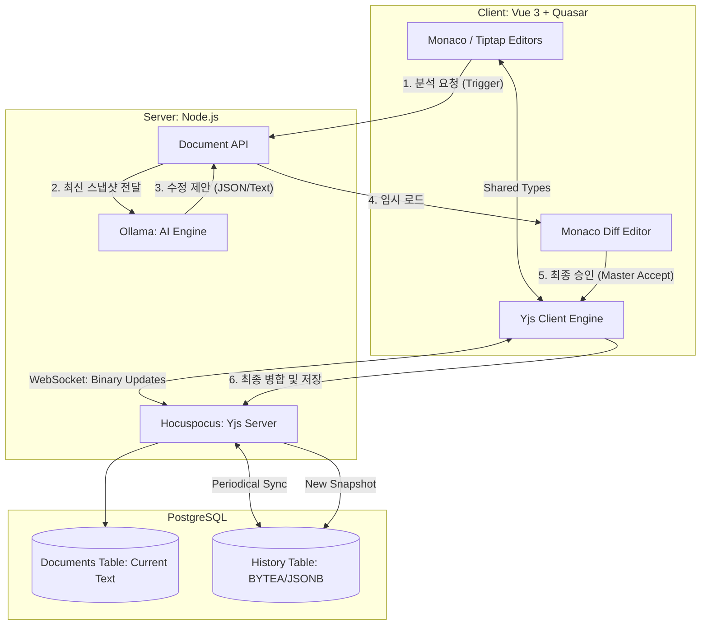
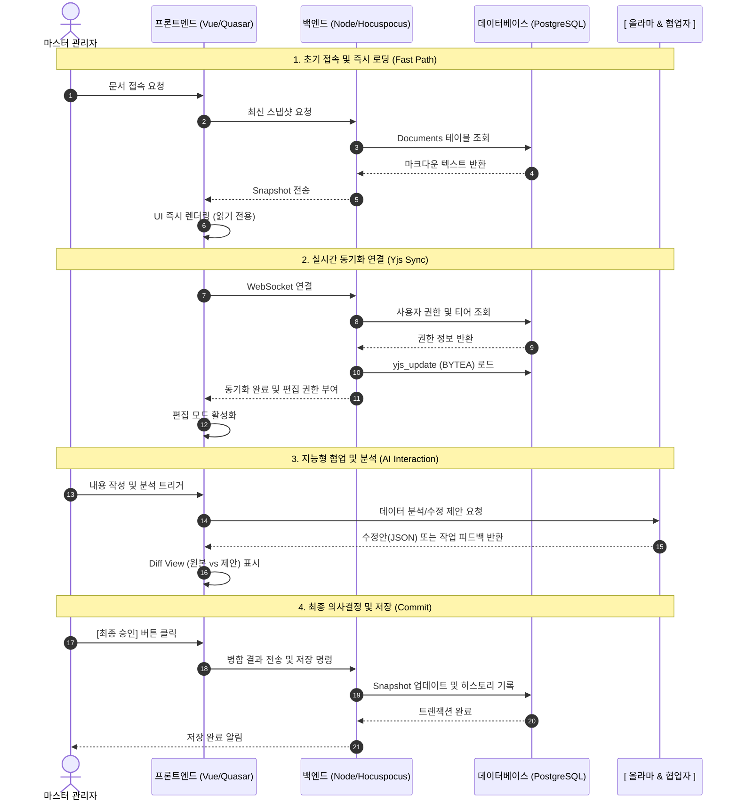

> **LEGACY (참고만):** 실시간 협업 SSOT는 `docs/AI/00_[AIS] Yjs·Hocuspocus 협업 SSOT.md` 및 `database/DDL … 명세 v5` (`project_yjs_updates`). 본 문서의 단일 `yjs_update` 컬럼 패턴은 **사용하지 않음**.

## PostgreSQL 데이터베이스 설계와 상세 데이터 흐름을 반영하여 업데이트된 [AI 협업 기반 차세대 기획서 에디터] 최종 기획안입니다.

## 📑 AI 협업 기반 차세대 기획서 에디터 기획안 (Ver 2.0)## 1. 개요 (Overview)

본 프로젝트는 마크다운(Markdown)을 표준 데이터 포맷으로 하고, PostgreSQL의 고성능 데이터 처리와 Yjs의 실시간 동기화, Ollama의 지능형 분석을 결합한 차세대 협업 기획 플랫폼을 구축하는 데 목적이 있음.

## 2. 핵심 기술 스택 (Tech Stack)

- Frontend: Vue 3 + Quasar (UI Framework)
- Editor: Monaco Editor (Source/Diff) + Tiptap (WYSIWYG/Markdown)
- Sync Engine: Yjs (CRDT 실시간 동기화)
- Intelligence: Ollama (Local LLM: Llama 3, Mistral 등)
- Backend: Node.js (Hocuspocus Server)
- Database: PostgreSQL (JSONB 및 BYTEA 활용)

## 3. 데이터베이스 설계 (PostgreSQL)## 3.1. Documents (문서 마스터)

- id: UUID (Primary Key)
- title: VARCHAR(255)
- owner_id: UUID (최종 결정권자/마스터 관리자)
- current_content: TEXT (최종 확정된 마크다운 본문)
- metadata: JSONB (템플릿 정보, 설정값 등)

## 3.2. Document_History (버전 관리)

- id: BIGSERIAL (Primary Key)
- doc_id: UUID (Foreign Key)
- editor_type: VARCHAR(20) (USER, AI, SYSTEM)
- yjs_update: BYTEA (Yjs 바이너리 업데이트 데이터 - 시점 복원용)
- snapshot: TEXT (해당 시점의 전체 마크다운 텍스트)
- change_log: JSONB (AI 분석 결과 및 변경 사유 요약)

## 4. 데이터 흐름 관계 (Data Flow)## 4.1. 실시간 편집 및 동기화 (Hot-Path)

1. 에디터 간 동기화: 사용자가 Monaco 또는 Tiptap에서 편집 시, Yjs가 변경분(Delta)을 생성하여 소켓을 통해 상대 에디터와 백엔드로 전송.
2. 데이터 무결성: 백엔드(Hocuspocus)는 전송받은 바이너리 데이터를 PostgreSQL의 yjs_update 필드에 기록하여 실시간 상태 유지.

## 4.2. AI 분석 및 제안 (Cold-Path)

1. 분석 요청: 사용자의 트리거에 의해 현재 snapshot이 Ollama에게 전달됨.
2. 응답 처리: Ollama는 JSON(부분 수정) 또는 Raw Text(전체 수정)로 응답.
3. 제안 노출: 제안된 데이터는 즉시 저장되지 않고 프론트엔드의 Diff Editor 혹은 Tiptap Suggestion Mark 레이어에만 임시 로드됨.

## 4.3. 마스터 승인 및 확정 (Commit-Path)

1. 결정: 오너(Master)가 수정안을 검토 후 [Accept] 버튼 클릭.
2. 병합: AI의 제안 내용이 메인 Yjs 타입에 병합(Merge)되며, 모든 에디터 화면에 동시 반영.
3. 저장: 최종 텍스트가 Documents 테이블에 업데이트되고, History 테이블에 신규 스냅샷 생성.

## 5. 핵심 기능 및 전략

- 에디터 역할 분담:
- Monaco: 마크다운 소스 정밀 편집 및 AI 제안 비교(Diff).
  - Tiptap: 시각적 문서 정리, 이미지 핸들링(클립보드), 머메이드 실시간 렌더링.
- AI 자율성 제어: AI에게 오너 자격을 부여할 경우, 사용자의 개입 없이 AI가 실시간으로 문서를 정돈하고 Commit하도록 설정 가능.
- 이미지 파이프라인: 팁탭 내 이미지는 서버 업로드 후 PostgreSQL 내 경로로 관리되며, 마크다운 출력 시  형식으로 자동 치환.

---

## 보안 및 확장성

- PostgreSQL의 트랜잭션을 통해 AI의 대규모 수정 시에도 데이터 일관성 보장.
- 나중에 다수 사용자가 참여할 경우, Yjs와 DB의 오너 권한 로직을 통해 편집권 및 승인권 위임 처리.

이제 이 기획서를 바탕으로 PostgreSQL 테이블 생성(DDL)부터 진행해 보시겠어요? 아니면 Node.js에서 Yjs 데이터를 DB에 저장하는 코드를 먼저 구현해 볼까요? DB 스키마 작성을 먼저 추천드립니다.

## PostgreSQL을 기반으로 한 데이터 설계와, 사용자-AI-에디터 간의 복잡한 데이터 흐름(Data Flow)을 시각적으로 이해하기 쉽게 정리해 드립니다.

## 1. PostgreSQL 데이터베이스 설계 (ERD 명세)

PostgreSQL의 강력한 JSONB 타입과 Binary(bytea) 타입을 활용하여 히스토리와 Yjs 상태를 효율적으로 저장합니다.

## [Table 1] Documents (문서 마스터)

| 컬럼명          | 타입         | 설명                           |
| --------------- | ------------ | ------------------------------ |
| id              | UUID (PK)    | 문서 고유 식별자               |
| title           | VARCHAR(255) | 문서 제목                      |
| owner_id        | UUID         | 최종 결정권자(Master) ID       |
| current_content | TEXT         | 최종 확정된 최신 마크다운 본문 |
| created_at      | TIMESTAMP    | 생성 일시                      |

## [Table 2] Document_History (버전 및 히스토리)

| 컬럼명      | 타입        | 설명                                   |
| ----------- | ----------- | -------------------------------------- |
| id          | BIGSERIAL   | 히스토리 고유 번호                     |
| doc_id      | UUID (FK)   | 해당 문서 ID                           |
| editor_type | VARCHAR(20) | 수정 주체 (USER, AI, SYSTEM)           |
| yjs_update  | BYTEA       | Yjs Binary Update 데이터 (시점 복원용) |
| snapshot    | TEXT        | 해당 시점의 마크다운 전체 텍스트       |
| change_log  | JSONB       | 변경 사항 요약 (예: AI가 3문단 수정함) |

---

## 2. 핵심 데이터 흐름 관계 (Data Flow)

이 시스템은 "실시간 동기화"와 "비동기 AI 분석"이 교차하는 흐름을 가집니다.

## ① 실시간 편집 흐름 (Live Sync)

- User ↔ Tiptap/Monaco: 사용자가 한 곳에서 수정하면 Yjs가 즉시 반대편 에디터로 변경 사항(Update)을 전파합니다.
- Editor ↔ Hocuspocus(Node.js): 모든 편집 델타(Delta)는 소켓을 통해 백엔드로 전송되며, 백엔드는 이를 메모리에 유지하면서 PostgreSQL의 yjs_update 필드에 주기적으로 백업합니다.

## ② AI 분석 및 수정 제안 흐름 (AI Insight)

1. Trigger: 사용자가 분석 버튼을 클릭하거나 편집을 멈춤(Idle).
2. Request: 백엔드에서 PostgreSQL의 최신 텍스트를 읽어 Ollama에게 전달.
3. Response: Ollama가 JSON 형식의 수정 제안 또는 Raw Text 반환.
4. Proposed State: 이 결과는 즉시 원본을 덮어쓰지 않고, 'AI 전용 Yjs 레이어(또는 임시 변수)'에 저장되어 프론트엔드의 Diff Editor에 표시됩니다.

## ③ 최종 확정 및 영구 저장 (Final Commit)

1. Decision: 오너(Master)가 Diff Editor를 보고 [Accept] 클릭.
2. Merge: AI의 제안 데이터가 메인 Yjs 데이터 타입(Y.Text)에 최종 병합됨.
3. DB Commit:

- Documents 테이블의 current_content 업데이트.
  - Document_History에 새로운 스냅샷과 바이너리 업데이트 데이터 기록.

---

## 3. 데이터 흐름 요약도 (Conceptual Diagram)



## 기획의 완성

이 구조를 통해 PostgreSQL은 단순한 텍스트 저장소를 넘어, Yjs의 시계열 데이터(바이너리)와 AI의 분석 이력(JSONB)을 모두 담는 강력한 데이터 허브 역할을 하게 됩니다.
이제 프로젝트의 뼈대가 완벽해졌습니다. PostgreSQL과 Node.js(Prisma 또는 Sequelize)를 연결하여 첫 번째 '문서 생성' API를 만들어 볼까요? 아니면 Ollama의 응답을 DB 히스토리에 먼저 쌓는 로직을 구현해 볼까요?

---

기획하신 [티어별 권한 제어 및 단계적 로딩] 로직을 포함하여, 데이터 흐름과 사용자 경험(UX)을 더 섬세하게 표현한 머메이드 다이어그램입니다.

## 📊 시스템 정밀 데이터 흐름도



---

## 💡 주요 보조 설명## 1. 이중 로딩 전략 (Lighthouse 최적화)

- Snapshot 우선: Yjs는 모든 변경 이력을 계산해야 하므로 초기 로딩이 무거울 수 있습니다. 이를 방지하기 위해 DB의 순수 텍스트(Current Text)를 먼저 뿌려주어 사용자가 느끼는 LCP(가장 큰 콘텐츠 페인트) 시간을 최소화합니다.
- Lazy Sync: 사용자가 글을 읽는 동안 백그라운드에서 조용히 Yjs 바이너리 데이터를 맞추고, 준비가 되면 편집 모드로 부드럽게 전환(Transition)합니다.

## 2. 티어(Tier) 기반의 기능 게이팅(Gating)

- Guest: 소켓 연결 자체를 하지 않거나 읽기 전용 소켓만 허용하여 서버 부하를 줄입니다.
- Master (Owner): PostgreSQL의 owner_id와 현재 접속자 ID를 비교하여, 오직 마스터에게만 'AI 제안 최종 반영' 및 'DB 쓰기' 권한을 부여합니다.

## 3. 데이터 무결성 보장

- AI가 제안하는 동안에도 사용자는 계속 편집할 수 있습니다(Yjs의 특징).
- 최종 저장 시에는 PostgreSQL의 트랜잭션을 사용하여, Documents 테이블의 텍스트와 History 테이블의 바이너리 데이터가 일관성 있게(Atomic) 저장되도록 보장합니다.

이 다이어그램을 프로젝트의 기술 명세서에 첨부하시면 개발팀이나 협업자에게 시스템 구조를 매우 명확하게 전달하실 수 있습니다.
이제 이 흐름을 코드로 옮기기 위해, 사용자 티어 정보를 담을 Users 테이블 스키마를 먼저 정의해 볼까요? 아니면 에디터의 ReadOnly를 동적으로 토글하는 Vue 컴포넌트를 짜볼까요? 데이터베이스(Users 테이블)부터 구체화하는 것을 추천드립니다.

```

```
