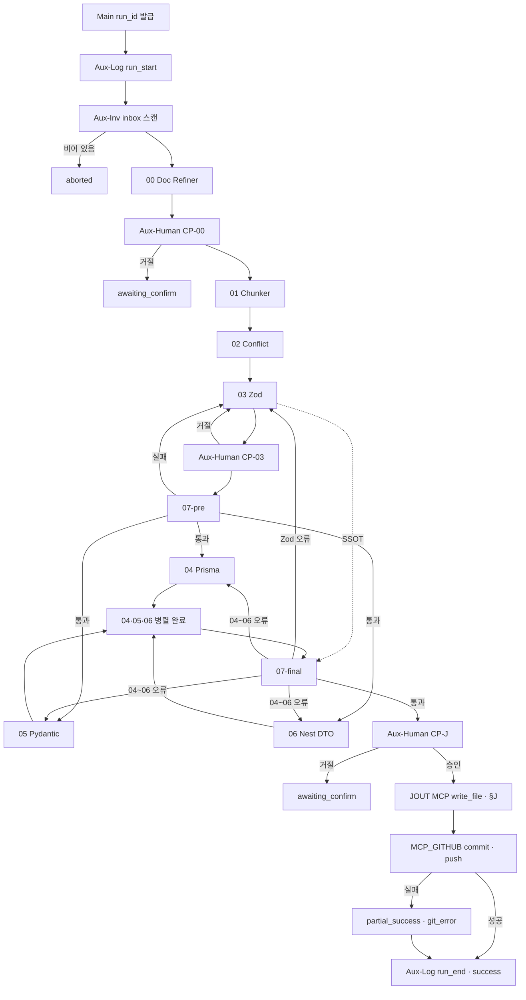

## Desktop Rivet 캔버스(Graph) 설계

메인 캔버스(**Main Orchestrator**)는 Sub_00~07·보조 Graph(**Aux-Log** · **Aux-Inv** · **Aux-Human**)를 조립하는 지휘자입니다.
웹앱, 백엔드(NestJS), DB(PostgreSQL/Prisma), 파이썬 PC까지 관통하는 Zod 중심 모노레포 파이프라인 설계도입니다. **코드·스키마 되돌리기는 Rivet이 아니라 에디터 Git**이 담당합니다.

**Desktop Rivet** 의 로컬 파일 I/O는 **MCP FileSystem**(`MCP Discovery` → `MCP Tool Call`)으로 구현하는 것을 **To-Be 기본**으로 합니다. 별도 NestJS·Node **External Call** 서버는 **레거시(초기 스케치)** — 운영 웹앱은 `Rivet 파이프라인.md` 대로 **NestJS 내부**에서만 파일시스템을 다룹니다.

### `docs/` 생애주기 (모노레포 To-Be)

```text
docs/
├── inbox/     # (필수) 날것 메모·아이디어 — 00번만 읽기 · Aux-Inv 스캔
├── refined/   # Desktop Rivet 1차 정제 기획 — 01~02번
├── specs/     # 확정 명세·Zod·도메인 SSOT — 03~07번
├── trash/     # 정제 완료 inbox → trash/inbox/… 동일 경로 미러
└── .rivet/
    └── runs/{run_id}/   # Aux-Log — pipeline.log.jsonl · 인벤토리 스냅샷(선택)
```

> 루트의 `docs/Nexia/` 등 **레거시 폴더**는 `docs/specs/` 로 **수동 이전** 예정. 상세: `_NEXA-OS-V2.1-설계-표준-및-미션크리티컬-전략-보강본.md` §docs-lifecycle.

---

### 모노레포 플랫폼 구축을 위한 표준 Subroutine(서브 캔버스(Graph)) 정의서

| 번호 | 서브루틴(캔버스(Graph)) 명칭 | 주요 역할 (Hermes 3 페르소나 및 임무)                                                                                                                                                                                                                                                                                                                                                         | 입력 데이터 (Input)                                                                | 출력 데이터 (Output)                                                                                                       |
| ---- | ---------------------------- | --------------------------------------------------------------------------------------------------------------------------------------------------------------------------------------------------------------------------------------------------------------------------------------------------------------------------------------------------------------------------------------------- | ---------------------------------------------------------------------------------- | -------------------------------------------------------------------------------------------------------------------------- |
| Main | Main Orchestrator            | [지휘·게이트·분기] **LLM 없음** — `run_id` · **Aux-Inv → 00~07 → J → MCP_GITHUB** · **Aux-Log** 각 Subgraph 직후 · **Aux-Human** `CP-00`·`CP-03`·`CP-J` · **07-pre** 전 **04~06 미실행** · **Join**·**07-final** · **`CP-J` 승인 → J → MCP_GITHUB** · Git 실패 시 J 성공은 유지 가능(`partial_success`) · 실패 라우팅 Zod→**03** · 파생물→**04~06** | 트리거 · `docs/`·Normex·루트 · Aux·handoff · Human 플래그 · (선택) Git 브랜치·PR 정책 | `run_id` · `pipeline_result` · `written_paths[]` · `git_commit_sha` · `pr_url`(선택) · `step_log[]` · `last_error` |
| 00   | Sub_Doc_Refiner_and_Placer   | [문서 정제·배치] inbox 날것을 Normex에 맞게 **`docs/refined/`** 저장 · inbox 원본 **`docs/trash/inbox/…`** 미러 · **Refined Manifest** JSON 산출 (인벤토리 스캔은 **Aux-Inv** 담당)                                                                                                                                                                                                           | **Aux-Inv** `inbox_inventory.json` · inbox 대상 · refined/specs 맥락 · 파일명 규약 | `docs/refined/**` · **refined_manifest.json** — 01번 입력                                                                  |
| 01   | Sub_Doc_Chunker              | 대량의 MD 기획서를 도메인(유저, 인증, 상품 등)별로 분류하고 처리 가능한 크기로 쪼갬                                                                                                                                                                                                                                                                                                           | **`docs/refined/`** 파일 목록 및 경로                                              | 도메인별 분류된 문서 청크 배열 (Array)                                                                                     |
| 02   | Sub_Conflict_Analyzer        | [충돌 분석] 기획서 간의 데이터 항목 누락, 웹-PC 간의 로직 모순, 타입 불일치를 찾아내 리포트 작성                                                                                                                                                                                                                                                                                              | 분할된 문서 청크                                                                   | 모순점 및 데이터 필드가 정리된 충돌 리포트 (Text)                                                                          |
| 03   | Sub_Zod_Schema_Generator     | [최상위 표준 수립] Zod SSOT **초안** 작성 · **디스크 반영은 `CP-J` 승인 후 J**                                                                                                                                                                                                                                                                                                                | 병합된 최종 충돌 리포트 · (참고) `docs/specs/` 맥락                                | Zod·specs 가이드 **버퍼** — J 시 `packages/shared` · `docs/specs/`                                                         |
| 04   | Sub_Prisma_Schema_Converter  | [DB 연동] 사전 검증 통과 Zod를 기반으로 DB에 반영할 Prisma 데이터 모델 구조 생성 (04·05·06 **병렬** 중 하나)                                                                                                                                                                                                                                                                                  | 03번 Zod · **07번 사전 검증 통과** 게이트                                          | Prisma 스키마 코드 블록 (schema.prisma 추가용)                                                                             |
| 05   | Sub_Pydantic_Converter       | [PC 프로그램 연동] 사전 검증 통과 Zod를 Pydantic 모델로 변환 (04·05·06 **병렬** 중 하나)                                                                                                                                                                                                                                                                                                      | 03번 Zod · **07번 사전 검증 통과** 게이트                                          | Python Pydantic 모델 코드 (schemas.py 형태)                                                                                |
| 06   | Sub_NestJS_DTO_Generator     | [백엔드 연동] 사전 검증 통과 Zod를 NestJS API DTO(Class)로 가공 (04·05·06 **병렬** 중 하나)                                                                                                                                                                                                                                                                                                   | 03번 Zod · **07번 사전 검증 통과** 게이트                                          | nestjs-zod 기반 백엔드 DTO 코드                                                                                            |
| 07   | Sub_Syntax_Validator         | [사전·최종 검증] **① 사전**: 03번 Zod만 정적 검사(통과 시에만 04~06 게이트 오픈) · **② 최종**: 04~06 병렬 산출물 전체(TS·Python·Prisma) 문법·타입 유실 검사 및 셀프 피드백                                                                                                                                                                                                                    | ① 03번 Zod 스키마 · ② 04~06 생성 코드 전체                                         | 검증 통과 여부 및 오류 수정 제안 (Boolean / Text)                                                                          |

#### 보조 Graph (Aux) — 00~07 번호와 분리

| Aux ID        | Graph 명칭                  | LLM  | 주요 역할                                                                                                   | Input                                                         | Output                                              |
| ------------- | --------------------------- | ---- | ----------------------------------------------------------------------------------------------------------- | ------------------------------------------------------------- | --------------------------------------------------- |
| **Aux-Log**   | Sub_Pipeline_Logger         | 없음 | 각 Subgraph 실행 **직후** 1행 append · 성공/실패·`duration_ms`·오류·`retry_count` · 04~06은 `branch` 구분   | `run_id` · `step_id` · handoff 메타 · 결과                    | `docs/.rivet/runs/{run_id}/pipeline.log.jsonl` — **MCP FS `write_file`** |
| **Aux-Inv**   | Sub_Inbox_Inventory_Scanner | 없음 | **00 전** `docs/inbox/**` 읽기 전용 스캔(경로·크기·mtime·해시·신규 플래그) · 비어 있으면 Main이 **aborted** | `docs/inbox/**`                                               | `inbox_inventory.json` — **MCP FS `list_directory`** (+ 필요 시 `read_file`) |
| **Aux-Human** | Sub_Human_Checkpoint        | 없음 | `checkpoint_id`별 **일시 정지·승인/거절** · REFACTOR는 **CP-00**에서 필수 확인                              | 요약 diff·Manifest·Zod 버퍼·07-final 리포트 · `checkpoint_id` | `approved` / `rejected` · 코멘트(선택)              |

**인벤토리 2종 (혼동 방지)**

| 이름                 | 시점      | 담당    | 용도                                            |
| -------------------- | --------- | ------- | ----------------------------------------------- |
| **Inbox Inventory**  | 00 **전** | Aux-Inv | 전체 inbox 현황·실행 여부 판단                  |
| **Refined Manifest** | 00 **후** | 00      | refined 배치·trash 미러·`action_type` — 01 입력 |

### Rivet MCP 노드 — Desktop 파일 I/O (External Call 대체)

Rivet에 **MCP Discovery** · **MCP Tool Call** · **MCP Get Prompt** 가 있으면, Desktop 개발 환경의 **로컬 파일·디렉터리 작업**은 NestJS External Call **없이** 구현 가능합니다.

| 환경 | 파일 I/O | 비고 |
| ---- | -------- | ---- |
| **Desktop Rivet (Windows)** | **MCP FileSystem** + Tool Call | 모노레포 루트를 MCP `roots`에 고정 |
| **운영 웹앱 (NestJS + Rivet Core)** | **NestJS 서비스** (API·Path 검증) | 브라우저·Rivet Core가 디스크 직접 접근 **금지** — `Rivet 파이프라인.md` |

**완전 대체가 되는 범위**

- `docs/inbox` · `refined` · `trash` · `specs` · `.rivet/runs` 스캔·읽기·쓰기
- **JOUT** — §J 경로 **write** (MCP FS)
- **MCP_GITHUB** — `written_paths[]` **commit · push** (·선택 PR)
- **Aux-Log** — `pipeline.log.jsonl` append

**대체가 어렵거나 별도인 범위**

- **운영 배포** 시 동일 MCP를 클라이언트에 노출하는 것 (보안상 NestJS 유지)
- **HTTP 전용** 외부 엔진(ComfyUI 등) — FileSystem MCP와 무관 · HTTP Call 유지
- **07-pre/final** 의 `tsc`·Prisma validate 등 — MCP FS만으로 부족 시 **Code** 노드 또는 CI

**MCP 노드 역할 (Main 1회 + 단계별 Tool Call)**

| Rivet 노드 | 용도 |
| ---------- | ---- |
| **MCP Discovery** | **FileSystem** + **GitHub** MCP 등록(시작 1회, 또는 JOUT 직전 GitHub만 추가 Discovery) · FS roots = 모노레포 루트 |
| **MCP Tool Call** | FS: `list_directory` · `read_file` · `write_file` · GitHub: `create_branch` · `commit` · `push` · (선택) `create_pull_request` |
| **MCP Get Prompt** | (선택) Normex·경로 규약 등 **고정 지시문** 템플릿 — 00·03 Chat **앞**에 주입 |

**보안 (Desktop도 필수)**

- MCP `roots`를 NEXA 모노레포로 **제한** · 상위 `..` Path Traversal 차단
- **J**는 `CP-J` 승인 **이후에만** `write_file` Tool Call 연결
- 민감 파일(`.env`·키) 경로는 Discovery 단계에서 **exclude** 목록

#### FileSystem MCP — 파이프라인 단계별 사용처

| 단계 | MCP Tool (예) | 경로·대상 | R/W | 비고 |
| ---- | ------------- | --------- | --- | ---- |
| **Main 시작** | Discovery | 모노레포 루트 | — | 세션당 1회 · 이후 Tool Call 공통 |
| **Aux-Log** | `write_file` | `docs/.rivet/runs/{run_id}/pipeline.log.jsonl` | W | NDJSON 1행 append · run_start/run_end/step |
| **Aux-Inv** | `list_directory` | `docs/inbox/**` | R | 빈 배열 → `aborted` · inventory JSON은 Context 또는 `write_file`로 run 폴더 저장 |
| **00 입력** | `list_directory` · `read_file` | `inbox/` · `refined/` · `specs/` (맥락) | R | §1 `directory_structure` · Hermes 입력 재료 |
| **00 출력** | `write_file` | `docs/refined/**` · `docs/trash/inbox/…` | W | **J 이전** 문서 이동·정제본 저장 · `refined_manifest.json` |
| **01** | `read_file` | `docs/refined/**` | R | 청크 입력 |
| **02** | — | (01 handoff 메모리) | — | FS 없음 |
| **03 입력** | `read_file` | `docs/specs/**` (가이드·맥락) | R | Zod는 **버퍼** 우선 |
| **03 출력** | — | (버퍼) | — | 디스크 Zod는 **CP-J → J** |
| **07-pre / 07-final** | `read_file` | (선택) 스테이징·기존 `packages/shared` | R | 정적 검사 입력이 디스크일 때만 |
| **04~06** | `read_file` | Zod SSOT (Context 또는 shared) | R | 산출은 버퍼 → Join |
| **CP-00 / CP-03 / CP-J** | `read_file` | Manifest · Zod·파생물 **요약 파일** | R | User Input에 diff·요약 표시 |
| **J (JOUT)** | `write_file` | §J 표 전 경로 | W | **temp → 최종** · `written_paths[]` |
| **MCP_GITHUB** | GitHub MCP Tool Call | `written_paths[]` · working tree | W(Git) | **JOUT 직후** · §MCP_GITHUB · 롤백·revert는 여전히 **Git 이력** SSOT |

> **00** 만 `docs/` 에 **선행 쓰기** — 코드·스키마 실경로 쓰기는 **J** · 원격 반영은 **MCP_GITHUB**.

---

### 메인 캔버스 (Desktop Rivet) 에서의 유기적인 흐름 (작동 시나리오)

0.  **Main**이 `run_id`(UUID)를 발급하고 **Aux-Log**에 `run_start`를 기록합니다.
1.  **Aux-Inv**가 `docs/inbox/**` 를 스캔합니다. **비어 있으면** `pipeline_result: aborted` 로 종료합니다.
2.  **00번**이 inbox를 정제·`docs/refined/` 배치·trash 미러 후 **Refined Manifest** JSON을 만듭니다.
3.  **Aux-Human `CP-00`** — refined 배치·`action_type`(REFACTOR 포함) 확인 · **거절** 시 벨트 중단(`awaiting_confirm`).
4.  **01·02번**이 청크·충돌 리포트를 만듭니다.
5.  **03번**이 Zod SSOT **초안**(버퍼·아직 J 미반영)을 생성합니다.
6.  **Aux-Human `CP-03`** — Zod SSOT 검토 · **거절** 시 03 재실행.
7.  **07-pre** — Zod 정적 검사 · 실패 시 03 루프.
8.  **04·05·06** 병렬 · **Join** 후 **07-final** · 실패 시 Zod→03 · 파생물→04~06 재진입.
9.  **Aux-Human `CP-J`** — 07-final 통과 산출물 diff 요약 승인 · **승인 시에만** **J (JOUT)** 실행.
10. **MCP_GITHUB** — JOUT으로 기록된 `written_paths[]` 를 스테이징·커밋·푸시(·선택 PR) · §MCP_GITHUB.
11. **Aux-Log** `run_end` · `pipeline_result: success` (또는 Git만 실패 시 `partial_success`) · 롤백은 §롤백.

> 07번은 `Sub_Syntax_Validator`를 **07-pre** / **07-final** 로 두 번 호출합니다. **Aux-Log**는 매 Subgraph 직후 best-effort append 합니다.

**Human Checkpoint 운영 모드 (Main 설정)**

| 모드           | CP-00                    | CP-03 | CP-J |
| -------------- | ------------------------ | ----- | ---- |
| **초반(기본)** | ON                       | ON    | ON   |
| **안정기**     | ON(REFACTOR만 강제 가능) | OFF   | ON   |

```text
run_start (Aux-Log)
    ↓
Aux-Inv (inbox 스캔) ──(비어 있음)──→ aborted
    ↓
00 → CP-00 ──(거절)──→ awaiting_confirm
    ↓
01 → 02 → 03 → CP-03 ──(거절)──→ 03
    ↓
07-pre ──(실패)──→ 03
    ↓
04+05+06 → Join → 07-final
    ├─(Zod 오류)──→ 03
    ├─(04~06 오류)──→ 04~06 재실행
    └─(통과)──→ CP-J ──(거절)──→ awaiting_confirm (디스크 미기록)
              └─(승인)──→ JOUT → MCP_GITHUB → run_end
```

### J — 파일 시스템 반영 · JOUT (`CP-J` 승인 후)

Rivet 그래프 **밖**(모노레포 실경로)에 검증된 산출물을 씁니다. **`docs/specs/`만이 아닙니다** — `specs/`는 **문서·도메인 명세 SSOT** 구역이고, 실행·DB·PC 계약 코드는 **각 앱·패키지**에 둡니다.

| 출처            | 기록 대상 (To-Be 예)                                                         | 성격                                 |
| --------------- | ---------------------------------------------------------------------------- | ------------------------------------ |
| **03** Zod      | `packages/shared/src/schemas/**` (`index.ts` 등)                             | **Contract SSOT** (TS 3앱 공통)      |
| **03** 가이드   | `docs/specs/**` (도메인 MD·Zod 가이드·D8 매핑 표 등)                         | 사람이 읽는 **명세·규약 문서**       |
| **04** Prisma   | `apps/backend/prisma/schema.prisma` (+ 필요 시 `migrations/`는 Execute 단계) | **DB 물리 SSOT**                     |
| **05** Pydantic | `apps/desktop/.../bridge/dto/` (`schemas.py` 등)                             | PC(U2BEE) **런타임 gate** — Zod 미러 |
| **06** Nest DTO | `apps/backend/src/**` (nestjs-zod·DTO 모듈)                                  | API **요청/응답 경계**               |

- **`docs/refined/`** · **`docs/inbox/`** — J 대상 **아님** (00~02 단계에서 이미 처리).
- **`CP-J` 거절** 시 J 미실행 — 모노레포 코드·스키마 경로에 **쓰기 없음**.
- Desktop Rivet: **MCP FS** `write_file` 로 §J 경로 **atomic write**(`.tmp` → rename) · 다이어그램 노드명 **JOUT**.

### MCP_GITHUB — Git 반영 (JOUT 직후)

로컬 디스크 반영(**JOUT**) 다음, **GitHub MCP**로 변경을 VCS·원격에 올립니다. Rivet **MCP Discovery**에 GitHub 서버가 등록되어 있어야 합니다.

| 항목 | 내용 |
| ---- | ---- |
| **입력** | `run_id` · `written_paths[]` · 커밋 메시지 템플릿(예: `rivet({run_id}): pipeline SSOT update`) · (선택) 대상 브랜치·base |
| **Tool Call (예)** | 변경 파일 스테이징 → `create_commit` / `push` → (선택) `create_pull_request` |
| **출력** | `git_commit_sha` · `branch` · (선택) `pr_url` — Main·`pipeline.log.jsonl`·`step_log[]`에 기록 |
| **실패** | JOUT은 이미 완료 — Main은 `pipeline_result: partial_success` + `git_error` · **수동** `git commit` / 에디터 Git으로 보완 |
| **롤백** | Rivet undo 없음 · **revert**는 `git revert` / PR close — §롤백 |

**Main 설정 (권장)**

| 플래그 | 동작 |
| ------ | ---- |
| `github.enabled=true` (기본) | JOUT 성공 후 **MCP_GITHUB** 실행 |
| `github.enabled=false` | JOUT 후 **run_end** — 커밋은 기획자가 에디터 Git에서 수동 |
| `github.pr=optional` | push만 또는 PR 자동 생성 |

> **CP-J**가 디스크 쓰기 승인 · **MCP_GITHUB**는 그 다음 **이력 고정** 단계(자동 커밋 정책에 따라 생략 가능).

### 롤백 정책

| 구분              | 정책                                                                                                          |
| ----------------- | ------------------------------------------------------------------------------------------------------------- |
| **파이프라인**    | Rivet Graph에 **undo / rollback 서브루틴 없음** — 실패·거절 시 **재실행·수동 수정**만                         |
| **되돌리기 SSOT** | **Git** — 에디터 또는 `git` CLI · **MCP_GITHUB** 이전에는 uncommitted 변경만 · 이후에는 **commit SHA** 기준 `revert` |
| **JOUT 이후**     | `written_paths[]` 미커밋 변경 → `git restore` · **MCP_GITHUB** 커밋 후 → `git revert` / PR revert              |
| **MCP_GITHUB 실패** | 로컬 파일은 JOUT 상태 유지 — 수동 커밋 또는 재실행 · 파이프라인 undo 없음                                      |
| **문서(docs/)**   | inbox/refined/trash 이동은 00에서 이미 발생 — 문서 되돌리기도 **Git** 또는 trash에서 수동 복구                |

### Aux-Log — `pipeline.log.jsonl` 행 스키마 (요약)

| 필드            | 설명                                                                             |
| --------------- | -------------------------------------------------------------------------------- |
| `run_id`        | Main 시작 시 UUID                                                                |
| `step_id`       | … · `J` · **`MCP_GITHUB`** · `run_end` |
| `git_commit_sha`| `MCP_GITHUB` 성공 시 (선택 필드) |
| `status`        | `success` / `fail` / `skipped`                                                   |
| `duration_ms`   | Subgraph wall time                                                               |
| `branch`        | 병렬 시 `prisma` / `pydantic` / `nest` (해당 시만)                               |
| `error_message` | 실패 시                                                                          |
| `retry_count`   | 루프 회차                                                                        |

로그 기록 실패는 **비즈니스 실패로 간주하지 않음** (best-effort).

### 전체 흐름 다이어그램



> 각 사각 노드 **직후** Main이 **Aux-Log** append (다이어그램 생략). REFACTOR는 **00 → CP-00** 에서 구조 개편 제안서와 함께 확인.

---

## Sub_Doc_Refiner_and_Placer 캔버스에서 요구사항 상세

초기 기획 단계에서는 날것의 아이디어 하나 때문에 기존에 짜두었던 데이터 규약(Zod 스키마)이나 폴더 구조 전체를 뒤엎고(Refactoring) 판을 새로 짜야 하는 일이 빈번하게 발생합니다.
Hermes 3가 이 작업을 완벽하게 수행하려면, 단순히 날것의 문서 하나만 봐서는 절대 안 됩니다.

"현재 정제되어 있는 기존 문서 전체의 맥락"과 "우리가 합의한 아키텍처 규약"을 양손에 쥐고 있어야 올바른 판단을 내릴 수 있습니다.
리벳(Rivet)의 Sub_Doc_Refiner_and_Placer 캔버스(Graph) 내부 구조를 어떻게 고도화해야 하는지 전략을 다음과 같이 정리

---

## 1. Hermes 3에게 공급해야 할 3가지 필수 재료

이 서브루틴의 Graph Input 노드는 날것의 문서 외에도 기존 데이터의 전반적인 상태를 AI에게 주입해 주어야 합니다.

1.  날것의 신규 문서 (raw_input_text): 기획자님이 방금 던진 두서없는 메모.
2.  현재 정제된 핵심 기획서 및 규약 요약본 (current_system_context): 기존에 통과된 핵심 도메인 정보와 현재의 Zod 스키마 표준 가이드라인.
3.  현재 문서고 폴더 트리 구조 (directory_structure): 파일들이 어디에 위치해 있는지 보여주는 맵.

---

## 2. 초반 대격변(판 뒤집기)을 감당하기 위한 Hermes 3 프롬프트 설계법

초반에 규약 전체를 뒤바꾸는 유연성을 발휘하게 하려면, Hermes 3의 행동 강령(System Prompt)에 "기존 규칙을 파괴할 권한"을 명시적으로 부여해야 합니다. Hermes 3는 검열이 없고 지시를 매우 잘 따르므로 아래와 같은 가이드라인이 효과적입니다.

- 프롬프트에 주입할 핵심 행동 지침 (예시):

"당신은 단순한 비서가 아니라, 플랫폼 전체를 설계하는 수석 아키텍트입니다. 신규 메모의 요구사항이 기존 시스템 규약과 정면으로 충돌할 경우, 다음 두 가지 선택지 중 하나를 엄격하게 판단하세요."

- 옵션 A (단순 추가/수정): 기존 규약의 틀 안에서 소폭 수정이나 파일 배치가 가능한 경우 ➡️ action_type: "CREATE" 또는 "APPEND"로 처리.
  - 옵션 B (시스템 아키텍처 리팩토링): 신규 요구사항이 워낙 중요하여 기존 데이터 구조나 규약(Zod 표준 등) 전체를 전면 수정해야 하는 경우 ➡️ action_type: "REFACTOR"로 응답하고, 어떤 기존 문서들을 어떻게 수정해야 하는지 '구조 개편 제안서'를 함께 출력할 것.

---

## 3. action_type: "REFACTOR" 발생 시 리벳의 제어 흐름

00번이 `action_type: REFACTOR` 를 Refined Manifest에 넣으면, Main은 **01 이전**에 **Aux-Human `CP-00`** 으로 보냅니다. (구 Graph 분기는 **CP-00** 으로 흡수.)

[00 완료 → Aux-Human CP-00]
│
┌─────────┴─────────┐
▼ CREATE / APPEND ▼ REFACTOR
[승인 → 01~02…] [구조 개편 제안서 검토 · 승인 전 01 미시작]
[거절 → awaiting_confirm · Git으로 refined/trash 정리]

- **REFACTOR** — '규약 전면 수정 제안서' + "이 방향으로 판을 뒤엎을까요?" · **롤백은 에디터 Git**
- **CREATE / APPEND** — 배치·Manifest 확인 후 01 진행

> 초반: CP-00·CP-03·CP-J 모두 ON. 안정기: §작동 시나리오 **Human Checkpoint 운영 모드** 참고.

## 장기적인 안정화 전략 (정리 요함)

** [시나리오 1] ** : 프로젝트 중반을 넘어가면 시스템이 안정되면서 판이 자꾸 뒤집히는 것이 오히려 독이 될 수 있습니다.
그때는 이 서브루틴의 프롬프트에서 *"이제 아키텍처가 안정기이므로, 웬만한 요구사항은 기존 규약을 깨지 않는 선에서 수용하라"*고 한 줄만 수정해 주면 시스템의 성격이 '유연한 아키텍트'에서 '보수적인 관리자'로 자연스럽게 전환.
** [시나리오 2 ]** : 새로운 내용에 따라 규약 자체를 바꾼다는 발상은 플랫폼 기획의 리스크를 엄청나게 줄여줄 핵심 장치입니다.
이때 다시 specs/ 폴더에 있는 기존 규약 요약본을 참고하여 규약을 수정 할지 아니면 모두 inbox/ 또는 refined/ 로 이동 시킨 후 새로 짜야 하는지 판단 할 수 있다.

---

## Rivet(리벳) 구현 로드맵

설계서의 **논리 단위**(Main · 00~07 · Aux · J)를 Rivet Desktop에 옮길 때의 **단계·노드·완료 기준**입니다.  
**캔버스(.rivet) 파일 수 ≠ 논리 단계 수** — 아래 §물리 배치 권장을 따릅니다.

### Rivet 물리 배치 (권장 · 하이브리드)

| 논리 단위 | Rivet 구현 | 비고 |
| --------- | ---------- | ---- |
| **Main** | `Main.rivet` 1탭 | Subgraph 호출·If/Match·`run_id` Context |
| **00~07** | 서브그래프 **8탭** (07은 Main에서 **07-pre / 07-final** 2회 호출) | Hermes Chat·Prompt |
| **Aux-Log** | Main · **MCP Tool Call** (`write_file`) × N | log append |
| **Aux-Inv** | Main · **MCP Tool Call** (`list_directory`) | inbox 스캔 |
| **Aux-Human** | Subgraph **1탭** | `checkpoint_id` · CP 표시용 **MCP read** 선택 |
| **J / JOUT** | Main · **MCP FS** `write_file` | §J · CP-J 승인 후 |
| **MCP_GITHUB** | Main · **MCP GitHub** Tool Call | JOUT 직후 · `github.enabled` |

**Main 시작 노드:** **MCP Discovery** (FileSystem + GitHub) — FS·Git Tool Call 위주.

예상 **신규 .rivet**: Main 외 **+1~2** (Human 필수 · Inv는 Main에 흡수 가능).

---

### 1단계 — Main 골격 · 트리거 · Aux-Inv · Aux-Log

**범위:** `run_start` → Aux-Inv → (비어 있으면 `aborted`)

| 항목 | Rivet 구현 힌트 | 완료 기준 |
| ---- | --------------- | --------- |
| `run_id` | Graph Input 또는 Code로 UUID 생성 → **Context**에 보관 | `pipeline.log.jsonl` 첫 행에 동일 ID |
| Aux-Log `run_start` / step append | Subgraph 직후 **MCP Tool Call** `write_file` → `docs/.rivet/runs/{run_id}/` | 실패해도 Main 계속(best-effort) |
| Aux-Inv | **MCP Tool Call** `list_directory` on `docs/inbox` | `inbox_inventory.json` handoff |
| MCP Discovery | Main 최상단 **1노드** · FS MCP · roots=모노레포 | 이후 모든 FS Tool Call 전제 |
| inbox 비음 | **If/Match** → `pipeline_result: aborted` · 그래프 종료 | 00 미호출 |

> 로그는 1단계만이 아니라 **전 구간 횡단** — 1단계에서 append 패턴을 먼저 고정합니다.

---

### 2단계 — Aux-Human (CP-00 · CP-03 · CP-J)

**범위:** §작동 시나리오의 Human 게이트 3곳

| CP | Rivet 구현 힌트 | 승인 | 거절 (설계서 기준) |
| -- | --------------- | ---- | ------------------ |
| **CP-00** | **User Input** (Buttons: 승인/거절) · REFACTOR 시 제안서 텍스트 표시 | → 01 | `awaiting_confirm` · **Git**으로 refined/trash 정리 |
| **CP-03** | 동일 Subgraph · `checkpoint_id=CP-03` · Zod 버퍼 diff | → 07-pre | → **03** Subgraph 재호출 |
| **CP-J** | `checkpoint_id=CP-J` · 07-final 요약 | → **J** | `awaiting_confirm` · **디스크 미기록** |

- **User Input** = Suspend · Rivet 재개 시 승인/거절 전달.
- **거절 ≠ Rivet undo** — CP-00/CP-J 거절은 **루프보다 대기** · 코드 되돌리기는 **에디터 Git**(§롤백).
- CP-03 거절만 **03으로 화살표 재진입** (Loop/Subgraph 재호출).

**완료 기준:** 3 checkpoint 모두 승인/거절 분기가 Main mermaid와 동일.

---

### 3단계 — Hermes 서브그래프 00 · 01 · 02 · 03

**범위:** 00 → CP-00 → 01 → 02 → 03 → CP-03

| 서브 | Rivet 구현 힌트 | 완료 기준 |
| ---- | --------------- | --------- |
| **00** | Chat + Prompt · **MCP read** inbox/refined/specs · **MCP write** refined·trash·manifest | `refined_manifest.json` · `action_type` |
| **01** | Chat · **MCP read** `docs/refined/**` | 02 입력 배열 |
| **02** | Chat · 충돌 리포트 | 03 입력 |
| **03** | Chat · **MCP read** `docs/specs` 맥락 · JSON/Zod **초안** | 버퍼만 · **디스크는 CP-J 후 J(MCP write)** |

> 2단계 로드맵에 **02 Conflict** 가 빠져 있던 부분을 여기에 포함합니다.

---

### 4단계 — 07-pre · 04~06 병렬 · Join · 07-final

**범위:** CP-03 이후 ~ CP-J 이전

| 항목 | Rivet 구현 힌트 | 완료 기준 |
| ---- | --------------- | --------- |
| **07-pre** | Sub_07 1회차 · Code/Chat으로 Zod 정적 검사 | 실패 → **03** · 통과 시에만 04~06 |
| **04~06** | 07-pre True에서 **3출력** → Prisma / Pydantic / Nest 각 Subgraph(Chat) | `branch`별 Log 행 |
| **Join** | 3입력이 모두 도착할 때까지 대기 → Object/Array로 묶음 | **하나라도 끝나기 전 07-final 금지** |
| **07-final** | Sub_07 2회차 · Zod + Join 결과 | Zod 오류→**03** · 04~06만→`F & G & H` 재진입 |

**완료 기준:** mermaid의 Join·`D -.-> SSOT -> 07-final`·오류 루프 재현.

---

### 5단계 — CP-J · JOUT · MCP_GITHUB · run_end

| 항목 | Rivet 구현 힌트 | 완료 기준 |
| ---- | --------------- | --------- |
| **CP-J** | 2단계 Human Subgraph | 승인 시에만 JOUT |
| **JOUT** | **MCP FS** `write_file` · §J · temp→rename | `written_paths[]` |
| **MCP_GITHUB** | **MCP Discovery**(GitHub) + Tool Call · `written_paths` 스테이징·commit·push | `git_commit_sha` · 로그 `step_id=MCP_GITHUB` |
| **run_end** | Aux-Log append · `success` / `partial_success` | J·Git·경로 기록 |

---

### 학습·구현 순서 (권장)

1. **Chat + Prompt** — 문서 1건 → JSON/Zod 텍스트 1개 (03 미니판).
2. **User Input** — 중간 정지·승인/거절 (CP-03 미니판).
3. **If/Match + Subgraph 재호출** — CP-03 거절 → 03만 재실행.
4. **병렬 3출력 + Join** — 04~06 스텁 → 07-final.
5. **Aux-Inv + aborted** — inbox 비었을 때 00 미실행.
6. **Aux-Log append** — 매 Subgraph 직후 1행.
7. **MCP Discovery**(FS+GitHub) + **CP-J** + **JOUT** + **MCP_GITHUB** — 승인 후 디스크 → 커밋 · 거절·revert는 §롤백.

### 단계 ↔ 설계서 대응

| 로드맵 | Main mermaid / 시나리오 |
| ------ | ------------------------- |
| 1단계 | M → L0 → INV → (ABORT) |
| 2단계 | CP0 · CP3 · CPJ |
| 3단계 | A → B → C → D |
| 4단계 | E → F,G,H → Join → I |
| 5단계 | CPJ → JOUT → MCP_GITHUB → L1 |
