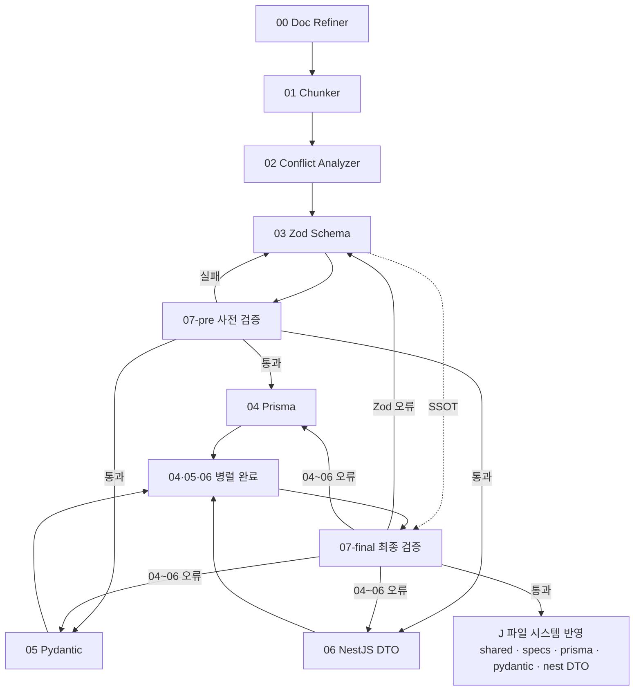

## Desktop Rivet 캔버스(Graph) 설계

메인 캔버스는 이 서브루틴들을 조립하는 '오케스트라 지휘자' 역할만 맡게 됩니다.
웹앱, 백엔드(NestJS), DB(PostgreSQL/Prisma), 그리고 파이썬 PC 프로그램까지 관통하는 Zod 중심 모노레포 파이프라인의 표준 서브루틴 설계도입니다. 각 캔버스의 입력, 출력, AI 역할을 스캔하기 좋게 정리해 드립니다.

### `docs/` 생애주기 (모노레포 To-Be)

```text
docs/
├── inbox/     # (필수) 날것 메모·아이디어 — 00번만 읽기
├── refined/   # Desktop Rivet 1차 정제 기획 — 01~02번
├── specs/     # 확정 명세·Zod·도메인 SSOT — 03~07번
└── trash/     # 정제 완료 inbox → trash/inbox/… 동일 경로 미러
```

> 루트의 `docs/Nexia/` 등 **레거시 폴더**는 `docs/specs/` 로 **수동 이전** 예정. 상세: `_NEXA-OS-V2.1-설계-표준-및-미션크리티컬-전략-보강본.md` §docs-lifecycle.

---

### 모노레포 플랫폼 구축을 위한 표준 Subroutine(서브 캔버스(Graph)) 정의서

| 번호 | 서브루틴(캔버스(Graph)) 명칭 | 주요 역할 (Hermes 3 페르소나 및 임무)                                                                                                                                      | 입력 데이터 (Input)                                                      | 출력 데이터 (Output)                                   |
| ---- | ---------------------------- | -------------------------------------------------------------------------------------------------------------------------------------------------------------------------- | ------------------------------------------------------------------------ | ------------------------------------------------------ |
| Main | Main Orchestrator            | [지휘·게이트·분기] **LLM 없음** — Sub_00~07만 순서·조건 호출 · **00** `action_type` REFACTOR 시 벨트 **중단**·Human-in-the-loop · **07-pre** 통과 전 **04~06 미실행** · **Join** 후 **07-final** · 실패 시 Zod→**03** · 파생물→**04~06 병렬 재진입** · 통과 시 **J** 트리거 · 단계 상태·재시도·`written_paths` 집계 | 트리거(inbox 신규·수동 Run) · `docs/` 경로·Normex·프로젝트 루트 · 각 서브 Output handoff · (선택) REFACTOR·J 쓰기 전 기획자 컨펌 | `pipeline_result` (success / aborted / awaiting_confirm) · `step_log[]` · J 시 `written_paths[]` · 실패 시 `last_error` + 복귀 서브 ID |
| 00   | Sub_Doc_Refiner_and_Placer   | [문서 정제·배치] `docs/inbox/` 날것을 Normex·용어집에 맞게 다듬어 **`docs/refined/`** 에 저장 · 원본은 **`docs/trash/inbox/…`** 로 미러 이동                               | `docs/inbox/**` · `docs/refined/`·`docs/specs/` 트리(맥락) · 파일명 규약 | `docs/refined/**` · **문서 인벤토리** JSON — 01번 입력 |
| 01   | Sub_Doc_Chunker              | 대량의 MD 기획서를 도메인(유저, 인증, 상품 등)별로 분류하고 처리 가능한 크기로 쪼갬                                                                                        | **`docs/refined/`** 파일 목록 및 경로                                    | 도메인별 분류된 문서 청크 배열 (Array)                 |
| 02   | Sub_Conflict_Analyzer        | [충돌 분석] 기획서 간의 데이터 항목 누락, 웹-PC 간의 로직 모순, 타입 불일치를 찾아내 리포트 작성                                                                           | 분할된 문서 청크                                                         | 모순점 및 데이터 필드가 정리된 충돌 리포트 (Text)      |
| 03   | Sub_Zod_Schema_Generator     | [최상위 표준 수립] 취합된 리포트를 바탕으로 중복을 제거하고, 모노레포 공유 폴더에 들어갈 최상위 Zod 스키마 코드를 작성                                                     | 병합된 최종 충돌 리포트 · (참고) `docs/specs/` 맥락                      | `packages/shared` Zod + **`docs/specs/`** 가이드 갱신  |
| 04   | Sub_Prisma_Schema_Converter  | [DB 연동] 사전 검증 통과 Zod를 기반으로 DB에 반영할 Prisma 데이터 모델 구조 생성 (04·05·06 **병렬** 중 하나)                                                               | 03번 Zod · **07번 사전 검증 통과** 게이트                                | Prisma 스키마 코드 블록 (schema.prisma 추가용)         |
| 05   | Sub_Pydantic_Converter       | [PC 프로그램 연동] 사전 검증 통과 Zod를 Pydantic 모델로 변환 (04·05·06 **병렬** 중 하나)                                                                                   | 03번 Zod · **07번 사전 검증 통과** 게이트                                | Python Pydantic 모델 코드 (schemas.py 형태)            |
| 06   | Sub_NestJS_DTO_Generator     | [백엔드 연동] 사전 검증 통과 Zod를 NestJS API DTO(Class)로 가공 (04·05·06 **병렬** 중 하나)                                                                                | 03번 Zod · **07번 사전 검증 통과** 게이트                                | nestjs-zod 기반 백엔드 DTO 코드                        |
| 07   | Sub_Syntax_Validator         | [사전·최종 검증] **① 사전**: 03번 Zod만 정적 검사(통과 시에만 04~06 게이트 오픈) · **② 최종**: 04~06 병렬 산출물 전체(TS·Python·Prisma) 문법·타입 유실 검사 및 셀프 피드백 | ① 03번 Zod 스키마 · ② 04~06 생성 코드 전체                               | 검증 통과 여부 및 오류 수정 제안 (Boolean / Text)      |

---

### 메인 캔버스 (Desktop Rivet) 에서의 유기적인 흐름 (작동 시나리오)

1.  **00번**이 `docs/inbox/` → `docs/refined/` 로 정제·배치하고, 원본은 `docs/trash/inbox/` 로 옮긴 뒤 **문서 인벤토리**를 만듭니다.
2.  01번과 02번이 문서를 탈탈 털어 모순이 해결된 순수한 기획 데이터를 뽑아냅니다.
3.  **03번**이 SSOT인 Zod 스키마(`packages/shared` · `index.ts`)를 생성합니다.
4.  **07번(사전 검증)**이 03번 산출 Zod만 정적 검사합니다. **실패 시** 04~06은 실행하지 않고 피드백 루프(03 재생성 또는 수동 수정)로 되돌립니다.
5.  **사전 검증 통과 시에만** **04(Prisma)** · **05(Pydantic)** · **06(NestJS DTO)** 가 `index.ts`를 공통 입력으로 **병렬** 실행됩니다.
6.  **07번(최종 검증)**이 03번 Zod(SSOT)와 **04·05·06 병렬이 모두 완료된 뒤** 산출물 전체를 검수합니다. **Zod 오류**면 03으로, **Prisma·Pydantic·DTO만 오류**면 04~06만 재실행(Zod는 유지)합니다. 통과 시 **J(파일 시스템 반영)** — 아래 §J — 로 기록하며 파이프라인이 종료됩니다.

> 07번은 동일 서브루틴(`Sub_Syntax_Validator`)을 **입력 프로필만 다르게** 두 번 호출합니다. Rivet 그래프에서는 `07-pre` / `07-final` 노드로 구분하는 것을 권장합니다.

```text
03 Zod 생성
    ↓
07-pre 사전 검증 ──(실패)──→ 03 피드백 루프
    ↓ (통과)
04 + 05 + 06 병렬 실행
    ↓ (전 분기 완료)
07-final 최종 검증 ←── SSOT(Zod) 참조
    ├─(Zod 오류)──────────→ 03 피드백 루프
    ├─(04~06만 오류)──────→ 04~06 재실행 (Zod 유지)
    └─(통과)──────────────→ J 파일 시스템 반영 · 종료
```

### J — 파일 시스템 반영 (`07-final` 통과 후)

Rivet 그래프 **밖**(모노레포 실경로)에 검증된 산출물을 씁니다. **`docs/specs/`만이 아닙니다** — `specs/`는 **문서·도메인 명세 SSOT** 구역이고, 실행·DB·PC 계약 코드는 **각 앱·패키지**에 둡니다.

| 출처            | 기록 대상 (To-Be 예)                                                         | 성격                                 |
| --------------- | ---------------------------------------------------------------------------- | ------------------------------------ |
| **03** Zod      | `packages/shared/src/schemas/**` (`index.ts` 등)                             | **Contract SSOT** (TS 3앱 공통)      |
| **03** 가이드   | `docs/specs/**` (도메인 MD·Zod 가이드·D8 매핑 표 등)                         | 사람이 읽는 **명세·규약 문서**       |
| **04** Prisma   | `apps/backend/prisma/schema.prisma` (+ 필요 시 `migrations/`는 Execute 단계) | **DB 물리 SSOT**                     |
| **05** Pydantic | `apps/desktop/.../bridge/dto/` (`schemas.py` 등)                             | PC(U2BEE) **런타임 gate** — Zod 미러 |
| **06** Nest DTO | `apps/backend/src/**` (nestjs-zod·DTO 모듈)                                  | API **요청/응답 경계**               |

- **`docs/refined/`** · **`docs/inbox/`** — J 대상 **아님** (00~02 단계에서 이미 처리).
- Desktop Rivet 개발 중에는 NestJS **External Call** 또는 전용 Node 스크립트가 위 경로에 **atomic write**(임시 파일 → rename) 하는 것을 권장합니다.

### 전체 흐름 다이어그램



---

## Sub_Doc_Refiner_and_Placer 캔버스에서 요구사항 상세

초기 기획 단계에서는 날것의 아이디어 하나 때문에 기존에 짜두었던 데이터 규약(Zod 스키마)이나 폴더 구조 전체를 뒤엎고(Refactoring) 판을 새로 짜야 하는 일이 빈번하게 발생합니다.
Hermes 3가 이 작업을 완벽하게 수행하려면, 단순히 날것의 문서 하나만 봐서는 절대 안 됩니다.

"현재 정제되어 있는 기존 문서 전체의 맥락"과 "우리가 합의한 아키텍처 규약"을 양손에 쥐고 있어야 올바른 판단을 내릴 수 있습니다.
리벳(Rivet)의 Sub_Doc_Refiner_and_Placer 캔버스(Graph) 내부 구조를 어떻게 고도화해야 하는지 전략을 다음과 같이 정리

---

## 1. Hermes 3에게 공급해야 할 3가지 필수 재료

이 서브루틴의 Graph Input 노드는 날것의 문서 외에도 기존 데이터의 전반적인 상태를 AI에게 주입해 주어야 합니다.

1.  날것의 신규 문서 (raw_input_text): 기획자님이 방금 던진 두서없는 메모.
2.  현재 정제된 핵심 기획서 및 규약 요약본 (current_system_context): 기존에 통과된 핵심 도메인 정보와 현재의 Zod 스키마 표준 가이드라인.
3.  현재 문서고 폴더 트리 구조 (directory_structure): 파일들이 어디에 위치해 있는지 보여주는 맵.

---

## 2. 초반 대격변(판 뒤집기)을 감당하기 위한 Hermes 3 프롬프트 설계법

초반에 규약 전체를 뒤바꾸는 유연성을 발휘하게 하려면, Hermes 3의 행동 강령(System Prompt)에 "기존 규칙을 파괴할 권한"을 명시적으로 부여해야 합니다. Hermes 3는 검열이 없고 지시를 매우 잘 따르므로 아래와 같은 가이드라인이 효과적입니다.

- 프롬프트에 주입할 핵심 행동 지침 (예시):

"당신은 단순한 비서가 아니라, 플랫폼 전체를 설계하는 수석 아키텍트입니다. 신규 메모의 요구사항이 기존 시스템 규약과 정면으로 충돌할 경우, 다음 두 가지 선택지 중 하나를 엄격하게 판단하세요."

- 옵션 A (단순 추가/수정): 기존 규약의 틀 안에서 소폭 수정이나 파일 배치가 가능한 경우 ➡️ action_type: "CREATE" 또는 "APPEND"로 처리.
  - 옵션 B (시스템 아키텍처 리팩토링): 신규 요구사항이 워낙 중요하여 기존 데이터 구조나 규약(Zod 표준 등) 전체를 전면 수정해야 하는 경우 ➡️ action_type: "REFACTOR"로 응답하고, 어떤 기존 문서들을 어떻게 수정해야 하는지 '구조 개편 제안서'를 함께 출력할 것.

---

## 3. action_type: "REFACTOR" 발생 시 리벳의 제어 흐름

리벳 메인 캔버스에서는 이 Sub_Doc_Refiner_and_Placer가 뱉은 action_type 결과값에 따라 흐름을 분기(Match 또는 If 노드 사용)시킵니다.

[Sub_Doc_Refiner_and_Placer 분석 완료]
│
┌─────────┴─────────┐
▼ (일반 상황) ▼ (대격변 상황: REFACTOR)
[기존 벨트 가동] [🚨 아키텍처 리팩토링 경고 발생]

- 문서 자동 배치 - AI가 제안한 '규약 전면 수정 제안서' 출력
- Zod 스키마 갱신 - 기획자에게 "이 방향으로 판을 뒤엎을까요?" 컨펌 요청

> 초반 개발 단계에서는 이 REFACTOR 알림을 적극적으로 활용하여, AI가 "이 메모대로 라면 기존 user 테이블 구조를 다 뜯어고쳐야 하는데 진행할까요?"라고 기획자(사람)에게 되묻는 '인간 참여형(Human-in-the-loop)' 피드백 구조.

## 장기적인 안정화 전략 (정리 요함)

** [시나리오 1] ** : 프로젝트 중반을 넘어가면 시스템이 안정되면서 판이 자꾸 뒤집히는 것이 오히려 독이 될 수 있습니다.
그때는 이 서브루틴의 프롬프트에서 *"이제 아키텍처가 안정기이므로, 웬만한 요구사항은 기존 규약을 깨지 않는 선에서 수용하라"*고 한 줄만 수정해 주면 시스템의 성격이 '유연한 아키텍트'에서 '보수적인 관리자'로 자연스럽게 전환.
** [시나리오 2 ]** : 새로운 내용에 따라 규약 자체를 바꾼다는 발상은 플랫폼 기획의 리스크를 엄청나게 줄여줄 핵심 장치입니다.
이때 다시 specs/ 폴더에 있는 기존 규약 요약본을 참고하여 규약을 수정 할지 아니면 모두 inbox/ 또는 refined/ 로 이동 시킨 후 새로 짜야 하는지 판단 할 수 있다.
