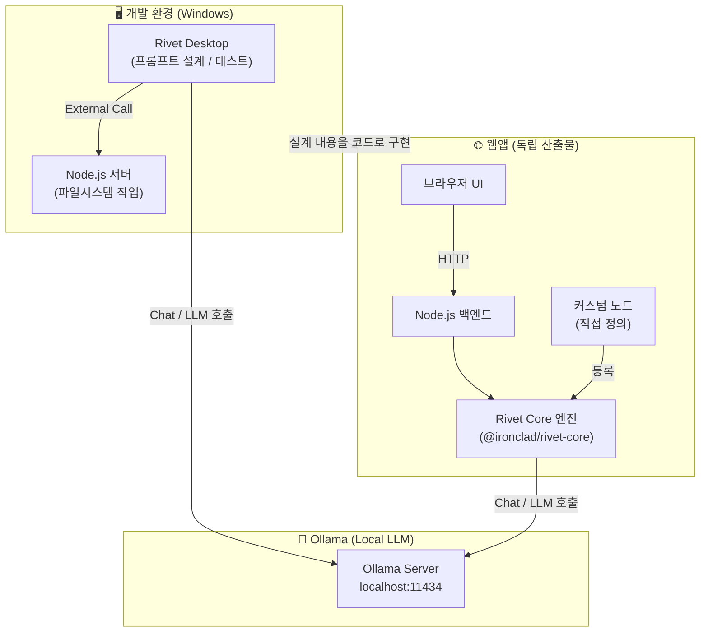
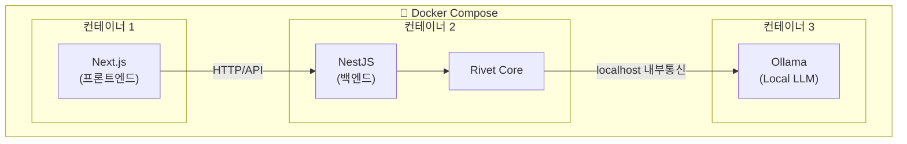

# Rivet 기반 격리 및 자동화 아키텍처 다이어그램

## Rivet 기반 격리 및 자동화 아키텍처 다이어그램



---

### Node.js는 별도가 아니라 NestJS 안에 통합

```
Next.js  (프론트엔드)
NestJS   (백엔드) ← 여기 안에 Rivet Core + 파일시스템 작업 모두 포함
```

개발환경의 별도 Node.js 서버는 **Desktop Rivet 전용 임시 서버**였고, 웹앱에서는 **NestJS가 그 역할을 흡수**합니다.

---

### 보안 관점

| 항목                | 내용                                                   |
| ------------------- | ------------------------------------------------------ |
| **Rivet Core**      | NestJS 서비스 레이어 안에서만 실행, 외부 노출 없음     |
| **Ollama**          | NestJS → Ollama 내부 통신, 브라우저에서 직접 접근 불가 |
| **파일시스템 작업** | NestJS 내부에서만 처리, API 엔드포인트로 제어          |
| **Next.js**         | NestJS API만 호출, Ollama/Rivet 직접 접근 불가         |

---

### 도커 배포 구조



---

### 핵심 정리

- **Node.js는 NestJS가 곧 Node.js**이므로 별도 서버 불필요
- **컨테이너 3개**로 깔끔하게 분리
- **Ollama는 AI 컨테이너로 독립**시키면 교체/업그레이드 용이
- 외부에서는 **Next.js 포트만 노출**, NestJS/Ollama는 내부 통신만

이 구조면 보안도 깔끔하고 도커 배포도 용이

---

### Rivet 설계만 잘하면 되는 이유

```
Rivet 그래프 (명확한 지시)
        ↓
LLM이 구조를 이해하고
        ↓
Next.js / NestJS /
        ↓
Docker 코드 생성
```

---

### LLM에게 컨텍스트를 명확히 줘야 함

Rivet 그래프 안에서 이런 내용을 시스템 프롬프트로 고정해두면 LLM이 매번 올바른 구조로 생성

```
- 프론트: Next.js (컨테이너 1)
- 백엔드: NestJS + Rivet Core (컨테이너 2)
- LLM: Ollama (컨테이너 3)
- 배포: Docker Compose
- 파일시스템 작업: NestJS 내부에서만
- Path Traversal 검증 필수
```

---
