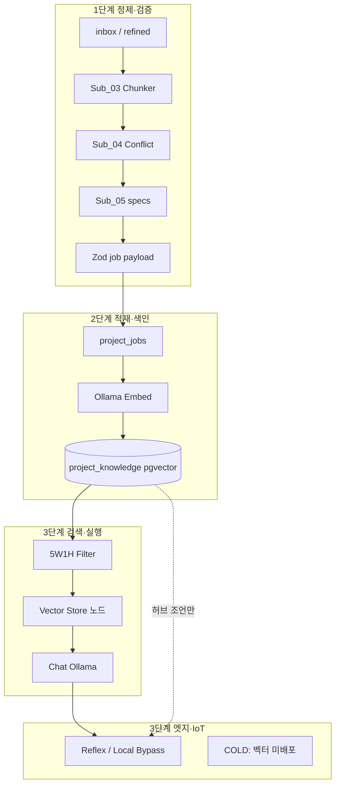

# 벡터 데이터 처리 및 아키텍처

> **범위:** NEXA 플랫폼에서 **임베딩·pgvector·RAG 검색**을 어떻게 다루는지, **Rivet 그래프 설계**에 무엇을 박제해야 하는지를 정리한다.  
> **RAG 전체 연결:** [`NEXA RAG 아키텍처 — Rivet·PostgreSQL·Ollama`](../Rivet/NEXA%20RAG%20아키텍처%20—%20Rivet·PostgreSQL·Ollama.md) · **DB SSOT:** [`DDL v5`](../Database/DDL%200%20SCHEMA%20NEXA%20Platform%20DB%20설계%20명세%20v5.md)

---

## 0. 본 문서의 위치

| 문서                                                                                                                                  | 역할                                                              |
| ------------------------------------------------------------------------------------------------------------------------------------- | ----------------------------------------------------------------- |
| **본 문서**                                                                                                                           | 벡터 **처리 파이프라인** · 임베딩 모델 정책 · Rivet 노드 매핑     |
| [`NEXA RAG 아키텍처`](../Rivet/NEXA%20RAG%20아키텍처%20—%20Rivet·PostgreSQL·Ollama.md)                                                | 코퍼스 이원화 · SSOT 계층 · 운영 Retrieve                         |
| [`Rivet 파이프라인`](../Rivet/Rivet%20파이프라인.md)                                                                                  | Desktop vs rivet-core · Ollama 경로 · 일방통행                    |
| [`Desktop Rivet 캔버스 설계 v1.0`](<../Rivet/Desktop%20Rivet%20캔버스(Graph)%20설계%20v1.0.md>)                                       | Sub_03 Chunker · 05 specs · MCP                                   |
| [`CSIM · AXON 프로토콜 (정본)`](<../Nexia/_Cosmic%20Semantic%20Interface%20Matrix%20v2%20—%20CSIM%20·%20AXON%20프로토콜%20(정본).md>) | **NEXA HEXAGON 프로토콜** — IoT 고정 스키마 ↔ 백오피스 지식 경계 |
| [`RAG · OAG · AIP — 지능 층위와 오케스트레이션`](./RAG%20·%20OAG%20·%20AIP%20—%20지능%20층위와%20오케스트레이션.md)                   | **RAG → OG-RAG → OAG → AIP** · rivet-core + LangGraph             |

---

## 1. 설계 원칙 (Non-Negotiable) — Rivet 채택 · JSONB · 환각

NEXA가 **Rivet**을 오케스트레이션 중심으로 택한 이유는, 벡터·RAG·AI 출력을 **한 덩어리의 반정형 데이터(JSONB·세션 메모리)** 에 맡기지 않겠다는 결론과 **일맥상통**한다. 본 절은 이후 모든 절의 **상위 규범**이다.

### 1.1 JSONB는 최소화 — 보조 주머니일 뿐

| 계층           | 역할                                                                                                             | JSONB 여부                                                |
| -------------- | ---------------------------------------------------------------------------------------------------------------- | --------------------------------------------------------- |
| **1순위 SSOT** | `docs/specs/**` (Git) · Zod(06) · DDL **고정 컬럼** (5W1H SMALLINT, `nature_tag`, `content_fact`, `raw_content`) | **사용 안 함** (본문·규범)                                |
| **2순위 근거** | `ref_ids` · wikilink · `vault_path` · `git_sha`                                                                  | **구조화 JSONB** — 인용 키만, 본문 아님                   |
| **3순위 보조** | `metadata`, `extra_data`                                                                                         | **확장·실험 필드만** — 스키마 회피용 만능 주머니 **금지** |

**원칙**

- “스키마가 바뀔까 봐 전부 JSONB”는 **채택하지 않는다.** 진화는 `extra_data` **일부**로 흡수하고, **검색·필터·규범에 쓰이는 값은 컬럼·MD·Zod로 승격**한다.
- **Rivet 그래프** = 흐름·검증·Human CP가 **눈에 보이는 구조** — JSONB 속에 온톨로지를 숨기면 감사·롤백이 불가능해진다.
- 임베딩·벡터는 JSONB가 아니라 **`embedding` 컬럼 + 원문(`raw_content`)** — 벡터만 남고 의미가 증발하는 설계 금지.

```text
진실 우선순위:
  Git specs MD  >  Zod Contract  >  DDL 고정 필드  >  ref_ids  >>  metadata/extra_data (보조)
```

— Rivet 채택 배경: [`Rivet 파이프라인`](../Rivet/Rivet%20파이프라인.md) 「왜 리벳인가?」「최종 진실 = Git + specs + Zod」.

### 1.2 AI 온톨로지·AI 답변 — 언제든 환각, 독(Poison)

**AI가 만든 온톨로지**(개념 그래프, Extract JSON, 자동 wikilink, 벡터만 있는 “세계관”)와 **그 위에서 나온 답변**은 **언제든 환각을 포함할 수 있다.** 이를 **검증 없이 SSOT·실행·규범**에 쓰면 플랫폼에 **독**이 된다.

| 위험                                          | 독이 되는 이유                      | NEXA 방어 (Rivet·파이프라인)                                                                                                                                  |
| --------------------------------------------- | ----------------------------------- | ------------------------------------------------------------------------------------------------------------------------------------------------------------- |
| LLM이 만든 **온톨로지 JSON**을 DB SSOT로 저장 | 관계·정의가 조용히 틀림 · diff 불가 | **05 specs MD** + Git · 04 Conflict MOC · **Human CP-02**                                                                                                     |
| **벡터 검색 결과만**으로 답변·실행            | 출처 불명 · 그럴듯한 거짓           | **OG-RAG** — ref_ids·wikilink·04 MOC 확장 후 **citations** · Get Prompt(`specs/`)                                                                             |
| AI **ECHO**를 **GOVERN**으로 승격             | 잘못된 규범이 영구화                | 반복 승인 전 **QUERY→GOVERN 금지** — [페르소나 전략서](<../../../NEXA V2.0/docs/_inbox/NEXA AIS RAG 및 페르소나 아카이브 전략서 (RAG & Persona Strategy).md>) |
| RAG·온톨로지를 **실시간 제어**에 연결         | 지연 + 환각 = 물리 사고             | **Reflex·Local Bypass** · Normex MUST · Omnix 승인                                                                                                            |
| **JSONB 덩어리**에 AI 산출 온톨로지 적재      | 무엇이 맞는지 추적 불가             | §1.1 — 고정 필드·MD 우선 · JSONB는 메타만                                                                                                                     |

**못 박는 문장**

> **검증·Git·Human CP를 거치지 않은 AI 온톨로지와 그 파생 답변은 데이터가 아니라 독이다.** Rivet은 이 독이 **디스크·DB·실행**에 닿기 전에 **노드·게이트·로그**로 걸러내기 위해 존재한다.

**Rivet 그래프 필수 게이트 (환각 → 독 유입 차단)**

```text
AI 생성 (Chunk · Extract JSON · Chat · Embed)
  → 04 Conflict / Normex (구조 검증)
  → Zod safeParse (형식만 — 의미 진실 아님)
  → specs MD + Git (의미 SSOT)
  → CP-02 / CP-06 / CP-12 (Human)
  → PG upsert / 12 JOUT / 실행
```

- **Zod**는 **오염·형식 붕괴**를 막을 뿐, **의미적 진실**을 보장하지 않는다. 진실은 **`docs/specs/` + 사람 승인**이다.
- **RAG_Retrieve**는 Vector Store **단독 종료 금지** — **OG-RAG**(ref_ids·MOC) 후 **specs 인용·citations** 노드를 거친다 (§5.4 · [지능 층위 §3](./RAG%20·%20OAG%20·%20AIP%20—%20지능%20층위와%20오케스트레이션.md)).

### 1.3 피지컬 AI(IoT) vs 백오피스 — NEXA HEXAGON 프로토콜

> **한 줄:** **NEXA HEXAGON**은 모호한 의도를 **5W1H 6축 정수 토큰**으로 정규화해, **백오피스**(NEXAON/NEXAVULT·온톨로지·RAG)와 **피지컬 AI**(IoT·ACTON·Rule-based 고정 스키마)가 **서로 다른 데이터**를 쓰면서도 맞물리게 하는 AXON의 **기계 간 공통 문법·경계 프로토콜**이다.

**JSONB·AI 온톨로지를 최소화하는 이유**는 백오피스에만 두기 위함이다. **피지컬 AI 제어부(IoT·엣지)** 와 **허브 백오피스**는 스키마·프로토콜이 다르고, 둘을 잇는 **공식 해법**이 **NEXA HEXAGON 프로토콜**이다.

| 평면                     | 스키마                                                                        | AI 온톨로지 · JSONB                      | Rivet                                                 |
| ------------------------ | ----------------------------------------------------------------------------- | ---------------------------------------- | ----------------------------------------------------- |
| **피지컬 AI 제어 (IoT)** | **Rule-based** · **고정 스키마** — HEXAGON 5W1H SMALLINT · APEX · Zod · ACTON | **금지** (제어 SSOT 아님)                | `HEXAGON_Route` · `ACTON_Execute` — Vector Store 없음 |
| **백오피스 지식**        | `project_knowledge` · specs · 고정 컬럼 + **보조** JSONB                      | **허용** — NEXAON/NEXAVULT·RAG·학습 초안 | `Embed_Pipeline` · `RAG_Retrieve`                     |

```text
백오피스:  AI 온톨로지(초안) · JSONB 메타 · pgvector  —  NEXAON · NEXAVULT
                        ║
              NEXA HEXAGON (5W1H 정수 토큰)
                        ║
피지컬 AI:  Rule-based · Zod · ACTON · Reflex  (온톨로지·벡터 모름)
```

> **못 박기:** 피지컬 AI 제어에는 **규칙 기반 고정 스키마만**. AI 온톨로지와 JSONB는 **백오피스 지식 관리용**이며, 이 둘을 **안전하게 분리·연결**하는 프로토콜이 **NEXA HEXAGON** 이다.

- AXON: APEX → HEXAGON → NEXAON → NEXAVULT (백오피스) / HEXAGON → ACTON (피지컬) — [`CSIM · AXON (정본)`](<../Nexia/_Cosmic%20Semantic%20Interface%20Matrix%20v2%20—%20CSIM%20·%20AXON%20프로토콜%20(정본).md>) §3 · §11.
- RAG·Rivet 상세 분리: [`NEXA RAG 아키텍처`](../Rivet/NEXA%20RAG%20아키텍처%20—%20Rivet·PostgreSQL·Ollama.md) **§10**.

---

## 2. 시스템 철학과의 정합 — 충돌 지점 점검

초안(400개 MD 일괄 처리 · Pinecone 이주 · bge-m3 1순위)은 **방향은 맞지만**, NEXA 플랫폼 SSOT와 **아래 지점에서 충돌**한다. 보강 시 **오른쪽(정합)** 을 따른다.

| 초안 내용                                  | 충돌·리스크                                                      | NEXA 정합 (SSOT)                                                                                                      |
| ------------------------------------------ | ---------------------------------------------------------------- | --------------------------------------------------------------------------------------------------------------------- |
| **Pinecone 이주를 3단계 기본 경로**로 서술 | 클라우드 벡터 DB가 **지식 SSOT**처럼 읽힘 · 로컬·감사 체계 약화  | **pgvector(PostgreSQL) 기본** · Pinecone은 **선택 백엔드**(Vector Store Connector 노드) · `docs/specs/`+Git 근거 유지 |
| **bge-m3 1순위**                           | DDL·RAG 문서와 **임베딩 모델 불일치** · 차원 1024 vs 기존 768    | **SSOT: `nomic-embed-text`(768)** · bge-m3는 **명시적 마이그레이션+전량 재인덱싱** 시에만                             |
| **JSONB 주머니 + embedding** 단순 3층      | AI 온톨로지·본문이 JSONB에 묻힘 — §1.1 **독** 경로               | DDL **고정 필드 우선** · JSONB는 `metadata`/`extra_data` **보조만**                                                   |
| **400개 MD를 AI에 직접**                   | Desktop **01~05 파이프라인**·04 Conflict 게이트 우회             | **inbox→refined→specs** · Sub_03 청크 · 04 통과 후 임베딩                                                             |
| **중앙 온톨로지만**으로 IoT 협업           | AI 온톨로지 환각이 **Shared World Model**로 굳어짐 — §1.2 **독** | **specs+Normex** 정본 · AI 그래프는 **초안** · Reflex·승인 후만 실행                                                  |
| Zod = DB 삽입 직전만                       | RAG 아톰과 **API Contract(06)** 혼동                             | Zod = **계약·job 페이로드** · 지식 본문 = **specs MD + content_fact**                                                 |
| Vector Store = Pinecone (리벳 예시 관성)   | Rivet 표준 노드 예시를 **플랫폼 기본값**으로 오인                | **pgvector 커스텀 Vector Store Connector** — Pinecone은 `backend=pinecone` 옵션                                       |

**유지해도 좋은 초안 요지**

- 공리(Axiom)·제약(Constraints) 분리 → `specs/project-core/` · `constraints.md` · Normex
- PostgreSQL **원본 + 벡터 통합** → pgvector + `ref_ids` 조인
- Ollama **전용 임베딩 모델**(생성 LLM과 분리) → Embed 서브그래프

---

## 3. NEXA 벡터 처리 3단계 (Rivet 관점)

초안의 [1~3단계]를 **Desktop · NestJS · rivet-core** 에 맞게 재정의한다.



### [1단계] 코퍼스 정제 · 계약 검증 (Desktop Rivet + Zod)

**원칙:** 벡터화 **전에** 문서·청크 품질을 맞춘다. “400개 MD를 한꺼번에 AI에”가 아니라 **파이프라인 번호**로 쪼갠다.

| 입력           | 처리        | Rivet 담당                     |
| -------------- | ----------- | ------------------------------ |
| `docs/inbox`   | Normex·경로 | **02** Refiner                 |
| `docs/refined` | 의미 청크   | **03** Chunker                 |
| 청크           | 모순·누락   | **04** Conflict (Obsidian MOC) |
| 통과 청크      | specs MD    | **05** Planning                |

**공리·제약 분리 (초안 계승 → NEXA 경로)**

| 초안 용어              | NEXA SSOT 경로                                          | Rivet 반영                          |
| ---------------------- | ------------------------------------------------------- | ----------------------------------- |
| **Axiom (공리)**       | `specs/project-core/vision` · `domain-map` · `glossary` | Get Prompt(MCP) · Planning 컨텍스트 |
| **Constraints (제약)** | `specs/project-core/constraints.md` · Normex MUST       | **04** 충돌 · Normex Subgraph       |

**Zod 역할 (벡터 직전)**

- **임베딩 job 페이로드** (`chunk_id`, `vault_path`, `content_fact`, `project_id` …) 검증
- **06 Zod Contract** — API·DB 스키마용 · **지식 본문 SSOT 아님**
- DB upsert 직전 `safeParse` — 오염·인젝션 차단 (초안 유지)

### [2단계] PostgreSQL + pgvector 적재

**구조 (DDL 정합)** — 단순 `[ID + JSONB + VECTOR]` 가 아니라:

| 계층            | `project_knowledge` 예                            | 용도                            |
| --------------- | ------------------------------------------------- | ------------------------------- |
| **고정·인덱스** | `id`, `project_id`, `nature_tag`, 5W1H SMALLINT×6 | DB 레벨 **90% 프리필터**        |
| **본문**        | `content_fact`(요약), `raw_content`(원문)         | RAG 컨텍스트 · 토큰 절약        |
| **유연**        | `metadata`, `extra_data` JSONB                    | vault_path · git_sha · chunk_id |
| **근거**        | `ref_ids` JSONB                                   | `source_log_ids` · specs 역추적 |
| **벡터**        | `embedding` vector(768)                           | cosine · HNSW                   |

**실효성:** 스키마 진화는 **보조** `extra_data·metadata` 로만 흡수 (§1.1). **의미·규범**은 specs·고정 컬럼으로 승격. 검색은 **같은 테이블**에서 5W1H 필터 + 벡터.

**Rivet — 배치 Embed 서브그래프 (Desktop 또는 NestJS `project_jobs`)**

```text
Graph Inputs (planning_manifest / chunk[])
  → Chunk Text (이미 03에서 했으면 Pass)
  → HTTP/MCP: specs 인용 메타 병합
  → Ollama Embed (nomic-embed-text)
  → Code: Zod safeParse (upsert payload)
  → PG Upsert (NestJS 내부 API)
  → Graph Outputs (job_id, upserted_ids[])
```

| Aux              | 역할                                 |
| ---------------- | ------------------------------------ |
| **Aux-Log**      | `.rivet/runs` · `pipeline.log.jsonl` |
| **project_jobs** | UI 진행률 · 재접속 후 상태           |

### [3단계] 검색 · 협업 · 피지컬 AI (웹 rivet-core)

**RAG (초안 계승, 경로 수정)**

- 정제된 벡터 + **specs 정본** + `ref_ids` 로 인간·AI 질의에 답변
- **운영 그래프 필수:** Vector Store · 5W1H Filter · Chat — [`NEXA RAG 아키텍처`](../Rivet/NEXA%20RAG%20아키텍처%20—%20Rivet·PostgreSQL·Ollama.md) §6

**피지컬 AI · IoT — HEXAGON 프로토콜 (§1.3)**

| 구분                | 정책                                                                                                            |
| ------------------- | --------------------------------------------------------------------------------------------------------------- |
| **제어 (IoT·엣지)** | **Rule-based 고정 스키마** — HEXAGON SMALLINT · APEX 패킷 · Zod · ACTON/`programRef` · Domain Profile whitelist |
| **지식 (백오피스)** | AI 온톨로지 · JSONB(`metadata`/`extra_data`) · pgvector — **NEXAON/NEXAVULT·RAG·기획만**                        |
| **경계 프로토콜**   | **NEXA HEXAGON** — 모호한 의도→정수 토큰 정규화 · NEXAON(해석)와 ACTON(실행) **분리**                           |
| **금지**            | Vector Store→ACTON 직결 · 엣지에 JSONB 온톨로지·벡터 배포 · RAG를 실시간 제어 루프에 인라인                     |
| **엣지 상향**       | **FACT·5W1H 요약**만 — Shared World Model은 **허브** `project_knowledge`+specs (사후·조언)                      |
| **승인**            | HEXAGON→ACTON 전 **Normex·Ethos·Omnix** — AI 온톨로지는 실행 조건이 **아님**                                    |

| 초안                              | NEXA 정합                                                                        |
| --------------------------------- | -------------------------------------------------------------------------------- |
| 중앙 지식 DB = Shared World Model | **백오피스만** — IoT는 HEXAGON·Rule · 허브는 NEXAVULT/RAG                        |
| 기계가 중앙 온톨로지만 읽고 협업  | **비규범** — 기계는 **HEXAGON·Reflex** · 온톨로지는 NEXAON이 **허브에서만** 해석 |
| Pinecone = 초저지연 제어          | **오해** — 초저지연 = Rule·Reflex · Pinecone/RAG = 백오피스 검색 선택지          |

**COLD 프로필 (엣지):** 10KB 미만 필수 데이터만 · **벡터 페이로드 배포 금지** — [`로드맵`](../_NEXA%20GUIDE%20플랫폼%20구현%20단계%20및%20로드맵.md).

**Pinecone (선택 이전 — 기본 경로 아님)**

| 조건                                              | 정책                                                                                  |
| ------------------------------------------------- | ------------------------------------------------------------------------------------- |
| pgvector로 **단일 DB·RLS·ref_ids 조인** 유지 가능 | **기본 — 변경 없음**                                                                  |
| 수천만 벡터 · 전용 ANN SLA 필요                   | **Vector Store Connector** `backend=pinecone` · **메타·원문 SSOT는 PostgreSQL 유지**  |
| 이전                                              | `project_jobs` 전량 재임베딩 · dual-write 기간 · Rivet 노드 `backend` 파라미터만 교체 |

> Pinecone은 **Rivet Vector Store 노드의 플러그인**이지, NEXA 지식 SSOT를 클라우드에 옮긴다는 뜻이 **아니다.**

---

## 4. Ollama 임베딩 모델 정책

생성 LLM(Hermes 등)과 **별도**로, 임베딩 전용 소형 모델을 쓴다 (초안 유지).

### SSOT (현재 채택)

| 항목     | 값                                                                                                                                                                                         |
| -------- | ------------------------------------------------------------------------------------------------------------------------------------------------------------------------------------------ |
| **모델** | `nomic-embed-text` (Nomic AI)                                                                                                                                                              |
| **명령** | `ollama pull nomic-embed-text`                                                                                                                                                             |
| **차원** | **768** — `project_knowledge.embedding` 과 **일치 필수**                                                                                                                                   |
| **근거** | [`DDL v5`](../Database/DDL%200%20SCHEMA%20NEXA%20Platform%20DB%20설계%20명세%20v5.md) §HEXAGON · [`NEXA RAG 아키텍처`](../Rivet/NEXA%20RAG%20아키텍처%20—%20Rivet·PostgreSQL·Ollama.md) §5 |

**Rivet Embed 노드:** provider=Ollama, model=`nomic-embed-text` — **하드코딩 변경 시 §5 마이그레이션 절차**.

### 선택 업그레이드: bge-m3 (비기본)

| 항목               | bge-m3                                                                                                                  |
| ------------------ | ----------------------------------------------------------------------------------------------------------------------- |
| 차원               | 1024                                                                                                                    |
| 장점               | 다국어·장문(8K 토큰) 문맥 보존                                                                                          |
| NEXA에서 쓰는 조건 | ① DDL vector 차원 변경 ② `project_jobs` **전량 재인덱싱** ③ Rivet·NestJS 모델 상수 동시 갱신 ④ A/B 품질 검증(04·14 MOC) |

**순위 정리:** 운영 SSOT는 **nomic-embed-text 1순위** · bge-m3는 **품질 실험·마이그레이션 후보** (초안의 1·2순위 문구를 이렇게 뒤집어 정합).

---

## 5. Rivet 설계 가이드 (본 문서 핵심 산출)

### 5.1 그래프 2종 — 반드시 분리 설계

| 그래프                    | 런타임                                 | 벡터 관련 노드                                 |
| ------------------------- | -------------------------------------- | ---------------------------------------------- |
| **Embed_Pipeline** (배치) | Desktop 테스트 → NestJS `project_jobs` | Chunk · Embed · Zod · PG Upsert                |
| **RAG_Retrieve** (운영)   | rivet-core @ NestJS                    | 5W1H Filter · Vector Store · Get Prompt · Chat |

Desktop **Main 01~13** 과 **웹 운영 그래프**는 같은 JSON 규격 · **다른 Graph Inputs** (MCP path vs `project_id`).

### 5.2 표준 노드 · 커스텀 노드

| 노드          | 타입                                                | 설정                                                   |
| ------------- | --------------------------------------------------- | ------------------------------------------------------ |
| 청킹          | Chunk Text / AST Chunker                            | 03와 동일 규칙                                         |
| 임베딩        | Chat(Ollama embed API) 또는 커스텀 **Ollama Embed** | model=`nomic-embed-text`                               |
| 검색          | Vector Store → **커스텀 Connector**                 | `backend: pgvector` (기본)                             |
| 근거          | MCP Get Prompt / HTTP                               | `specs/` · `ref_ids`                                   |
| 검증          | Code + Zod                                          | job payload · **not** raw MD                           |
| 분기          | Match                                               | confidence_score 낮음 → ASK                            |
| **환각 차단** | **04 Conflict** · Normex · **CP-\***                | AI 온톨로지·답변의 **실행·디스크 유입 전** 필수 (§1.2) |

**금지 패턴 (Rivet 설계 시)**

- Extract JSON → **곧바로** PG upsert / 12 JOUT (specs·CP 없음)
- Vector Store → Chat → Graph Outputs (**specs citations 없음**)
- `extra_data`에 **본문·온톨로지 전체** 저장 (§1.1 위반)
- **Vector Store → ACTON / 펌웨어 write** 직결 (§1.3 — IoT는 HEXAGON·Rule 그래프만)

카탈로그: [`Rivet Engine 노드 분석`](../Nexia/Rivet%20Engine%20노드%20분석.md).

### 5.3 Graph Inputs / Outputs (벡터 파이프라인)

**Embed_Pipeline Inputs**

```json
{
  "project_id": "uuid",
  "chunks": [{ "chunk_id": "...", "vault_path": "specs/...", "content_fact": "...", "raw_content": "..." }],
  "embedding_model": "nomic-embed-text"
}
```

**Embed_Pipeline Outputs**

```json
{
  "job_id": "uuid",
  "upserted_ids": ["..."],
  "failed": []
}
```

**RAG_Retrieve Outputs (citations 필수)**

```json
{
  "answer": "...",
  "citations": [
    { "type": "knowledge", "id": "...", "score": 0.87 },
    { "type": "spec", "vault_path": "specs/project-core/vision" }
  ]
}
```

### 5.4 설계 체크리스트

- [ ] **JSONB**에 본문·온톨로지를 넣지 않았는가 — `content_fact`/`raw_content`/specs MD 우선 (§1.1)
- [ ] **IoT/ACTON** 그래프와 **RAG** 그래프가 **분리**되었는가 — HEXAGON 경계 (§1.3)
- [ ] AI 산출이 **04·Normex·CP** 없이 DB·디스크에 쓰이지 않는가 (§1.2)
- [ ] RAG 답변이 **citations + specs 경로** 없이 종료되지 않는가
- [ ] Embed 그래프가 **03 청크 스키마**·`planning_manifest.json` 과 호환되는가
- [ ] Retrieve 그래프가 **`project_chats` + `project_knowledge`** 삼각 편대를 쓰는가
- [ ] Vector Store가 **pgvector 기본** · Pinecone은 `backend` 스위치만인가
- [ ] 임베딩 모델 변경 시 **§4 마이그레이션** 절차가 Runbook에 있는가
- [ ] 04 conflict · 14 health 결과가 검색 **랭킹/제외**에 반영되는가
- [ ] Ollama 호출이 **NestJS/Desktop만** 인가 (브라우저 직접 X)
- [ ] 엣지 COLD 배포에 **벡터 포함 없음**이 명시되는가

### 5.5 의사 토폴로지 (좌표 없음 — AI·Dagre 담당)

```json
{
  "nodes": [
    { "id": "in", "type": "Graph Inputs" },
    { "id": "filter", "type": "Code", "data": { "label": "5W1H Filter" } },
    { "id": "vec", "type": "Vector Store", "data": { "backend": "pgvector", "table": "project_knowledge" } },
    { "id": "spec", "type": "HTTP Request", "data": { "label": "resolve specs citation" } },
    { "id": "chat", "type": "Chat", "data": { "provider": "Ollama" } },
    { "id": "out", "type": "Graph Outputs" }
  ],
  "edges": [
    { "source": "in", "target": "filter" },
    { "source": "filter", "target": "vec" },
    { "source": "vec", "target": "spec" },
    { "source": "spec", "target": "chat" },
    { "source": "chat", "target": "out" }
  ]
}
```

Export 후 레포 반영 → NestJS rivet-core 등록 — [`Rivet 파이프라인`](../Rivet/Rivet%20파이프라인.md).

---

## 6. 검색 성능 · 인덱스 (요약)

| 항목      | SSOT                                              |
| --------- | ------------------------------------------------- |
| 거리      | **cosine** (`vector_cosine_ops`)                  |
| 인덱스    | **HNSW** 기본 (`project_knowledge.embedding`)     |
| 프리필터  | 5W1H SMALLINT · `nature_tag` · `project_id` · RLS |
| 랭킹 보정 | `confidence_score` 낮으면 하향                    |
| 캐시      | Redis — 동일 질의·필터 (선택)                     |

상세: DDL v5 §RAG·시맨틱 검색 벡터 인덱스.

---

## 7. 요약

| 단계       | 한 줄                                                                | Rivet                        |
| ---------- | -------------------------------------------------------------------- | ---------------------------- |
| **0 원칙** | JSONB·온톨로지=백오피스만 · IoT=Rule+**HEXAGON** · 검증 전 유입 금지 | §1.1~1.3 · ACTON vs RAG 분리 |
| **1 정제** | specs·청크·Conflict 통과 후에만 벡터화                               | Desktop 02~05 + Zod job      |
| **2 적재** | pgvector + **고정 필드** + ref_ids (JSONB 보조)                      | Embed_Pipeline 서브그래프    |
| **3 검색** | 5W1H → vector → **OG-RAG**(ref_ids·MOC) → **specs 인용** → Ollama    | RAG_Retrieve @ rivet-core    |
| **엣지**   | RAG·AI 온톨로지로 제어 금지 · Reflex · COLD 벡터 금지                | 별도 그래프                  |

**철학 (못 박기):**

1. **JSONB는 보조** — 진실은 Git · `docs/specs/` · Zod · DDL 고정 컬럼.
2. **AI 온톨로지·미검증 AI 답변은 독** — **백오피스(NEXAON/NEXAVULT)만** · Rivet 게이트(04·Normex·CP).
3. **피지컬 AI(IoT) = Rule-based 고정 스키마** — **NEXA HEXAGON 프로토콜**이 백오피스와 제어를 분리한다.
4. **벡터는 검색 가속** — IoT 제어 루프·엣지 배포에 넣지 않는다.

---

## 관련 문서

| 주제                       | 문서                                                                                                                         |
| -------------------------- | ---------------------------------------------------------------------------------------------------------------------------- |
| RAG·코퍼스                 | [`NEXA RAG 아키텍처`](../Rivet/NEXA%20RAG%20아키텍처%20—%20Rivet·PostgreSQL·Ollama.md)                                       |
| Desktop Sub                | [`Desktop Rivet 캔버스 설계 v1.0`](<../Rivet/Desktop%20Rivet%20캔버스(Graph)%20설계%20v1.0.md>)                              |
| AI 물결·피지컬 AI          | [`The Wave of AI Innovation`](<./The%20Wave%20of%20AI%20Innovation(AI%20혁신의%20물결).md>)                                  |
| HEXAGON · AXON · ACTON     | [`CSIM · AXON (정본)`](<../Nexia/_Cosmic%20Semantic%20Interface%20Matrix%20v2%20—%20CSIM%20·%20AXON%20프로토콜%20(정본).md>) |
| IoT vs 백오피스 Rivet 분리 | [`NEXA RAG 아키텍처`](../Rivet/NEXA%20RAG%20아키텍처%20—%20Rivet·PostgreSQL·Ollama.md) §10                                   |
| RAG·OG-RAG·OAG·AIP 층위    | [`RAG · OAG · AIP — 지능 층위와 오케스트레이션`](./RAG%20·%20OAG%20·%20AIP%20—%20지능%20층위와%20오케스트레이션.md)          |
| pgvector 역사·통합 DB      | [`DDL v5`](../Database/DDL%200%20SCHEMA%20NEXA%20Platform%20DB%20설계%20명세%20v5.md) §「왜 전체를 벡터화 했을까」           |
